# 151：创建基础 knitr 文档 🧑‍💻

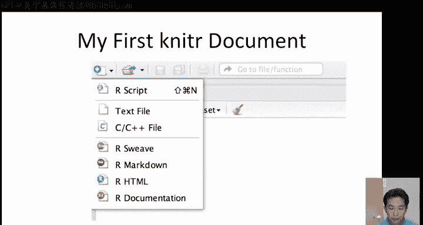

在本节课中，我们将学习如何使用 RStudio 创建一个基础的 knitr 文档。我们将了解 R Markdown 文档的基本结构，如何嵌入和运行 R 代码，以及如何将文档编译成可读的输出格式（如 HTML）。

---

## 🛠️ 在 RStudio 中创建新文档


上一节我们介绍了 knitr 的基本概念，本节中我们来看看如何实际操作。在 RStudio 中创建 knitr 文档是最简单的方法之一。

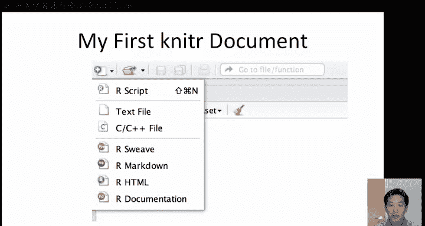

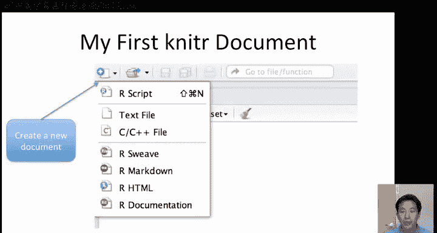

在 RStudio 左上角点击“新建文档”按钮，你会看到多个选项。选择“R Markdown”选项，即可创建一个新的 R Markdown 文件。

这个文件将包含文本和代码。

---

## 📄 R Markdown 文档的基本结构

以下是 R Markdown 文档的一个基本示例。R Markdown 本质上是嵌入了 R 代码的 Markdown 格式。

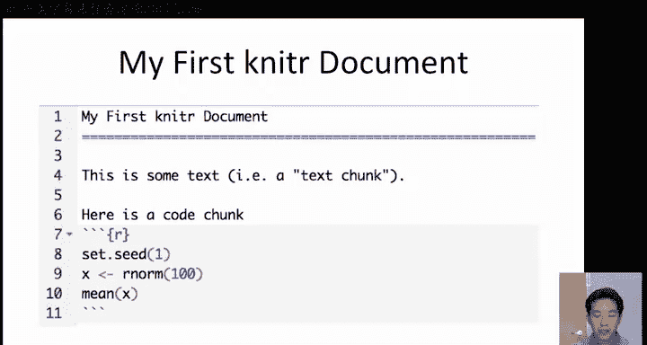

```r
---
title: "我的第一个 knitr 文档"
---

这是一些文本。

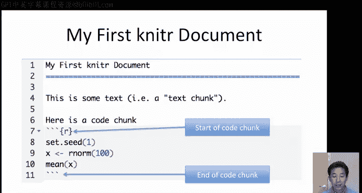

以下是一个代码块：

```{r}
set.seed(1234)
x <- rnorm(100)
mean(x)
```
```

你可以看到，文档以 YAML 头部（定义标题等信息）开始，然后是普通的文本段落。

---

## 🔤 代码块详解

在 R Markdown 中，代码块用于嵌入和执行 R 代码。以下是关于代码块的关键点：

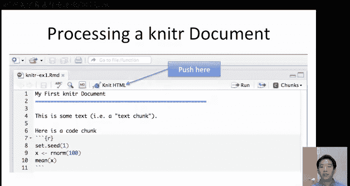

*   **代码块起始**：代码块以三个反引号（```）开始，后跟花括号 `{r}`。这表示一个 R 代码块的开始。
*   **代码块结束**：代码块以三个反引号（```）结束。
*   **代码位置**：所有的 R 代码都写在这两个标记之间。

你可以拥有任意多个代码块，不必将所有代码都放在一个块中。

---

## 🏷️ 代码块命名与输出控制

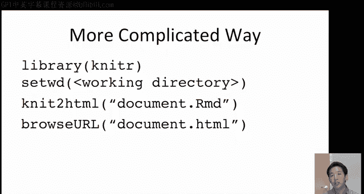


代码块可以拥有名称，并且可以控制其输出是否在最终文档中显示。

*   **命名代码块**：在 `{r}` 后面的花括号内，可以指定一个名称，例如 `{r my_chunk_name}`。
*   **默认行为**：默认情况下，代码块中的代码及其运行结果都会在输出文档中显示（即“回显”）。

---


## ⚙️ 编译文档生成输出

创建好 R Markdown 文档后，下一步是将其“编织”成可读的输出格式。

在 RStudio 中，这非常简单。你只需点击“Knit to HTML”按钮，RStudio 会自动执行以下操作：
1.  运行文档中所有的 R 代码。
2.  将代码的输出结果嵌入到文档中。
3.  将整个文档转换为 HTML 网页。

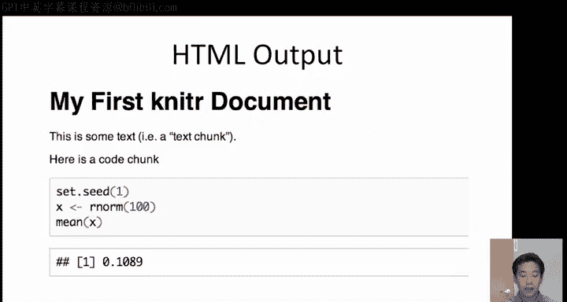

如果你不使用 RStudio，也可以通过 R 命令来完成这个过程：
```r
library(knitr)
setwd("/path/to/your/document") # 设置工作目录到 Rmd 文件所在位置
knit2html("your_document.Rmd")  # 编译为 HTML
browseURL("your_document.html") # 在浏览器中打开
```
`knit2html` 函数会处理你的 R Markdown 文件，运行其中的 R 代码，并将输出嵌入，最终生成一个同名的 HTML 文件。

---

## 📊 输出结果示例

编译成功后，你会得到一个 HTML 文件。其内容大致如下：
*   标题以大字体显示。
*   普通文本段落正常显示。
*   代码会显示在一个有阴影的方框中。
*   代码的运行结果直接显示在代码下方。

例如，上述示例代码块的输出可能显示为：
```
[1] 0.1088874
```
这就是 `mean(x)` 函数的计算结果。

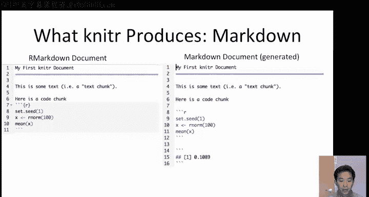

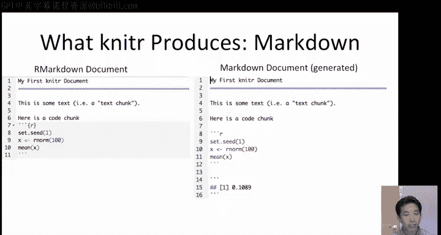

---

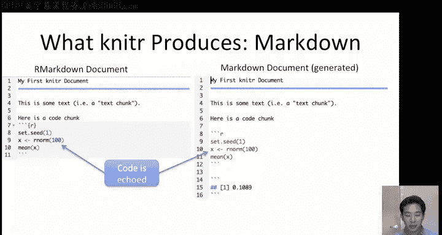

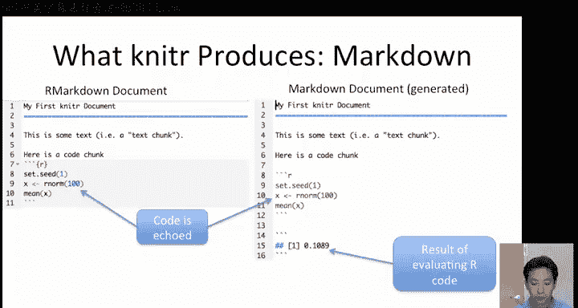

## 🔄 knitr 的工作原理

理解 knitr 的工作原理有助于更好地使用它。knitr 的处理流程如下：
1.  **输入**：读取原始的 R Markdown (`.Rmd`) 文档。
2.  **处理**：执行文档中所有的 R 代码块。
3.  **转换**：将代码的输出结果插入到文档中相应位置，生成一个“中间”的纯 Markdown (`.md`) 文档。
4.  **输出**：最后，使用其他工具（如 Pandoc）将这个 Markdown 文档转换为最终的输出格式（如 HTML、PDF）。

关键的一点是，**代码执行的结果被添加到了 Markdown 文档中**。

---

## 💡 实用提示

在开始创建自己的文档时，请注意以下几点：

*   **删除示例内容**：在 RStudio 中创建新 R Markdown 文档时，它会自动填充一些通用的示例文本和代码。你的第一步通常是删除这些内容，替换成你自己的。
*   **文件扩展名**：R Markdown 文件通常使用 `.Rmd` 作为扩展名，这有助于识别文件类型，但并非强制要求。

---

## 📝 总结

本节课中我们一起学习了如何创建基础的 knitr 文档。我们了解了在 RStudio 中创建 R Markdown 文件的步骤，掌握了文档的基本结构，特别是如何使用代码块嵌入 R 代码。我们还学习了如何通过点击按钮或使用 `knit2html()` 函数来编译文档，生成包含代码和结果的 HTML 报告，并理解了 knitr 将代码、文本和输出结果编织在一起的基本原理。