# 154：如何有效沟通数据分析结果 📊

在本节课中，我们将学习如何以一种清晰、有层次的方式向他人沟通数据分析的结果。重点不在于可重复研究本身，而在于如何组织信息，让他人能够理解你的发现，并在必要时验证你的结论。这对于大型或复杂的分析项目尤其重要。


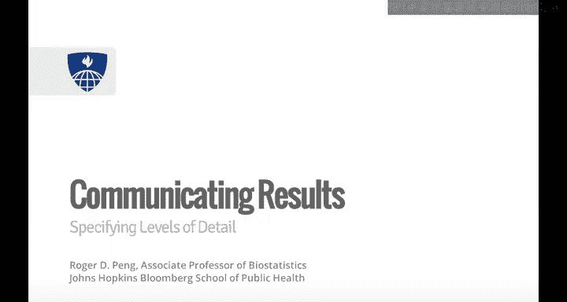

## 沟通的层次结构

上一节我们介绍了沟通结果的重要性，本节中我们来看看如何构建信息层次。当你以可重复的方式进行数据分析时，会产生大量内容、文件、输出和数据。你无法一次性呈现所有内容。因此，向他人展示发现时，需要建立一个从最不具体到最具体的信息层次结构。

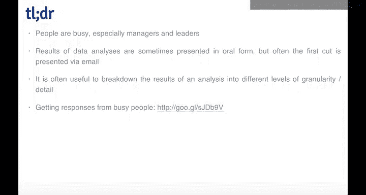


核心观点是，如今的管理者和组织领导者通常非常忙碌。他们需要你以分层的方式呈现内容。很多时候，数据分析会以口头形式呈现，例如在演示或会议中。但初步或中期结果通常通过电子邮件等媒介传达。将分析结果分解为不同粒度或详细程度非常有用。

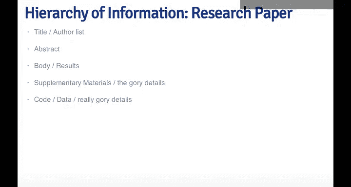


以下是一些关于如何从忙碌人士那里获得电子邮件回复的通用建议链接。基本思想是，不要一次性向某人发送大量信息，因为这会让人不知所措，降低他们阅读的可能性。


## 以研究论文为类比

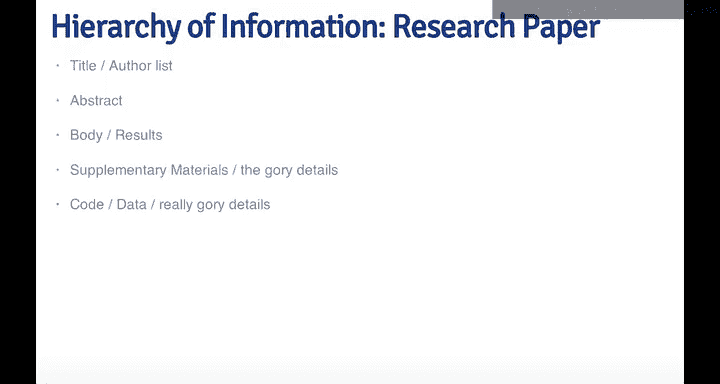

为了理解这种层次结构，我们可以思考一篇典型的研究论文是什么样子。

研究论文本身就内置了信息层次结构。

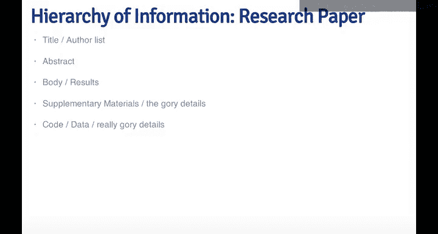

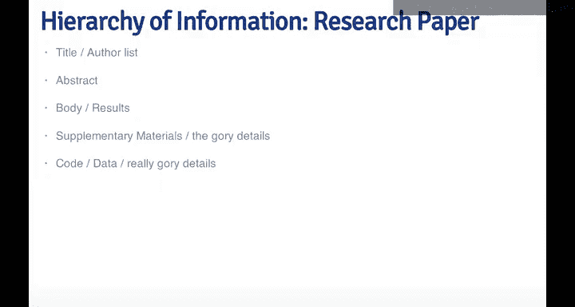

*   **标题**：通常是第一层。它描述论文的主题，希望有趣并能让你了解大致内容。标题本身没有细节，只涵盖主题。
*   **摘要**：下一层。通常是几百字，说明论文内容、研究动机、解决问题的方法以及最重要的结果。
*   **论文正文**：包含更详细的方法、更具体的结果、敏感性分析以及对结果影响的更深入讨论。
*   **补充材料**：对于复杂的数据分析，书面论文本身可能无法包含重现发现所需的所有细节。因此，通常会有补充材料，提供更多关于所做工作的细节。
*   **代码与数据**：如果你真的想精确地复现所做的工作，可能需要获取代码、数据以及所有具体的细节。

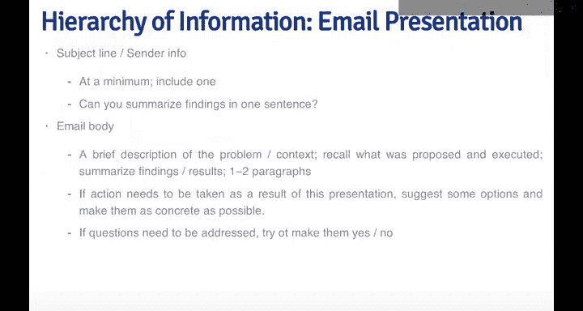

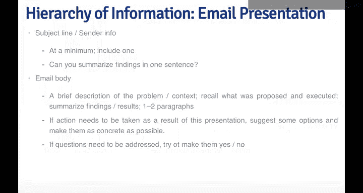

这就是你可能呈现的信息范围，从最不具体到最具体。当然，并非每个人都在撰写研究论文，但大多数数据分析的呈现方式都有类似的类比。

## 电子邮件沟通的层次结构

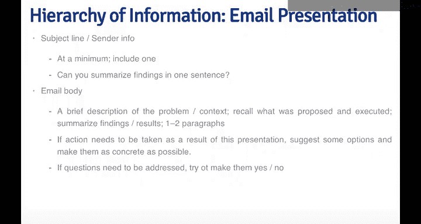

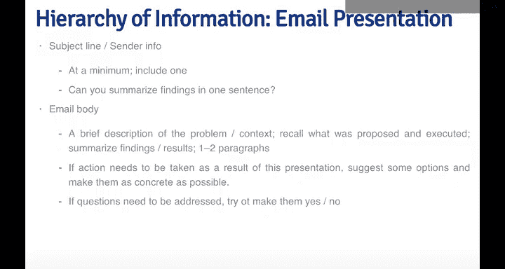

如果你要通过电子邮件向同事或经理发送结果，信息层次结构如下：


*   **邮件主题**：这是第一层信息，类似于标题。它应该简洁、具有描述性。至少应该有一个主题，不要发送没有主题的邮件。如果你能用一句话总结你所做的工作，将其放在主题中会很有用。这样，阅读主题的人就能了解大致情况，甚至可能仅凭此做出决定。
*   **邮件正文**：这是下一层信息。尽管邮件正文没有技术上的大小限制，但也不应过于冗长。你需要提供问题的简要描述。如果收件人同时处理多项事务，可能不记得你正在处理的具体问题，因此需要提供一些背景和描述。总结你的发现和结果。整个邮件正文总共一到两段即可。
*   **行动建议**：如果你需要收件人根据呈现的结果采取某种行动，那么应该尝试提出一些尽可能具体的选项。如果你希望他们回复答案，最好将问题设计得尽可能简单，例如是/否问题。
*   **附件报告**：在邮件正文之后，你可以附加一个更长的文件，如PDF或其他类型的文档。这可以是一份包含更详细分析、图表、表格等的报告。这份报告可以由R Markdown文件生成，使用`knitr`等工具创建。但即使在这样的报告中，你可能有几页的篇幅来呈现内容，你仍然需要保持简洁，不要输出成页的代码、表格和结果。
*   **代码仓库链接**：我们知道你的代码是可用的，因为如果你使用`knitr`之类的工具，显然需要将代码与结果放在一起。但你不必在报告中全部呈现。如果有人真的想精确查看你所做的工作，你可以给他们一个链接，指向像GitHub或项目网站这样的代码仓库，那里包含所有细节：所有代码文件、所有数据集、所有具体细节以及你的软件环境等。

## 总结与核心要点

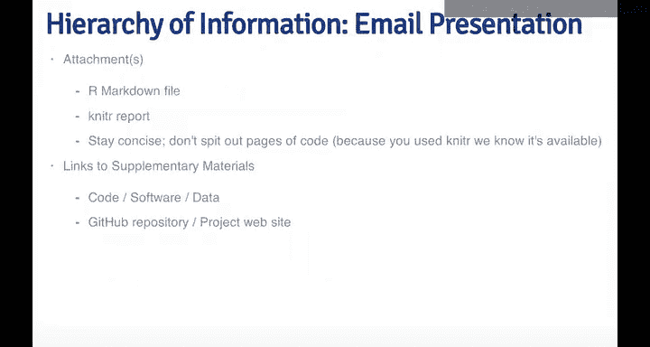

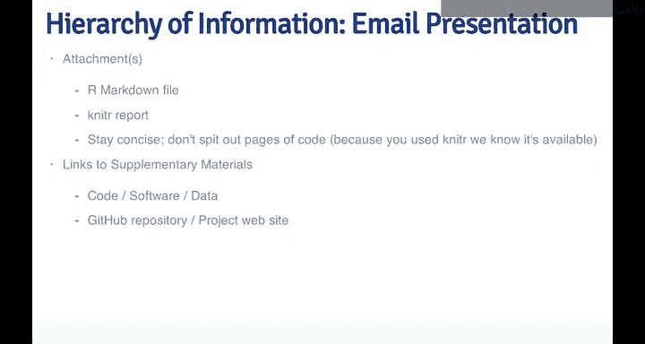

本节课中，我们一起学习了如何分层级地沟通数据分析结果。

这就是你可能希望向他人呈现的不同详细程度。真正对你所做的一切感兴趣或想了解细节的人，可能会访问你的GitHub仓库，开始拉取代码并查看详细结果。而只需要高层总结的人，则会阅读邮件主题、简要描述，并可能翻阅报告。

关键在于，不同的人对你所做工作的详细程度有不同的兴趣。因此，你需要向人们呈现这些不同的层次，以便他们能够选择自己最感兴趣的层级。这只是一个关于如何呈现你完成的分析、数据或项目的通用模板。并非每次呈现都需要所有这些不同的层级，但我发现这是一个有用的分解，展示了你可以进行的各种呈现类型。

**核心公式**：有效沟通 = 信息层次化（从概括到细节） + 为不同受众提供入口点。

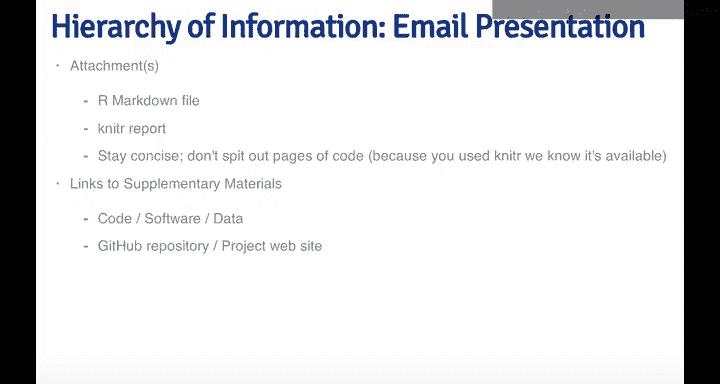

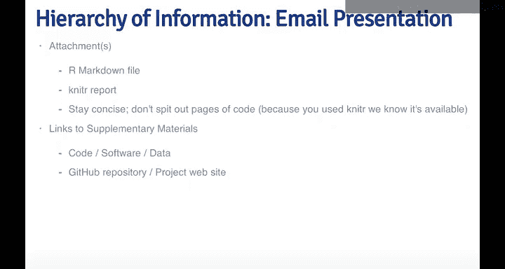

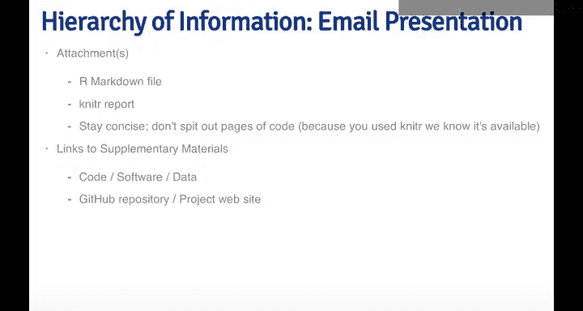

**核心代码示例**（使用R Markdown生成报告）：
```r
# 这是一个R Markdown文档的YAML头部示例，用于生成可包含代码和结果的报告
---
title: "数据分析报告"
author: "你的名字"
date: "`r Sys.Date()`"
output: pdf_document
---
```