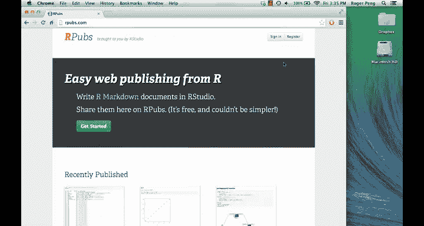
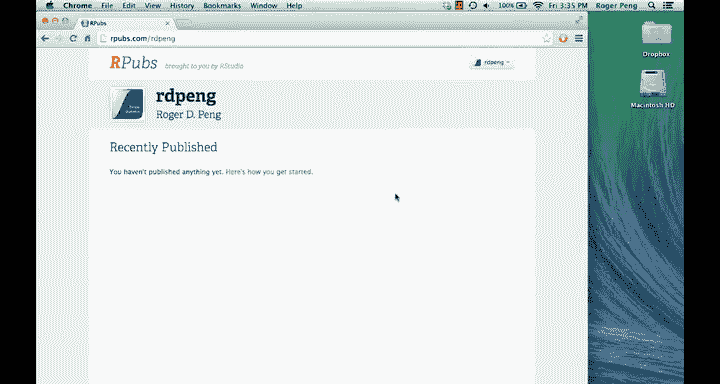
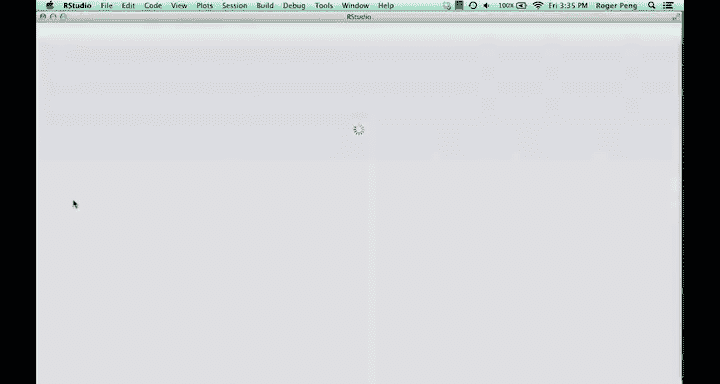
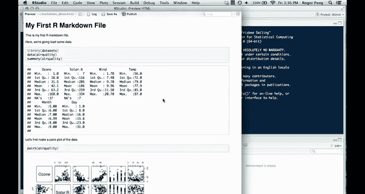
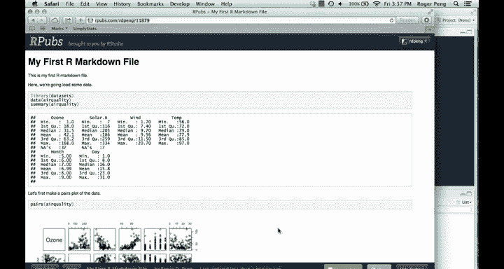
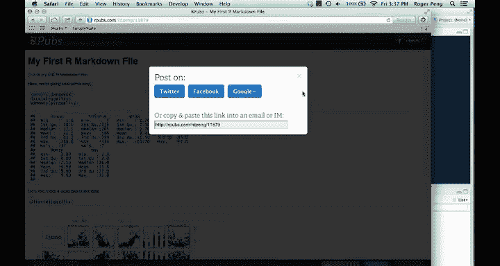
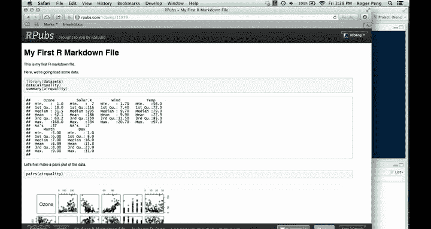

# 155：使用 RPubs 分享你的分析报告 📤

在本节课中，我们将学习如何使用 RStudio 提供的一项便捷服务——RPubs。这项服务允许你将 R Markdown 生成的 HTML 文档轻松发布到网上，并与他人分享你的数据分析成果。

---

将 R Markdown 与 RStudio 结合使用的一个便利之处，在于 RStudio 提供了一项名为 RPubs 的服务。

因此，我想介绍一下这项服务，向你展示它的基本工作原理。首先，我们访问 `rpubs.com` 网站。

你可以看到这是一个由 RStudio 提供的网站。你需要在此创建一个账户。

基本概念是，一旦你创建了账户，就可以将 Markdown 或 Knitr 生成的文档发布到这个网站上，用于与他人或公众分享。

你需要做的第一件事是注册账户。你只需输入姓名、邮箱、用户名和密码即可。

拥有账户后，你就可以开始向 RPubs 发布内容了。

我将在此登录，因为我已有一个账户。

登录后，你可以进入“我的账户”页面，查看个人资料。可以看到我还没有发布任何内容。

那么，让我们尝试在这里发布一些内容。我将关闭这个页面，然后启动 RStudio。

RStudio 启动后，你可以看到左侧已经有一个作为演示的 Markdown 文档。

我首先要做的是“编织”这个文档，看看生成的 HTML 是什么样子。这里显示，我加载了空气质量数据集，并绘制了数据集中变量的配对图。

往下滚动一点，可以看到我拟合了一个以臭氧为因变量，以风速、太阳辐射和温度为自变量的线性模型，并在此展示了线性模型的结果。

这个分析本身并不复杂，但我希望能够与世界分享它。你会注意到预览窗口顶部有一个“发布”按钮。

我只需点击这个“发布”按钮。

你会看到一个关于 RPubs 的小提示，点击“发布到 RPubs”即可。如果你已经登录了 RPubs 账户，它会直接发布。

如果尚未登录，它会提示你。发布时，你可以为文档设置一个标题和描述。

例如，标题可以是“空气质量数据集的一些分析.R”。

你还可以为它设置一个自定义标识符，或者直接留空，点击继续。

注意顶部，它自动生成了一个标识符，例如 `11879`。这将成为此分析报告的永久链接。

你可以看到，网页上的输出结果与 RStudio 预览窗口中显示的 HTML 输出完全一致，但现在它已经发布在网站上了。

你可以将此链接分享给他人。人们可以在此评论，这里有一个评论按钮。

你也可以点击“分享”按钮，将其发送到各种社交网络或通过电子邮件分享给某人。

这是一项非常有用的服务，并且完全免费。但有一点非常重要：你发布到此的所有内容都会立即公开，没有任何私密期。

因此，你需要小心，确保没有发布任何你本不想公开的内容。

当然，如果你不小心发布了某些内容，也可以随时在页面底部将其删除。

这就是 RPubs。对于发布和分享使用 R Markdown 和 Knitr 编写的统计分析报告来说，它是一项非常有用的服务，值得一试。

---

本节课中，我们一起学习了如何使用 RPubs 服务。我们了解了如何注册账户、将 R Markdown 文档编织为 HTML 并发布到网上，以及如何管理和分享已发布的报告。记住，RPubs 是一个强大的分享工具，但发布内容前务必确认其适合公开。