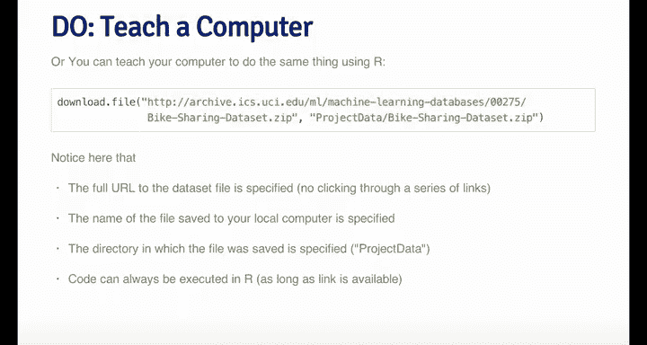
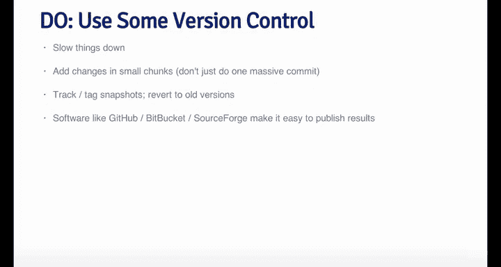
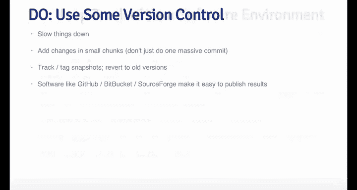
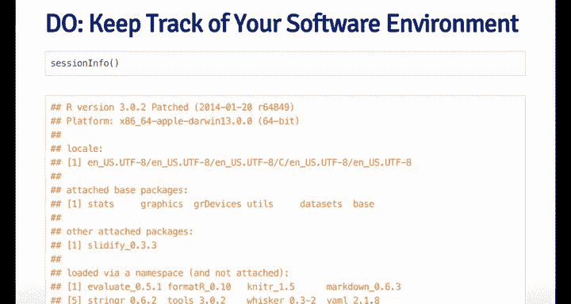
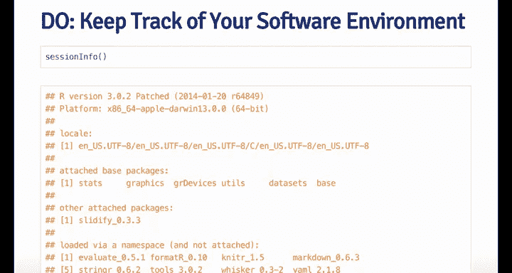
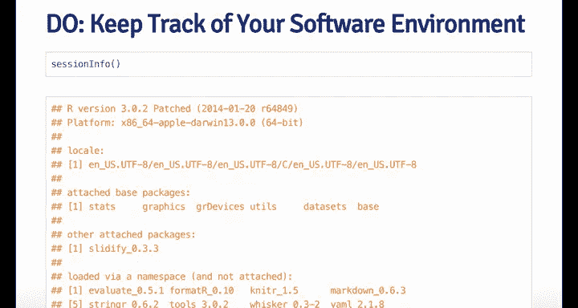

# 157：可重复研究清单第2部分 📋

在本节课中，我们将继续学习如何确保数据分析项目的可重复性。我们将重点探讨三个核心实践：自动化数据处理、使用版本控制软件以及记录软件环境。掌握这些方法能让他人轻松复现你的分析过程与结果。

## 自动化数据处理 🤖

上一节我们介绍了可重复研究的基本概念，本节中我们来看看如何通过自动化来避免手动操作带来的问题。

手动操作的替代方案是，你应该尝试教会计算机执行你分析中的所有任务。具体而言，如果你的项目涉及数据处理，你应该始终尝试让计算机来完成。

这样做有两个主要原因：
1.  如果你能教会计算机执行任务，你就拥有了一套明确、具体的操作指令。这消除了数据分析中的模糊性，因为计算机通常不接受模糊指令，它需要精确的编程命令。
2.  当你向计算机发出指令时，本质上是在精确记录你的意图和操作方法，这正是可重复性的定义。

因此，教会计算机执行任务在很大程度上保证了你的工作是可重复的。即使某项任务你只打算做一次，尝试让计算机来完成也是有益的。这可能涉及使用不同的编程语言，例如 R 或其他语言。让计算机为你执行任务总是更有利于可重复性。虽然编程可能需要更长时间，看似不便，但这种方式所做的一切都将可重复，这会带来长远的回报。

以下是一个简单的例子，这是大多数项目中常见的操作：下载数据。数据可能来自网络。

例如，你可能需要从 UCI 机器学习仓库下载自行车共享数据集。通常的操作流程是：访问网站，找到自行车共享数据页面，点击数据文件夹，在文件夹内找到包含数据的 zip 文件链接，在浏览器中选择“另存为”，然后在本地计算机的文件夹中命名并保存文件。这些操作非常自然。

但你会发现，即使是这样一个简单的操作，需要描述的指令列表也相当冗长。

一个替代方案是直接教会计算机完成所有这些步骤。事实上，在 R 语言中这非常简单，你可以使用 `download.file()` 函数直接将文件下载到计算机上。



这个例子有几个优点：
*   首先，数据的完整 URL 被明确指定，没有歧义。你无需点击网站、文件夹和 zip 文件链接，数据集的完整 URL 就在代码中，非常具体。
*   其次，保存到计算机的文件名也被明确指定。例如，使用浏览器下载文件时，你总可以重命名文件。但如果这一点没有被记录，就很难将重命名后的文件与网络上的原始数据集关联起来。而在代码中，我明确指定了本地数据集将被称为 `bike-sharing-data.zip`。
*   最后，我知道数据将被保存到哪个目录。我将数据保存到名为 `project-data` 的目录中。因此，我不必猜测数据被保存在哪里。

这段代码可以在 R 中随时执行，即使你只需要执行一次。只要使用 R 并且 URL 和网站没有改变，其他人就可以执行完全相同的代码，下载到相同的数据集。

当然，有许多事情是你无法控制的。如果你不运营该网站，你就必须依赖网站运营者不做大量更改。但在你可控的范围内，越多地使用类似 `download.file()` 这样的代码，你的工作可重复性就越好。


```r
# 示例：使用R的download.file函数下载数据
download.file(url = "http://archive.ics.uci.edu/ml/machine-learning-databases/00275/Bike-Sharing-Dataset.zip",
              destfile = "./project-data/bike-sharing-data.zip")
```

## 使用版本控制软件 🔄




另一个通用建议是使用某种版本控制软件。这类软件有很多种，在本系列课程中，我们主要关注 Git，它是一个非常优秀的版本控制软件，并且可以与 GitHub、Bitbucket 等优秀网站结合，用于发布代码和其他类型的项目。



在数据分析项目中使用版本控制系统时，需要记住的主要特点是，它有助于让你稍微放慢速度。这听起来可能像件坏事，但让人放慢速度通常是好事。因为通常当你有一个项目，对数据感到兴奋并急于开始时，你会直接开始做事和处理数据，而没有真正跟踪发生了什么。无论你使用哪种版本控制软件，它都会帮助你停下来，思考已经做了什么，思考发生了哪些更改，将更改提交到存储库，以便你拥有记录。

然后，你可以一步步地推进。这对于数据分析非常有用，因为你拥有了一份关于发生了什么以及你朝哪个方向前进的日志。如果你想回溯，你可以返回，并且有关于你发现了什么的记录。例如，在探索性分析过程中，如果你发现了一些有趣的东西，你会有一个关于如何到达那里的历史记录。因此，版本控制系统对于这个目的非常有用。

当然，像 Git 这样的软件可以用来跟踪和标记项目的快照，可以恢复到旧版本，所有这些功能在版本控制系统中都是相当标准的。因此，如果你能在推进项目时，以小块的方式添加更改，这将非常有用。不要在一次大型提交中添加 100 个文件。如果你能将分析分解为逻辑部分，并逐个部分地添加，这将有助于你阅读历史记录并理解过去做了什么。

## 记录软件环境 💻

跟踪你的软件环境对于可重复性非常重要，因为许多复杂的项目会涉及将许多工具链接在一起，合并不同的数据集，而某些工具和数据可能只在特定环境中工作。因此，软件和通用计算环境实际上对于复现分析至关重要。

你的软件环境中可能需要跟踪许多不同的方面，并非所有方面对每种类型的项目都至关重要，但请记住几个相当常见的要点：

以下是需要记录的关键环境信息：

1.  **计算机架构**：这通常不太重要，过去可能更重要。了解你正在使用的计算机架构类型，如果你需要与他人沟通，这是有用的。例如，你使用的 CPU 是 Intel 芯片、AMD 芯片还是 ARM 芯片？制造商信息可能有用。另一个方面是 32 位还是 64 位，这可能影响某些软件。你是否使用图形处理单元（GPU）？这些信息需要心中有数并加以跟踪。
2.  **操作系统**：这可能非常重要。你使用的是 Windows、Mac OS、Linux 还是其他 Linux 版本？这可能非常重要，因为有些软件只能在 Windows 上运行，有些只能在 Mac 上运行，等等。如果有人想复现你所做的工作，而你使用的软件只能在 Windows 上运行，那么他们将必须找到一台 Windows 机器或使用 Windows 模拟器。
3.  **软件工具链**：这非常重要。通常你会使用许多不同的软件。其中一些是标准的，例如网络浏览器，几乎每个人都会有。但像编译器、解释器、你使用的 shell（例如 bash 或其他）、你使用的不同编程语言（C++、Python 等）、你使用的不同数据库后端等，都需要注意。如果你使用不同的数据分析软件，所有这些都应该被记录下来，因为如果有人想复现你所做的工作，他们将必须复现整个环境，包括你使用的所有编译器等。
4.  **支持软件**：特别是像软件库或 R 包这样的东西，以及其他类型的依赖项，跟踪这些非常重要。
5.  **外部依赖项**：这些是你计算机外部的东西。例如，你是否从中央存储库下载数据？是否有其他远程数据库需要查询？你是否从其他软件存储库获取软件？诸如此类的事情可能对你的分析很重要。

对于所有这些方面，通常跟踪版本号很重要，因为随着其他人开发软件，他们会进行更改，这可能会破坏依赖关系。因此，如果你的项目是使用某个特定版本的操作系统或软件完成的，可能只有使用该版本才能复现，而未来的版本则不能使用。所以，如果可能，记录所有东西的确切版本号很重要。


一个小例子是在 R 中，如果你使用 `sessionInfo()` 函数，它会尽可能多地告诉你关于你的环境信息。你可以看到这是我计算机上的输出。我使用的是 R 版本 3.0.2（已打补丁），它甚至给了我子版本或修订号 64849，所以实际上非常精确。我使用的是 64 位 Intel 兼容计算机（x86），并且使用的是苹果电脑。我处于美国英语区域设置环境中。以下是已安装的 R 包：stats、graphics、utils、datasets，这些都是 R 附带的基础包。我还安装了其他包，然后有其他包已加载，还有一些包未加载但命名空间可用，例如 knitr、markdown、yaml 等。这些大致就是我进行分析时 R 环境的样子。当然，这只是我整个软件环境的一小部分，但拥有这种详细信息通常是有用的。

```r
# 在R中获取当前会话信息
sessionInfo()
```







本节课中我们一起学习了确保数据分析可重复性的三个关键实践：通过编写代码（如使用 `download.file`）自动化数据处理任务，利用 Git 等版本控制系统跟踪项目变更历史，以及详细记录软件环境信息（如使用 `sessionInfo()`）。将这些方法结合起来，能极大地提高你工作的透明度、可追溯性和可复现性。