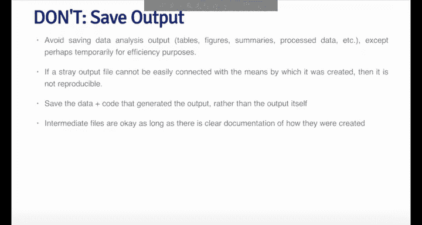
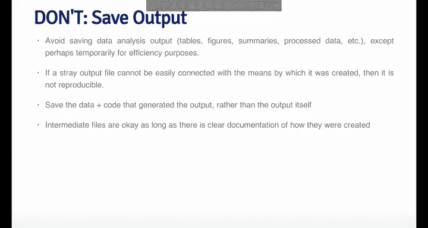
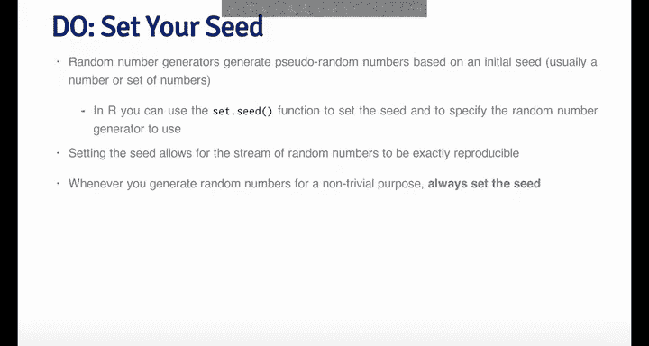
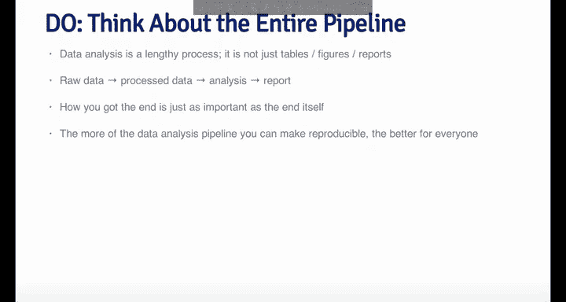
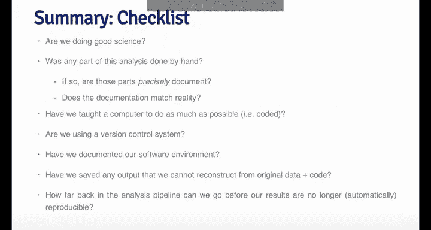

# 158：可重复研究清单第3部分 📋


在本节课中，我们将学习如何确保数据分析过程的可重复性。我们将探讨避免保存无法追溯的输出、设置随机数种子以及审视整个分析流程的重要性。

---

## 避免保存无法追溯的输出

上一节我们讨论了文档的重要性，本节中我们来看看如何处理分析过程中的输出文件。



我在进行数据分析时，会牢记一条快速规则：**不要保存任何输出**。这听起来可能有点奇怪，因为你最终确实需要一些输出。是的，你需要表格、图形和摘要来撰写报告或论文。但最好等到你真正进行最终阶段活动时再生成这些输出，而不是提前保存。

一个随意存放在项目目录中的输出文件，如果你不知道它从何而来或如何生成，就是不可重复的。如果不可重复，保存它几乎毫无价值，因为你总会疑惑那些数字是如何得到的，那个图形是如何制作的。

因此，与其保存表格或图形这类输出，不如保存生成该表格或图形的**数据和代码**。这样，你总能重新生成你需要的任何类型的输出。

当然，在大型项目中，分析流程可能很长，从原始数据开始，到处理数据，再到进一步处理和分析。在这个过程中可能会生成许多中间文件，这通常没问题。保留它们可以提高分析效率，避免每次都要从头重现所有步骤。



**但是**，如果你保留中间文件，**必须确保**每个中间文件都有文档记录，你有生成该文件的代码，并且输入其中的数据有清晰的记录。

总而言之，通常**最好不要保存任何输出**，因为你可以保存代码和数据。但如果需要保存中间文件，请确保你同时拥有相关的代码和数据。

---

## 设置随机数种子

这是一个非常具体但极其重要的问题，因为它可能导致非常不可重复的结果。

如果你生成随机数，几乎所有随机数生成器都会基于一个称为**种子**的东西来生成伪随机数。种子通常是一个或一组数字，用于初始化随机数生成器，然后生成器会按序列生成随机数。



例如，在 R 语言中，你可以使用 `set.seed()` 函数，只需给它一个整数，它就会初始化随机数生成器，然后生成一系列随机数。

```r
# 设置随机数种子
set.seed(123)
# 生成随机数
runif(5)
```

如果你调用 `set.seed()` 然后生成随机数，只要你稍后再次设置相同的种子，这个随机数序列将**总是可以精确重现**。

这对于模拟、马尔可夫链蒙特卡洛分析等涉及生成随机数的操作非常重要。你应该始终记住设置种子，否则你的数字将无法重现。

如果你发表了一项使用随机数的分析但没有设置种子，基本上不可能回过头去弄清楚当时的情况。因此，**任何时候使用随机数，都要考虑这一点**。

---



## 审视整个分析流程

最后，我想提一下，整个数据分析和处理过程通常是一个很长的流程。从获取原始数据（可能来自网络或实验），到清理、处理、分析，再到制作摘要和图形，最后生成结果，这是一个漫长的过程。

你应该在工作的同时，思考整个流程，并考虑每个环节是否可重复。沿着这条流程前进，**如何到达终点与你最终产出的产品同等重要**。你最终产出的分析或报告，只是你为到达那里所做全部工作的一小部分。事实上，你为到达终点所做的所有工作，其记录和文档的重要性不亚于最终结果。

一般来说，你能使数据分析流程中**越多环节可重复**，对你、对他人就越好，你的结果也越可信。所以，要思考整个流程，**所有环节都重要，不仅仅是最终产品**。



---

## 可重复性自查清单

综合以上规则，我整理了一个简单的自查问题清单，供你在进行任何数据分析时自问。

以下是你在进行数据分析时应问自己的关键问题：

1.  **我们是否在做有价值的科学？** 这有趣吗？值得做吗？
2.  **分析的任何部分是否手工完成？** 这可能无法避免，但关键问题是：如果手工操作，是否有精确的文档记录？特别是，你必须确保文档与实际操作相符。很多时候，你写下了文档，但后来实际修改了操作。如果你更新或更改了某些内容，必须同时更新相应的文档。
3.  **你是否尽可能多地编写了代码？** 你希望尽可能多地教会计算机去完成工作。以精确的方式写下你所做的任何事情，这是一个好主意。
4.  **你是否使用了版本控制系统？** 例如 Git 或 SVN。
5.  **你是否记录了软件环境？** 每个工具、每个库、你的操作系统、架构，这些都必须注明。
6.  **你是否保存了任何无法从原始数据和代码重建的输出？** 一般来说，你应该避免保存任何无法从某些数据和代码推导出的输出。保存数据和代码比保存输出更好。
7.  **在分析流程中，我们可以回溯多远，结果才不再可重复？** 如果你只负责流程的一部分，可能无法一直回溯到原始数据，只能回溯到某个处理过的数据版本，这没关系。但要思考整个流程，并尝试使其尽可能可重复。

这些是我对于通用数据分析项目中可重复性思考的一般建议。遵循这些建议将帮助你组织项目，并确保你的思路正确。**关键点在于：手工操作时要小心，尽可能多地编写代码，并尽可能精确地记录一切。**

---


本节课中，我们一起学习了确保数据分析可重复性的几个核心实践：避免保存无法追溯的中间输出、在使用随机数时务必设置种子以保障结果可复现，以及从全局视角审视整个分析流程的重要性。最后，我们掌握了一份实用的可重复性自查清单，帮助你在日常分析工作中系统性地评估和改进项目的可重复性。记住，可重复的研究是可信研究的基石。