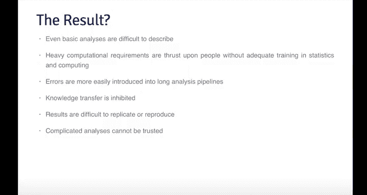

# 159：基于证据的数据分析 第 1 部分 🧪

在本节课中，我们将要学习科学研究中两个至关重要的概念：**可重复性**与**可复制性**。我们将明确区分这两个术语，并探讨它们在现代数据密集型科学研究中的重要性，特别是在数据科学领域。

---

## 概述：可重复性与可复制性的区别

人们常常会互换使用“可重复性”和“可复制性”这两个词。但在本次讨论中，我们需要对它们进行明确的区分。

上一节我们介绍了课程主题，本节中我们来看看这两个核心概念的具体定义。

### 可复制性

我认为，**可复制性**关注的是**科学主张的有效性**。例如，如果一项研究声称“X与Y相关”，那么首要问题就是：这个结论是否真实？为了验证这一点，我们需要进行复制研究。

以下是可复制性研究的关键特征：
*   由新的研究者执行。
*   收集全新的数据。
*   可能使用不同的分析方法、实验室或仪器。

如果经过一系列独立的复制研究，大家都得到了大致相同的结果，那么这个科学主张很可能是合理的。反之，如果无人能复制出相同结果，则该主张可能不成立。因此，可复制性是我们加强科学证据的终极标准。

### 可重复性

**可重复性**则侧重于**数据分析过程的有效性**。这里的情况是：数据已经被收集并分析，研究者得出了“X与Y相关”的结论。

可重复性提出的关键问题是：**我们能否信任这项分析？** 其核心在于，新的研究者能否**使用相同的数据和相同的方法**，重现出原作者声称的结果。

这一点至关重要，特别是在我的工作领域——**当完全复制研究不可能时**，可重复性就显得尤为重要。例如，一些长达25年的流行病学队列研究，在合理时间内根本无法复制。

---

## 背景：为何可重复性日益重要？

近年来，关于可重复性的讨论非常多。一些趋势推动了这种关注：

*   **许多研究无法被复制**：尤其是像流行病学中那些耗时数十年的队列研究。
*   **技术影响**：数据收集速度因技术而极大提升。
*   **数据复杂性高**：人们正疯狂地将各种数据库整合在一起。许多数据被“超范围使用”，例如将行政数据集用于健康研究。
*   **计算能力强大**：我们现在可以对小型数据集进行非常复杂的分析。
*   **计算学科的普及**：如今，几乎每个传统领域X，都出现了对应的“计算X”领域。
*   **方法描述困难**：基础分析的结果有时都难以在期刊的标准方法部分描述清楚。
*   **培训不足**：计算需求被强加给许多未经充分培训的研究者。

考虑到这些背景，我们可以想象研究者的计算能力范围。这个房间里的大部分人可能处于能力较高的一端，但还有大量研究者处于能力谱系的另一端。他们无论喜欢与否，都不得不进行大量的计算工作，因为数据正源源不断地涌来。

---

## 当前面临的挑战

上述背景和趋势导致了一系列问题：

以下是数据分析流程中可能出现的具体问题：
1.  **错误引入**：在漫长的分析流程中容易引入错误。
2.  **知识传递困难**：我们无法在有限的时间和篇幅内，向他人完整说明我们所做的一切。
3.  **信任危机**：在许多情况下，人们感觉复杂的分析结果不可信。

---

## 总结

本节课中，我们一起学习了**可重复性**与**可复制性**的核心区别。我们明确了：
*   **可复制性**关乎科学主张的终极验证，需要通过独立的新研究来实现。
*   **可重复性**则关乎数据分析过程本身的可靠性，强调对同一数据和相同方法进行重现的能力。

我们还探讨了在数据爆炸、分析复杂化的今天，确保研究（尤其是那些难以复制的研究）的可重复性所面临的重大挑战。理解这些概念是进行严谨、可信的数据科学研究的基石。