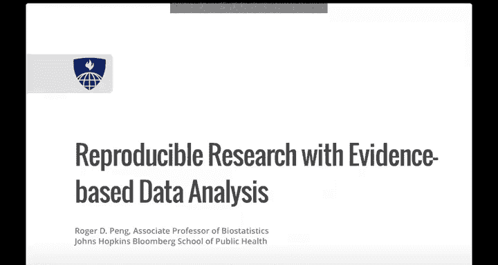
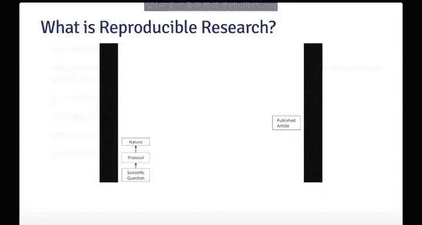
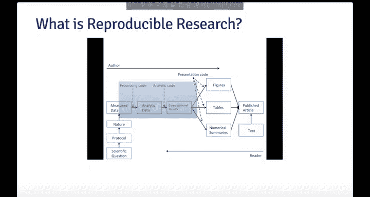
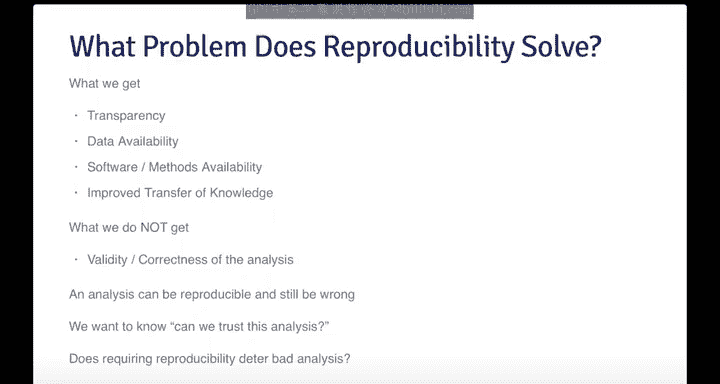
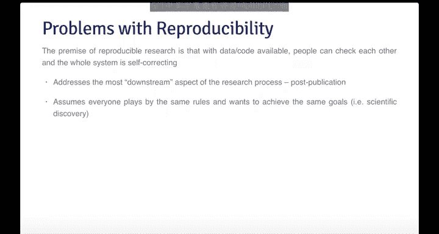

# 160：基于证据的数据分析（第二部分）🔍

在本节课中，我们将深入探讨可重复性研究的概念框架、其解决的问题以及存在的局限性。我们将分析从原始数据到发表文章的全过程，并理解开放数据与代码在科学研究中的角色与意义。

---

## 研究过程的传统框架

上一节我们介绍了数据分析的基本概念，本节中我们来看看一个典型的研究过程是如何进行的。

通常，你会在期刊上看到一篇已发表的文章，这就是你所能获得的全部信息。你可以了解到研究者提出的科学问题，以及他们如何从自然现象出发进行研究。然而，读者只能从文章本身开始，尝试逆向理解研究者的路径。

在绝大多数情况下，读者只能阅读文章，并可能对其留下深刻印象。理论上，他们可以回到原始的自然现象中去重复或复制这项研究，但除此之外，他们能做的非常有限。

## 可重复性研究的核心理念

当然，在已发表的文章背后，实际存在着一整套研究材料。这包括我们可能称之为原始数据和测量数据，对数据进行的特定分析，执行分析所涉及的所有代码，以及由此产生的结果、图表和表格等。

然而，这些材料通常并不对外公开。可重复性研究的基本理念，就是在这两者之间找到一个折中点。

以下是可重复性研究的核心主张：
*   公开分析数据。
*   在重要的情况下，公开部分预处理代码。

这种折中是在不要求完全复制整个研究的前提下，实现一定程度的可重复性。

## 可重复性能解决什么问题？

那么，可重复性究竟解决了什么问题呢？从一个可重复的研究中，我们可以获得几项关键收益。

首先，它带来了**透明度**。我们能更清楚地了解研究者实际做了什么。其次，我们获得了他们使用的**数据**。如果研究中涉及新方法，我们也能获取这些**方法**。最后，这促进了**知识的有效传递**，因为我们确切知道了他们实际的操作，而不仅仅是他们意图的操作。

然而，可重复性并不能让我们判断分析本身是否正确。分析完全可以既是可重复的，同时又是错误的。文献中有许多这样的例子：某项研究完全错误，但其过程却完全可以复现。这可能是因为研究者使用了错误的方法，或者以不当的方式处理了数据。

因此，“我们能否信任这项分析？”这个根本性问题，并不能通过可重复性得到解答。虽然透明度、数据和方法共享都非常重要，但我们仍然面临一个根本性的挑战。

## 可重复性的潜在问题与局限

一个合理的问题是：如果要求每项研究、每个分析都必须可重复，是否会阻止人们进行糟糕的分析？从根本上说，答案是否定的。

可重复性研究的前提是，当所有数据和代码都公开后，人们可以互相检查，验证他人的分析，从长远来看，整个系统能够自我修正。

但这里存在几个问题。首先，“长远”有时可能**过于漫长**，对于需要及时解决的问题来说，这可能不够。其次，我认为可重复性主要解决的是科学传播中**下游环节**的问题，更具体地说，它通常只在**文章发表之后**才发挥作用。

另一个在我的研究领域尤其关键的问题是，可重复性的理念**假设每个人都遵守相同的规则，并追求相同的目标**。而这显然并非事实。

---

**本节课总结**

本节课中，我们一起学习了可重复性研究的完整框架。我们剖析了从原始数据到发表成果的传统路径，理解了开放数据与代码如何作为折中方案提升研究的透明度与知识传递效率。同时，我们也认识到可重复性并不能保证分析的正确性，其自我修正机制存在时效性局限，并且其有效性依赖于一个理想化的、目标一致的科研环境假设。理解这些优势与局限，对于进行严谨的、基于证据的数据分析至关重要。