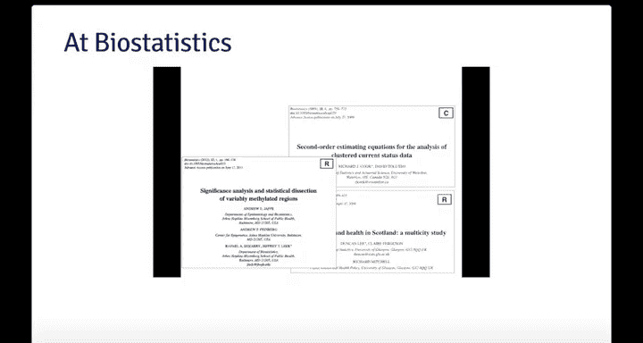

# 161：基于证据的数据分析 第3部分 🧪

在本节课中，我们将探讨如何将“可重复性研究”的理念从科学出版流程的末端，提前到更上游的环节。我们将通过一个哮喘研究的类比来理解这一概念，并介绍一种在学术期刊中实施的具体模型。

---

## 从哮喘治疗到研究流程的类比

上一节我们讨论了数据分析中的证据基础。本节中，我们来看看如何将医学干预的思维应用到研究流程本身。

我有时会用哮喘来打比方。在哮喘的过敏致敏和发病机制中，过敏原暴露会引发体内特定的免疫球蛋白E（IgE）附着于肥大细胞，致敏后产生炎症介质。这些炎症介质会导致支气管收缩等典型症状。

**公式：** `过敏原暴露 → IgE致敏 → 炎症介质释放 → 症状（支气管收缩）`

针对这一链条的干预手段是药物，例如：
*   吸入性皮质类固醇
*   白三烯调节剂
*   抗IgE疗法

这些药物在疾病进程的不同环节起作用。然而，还有一种干预位于最上游：环境干预。它不仅作用于疾病的最初环节，而且相对于药物而言成本更低、效率更高、潜力巨大。

## 研究传播流程的现状

如果将这个类比迁移到研究传播流程上：

1.  **研究实施**：研究人员进行研究，其分析可能存在问题或错误。
2.  **投稿与评审**：论文投稿至期刊，经过编辑初审（可能拒稿）和同行评审。
3.  **发表与公开**：论文通过评审后发表。**通常在此之后**，数据和代码才会公开，供他人查验。

传统的保障措施（编辑拒稿、同行评审）都发生在流程中。而**可重复性研究**，目前通常是在这个流程的最下游（发表后）才介入。

## 将可重复性提前：一种上游模型

现在有很多关于提前进行可重复性检查的讨论。核心思想是：为何要等到论文发表后才公开数据和代码？为何不将其作为出版过程的一部分？

虽然这是一个高尚的目标，但要求审稿人重现整个分析可能不现实。从经验来看，典型的审稿周期已长达6-12个月，若加上重现分析，周期可能会变得不可接受。

那么，我们能否在这个流程的更上游做些什么呢？这就是我今天想讨论的。

以下是将可重复性部分提前到同行评审阶段（或稍上游）的一个例子。

**《生物统计学杂志》**（世界上最好的统计学期刊之一）有一项政策。我担任其“可重复性副编辑”。我们有一项非常宽松的**自愿性**政策：作者可以将数据和代码提交给我（即可重复性副编辑）。

以下是该政策的具体操作：

*   如果提交的材料是可重复的，论文上会盖一个漂亮的 **R** 印章。
*   还有两个其他选项：
    *   **C**：如果只提交代码，会获得一个C印章（我通常假设其正确，不检查）。
    *   **D**：如果只提交数据，会获得一个D印章。
    *   如果同时提交数据和代码，会获得D和C印章；如果我成功重现了分析，则会获得R印章。

需要说明的是，这并非一个强制性的威慑措施，因为它是完全自愿的，并且发生在论文通过同行评审被接受之后。但这确实是一种可行的模型。

---

### 总结

本节课中，我们一起学习了如何借鉴上游干预的思维来改进研究流程。我们通过哮喘治疗的类比，说明了在问题源头进行干预的高效性，并将其应用于研究可重复性。最后，我们介绍了一种在学术出版上游实施自愿性可重复性检查的具体期刊模型，这是推动研究透明化和可靠性的有益尝试。