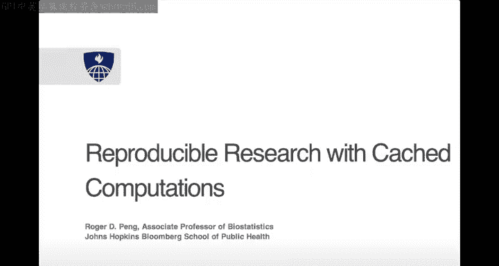
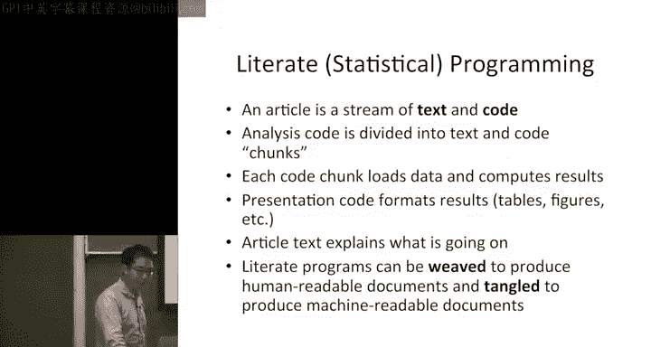
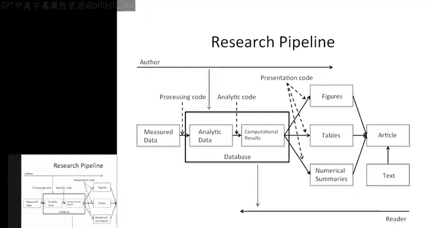
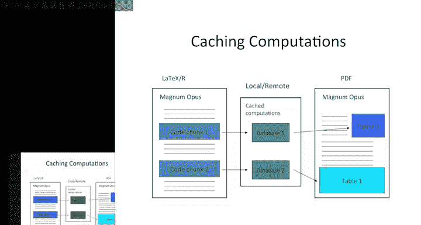
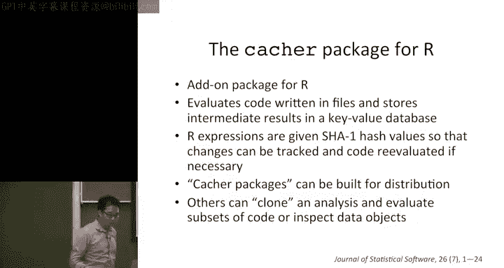
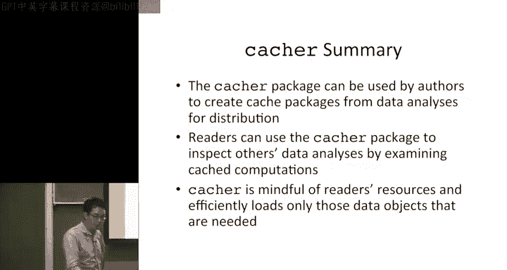

# 164：缓存计算 📚

在本节课中，我们将学习“文学化统计编程”的概念，并重点介绍一个名为 `cache` 的R语言包。这个包的核心思想是帮助作者将数据分析的代码、中间结果和最终成果打包，以便读者能够轻松地复现、审查或仅查看分析中的特定部分，而无需运行所有耗时的计算。

---

## 文学化统计编程 📝

上一节我们介绍了数据分析的基本流程，本节中我们来看看“文学化统计编程”这一理念。它源自“文学化编程”思想。

你可以将一篇分析文章视为文本流和代码流的结合。其中包含分析数据的代码块，以及用于格式化结果和解释过程的文本。这些文学化统计程序可以被“编织”成人类可读的文档，或“纠缠”成机器可读的文档。

这个概念由Donald Knuth提出。

---

## 实现工具：Sweave与缓存包 🔧

文学化编程概念需要两样东西：一种是文档语言，另一种是编程语言。

在R统计分析环境中，有一个特定的包叫 **Sweave**。它使用LaTeX作为文档语言，R作为编程语言，由Friedrich Leisch开发。当然，也存在其他组合方式。

我们感兴趣的是，如何将分析数据和计算代码也像文章一样变得可用。思路是将这些工作成果存储在某种数据库中，并向读者开放。在文学化统计编程框架下，你的论文包含文本和代码。你可以提取代码块，并将它们运行的结果存储起来。

以下是实现这一目标的两个关键部分：
*   作者将代码块的结果存储在中央数据库中。
*   论文本身（包含图表和表格）是从数据库中存储的材料生成的。

为此，我们有两个相关的R包。一个是 `CacheSweave`（本次不深入讨论），它与Sweave交互。另一个是独立的包，名为 **`cache`**。

---

## `cache` 包的核心思想 💡

`cache` 包的基本假设是，你有一个包含分析代码的R文件。

它的工作原理是读取你的代码，执行它，并将结果存储在一个键值数据库中。每个R表达式都会被赋予一个SHA1哈希值，以便跟踪更改并在必要时重新计算。目标是将所有代码和数据打包成一个可以分发给他人的“缓存包”。

我们称之为“缓存包”，其他人可以克隆整个分析，查看代码子集或检查特定的数据对象。这里的一个重要假设是，其他读者可能没有与你相同的计算资源。他们可能不想运行你用来获取后验分布的整个马尔可夫链蒙特卡洛模拟，而只想查看特定的最终结果。这个想法是让读者可以像剥洋葱一样层层深入，而不是直接触及核心。

---

## 作者的工作流程：创建缓存包 🛠️

基本模型是：你有源代码文件，代码和数据作为输入，产生结果。

作为作者，`cache` 包会解析源文件，创建用于存储的目录和子目录，然后评估每个表达式。如果你多次运行，若表达式未更改，则不会再次运行，而是直接从数据库加载之前缓存的结果。它会为每个表达式写出一堆元数据。

一旦你评估完整个分析（这可能耗时很长），所有中间结果都存储在数据库中。你可以将其打包成一个可分发的压缩包（即缓存包）。

以下是一个非常简单的分析示例：
1.  加载一些包。
2.  加载数据。
3.  拟合一个简单的线性模型。
4.  查看回归系数等汇总信息。
5.  绘制诊断图。

任何创建了变量的表达式，其结果都会被存储在数据库中。但仅打印内容到控制台的表达式则不会存储。图形本身也不直接存储。

生成的包会有一个标识符（如SHA1哈希值）。在文章中，你可以注明：“本文的所有分析结果可在此包中找到，标识符为…”。虽然标识符较长，但通常使用前四个字符就足以唯一标识。

---

## 读者的体验：探索与分析 🔍

在读者这一侧，如果你在期刊上看到这样的文章，你可以获取这个标识符字符串（例如前四个字符）来克隆整个分析包。

克隆后，本地会创建目录，源代码文件和元数据会被下载。但数据本身默认不会立即下载，因为它们可能很大。对已创建的各种数据对象的引用会被加载，这些引用是“惰性加载”到环境中的。只有当你想要查看某个具体对象时，它才会被下载到你的电脑上。

你可以查看代码，甚至可以生成分析过程的依赖关系图。这张图展示了所有数据对象是如何组合在一起的。例如，变量A、B和C共同创建了数据集D，然后数据集D与某个函数结合生成了估计值，等等。

如果你对某个特定数据对象感兴趣，可以使用 `object_code` 函数。它会显示生成该对象所涉及的具体代码行（可能只是整个文件中的一部分）。

你还可以使用 `run_code` 函数执行代码。默认情况下，它会从数据库加载对象，而不是重新执行所有计算，这使得首次运行更快。当然，像绘图这样的操作仍然需要生成。你也可以强制它从头开始运行所有计算。

`check_code` 函数会从头开始评估所有表达式，不加载任何缓存，然后将新结果与存储的结果签名进行比对，以验证一致性（这需要设置随机数种子等以确保可重复性）。还有一个辅助函数可以检查单个数据对象的签名，以防数据损坏。

使用 `load_cache` 函数可以加载指向特定数据对象的指针（这些对象可能存储在服务器上）。每当你访问该对象（如打印或绘图）时，它才会从源位置传输过来。每个对象都有其签名，一旦加载到你的系统中，后续访问就无需再次传输。

---

## 总结 📋

本节课中我们一起学习了 `cache` 包的基本理念。

它的核心思想是：作者可以将他们的分析过程“打包”，读者则可以下载这个分析包，灵活地查看特定对象或重新运行整个分析，而无需在资源有限的情况下重建整个复杂环境。其主要目标之一是体谅读者的计算资源，并高效地加载所需内容。

通过这种方式，数据分析的透明度和可重复性得到了极大的提升。