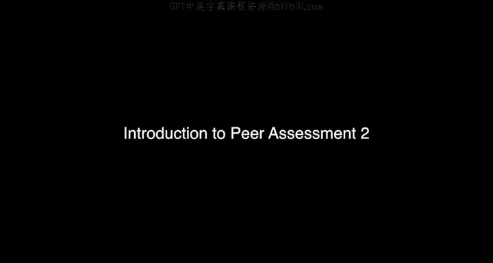

# 168： Foundations using R  
课程编号：P168 - 32_同行评估2介绍 🧑‍💻📊

## 概述

在本节课中，我们将学习本周同行评估任务的具体内容。本次评估要求你基于美国国家海洋和大气管理局（NOAA）的风暴事件数据库进行一次数据分析。

## 评估任务说明

上一节我们介绍了课程的整体安排，本节中我们来看看本周同行评估的具体要求。

本次同行评估的核心任务是利用NOAA风暴事件数据库完成一项数据分析。为了帮助你更好地理解任务要求和预期成果，我已经撰写了一份示例数据分析报告。

以下是获取该示例报告的途径：

*   你可以通过本讲座旁边提供的链接访问示例报告。
*   你也可以查看与本讲座相关的课程网站上的链接。

## 总结

本节课中我们一起学习了本周同行评估的任务目标，即基于NOAA风暴事件数据库进行数据分析。同时，我们明确了可以参考一份已提供的示例分析报告来辅助理解任务。祝你在本周的评估中顺利，我期待看到大家的成果。