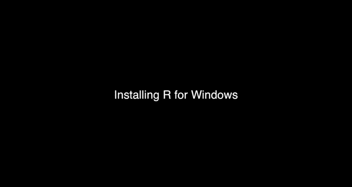
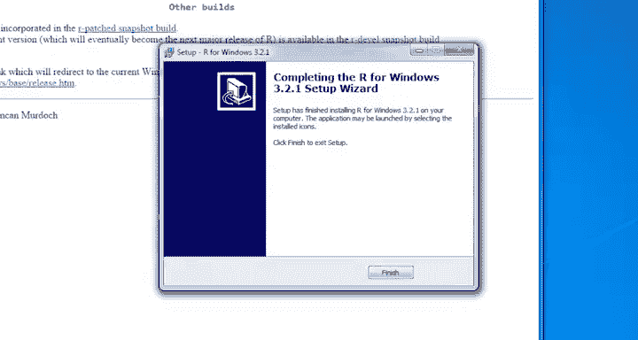
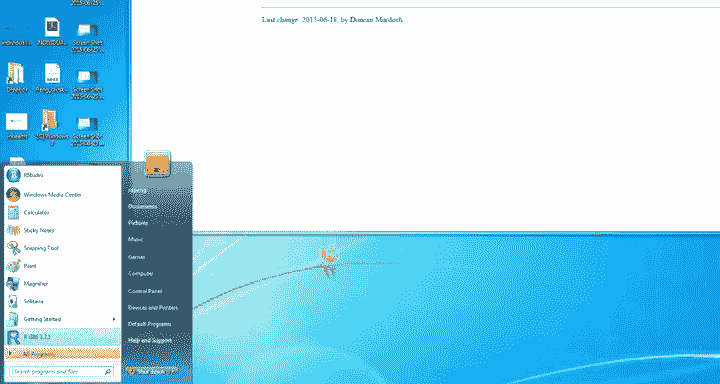
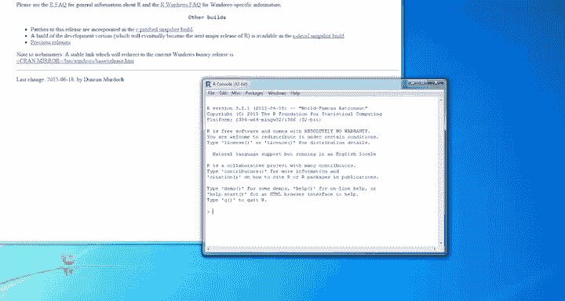

# 课程 101：在 Windows 系统上安装 R 🖥️

在本节课中，我们将学习如何在 Windows 操作系统的电脑上安装 R 语言环境。R 是进行数据科学分析的重要工具，安装它是我们学习的第一步。

---

## 概述

我们将通过访问 R 的官方镜像网络（CRAN）来下载安装程序，并逐步完成安装过程。整个过程包括启动浏览器、访问网站、下载文件、运行安装向导以及进行一些简单的初始设置。

---

## 启动浏览器并访问 CRAN

首先，你需要启动你的网页浏览器。你可以使用 Chrome、Firefox 或 Edge 等任何你习惯的浏览器。

启动浏览器后，你需要访问 **综合 R 档案网络**，即 CRAN。在浏览器的地址栏中输入网址：`https://cran.r-project.org/`。

## 选择 Windows 版本并下载

进入 CRAN 网站后，你会看到页面顶部有三个主要操作系统的选项：Linux、Mac 和 Windows。

你需要点击 **“Download R for Windows”** 这个链接。

进入 Windows 下载页面后，点击 **“base”** 子标题下的链接，这通常是推荐给大多数用户的版本。点击后，安装程序的下载将自动开始。下载速度取决于你的网络连接。

## 运行安装程序

下载完成后，找到并双击下载好的 `.exe` 文件以启动安装向导。

安装向导启动后，首先会提示你选择安装语言。你可以从列表中选择你熟悉的语言，例如选择“English”。选择后点击“OK”。

接下来，你将看到欢迎界面。点击“Next”继续。

## 同意许可协议

随后，安装程序会显示 R 的许可协议，即 **GNU 通用公共许可证**。你可以阅读该协议，了解相关条款。

阅读完毕后，勾选“我同意”选项，然后点击“Next”。

## 选择安装位置

安装程序会建议一个默认的安装目录，通常是 `C:\Program Files\R\`。对于大多数用户来说，使用这个默认路径即可，无需更改。

直接点击“Next”继续。

## 选择安装组件

在这一步，你可以选择要安装的组件。默认选项是安装 **32 位和 64 位** 两个版本，这能确保兼容性，是推荐的选择。

除非你明确知道你的电脑是较旧的纯 32 位系统，否则请保持默认设置，然后点击“Next”。

## 自定义启动选项

现在，你可以选择是接受所有默认设置，还是自定义启动选项。为了让你了解有哪些选择，我们点击“Customize startup”来自定义。

1.  **选择界面风格**：这里询问你偏好 **MDI** 还是 **SDI** 界面。
    *   **MDI**：R 运行在一个主窗口内，所有子窗口（如控制台、图形）都包含在这个主窗口里。
    *   **SDI**：控制台、图形窗口等会以独立的窗口形式出现。许多人觉得这样操作更方便。在本教程中，我们选择 **SDI** 选项。

2.  **选择帮助文件格式**：你可以选择以 **HTML** 格式还是 **纯文本** 格式查看帮助文档。HTML 格式更美观易读，而纯文本格式更简洁。你可以根据喜好选择，这里我们选择“Plain text”。

3.  **网络访问设置**：通常保持默认的“Standard”选项即可，无需修改。

完成这些选择后，点击“Next”。

## 创建快捷方式

安装程序会询问你是否在 **开始菜单** 中创建程序文件夹，这通常是个好主意，方便你快速找到 R。

它还会询问是否在 **桌面** 创建快捷方式图标。除非你的桌面非常杂乱，否则建议创建，以便快速启动。

接受这些默认设置，点击“Next”。

## 开始安装并完成

现在，安装程序将开始将必要的文件复制到你的电脑上。这个过程可能需要几分钟。

安装完成后，你会看到“安装完成”的提示。点击“Finish”退出安装向导。

## 启动 R

安装完成后，你可以在桌面上找到 R 的快捷方式图标。双击这个图标，R 的控制台窗口就会启动。

恭喜你，现在 R 已经成功安装并运行在你的 Windows 电脑上了！

---

## 总结

本节课中，我们一起学习了在 Windows 系统上安装 R 的完整流程。我们首先通过浏览器访问 CRAN 官网，下载了 Windows 版本的安装程序。接着，我们一步步运行安装向导，同意了许可协议，选择了安装路径和组件，并自定义了启动界面风格和帮助文档格式。最后，我们创建了快捷方式并成功启动了 R。现在，你的电脑已经准备好了运行 R 代码，为后续的数据科学学习打下了基础。