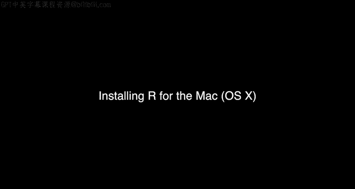
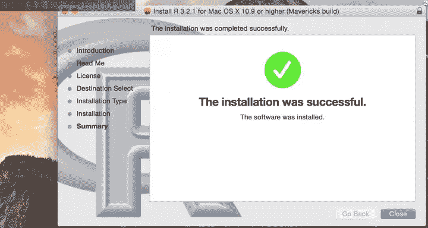

# 课程 102：在 Mac 上安装 R 🍎

在本节课中，我们将学习如何在 Mac 操作系统上安装 R 语言环境。整个过程非常简单，只需几个步骤即可完成。

## 概述

我们将通过访问 R 的官方下载网站，下载适用于 Mac 的安装包，并跟随安装向导完成整个安装过程。安装完成后，你可以在“应用程序”文件夹中找到并使用 R。

## 安装步骤

以下是安装 R 的具体步骤。

### 1. 访问下载网站

首先，你需要打开你的网页浏览器，并访问 CRAN（The Comprehensive R Archive Network）的官方网站。这是 R 语言的综合归档网络，提供了针对不同操作系统的下载选项。

### 2. 选择 Mac 版本

在 CRAN 网站上，找到并选择为 Mac 平台提供的下载链接。点击该链接，开始下载 R 的安装包文件（通常是一个 `.pkg` 文件）。

### 3. 下载安装包

点击下载链接后，下载进度条会开始运行。下载时间取决于你的网络连接速度，请耐心等待。

### 4. 运行安装程序

下载完成后，找到并打开下载的 `.pkg` 安装包文件。这将启动 R 的安装向导。

### 5. 跟随安装向导

安装向导会引导你完成所有必要的步骤：
*   **点击继续**，查看将要安装的内容描述。
*   **阅读并同意**软件许可协议（GNU 通用公共许可证第 2 版）。
*   **点击安装**，系统可能会要求你输入管理员密码以授权安装。

### 6. 完成安装

安装过程结束后，点击“关闭”。此时，R 就已经成功安装到你的电脑上了。

## 启动 R

现在，你可以前往 Mac 的“应用程序”文件夹。按字母顺序找到 “R” 应用图标，双击即可启动 R。

## 后续步骤（可选）

你可以直接使用这个基础的 R 应用。如果你希望获得更强大的集成开发环境，可以考虑后续安装 RStudio 等图形界面工具，它们能提供更好的代码编辑、管理和可视化体验。

## 总结

本节课中，我们一起学习了在 Mac 电脑上安装 R 语言环境的完整流程。我们经历了从访问官网下载安装包，到运行安装程序并完成设置的每一步。现在，你的 Mac 已经准备好了运行 R 代码，可以开始后续的数据科学学习之旅了。