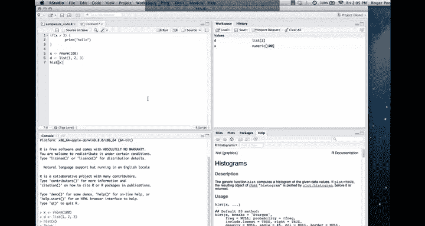

# 课程 103：在 Mac 上安装 RStudio 🍎

在本节课中，我们将学习如何为 R 语言安装一个名为 RStudio 的集成开发环境。RStudio 能显著提升使用 R 的体验，提供许多基础 R 系统不具备的便利功能。

## 概述

我们将首先介绍 RStudio 是什么，然后逐步演示如何在 Mac 操作系统上下载和安装它。最后，我们会快速浏览 RStudio 的主要界面和基本功能，帮助你快速上手。

## 什么是 RStudio？

RStudio 是一个交互式开发环境，通常简称为 IDE。它能够与 R 语言连接，并提供一系列基础 R 系统本身不具备的实用功能，让 R 的使用体验更加友好。

## 安装 RStudio 的步骤

在安装 RStudio 之前，你需要确保已经成功安装了 R 语言。完成 R 的安装后，即可按照以下步骤安装 RStudio。

以下是详细的安装流程：

1.  打开浏览器，访问 RStudio 的官方网站：`rstudio.org`。
2.  在网站上找到并点击“Download RStudio”按钮。
3.  选择下载“RStudio Desktop”版本。网站通常会自动识别你的操作系统类型。
4.  根据你的系统选择对应的安装包。RStudio 支持 Windows XP、Vista、7 以及多种 Linux 发行版。对于 Mac 用户，请下载推荐的 Mac 版本。
5.  下载完成后，打开下载的安装文件。
6.  将 RStudio 的图标拖拽到“应用程序”文件夹中。如果系统提示替换旧版本，选择确认替换即可。

## 启动与界面介绍

安装完成后，你可以在“应用程序”文件夹中找到并启动 RStudio。

RStudio 的界面主要分为四个窗口，每个窗口都有其特定功能。

以下是四个主要窗口的说明：

*   **左下角窗口**：这是 R 控制台。你可以在这里直接输入并执行 R 命令。例如，输入 `x <- rnorm(100)` 并按 `Cmd + Enter` 执行，可以创建一个名为 `x` 的数值向量。
*   **左上角窗口**：这是脚本编辑器。你可以在这里编写和编辑 R 代码文件，然后有选择地运行部分或全部代码。
*   **右上角窗口**：这是工作空间浏览器。它会显示当前 R 会话中创建的所有对象。例如，执行 `x <- rnorm(100)` 后，你会在这里看到一个名为 `x` 的向量及其简要信息。
*   **右下角窗口**：这是一个多功能面板。它包含文件浏览器、图形显示、已安装包列表和帮助文档查看器。
    *   执行绘图命令（如 `hist(x)`）后，生成的图表会显示在这里。
    *   点击“Packages”标签页，可以查看已安装和已加载的包。
    *   输入 `help(hist)` 等帮助命令后，相应的帮助文档会在此处显示。

## 总结

本节课我们一起学习了如何在 Mac 上安装和初步使用 RStudio。我们了解到 RStudio 是一个强大的 R 语言集成开发环境，它通过四个功能分明的窗口——控制台、脚本编辑器、工作空间和多功能面板——极大地便利了代码编写、数据管理和结果查看的过程。对于本课程的学习，使用 RStudio 将会是一个非常有用的工具。