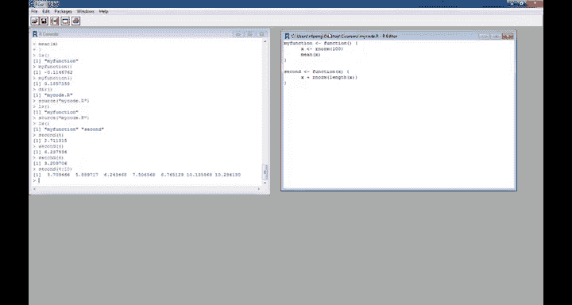

# 课程 4：设置工作目录与编辑代码文件 🖥️


在本节课中，我们将学习如何在 Windows 系统中设置 R 的工作目录，以及如何使用 R 内置的文本编辑器来编写和运行代码。掌握这些基础操作是高效使用 R 进行数据分析的前提。

## 理解工作目录 📂

上一节我们介绍了 R 的基本界面，本节中我们来看看如何管理你的工作环境。首先，你需要理解什么是工作目录。工作目录是 R 在你的计算机上查找和保存文件的默认位置。当你使用如 `read.csv` 或 `write.csv` 这类函数时，R 会默认在工作目录中读取或写入文件。

你可以使用 `getwd()` 函数来查看当前的工作目录设置。

```r
getwd()
```

执行后，你可能会看到类似 `C:/Users/YourName/Documents` 的路径。这个路径因你的 Windows 版本和硬件配置而异，但通常位于 C 盘。

## 设置工作目录 🔧

了解并正确设置工作目录至关重要。如果文件不在工作目录中，R 将无法找到它并报错。例如，尝试读取一个不存在的文件：

```r
read.csv("my_data.csv")
```

你会收到一个错误，因为 `my_data.csv` 不在当前工作目录中。解决这个问题有两种方法：将文件移动到工作目录，或者将工作目录更改为文件所在的路径。

以下是更改工作目录的步骤：
1.  在 R 的菜单栏中，点击 **File**。
2.  选择 **Change dir...**。
3.  在弹出的窗口中，导航到你希望设置为工作目录的文件夹（例如桌面上的一个文件夹）。
4.  点击 **确定**。

之后，再次使用 `getwd()` 确认路径已更改。

为了方便本课程的学习，建议你创建一个专用文件夹（例如命名为 `Coursera`）来存放所有课程资料。这样，你可以将工作目录永久设置为此文件夹，避免文件散落各处。

## 使用 R 编辑器编写代码 ✍️

在本课程中，你需要大量编写 R 代码。R 自带一个基础的文本编辑器，完全满足本课程的需求。

你可以通过以下步骤打开编辑器：
1.  点击菜单栏的 **File**。
2.  选择 **New script**。

这将打开一个空白的编辑窗口，你可以在其中编写代码。例如，我们编写一个简单的函数：

```r
my_function <- function() {
  x <- rnorm(100)
  mean(x)
}
```

## 将代码加载到 R 控制台 ⬇️

编写完代码后，需要将其加载到 R 控制台中才能使用。主要有两种方法：

**方法一：复制粘贴**
对于少量代码，你可以：
1.  在编辑器中使用 `Ctrl + A` 全选代码。
2.  使用 `Ctrl + C` 复制。
3.  切换到控制台，使用 `Ctrl + V` 粘贴并执行。

执行后，使用 `ls()` 查看工作空间，你会发现 `my_function` 已存在，并可以直接调用。

**方法二：保存并加载文件**
对于更复杂的项目，建议将代码保存为文件：
1.  在编辑器中，点击 **File** -> **Save As...**。
2.  将文件保存到你的工作目录（例如 `Coursera` 文件夹），命名为 `mycode.R`（`.R` 是标准扩展名）。
3.  在控制台中，使用 `source()` 函数加载该文件：

```r
source("mycode.R")
```

这将执行文件中的所有代码。之后，你可以随时修改编辑器中的代码，保存后，再次使用 `source("mycode.R")` 即可将更新后的代码加载到 R 中。

你可以创建多个 `.R` 文件来管理不同项目或作业的代码。通过 **File** -> **Open script...** 可以重新打开已保存的文件。

网络上可能有其他更高级的文本编辑器，但对于本课程，R 自带的编辑器已经足够。

## 总结 📝



本节课中我们一起学习了 R 环境设置的两个核心技能：设置工作目录和使用文本编辑器。我们了解了工作目录的概念及其重要性，学会了使用 `getwd()` 查看和通过菜单更改工作目录。同时，我们掌握了使用 R 内置编辑器编写代码，并通过复制粘贴或 `source()` 函数将代码加载到控制台运行的方法。建立这些工作习惯，将为后续的数据分析任务打下坚实基础。