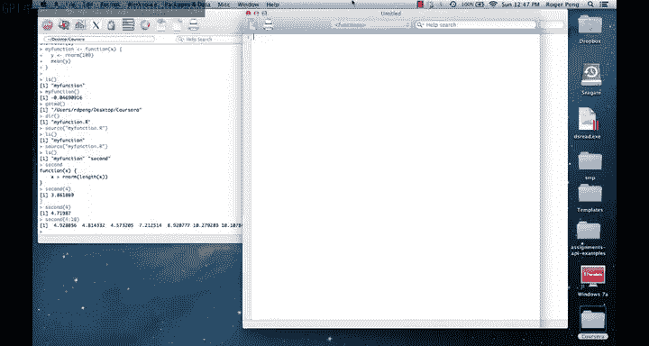

# 课程 5：设置工作目录与使用文本编辑器 (Mac) 🖥️


在本节课中，我们将要学习两个核心操作：如何设置R的工作目录，以及如何使用R自带的文本编辑器来编写和编辑代码文件。掌握这两项技能对于高效地使用R进行数据科学工作至关重要。

## 设置工作目录 📂

上一节我们介绍了R的基本界面，本节中我们来看看如何管理你的工作环境。工作目录是R读取和写入文件的默认位置。如果你不知道当前的工作目录在哪里，你将很难找到保存的文件或加载外部数据。

启动R后，你可以通过输入 `getwd()` 函数来查看当前的工作目录。

```r
getwd()
```

例如，在我的Mac上，R启动后的默认工作目录可能是 `/users/srpay`，也就是我的用户主目录。这个默认设置可能适用，但通常我们会将项目相关的数据和代码文件存放在特定的文件夹中。

### 如何更改工作目录

如果你需要读取或保存文件到其他文件夹，就需要更改工作目录。以下是更改工作目录的步骤：

1.  在R的菜单栏中，点击 **“Misc”** 菜单。
2.  选择 **“Change Working Directory...”**。
3.  在弹出的窗口中，导航到你希望设置为工作目录的文件夹并选择它。

更改后，再次使用 `getwd()` 命令，就能看到新的工作目录路径。

### 为什么工作目录很重要

工作目录的核心作用在于文件访问。当你尝试使用 `read.csv()` 等函数读取一个数据文件时，R默认会在当前工作目录中寻找该文件。

```r
# 尝试读取一个名为 “mydata.csv” 的文件
my_data <- read.csv("mydata.csv")
```

如果 `mydata.csv` 文件不在当前工作目录中，R会返回一个“文件未找到”的错误。因此，你有两个选择：一是将工作目录更改到文件所在的文件夹；二是将文件移动到当前的工作目录中。

为了本课程学习方便，我建议你创建一个专属的文件夹（例如在桌面上创建一个名为“Coursera”的文件夹），并将所有课程相关的文件都存放在那里。然后，将R的工作目录设置到这个文件夹。这样，你就不需要频繁地更改工作目录了。

## 使用R的文本编辑器 ✍️

上一节我们学习了如何管理文件路径，本节中我们来看看如何编写R代码。在本课程中，你需要大量编写R代码，因此一个趁手的编辑器是必不可少的。

对于Mac用户来说，R自带了一个简单但功能足够的文本编辑器，非常适合初学者使用。

你可以通过点击R窗口工具栏上的这个按钮来打开文本编辑器。

打开后，你会看到一个空白的编辑窗口。现在，你就可以开始编写R代码了。

### 编写并运行你的第一个函数

例如，让我们编写一个简单的函数。在编辑器中输入以下代码：

```r
myfunction <- function() {
  x <- rnorm(100)
  return(mean(x))
}
```

这个函数名为 `myfunction`，它的作用是生成100个随机正态分布数字并计算其平均值。

### 将代码加载到R中

编写完代码后，你需要将其加载到R的工作环境中才能使用。有以下两种常用方法：

**方法一：复制粘贴**
对于少量代码，最简单的方法是：
1.  在编辑器中使用 `Command + A` 全选代码。
2.  使用 `Command + C` 复制。
3.  切换到R的控制台窗口，使用 `Command + V` 粘贴，然后按回车执行。

执行后，输入 `ls()` 命令，你就能看到 `myfunction` 已经出现在工作空间的对象列表中了。现在你可以调用它：`myfunction()`。

**方法二：保存并加载文件**
对于更复杂的代码，更好的做法是将其保存为文件。
1.  在编辑器菜单中，点击 **“File” -> “Save As...”**。
2.  导航到你的工作目录（例如之前创建的“Coursera”文件夹）。
3.  将文件命名为 `myfunction.R`（R代码文件通常以 `.R` 为扩展名）并保存。
4.  在R控制台中，使用 `source()` 函数加载这个文件。

```r
source("myfunction.R")
```

执行 `source(“myfunction.R”)` 的效果与复制粘贴代码完全相同，但它让你可以重复利用和修改已保存的代码文件。

### 编辑和更新代码

如果你修改了编辑器中的代码（例如，又写了一个新函数），记得先保存文件（`Command + S`），然后再次使用 `source()` 函数将其加载到R中，这样修改才会生效。



## 总结 📝

本节课中我们一起学习了在Mac上使用R的两个基础技能：
1.  **设置工作目录**：使用 `getwd()` 查看目录，通过菜单更改目录。正确设置工作目录是顺利读写文件的关键。
2.  **使用文本编辑器**：利用R自带的编辑器编写代码，并通过**复制粘贴**或**保存后使用 `source()` 函数加载**的方式将代码送入R环境执行。

虽然网络上存在更多功能强大的代码编辑器，但对于本课程的学习而言，R自带的编辑器已经完全足够。请务必动手练习这些操作，它们是后续所有数据分析工作的基石。