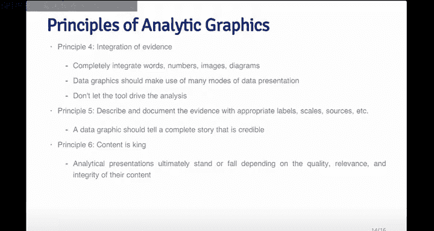
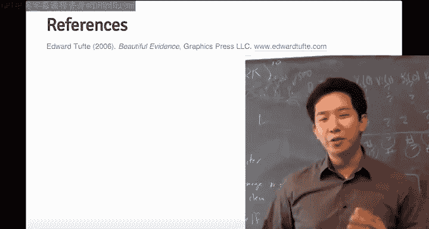

# 📊 课程 6：分析图形的构建原则

在本节课中，我们将学习构建分析图形的一些基本原则。这些原则由爱德华·塔夫特提出，旨在帮助我们通过数据图形有效地讲述数据背后的故事，并适用于多种情境。

---

## 🆚 原则一：展示比较

上一节我们介绍了分析图形的基本原则概述，本节中我们来看看第一个核心原则：展示比较。在科学研究中，支持某个假设的证据总是相对于另一个假设而言的。因此，证据始终是相对的。当你基于数据总结证据时，应该始终思考“与什么相比”这个问题。

以下是展示比较原则的一个具体应用示例：

*   **研究背景**：一个箱线图展示了空气净化器对一组家庭中儿童哮喘症状的影响。
*   **干预组**：为儿童家庭安装空气净化器，旨在降低室内空气污染水平。
*   **观察结果**：干预组儿童的“无症状天数”中位数增加了约1天/两周（数值越高越好）。
*   **关键对比**：仅凭此结果可能认为空气净化器有效，但必须与对照组比较。
*   **对照组**：另一组家庭未安装任何空气净化器，保持日常生活。
*   **对比结论**：对照组儿童的无症状天数平均变化约为零。相对于不做任何干预，空气净化器确实显示出改善儿童症状的效果。

在图形中展示对比至关重要，这为比较不同假设下的证据提供了基础。

---

## 🔍 原则二：展示因果关系或机制

上一节我们强调了比较的重要性，本节中我们来看看如何通过图形展示因果关系或解释机制。这里的“因果关系”并非严格意义上的形式定义，而是指展示你对世界运行方式的理解。你需要阐明你所关注的系统是如何运作的。

我们可以扩展上一节的空气净化器示例：

*   **核心问题**：为什么在儿童家中安装空气净化器能改善其症状？
*   **假设机制**：空气净化器清洁空气，去除了空气中的颗粒物。这些未被去除的颗粒物不再进入儿童肺部，从而不再引发哮喘症状。
*   **数据验证**：我们可以绘制另一张图来佐证这一假设。图的左侧显示无症状天数，右侧显示室内颗粒物水平。
*   **数据呈现**：对照组家庭的颗粒物水平基本无变化（甚至略有上升），而安装了空气净化器的家庭，其颗粒物水平显著下降。
*   **解释支持**：数据显示，安装空气净化器不仅增加了儿童的无症状天数，同时也降低了室内的颗粒物水平。这为“空气净化器通过降低颗粒物水平来改善症状”的假设提供了可能的解释。

当然，要完全证实这一假设需要更深入的调查和实验，但此图形暗示了一种可能的解释机制。

---

## 🧩 原则三：展示多变量数据

上一节我们探讨了如何展示机制，本节中我们来看看处理复杂数据的关键：展示多变量数据。这条原则可以归结为：尽可能在一张图上展示更多的数据。因为世界本质上是多变量的，时刻发生着许多事情。如果只绘制两个或三个变量，将无法展示世界的真实图景。如果能在一张图上整合大量数据，你就能讲述更丰富的故事。

以下是一个多变量数据展示的例子：

*   **基础关系**：一张图展示了户外空气污染（X轴为日均PM10浓度）与纽约市日均死亡率（Y轴）在1987-2000年间的关系。每个点代表一天的数据。
*   **初步观察**：整体回归线略微向下倾斜，表明PM10水平与死亡率呈微弱的负相关。这与“更高空气污染可能导致更高死亡率”的假设相悖。
*   **引入第三变量**：除了空气污染和死亡率，还有其他变量可能影响这个关系，例如季节。
*   **分季节展示**：我们可以制作另一张图，将数据按冬、春、夏、秋四个季节分开，分别展示每个季节内PM10与死亡率的关系。
*   **深入发现**：在每个季节的子图中，PM10与死亡率的关系实际上都呈正相关。
*   **揭示悖论**：这就是“辛普森悖论”的一个例子。季节因素混淆了PM10与死亡率之间的整体关系。当按季节分别观察时，关系发生了改变。

因此，在合理范围内尽可能多地展示变量，对于理清数据中的真实关系至关重要。

---

## 🧠 原则四：整合多种证据形式

上一节我们看到了展示多变量的价值，本节中我们来看看如何整合证据。其基本思想是，你应该使用尽可能多的不同证据呈现模式。没有理由说如果你有绘图工具就只展示图，或者如果你只能做表格就只展示表格。你应该能够将不同的证据模式组合到单一的展示中，以使你的图形或展示信息尽可能丰富。

关键点在于，不要让所使用的工具决定你制作何种图形。你应该制作你想制作的图形，而不是让工具替你思考。这正是像R这样的系统的优势之一，因为R中的工具非常灵活，你可以制作各种定制化的图形来展示数据，并整合不同的证据模式。

以下是一个来自《美国医学会杂志》已发表论文的简单示例：

*   **研究内容**：该图探讨了粗颗粒物与老年人住院率之间的关系。
*   **证据整合**：
    *   **点估计与置信区间**：实心圆点表示点估计值，延伸的线条表示其置信区间。
    *   **文本补充证据**：右侧的“后验概率”标签提供了另一个证据维度，用于衡量“相对风险大于零”的证据强度。
*   **整合优势**：通过这种方式，我们在同一张图上整合了点线估计和文本信息，无需将信息分散在不同位置，便于追踪和理解。

---

## 📝 原则五：描述和记录证据

上一节我们讨论了整合证据，本节中我们来看看确保图形可信度的关键：描述和记录证据。你需要为你呈现的证据提供一些可信度支撑。数据的来源非常重要，你如何制作图形也同样重要。

具体而言，如果你使用像R这样的系统制作图形，保存生成该图形的计算机代码至关重要。这是一个非常基本的原则，对你的可信度至关重要。

---

## 👑 原则六：内容为王

最后，也是最重要的原则是：内容为王。如果你没有有趣的故事要讲，那么再多的呈现技巧也无法让它变得有趣。

因此，在制作图形、图表时，首先要思考你试图呈现的内容是什么，你想讲述什么故事，你拥有什么数据。然后再思考最佳的呈现方式是什么，你将如何呈现，以及它最终会是什么样子。因为如果你没有非常好的内容，那么除此之外你能做的就非常有限了。

---

## 📚 总结

本节课中我们一起学习了构建分析图形的六项基本原则：

1.  **展示比较**：始终展示事物之间的相对关系。
2.  **展示因果关系或机制**：尝试解释系统或世界是如何根据你的想法运作的。
3.  **展示多变量数据**：始终尝试展示两个以上的变量，因为世界是复杂的，涉及许多变量。
4.  **整合多种证据形式**：你可以同时使用表格、图形和文字，不必将它们分开。
5.  **描述和记录证据**：始终提供数据来源和源代码，以增强图形的可信度。
6.  **内容为王**：始终记住，你讲述的故事和你使用的数据是任何图形中最重要的元素。

本演示参考了爱德华·塔夫特的著作《Beautiful Evidence》，这是一本极好的书，我强烈推荐。这些是关于构建分析图形的一些基本原则，在未来的课程中，我们将讨论如何使用R中的各种绘图系统来实现这些原则。