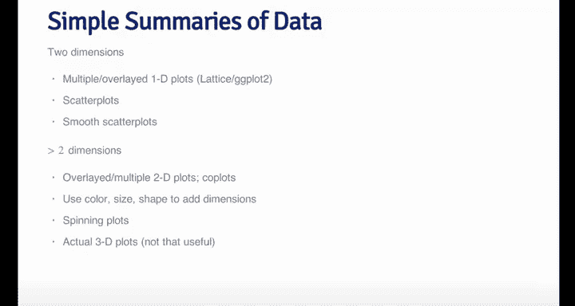
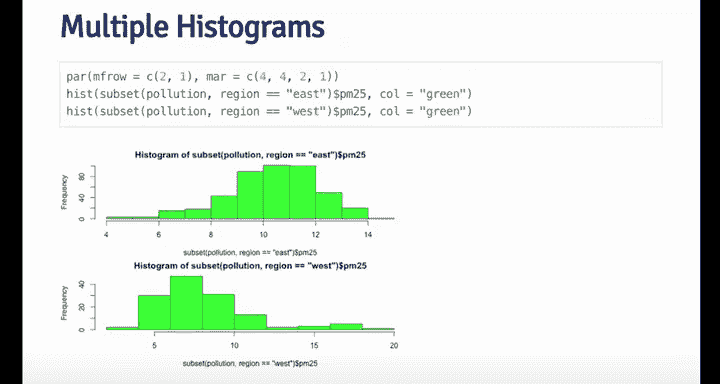
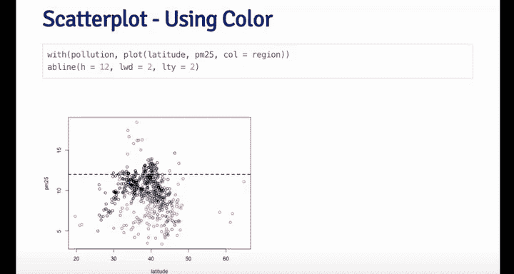
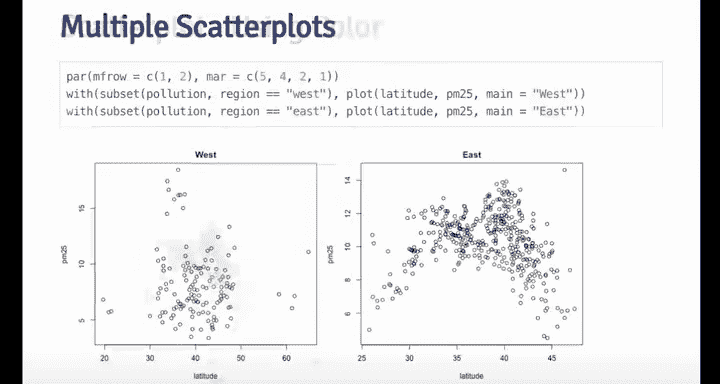
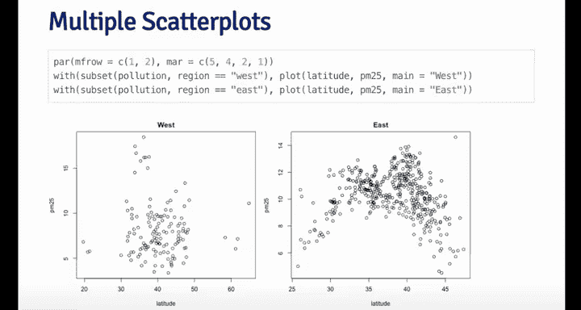
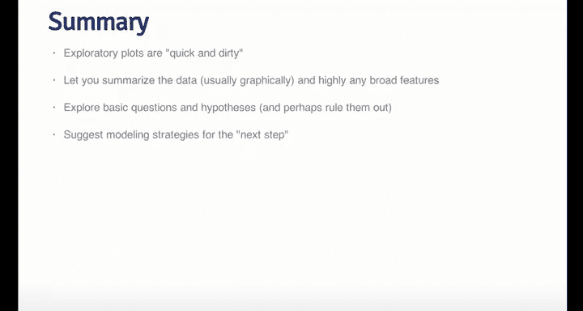

# 📊 课程 8：探索性图形分析（第二部分）

在本节课中，我们将学习如何使用二维及多维图形来探索和总结数据。我们将从基础的散点图开始，逐步介绍如何通过颜色、面板布局等方式，在二维图形中展示超过两个维度的信息。

上一节我们介绍了一维数据的图形总结方法。本节中，我们来看看如何将数据可视化扩展到二维甚至更高维度。

## 二维数据可视化方法

二维数据总结不仅包括散点图，还可以通过组合多个一维图形来实现。`lattice` 和 `ggplot2` 包尤其擅长此类任务。

以下是几种核心的二维可视化方法：
*   **散点图**：展示两个连续变量之间的关系。
*   **平滑散点图**：适用于数据点过于密集的情况。
*   **分组一维图**：例如，通过分组箱线图或直方图来同时观察一个分类变量和一个连续变量。

当需要展示超过两个维度的数据时，需要采用更巧妙的方法。虽然存在三维立体图或旋转图，但它们通常不如将二维图形进行特殊排列或组织来得实用。我们可以通过多面板图形，或者利用颜色、点的大小和形状等视觉元素来增加数据的维度。

## 分组箱线图与直方图

我们可以通过分组图形来同时观察一个分类变量和一个连续变量。

下图展示了美国各县的PM2.5数据，按“东部”和“西部”分类。x轴是分类变量（东/西），y轴是连续变量（PM2.5值）。

从图中可以看出，东部地区的PM2.5平均值明显高于西部地区。但值得注意的是，西部地区的PM2.5分布范围更广，包含了所有的极端高值。这意味着西部地区的平均值虽低，但数据波动性更大。

我们也可以用分组直方图来展示同样的信息。

上方的直方图对应东部各县，下方对应西部各县。该图印证了箱线图的发现：西部各县的平均值较低，但存在更多极高的极端值；东部各县的平均值较高，但极端高值较少。

## 散点图与多维扩展

散点图是最直观的二维数据可视化方法。

下图绘制了监测点纬度与PM2.5值的关系，旨在探索是否存在南北趋势。纬度增加表示向北移动。

图中显示了一个强烈的南北趋势：PM2.5在中纬度地区往往更高，而在高纬度和低纬度地区则相对较低。图中添加了一条12微克/立方米的水平虚线（国家环境空气质量标准），可以看到有许多数据点位于该线上方，这意味着这些地区在技术上可能不符合标准。

我们可以使用颜色在散点图中添加第三个维度。

在此图中，x轴是纬度，y轴是PM2.5，而点的颜色则代表了第三个变量“东/西”。黑色圆点代表东部各县，红色圆点代表西部各县。这样，我们就在一张图中同时观察了三个变量。

另一种观察这三个变量的方法是使用多面板图形。

现在，我们得到了一个由两个散点图组成的面板。左侧是所有西部县的纬度与PM2.5关系图，右侧是所有东部县的图。可以看出，无论是东部还是西部，污染较高的县都倾向于出现在中纬度地区，而北部和南部纬度地区的污染普遍较低。这个发现很有趣。

## 探索性图形的目的与资源

以上是对R中绘制一维和二维数据的快速总结，包括使用颜色和多面板来观察超过两个维度的数据。探索性图形通常追求快速和直接，我们通常使用默认的坐标轴和标签设置。

探索性图形的优点在于，它能让你快速总结数据，并突出显示数据中可能感兴趣的重要特征。你可以用它来探索基本的问题和假设。例如，我们最初的问题是“是否有县可能不符合标准？”，这些图形为此提供了线索，并可能为下一步更详细的分析或模型拟合建议有用的建模策略。

最后，这里有一些有用的资源：
*   **R Graph Gallery**：一个优秀的网站，提供了大量在R中制作的图形和绘图示例。
*   **R-bloggers**：该网站经常展示人们通过博客发布的各种绘图。

浏览这些资源可以让你了解R在数据可视化方面的各种可能性。

---

**本节课总结**：本节课我们一起学习了如何使用二维图形（如散点图、分组箱线图）来探索数据，并掌握了通过颜色、多面板等方式在二维平面上展示多维信息的技巧。探索性图形是数据科学中快速理解数据、形成初步假设的关键工具。