# 课程09：R语言中的绘图系统 📊

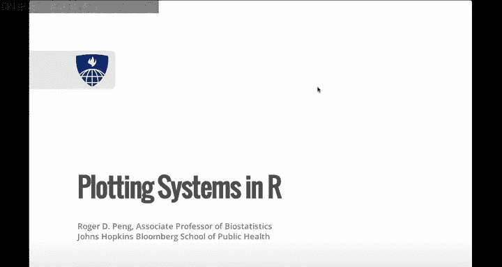

在本节课中，我们将要学习R语言中三种核心的绘图系统。这些系统在概念、构建方式和适用场景上各有不同。我们将逐一介绍它们的特点、优势与不足，帮助你理解如何根据不同的绘图目标选择合适的系统。

## 概述：三种绘图系统

R语言在发展过程中形成了三种核心绘图系统：基础绘图系统、Lattice系统和ggplot2系统。它们各有其设计哲学和适用场景。


---


## 基础绘图系统 🎨

基础绘图系统是R语言中最古老的绘图系统。它的构建理念类似于艺术家的调色板模型。

### 工作原理


该模型将绘图视为一个从空白画布开始，逐步添加元素的过程。首先创建一个包含坐标轴的画布，然后添加数据点、标签、回归线、标题等元素。每一个绘图元素通常对应一行代码。


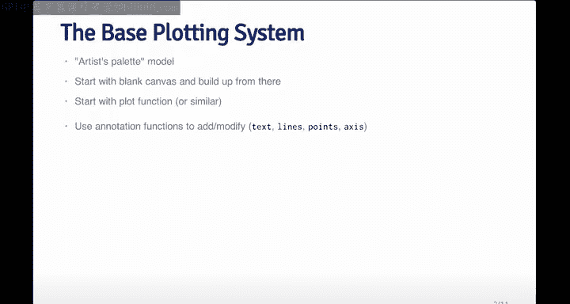

以下是构建基础绘图的基本模式：
1.  使用一个函数（如 `plot()`）生成初始图形。
2.  使用一系列注释函数（如 `points()`, `lines()`, `text()`, `title()`）向图形中添加元素。

### 优势与不足

基础绘图系统非常直观，尤其适合数据探索，因为你可能无法一开始就确定最终的图形样式。你可以逐步添加元素来构建图形。


然而，该系统也存在一些不足：
*   **不可逆性**：一旦添加了图形元素，就无法移除。绘图是一个累积的、单向的过程。
*   **难以复用与分享**：每个图形本质上都是一系列R代码的集合，缺乏一种通用的“语言”来描述图形，因此难以将绘图思路直接传达给他人。
*   **需要精细控制**：系统给予用户极大的控制权，这也意味着用户需要仔细设置所有细节，如果对默认设置不满意，就必须手动调整。


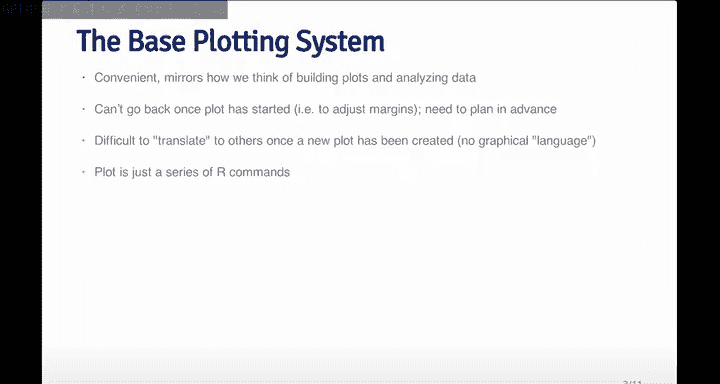

### 示例

以下是一个简单的基础绘图示例，使用了内置的 `cars` 数据集，展示了汽车速度与刹车距离的关系。

```r
plot(cars$speed, cars$dist, xlab = "Speed", ylab = "Stopping Distance")
```
这个散点图将速度放在X轴，刹车距离放在Y轴。你可以在此基础上添加标题、改变点的颜色和形状等。

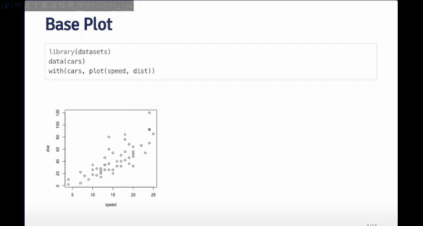

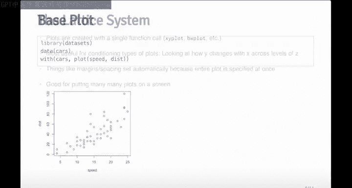

---

## Lattice绘图系统 🧩


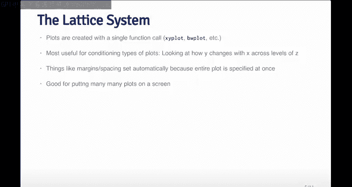

上一节我们介绍了逐步构建的基础绘图系统。本节中我们来看看Lattice系统，它的设计理念截然不同。

Lattice系统由 `lattice` 包实现。其核心思想是**通过单次函数调用构建整个图形**，而非逐步添加。

### 工作原理

最常用的函数是 `xyplot()`，此外还有 `bwplot()`, `histogram()` 等。由于需要一次性构建完整图形，你必须在函数调用中提供足够的信息和参数。


Lattice系统特别适用于创建**条件图**。例如，你想研究X和Y的关系如何随着第三个变量Z的不同水平而变化。你可以将数据按Z的不同水平分组，并在多个子图（面板）中分别展示X-Y关系。

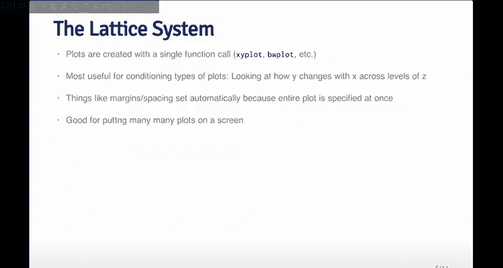


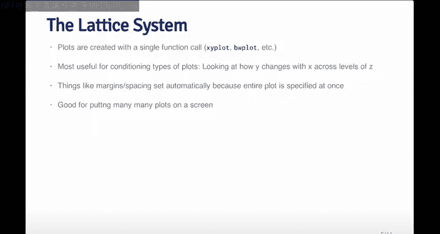

以下是Lattice系统的特点：
*   **自动化布局**：许多在基础系统中需要手动设置的细节（如边距、间距）在Lattice中会自动计算，默认效果通常很好。
*   **高效创建多面板图**：可以非常快速、轻松地在一页上排列多个相关图形。

### 优势与不足

Lattice系统在创建条件图时非常高效，且默认美学设置良好。


其不足之处在于：
*   **指定复杂**：有时用单个函数调用指定一个复杂图形会显得笨拙。
*   **难以注释**：图形一旦生成，就很难再添加新元素。若要添加，通常需要重新构建整个函数调用。虽然可以通过 `panel` 函数等方式注释每个面板，但这并不直观。
*   **缺乏灵活性**：与基础系统一样，无法在图形生成后修改。


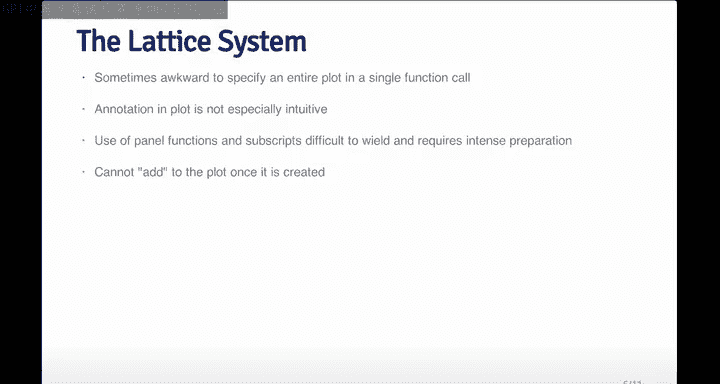

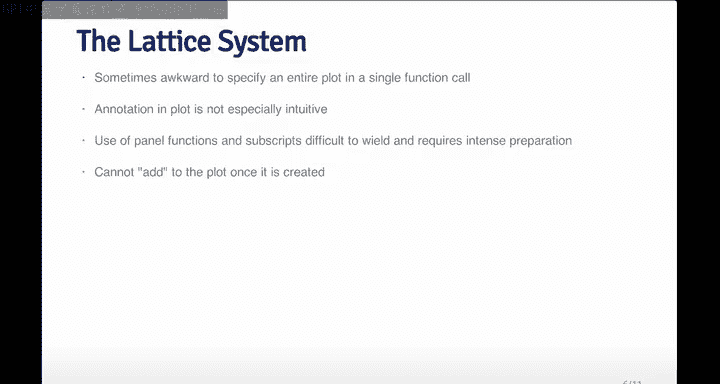

### 示例

以下是一个基本的Lattice图示例，使用了 `lattice` 包中的数据集，展示了美国各州人均收入与预期寿命的关系，并按地区进行条件分割。

```r
library(lattice)
xyplot(life.exp ~ income | region, data = state, layout = c(4, 1))
```
这个面板图通过一次 `xyplot()` 函数调用就完成了。若用基础系统实现，则需要多行代码，过程更为复杂。

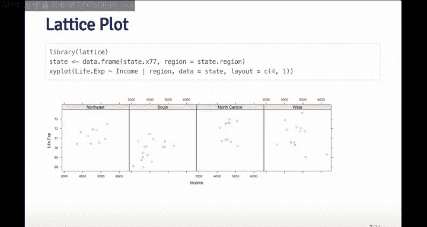

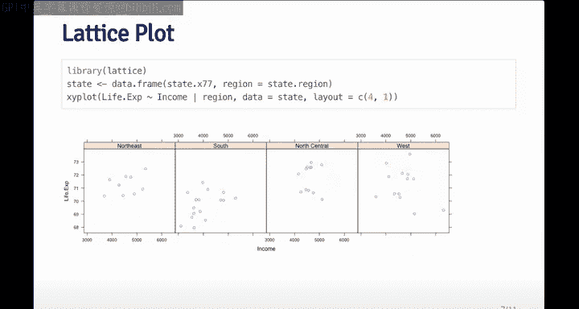


---

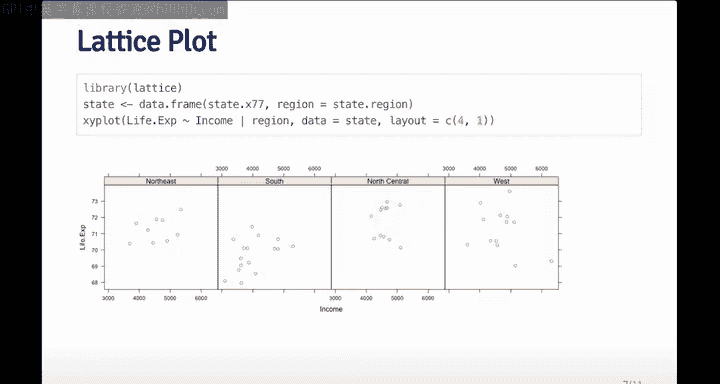


## ggplot2绘图系统 ✨

最后，我们来了解ggplot2系统。它基于“图形语法”理论，为描述图形的各个方面提供了一套严谨的语言。

ggplot2系统（通过 `ggplot2` 包实现）融合了基础系统和Lattice系统的思想。

### 工作原理


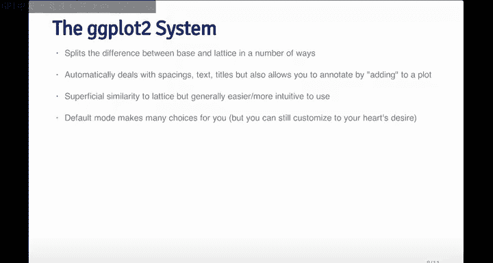


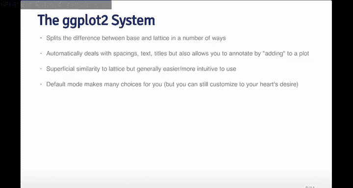

一方面，你可以像基础系统一样，通过**逐步添加图层**的方式来增量式构建图形。另一方面，它又像Lattice系统，能自动处理许多美学细节（如间距、标签位置）。

ggplot2同样非常适合创建条件图（多面板图）。系统提供了大量精心设计的默认设置，使用起来非常方便，同时也允许用户进行深度定制。

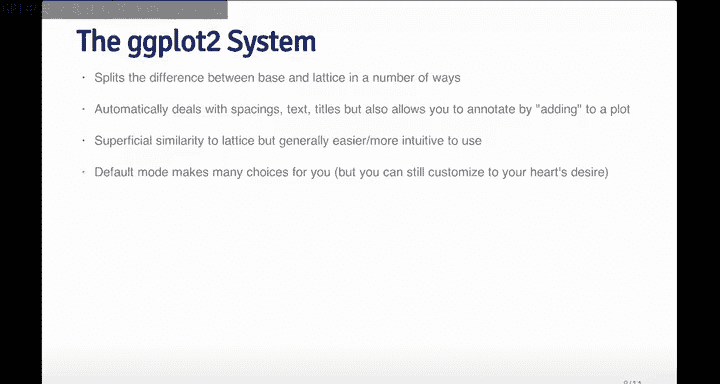


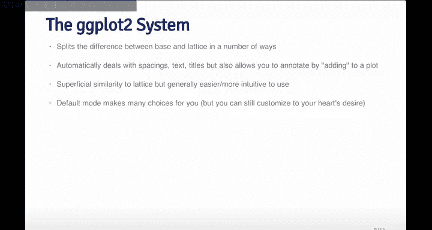

### 示例

以下是一个典型的ggplot2默认图形，使用了 `ggplot2` 包内置的 `mpg` 数据集，展示了汽车发动机排量与高速公路油耗的关系。

```r
library(ggplot2)
ggplot(mpg, aes(x = displ, y = hwy)) + geom_point()
```
可以看到，随着发动机排量增加，油耗大致呈下降趋势。ggplot2的默认美学风格与其他系统不同，例如灰色背景、白色网格线和实心点。所有这些都可以根据需要进行自定义。


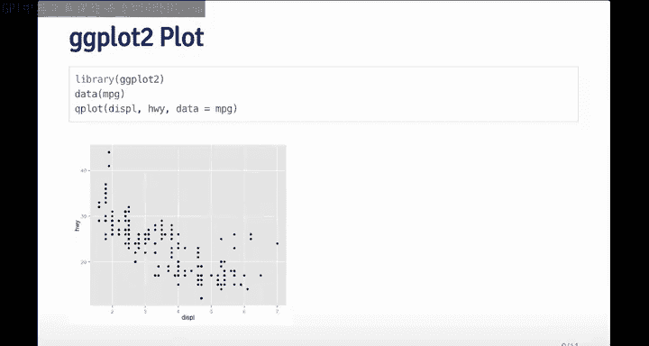

---

## 总结与重要提示 📝

本节课中我们一起学习了R语言的三种主要绘图系统：
1.  **基础绘图系统**：采用艺术家调色板模型，通过一系列函数调用逐步添加元素构建图形。
2.  **Lattice系统**：通过单次函数调用指定整个图形，特别擅长创建条件图（多面板图）。
3.  **ggplot2系统**：基于图形语法，融合了前两者的优点，既能增量构建，又拥有良好的默认设置。

**一个重要提示是：这三个系统的函数不能混用。** 一旦决定使用某个系统（例如ggplot2），就必须使用该生态系统内的函数来构建和修饰图形，混合使用不同系统的函数会导致错误或混乱的绘图结果。因此，在开始绘图前，通常需要根据需求选择一个系统并坚持使用。

在后续的单独课程中，我们将详细讲解如何使用每一种绘图系统。