# 课程10：在R中进行项目 📁

在本节课中，我们将要学习如何在R中组织和管理您的工作，核心工具是RStudio内置的“项目”功能。我们将了解项目的概念、其优势、以及如何创建、打开、关闭和切换项目。

---

## 什么是R项目？

上一节我们介绍了课程目标，本节中我们来看看R项目的核心定义。

R项目是RStudio的一项内置功能，它帮助您将所有相关文件组织在一起。当您创建一个项目时，它会生成一个文件夹，所有文件都将保存在此文件夹中。这有助于您组织工作，并将多个项目彼此分离。

当您重新打开一个项目时，RStudio会记住哪些文件是打开的，并恢复您离开时的工作环境。这在您休息一段时间后重新开始项目时非常有用。

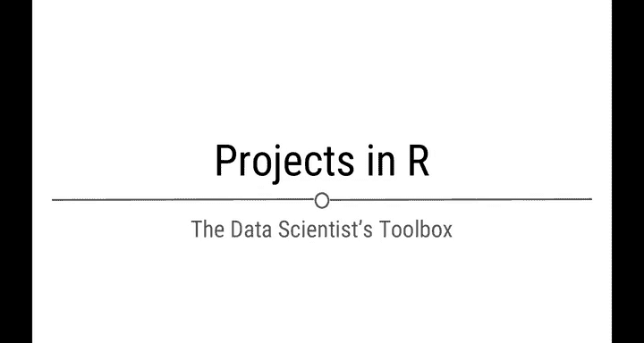

从功能上讲，在R中创建项目会生成一个新文件夹，并将其设置为工作目录，因此生成的所有文件都将被分配到同一目录。

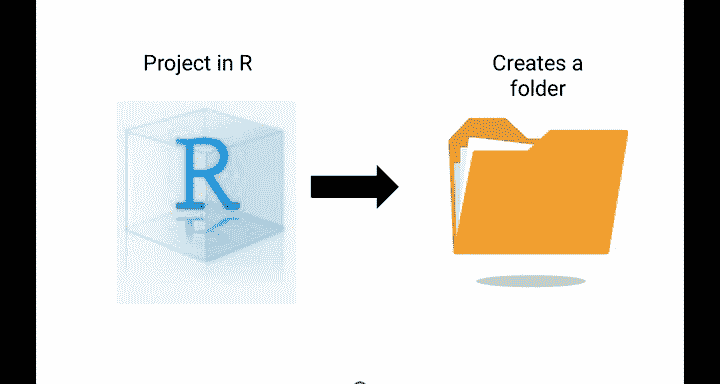

---

## 为什么使用项目？✨

了解了项目是什么之后，本节中我们来看看使用项目的主要好处。

使用项目的主要好处在于它从一开始就启动了组织流程。它为您创建一个文件夹，现在您就有了一个地方来存储所有输入数据、代码以及代码的输出。

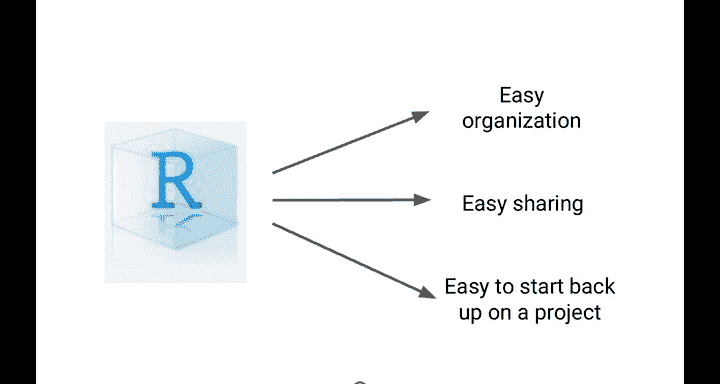

*   **自包含性**：项目中的所有内容都是自包含的，这意味着查找东西通常更容易，因为只有一个地方需要查看。
*   **易于共享**：由于与一个项目相关的所有内容都在同一个地方，因此与他人共享您的工作要容易得多，无论是直接共享文件夹/文件，还是将其与版本控制软件关联。
*   **易于恢复**：因为RStudio会记住您在关闭会话时打开了哪些文档，所以在休息后重新开始项目更容易，所有设置都保持您离开时的样子。

---

## 如何创建项目？🛠️

既然我们知道了项目的好处，接下来让我们学习创建项目的具体方法。

创建项目有三种方式。

以下是三种创建项目的方法：
1.  **从零开始创建**：这将创建一个新目录，用于存放您的所有文件。
2.  **从现有文件夹创建**：这将把现有目录与RStudio关联起来。
3.  **从版本控制创建**：这将把现有项目克隆到您的计算机上。暂时不必过于担心这个选项，在接下来的课程中您会更熟悉它。

让我们从零开始创建一个项目，这通常是您最常做的事情。

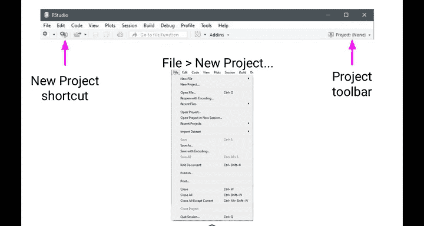

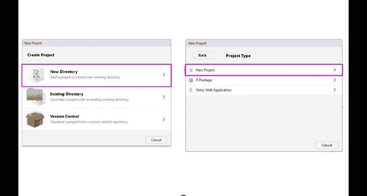

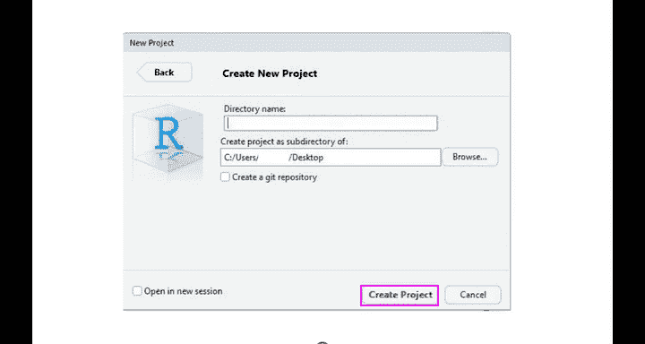

1.  打开RStudio，在“文件”菜单下，选择“新建项目”。
2.  您也可以通过点击项目工具栏，在下拉菜单中选择“新建项目”来创建新项目。或者，工具栏中也有“新建项目”的快捷图标。
3.  由于我们是从零开始，请选择“新建目录”。
4.  当提示选择项目类型时，选择“新建项目”。
5.  为您的项目选择一个名称，这次请将其保存到您的桌面。这将在您的桌面上创建一个文件夹，所有与此项目相关的文件都将保存在这里。
6.  点击“创建项目”。

一个空白的RStudio会话应该会打开。需要注意几点：
*   在屏幕的文件区域，您可以看到RStudio已将此新目录设置为您的工作目录，并生成了一个扩展名为 `.Rproj` 的单个文件。
*   在窗口的右上角，有一个项目工具栏，显示您当前项目的名称，并带有一个下拉菜单，其中包含一些我们稍后会讨论的不同选项。

---

## 如何打开、关闭和切换项目？🔄

我们已经学会了创建项目，本节中我们来看看如何管理现有的项目。

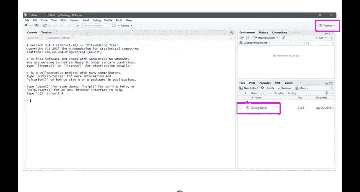

**打开现有项目**非常简单，只需在计算机上双击 `.Rproj` 文件即可。您也可以在RStudio内部通过以下方式实现：打开RStudio，进入“文件”->“打开项目”。或者，使用项目工具栏，打开下拉菜单并选择“打开项目”。

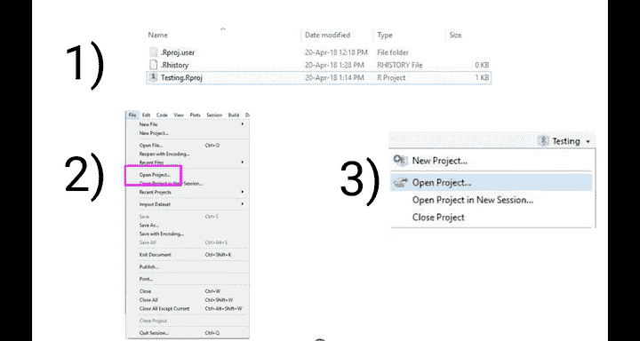

**退出项目**就像关闭RStudio窗口一样简单。您也可以进入“文件”->“关闭项目”，效果相同。最后，您可以使用项目工具栏，点击下拉菜单并选择“关闭项目”。所有这些选项都会退出项目，退出时RStudio会记录当前打开了哪些文档，以便在您重新启动时可以恢复，然后关闭R会话。

当您设置项目时，可以告诉它保存环境（例如，所有变量和数据表将在您重新打开项目时预加载），但这并非默认行为。

项目工具栏也是在项目之间切换的简便方法。点击下拉菜单，选择“打开项目”，找到您想要打开的新项目。这将保存当前项目，关闭它，然后在同一窗口中打开新项目。

如果您想同时打开多个项目，请执行相同的操作，但改为选择“打开项目于新会话”。这也可以通过“文件”菜单完成，其中提供了相同的选项。

---

## 项目组织最佳实践 📂

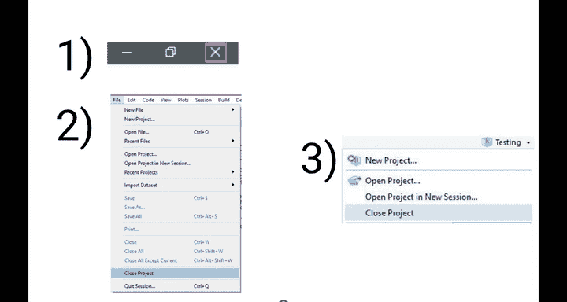

在学习了项目的基本操作后，本节中我们来探讨一些设置项目时的最佳实践，以优化您的文件结构。

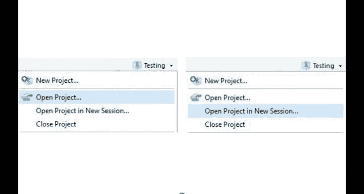

在设置项目时，一开始就创建几个目录会很有帮助。尝试几种策略，看看哪种最适合您。

大多数文件结构都围绕以下几个目录设置：
*   **`data/raw/`**：一个包含原始数据的目录。
*   **`scripts/` 或 `R/`**：一个用于存放脚本或R文件的目录。
*   **`output/` 或 `results/`**：一个用于存放代码输出的目录。

如果您在开始之前就设置好这些文件夹，可以在项目后期当您记不清某些东西在哪里时，避免组织上的麻烦。

---

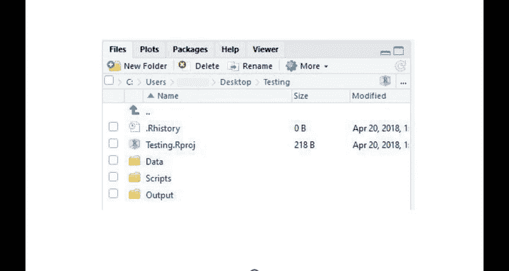

## 总结

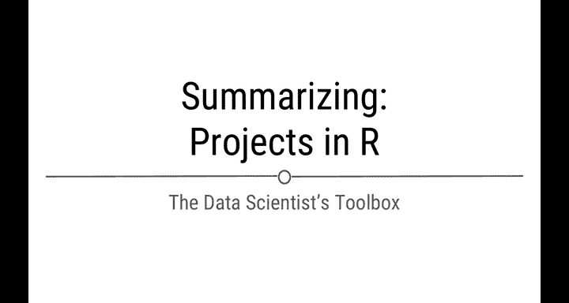

本节课中我们一起学习了R中的项目概念。我们涵盖了什么是R项目、为什么您可能想使用它们、如何打开、关闭或切换项目，以及一些最佳实践来帮助您更好地组织自己的工作。通过使用项目，您可以更高效、更清晰地管理数据分析工作流程。