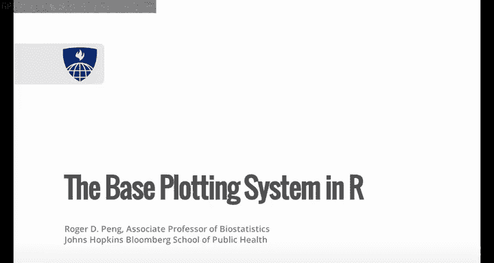
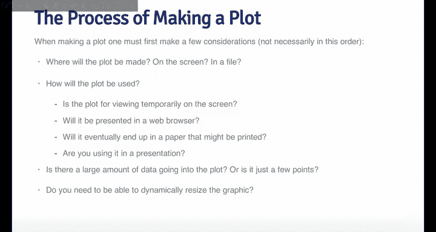
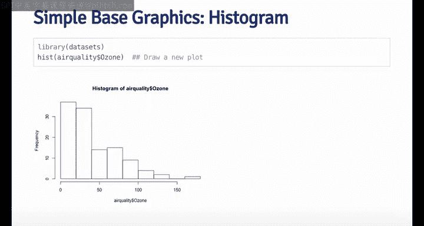
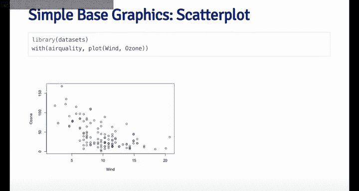
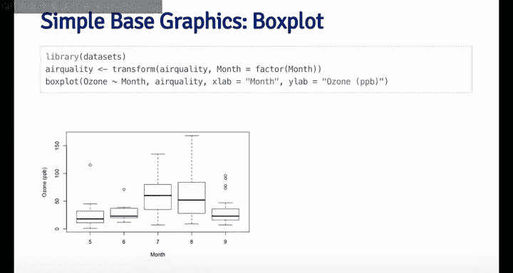
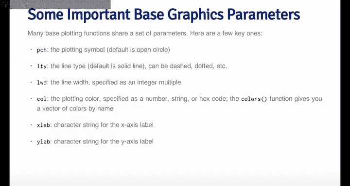
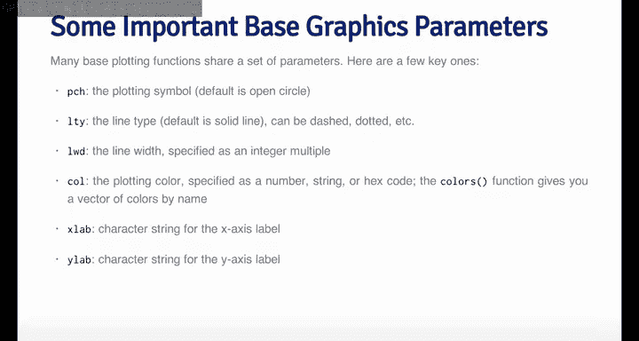
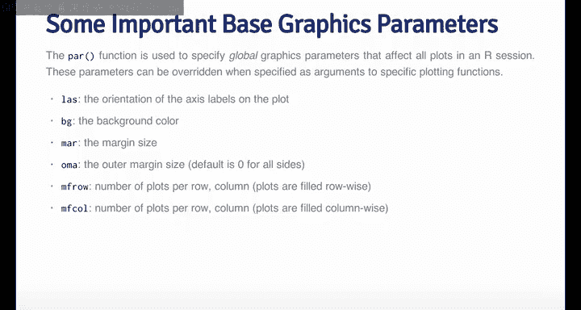
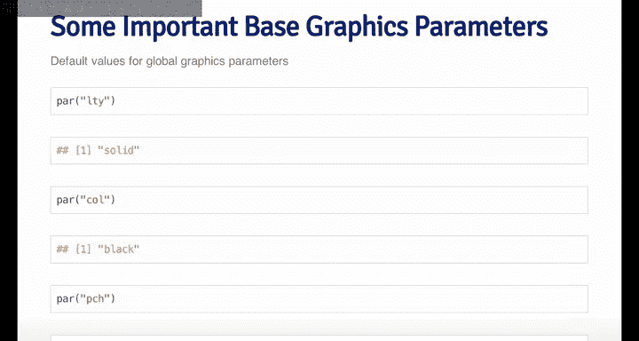
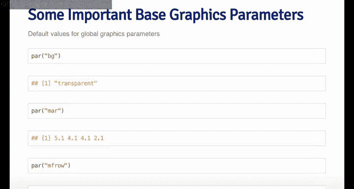

# 课程 P110：R 语言基础绘图系统（第一部分）📊

在本节课中，我们将要学习 R 语言中的基础绘图系统。这是 R 语言中最常用的绘图系统之一，我们将了解其核心概念、基本函数以及如何创建和定制简单的图形。

---

## 概述：R 语言的绘图系统



上一节我们介绍了 R 语言有三种不同的绘图系统：基础绘图系统、Lattice 系统和 ggplot2 系统。本节中，我们将重点探讨基础绘图系统。

R 语言的核心绘图和图形引擎被封装在 `graphics` 包和 `grDevices` 包中。`grDevices` 包包含了所有图形设备的代码，包括屏幕设备（如 X11、Windows 和 Quartz）以及文件设备（如 PDF 和 PostScript）。`graphics` 包则包含了绘图函数，例如 `plot`、`hist`、`boxplot` 等，这些构成了我们所说的基础绘图系统。

Lattice 系统被封装在 `lattice` 包中，它使用了另一个名为 `grid` 的低级图形系统。我们通常不直接调用 `grid` 包，而是通过 `lattice` 或 `ggplot2` 等包间接使用。Lattice 系统将在单独的课程中讨论。

---



## 绘图前的考量

在开始绘图之前，需要考虑几个问题。以下是需要考虑的关键点：

*   **绘图位置**：图形将显示在屏幕上，还是输出到文件？
*   **图形用途**：是临时在屏幕上查看，用于网页浏览器，打印在纸上（需要出版质量），还是用于幻灯片演示？
*   **数据量**：图形中会包含大量数据，还是只有少量数据点？是图像还是线图？
*   **动态调整大小**：是否需要能够动态调整图形大小？如果需要输出到文件，可能需要使用矢量格式（如 PDF）而非位图格式（如 PNG）。

此外，还需要决定使用哪种图形系统（基础、Lattice 或 ggplot2）。因为这三者不能混合使用。基础绘图系统采用分步构建的方式，通过一系列函数调用来组合图形。Lattice 系统通过单次函数调用创建整个图形。ggplot2 系统则结合了 Lattice 和基础绘图系统的概念。本课程将只关注基础绘图系统，并且仅讨论在屏幕设备上创建图形。

---

## 基础绘图系统的两阶段过程

在基础绘图系统中，创建二维图形通常分为两个阶段。

第一阶段是初始化一个新图形。第二阶段是在现有图形上添加注释或内容。有许多函数用于初始化图形，另有一组函数用于注释图形。

`plot` 函数或 `hist` 函数是初始化图形的两个例子。如果当前没有打开的图形设备，它们会启动一个图形设备（通常是一个弹出的窗口），然后在新设备上绘制图形。

`plot` 函数是 R 语言中的一个泛型函数，其行为会根据传入的数据类型而有所不同。如果没有传入特殊类型的数据，例如只传入向量 `x` 和 `y`，则会使用 `plot` 的默认方法。这个默认方法有很多参数，可以在帮助页面查看。例如，可以设置标题、X 轴标签和 Y 轴标签等细节。

总的来说，基础绘图系统有许多参数可以设置和调整，以使图形完全符合你的要求。这就像一把双刃剑，因为虽然可以高度自定义，但也意味着许多设置不是自动完成的，需要手动调整。大多数参数都记录在 `par` 函数的帮助页面中。

---

## 基础图形示例



以下是使用基础绘图系统创建的几个基本图形示例。

### 直方图



使用 `hist` 函数可以创建直方图，这是一种一维图形。这里我们加载 `datasets` 包中的 `airquality` 数据集，并绘制臭氧（Ozone）的直方图。我们没有设置 `hist` 的所有参数，而是使用了默认值。

```r
library(datasets)
hist(airquality$Ozone)
```

如果 R 中尚未打开图形设备，上述代码会打开一个图形设备窗口并显示直方图。




### 散点图

散点图是另一种基础图形，可以使用 `plot` 函数创建。这里我们使用相同的数据集，绘制臭氧（Ozone）与风速（Wind）的散点图。同样，我们使用了所有默认参数。

```r
plot(airquality$Wind, airquality$Ozone)
```

默认的绘图符号是一个空心圆。

### 箱线图

`boxplot` 函数用于初始化箱线图。这里我们按月份（Month）绘制臭氧（Ozone）分布的箱线图。`boxplot` 函数使用了一种公式表示法：波浪号（`~`）左侧指定 Y 轴变量（臭氧），右侧指定 X 轴变量（月份）。月份被当作分类变量处理。我们还通过 `xlab` 和 `ylab` 参数指定了坐标轴标签。

```r
boxplot(Ozone ~ Month, data = airquality, xlab = "Month", ylab = "Ozone (ppb)")
```

---


## 关键的基础图形参数





有几个关键的基础图形参数非常常用，值得牢记。

以下是这些核心参数及其作用：

*   **`pch`**：绘图字符或符号。可以是一个数字（对应内置符号表）或一个字符（如字母“A”）。默认是空心圆。有时可用于按组标记数据点。
*   **`lty`**：线型。指定线条是实线、虚线、点线还是点划线等。
*   **`lwd`**：线宽。根据图形用途调整，例如演示文稿中可能需要更粗的线条以便远距离观看。
*   **`col`**：绘图颜色。指定绘图符号或线条的颜色。可以通过数字、颜色名称字符串或十六进制代码指定。`colors()` 函数可以列出所有可用的颜色名称。
*   **`xlab` / `ylab`**：用于指定 X 轴和 Y 轴的标签，对图形注释非常有用。

另外，还有一些可以通过 `par` 函数设置的全局图形参数，它们会影响之后创建的所有图形。当然，通常也可以在单个绘图函数调用中覆盖这些全局设置。但是，像边距大小或 `mfrow` 这样的参数，只能在 `par` 函数中设置。

以下是几个有用的 `par` 参数：

*   **`las`**：坐标轴标签的方向（水平或垂直）。
*   **`bg`**：图形的背景颜色。
*   **`mar`**：图形边距大小。如果坐标轴标签很复杂，可能需要增大边距。
*   **`oma`**：外边界大小。当一页有多个图形并需要整体标题时有用。
*   **`mfrow`**：控制多图布局的行数和列数（例如，`mfrow = c(2, 2)` 表示 2 行 2 列共 4 个图形）。



可以通过调用 `par` 函数并传入参数名来查看其默认值。



```r
par("lty") # 查看默认线型
par("col") # 查看默认颜色
par("pch") # 查看默认绘图符号
par("bg")  # 查看默认背景色（通常是透明）
par("mar") # 查看默认边距（底部、左侧、顶部、右侧，单位是文本行数）
par("mfrow") # 查看默认多图布局（1行1列，即单图）
```

例如，`mar` 的默认值 `c(5.1, 4.1, 4.1, 2.1)` 分别对应图形底部、左侧、顶部、右侧的边距大小（以文本行数为单位）。`mfrow` 默认为 `c(1, 1)`，表示单图布局。

---

## 总结



本节课中，我们一起学习了 R 语言基础绘图系统的核心概念。我们了解了 R 的三种绘图系统，并聚焦于基础绘图系统的两阶段构建过程。我们通过实例学习了如何使用 `hist`、`plot` 和 `boxplot` 等函数创建直方图、散点图和箱线图。最后，我们介绍了一些关键的基础图形参数（如 `pch`、`col`、`xlab`）和全局参数（通过 `par` 设置），这些是定制图形外观的基础。掌握这些内容，是使用 R 语言进行有效数据可视化的第一步。