# 课程 P112：R 语言基础绘图演示 📊

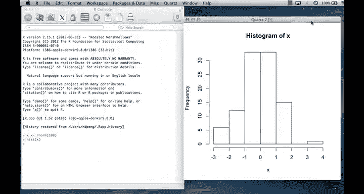

在本节课中，我们将学习 R 语言基础绘图系统的核心功能。我们将从创建简单的图形开始，逐步探索如何自定义图形元素、添加注释、在同一画布上排列多个图形，以及如何根据分组变量为数据点着色。


---

## 1. 创建基础图形

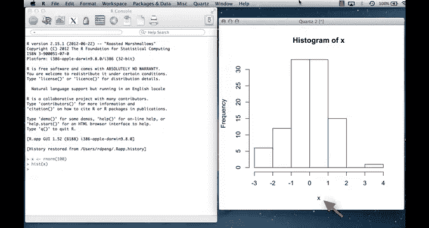

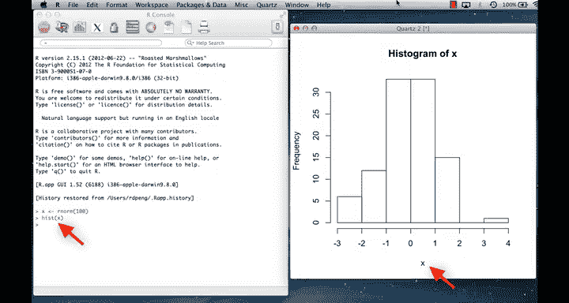


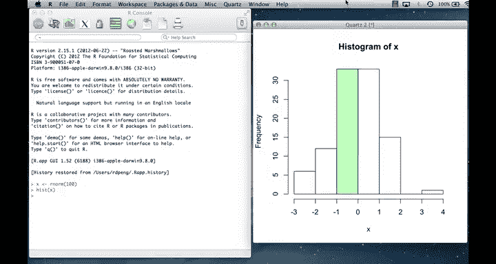

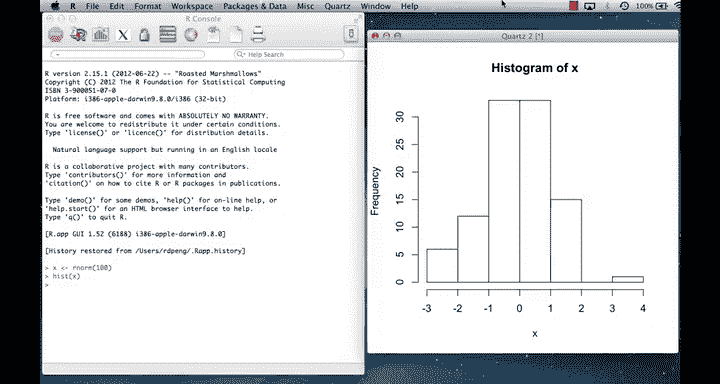

首先，我们通过生成一些模拟数据来创建一个简单的直方图。

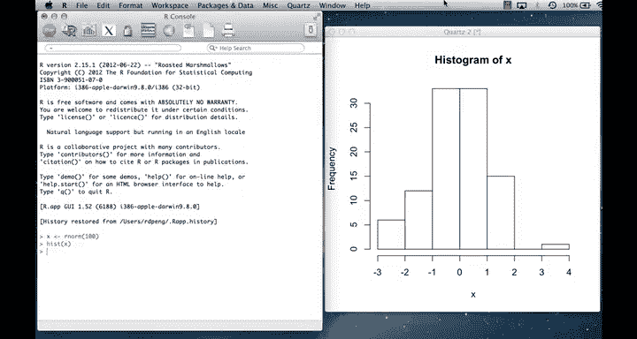

```r
# 生成 100 个服从标准正态分布的随机数
x <- rnorm(100)
# 绘制直方图
hist(x)
```

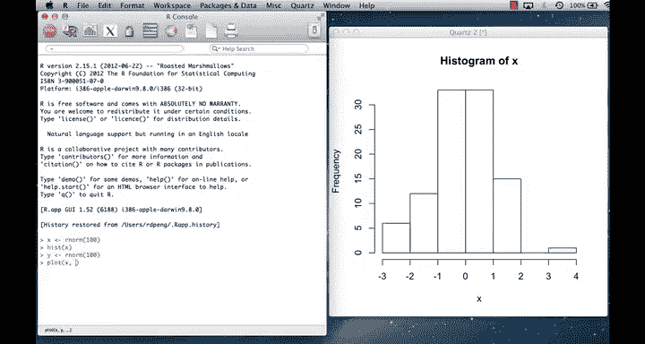

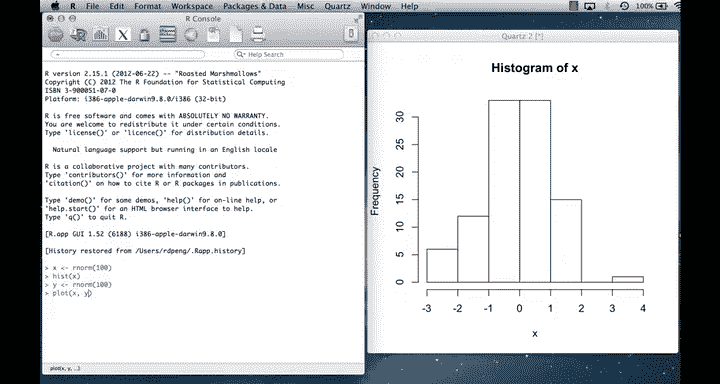

执行 `hist(x)` 后，会弹出一个绘图窗口。即使我们没有指定任何参数，图形也会自动包含标题、x 轴标签（默认为变量名 `x`）和 y 轴标签（对于直方图，默认为 `Frequency`）。直方图的形状大致呈正态分布。

接下来，我们生成更多数据来创建散点图。

```r
# 生成更多数据
y <- rnorm(100)
# 绘制散点图
plot(x, y)
```

由于绘图窗口已经打开，`plot(x, y)` 会将图形绘制到当前窗口。默认的绘图符号是空心圆。同样，x 轴和 y 轴的标签会自动设置为变量名 `x` 和 `y`。

---

## 2. 自定义图形参数

图形区域有几个重要的组成部分，例如四个边距（side1 底部，side2 左侧，side3 顶部，side4 右侧）。我们可以使用 `par()` 函数调整边距。

```r
# 将所有边距设置为 2 行文本的高度
par(mar = c(2, 2, 2, 2))
plot(x, y)
```

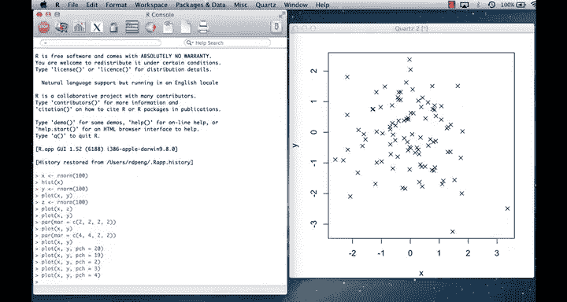

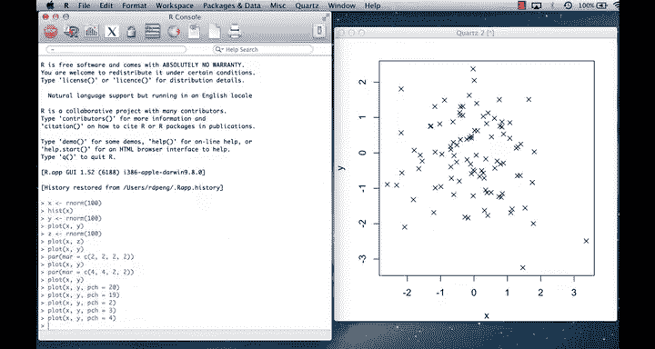


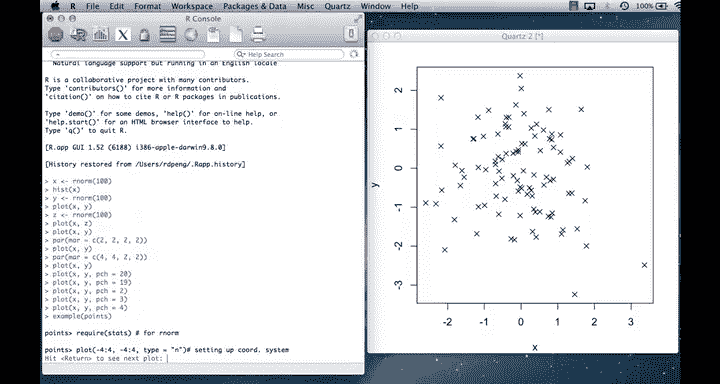

设置后，边距变小，图形区域变大，但轴标签可能因空间不足而消失。通常需要更大的边距来容纳标签。

```r
# 设置更合理的边距（底部4，左侧4，顶部2，右侧2）
par(mar = c(4, 4, 2, 2))
plot(x, y)
```

现在，图形有足够的空间显示 x 和 y 轴标签。

---

## 3. 自定义绘图符号与颜色

我们可以通过 `pch` 参数改变散点图中点的形状。

```r
# 使用不同的 pch 值改变点的形状
plot(x, y, pch = 20)  # 小实心圆
plot(x, y, pch = 19)  # 大实心圆
plot(x, y, pch = 2)   # 空心三角形
plot(x, y, pch = 3)   # 加号
plot(x, y, pch = 4)   # 叉号
```

如果不记得 `pch` 值对应的形状，可以使用 `example(points)` 命令查看演示图表。符号 21 到 25 比较特殊，它们有边框和填充色，可以分别用 `col`（边框色）和 `bg`（填充色）参数控制。

---

## 4. 为图形添加注释

我们可以为图形添加标题、文本标签、图例和拟合线。

```r
# 重新生成数据并绘制基础图形
x <- rnorm(100)
y <- rnorm(100)
plot(x, y, pch = 20)

# 添加标题
title("这是我的散点图")

# 在指定坐标添加文本
text(-2, -2, "这是一个标签")

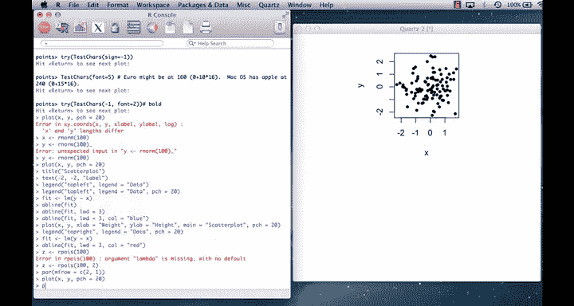


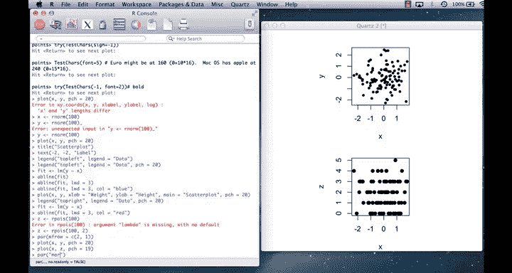

# 添加图例
legend("topleft", legend = "数据点", pch = 20)


# 拟合线性模型并添加回归线
fit <- lm(y ~ x)
abline(fit, col = "blue", lwd = 3)  # lwd 控制线宽
```

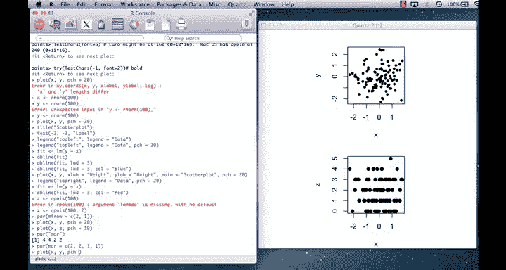

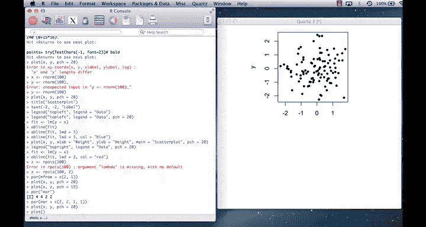

更常见的做法是在调用 `plot()` 函数时直接指定这些参数。

```r
plot(x, y,
     xlab = "体重",
     ylab = "身高",
     main = "散点图",
     pch = 20)
legend("topright", legend = "数据点", pch = 20)
fit <- lm(y ~ x)
abline(fit, col = "red", lwd = 2)
```

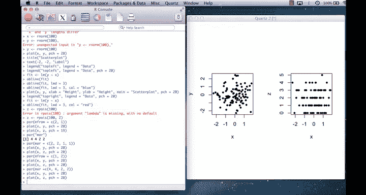

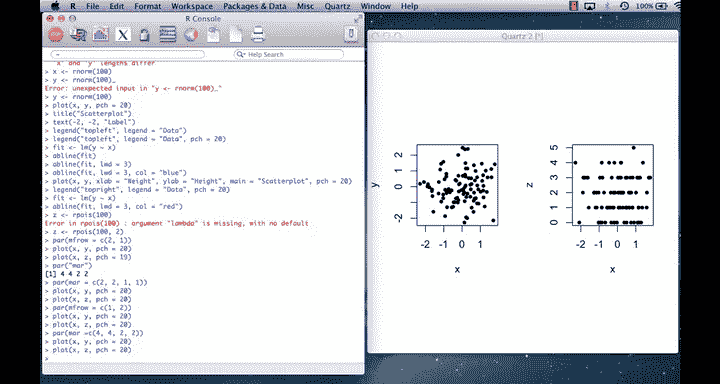

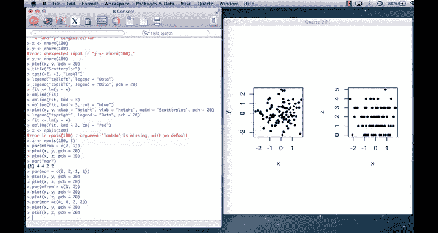

---


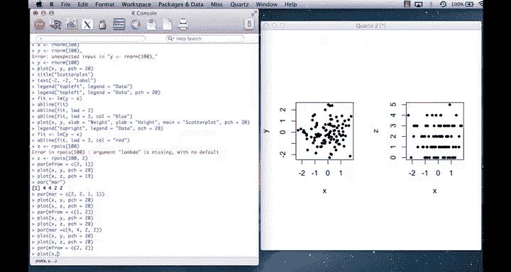

## 5. 在同一画布上排列多个图形

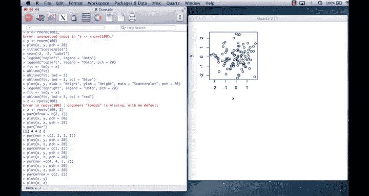


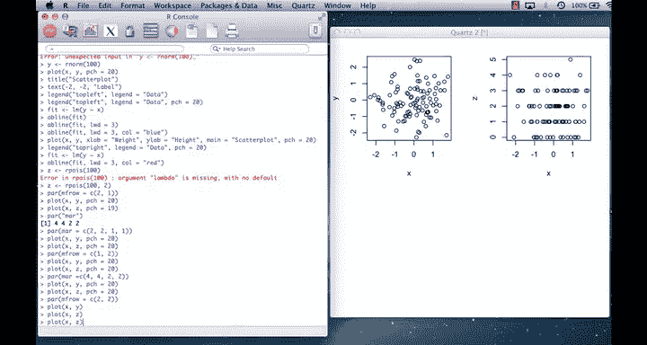

使用 `par(mfrow)` 或 `par(mfcol)` 可以在一个页面（画布）上排列多个图形。`mfrow` 按行填充，`mfcol` 按列填充。

```r
# 设置图形排列为 2 行 1 列
par(mfrow = c(2, 1))
plot(x, y, pch = 20, main = "图1: Y vs X")
# 生成新变量 z
z <- rpois(100, lambda = 2)
plot(x, z, pch = 19, main = "图2: Z vs X")
```

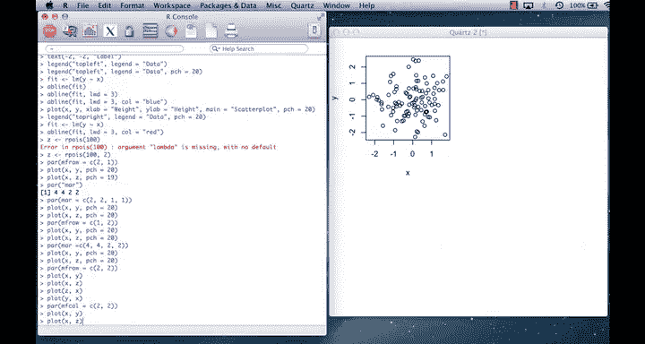

排列改变后，可能需要重新调整边距 `mar` 以减少空白。我们也可以创建 2x2 的图形布局。

```r
# 设置图形排列为 2 行 2 列
par(mfrow = c(2, 2))
plot(x, y, main = "左上")
plot(x, z, main = "右上")
plot(z, x, main = "左下")
plot(y, x, main = "右下")
```

---

## 6. 按分组变量绘制数据

在实际分析中，我们经常需要根据分组（如性别）用不同颜色或形状绘制数据点。基本思路是：先建立空的绘图区域，然后按组别分批添加数据点。

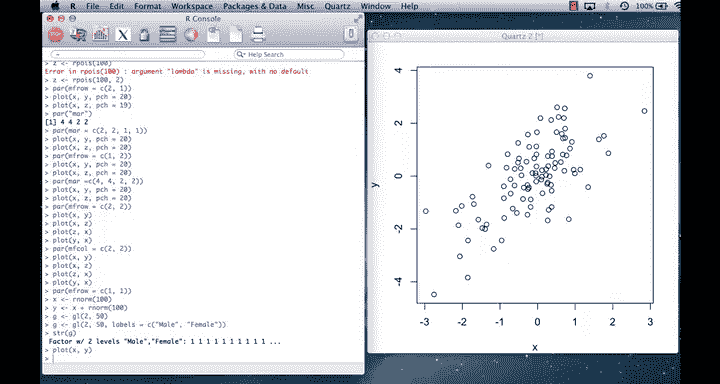

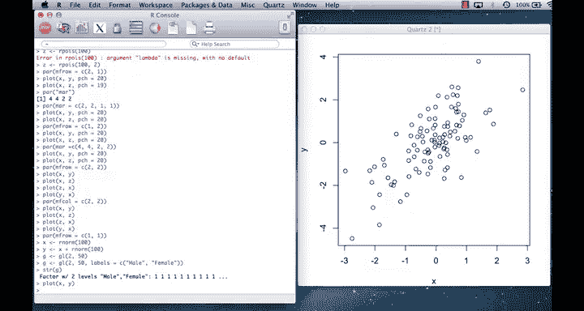


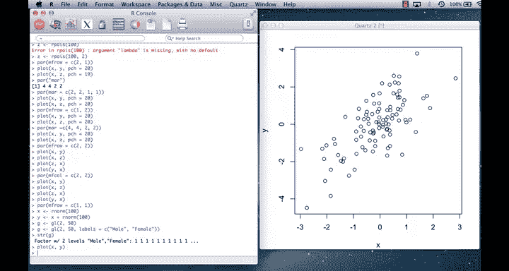

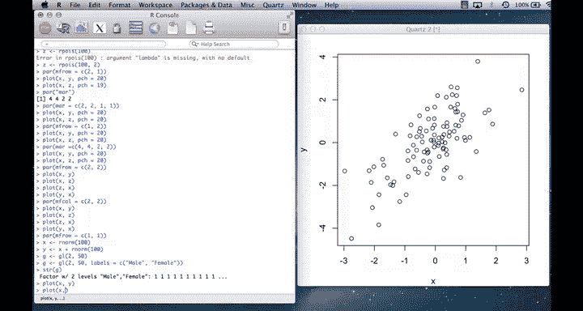

```r
# 生成包含分组信息的数据
set.seed(123)
x <- rnorm(100)
y <- x + rnorm(100, sd = 0.5)
# 创建分组变量（50个男性，50个女性）
g <- factor(rep(c("male", "female"), each = 50), labels = c("男性", "女性"))

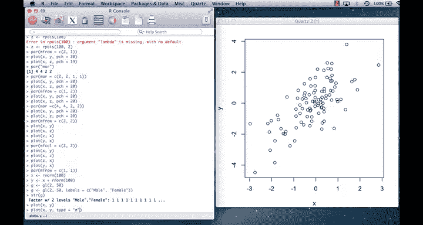


# 第一步：建立空的绘图区域 (type = "n")
plot(x, y, type = "n", xlab = "X", ylab = "Y", main = "按性别分组")

# 第二步：添加男性数据点（绿色）
points(x[g == "男性"], y[g == "男性"], col = "green", pch = 19)


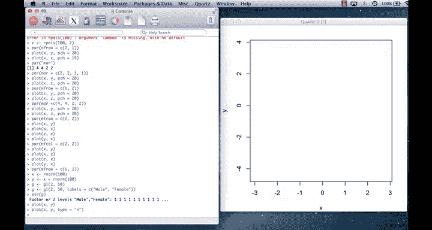


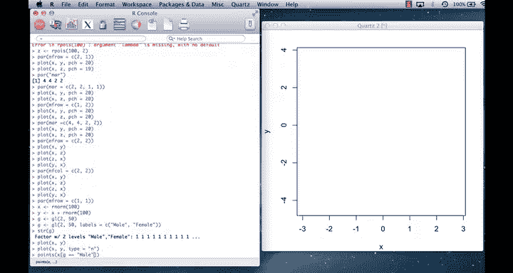


# 第三步：添加女性数据点（蓝色）
points(x[g == "女性"], y[g == "女性"], col = "blue", pch = 19)


# 可以添加图例
legend("topleft", legend = c("男性", "女性"), col = c("green", "blue"), pch = 19)
```

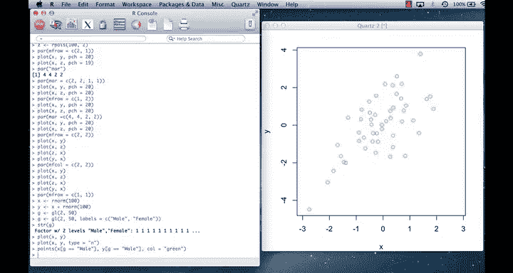

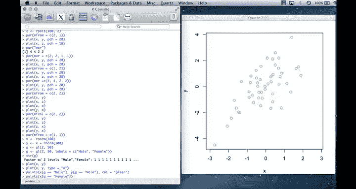

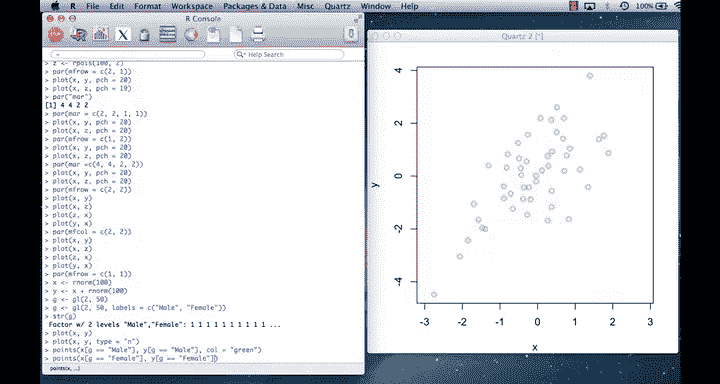

通过这种方式，我们可以在同一张散点图上清晰地区分不同组别的数据。除了颜色，我们还可以通过 `pch` 参数为不同组设置不同的形状。

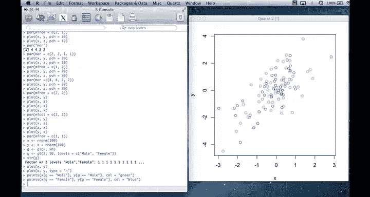

---

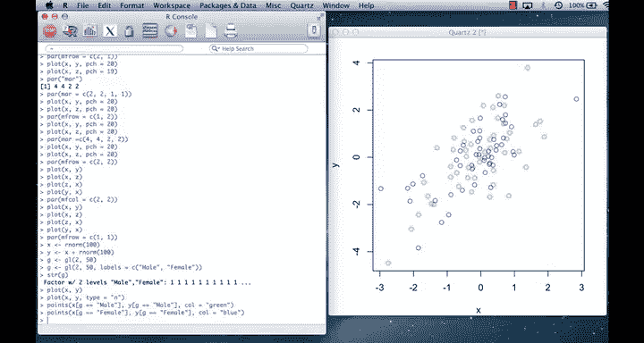

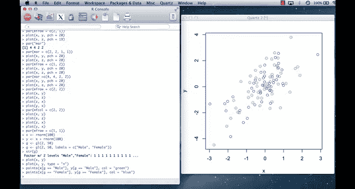


## 总结

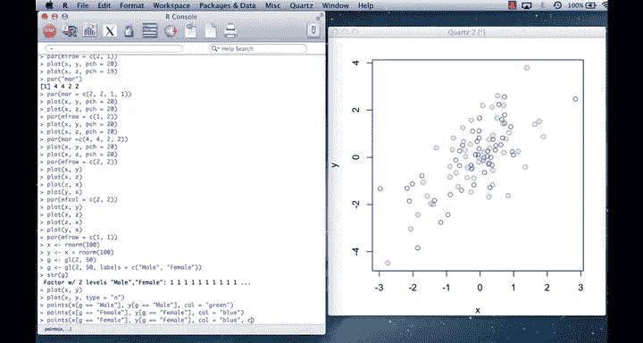

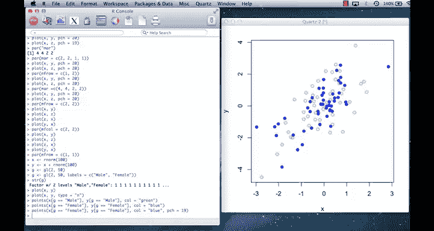

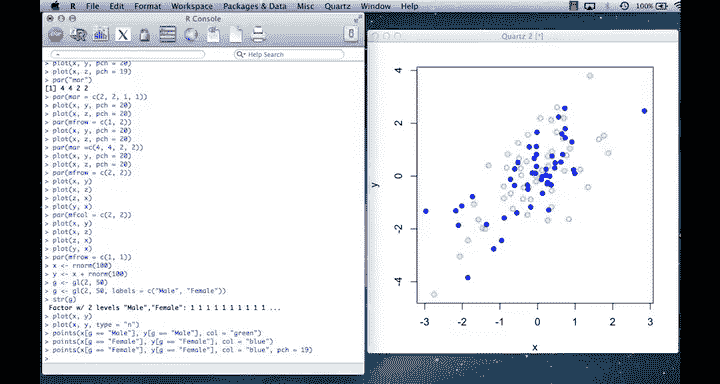

本节课我们一起学习了 R 基础绘图系统的核心功能。我们从创建简单的直方图和散点图开始，然后学习了如何通过 `par()` 函数调整图形参数（如边距 `mar` 和布局 `mfrow`/`mfcol`）。我们还探索了如何自定义绘图符号（`pch`）、颜色，以及如何为图形添加标题、文本、图例和拟合线等注释。最后，我们掌握了在同一画布上排列多个图形，以及根据分组变量为数据点着色的高级技巧。这些基础技能是进行有效数据可视化的关键。