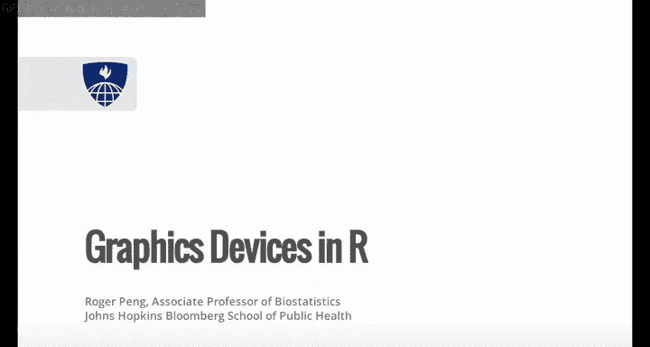
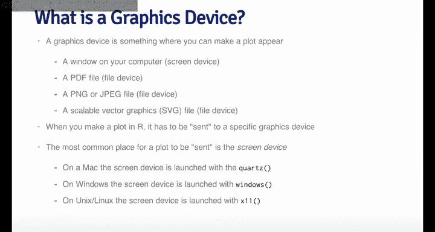
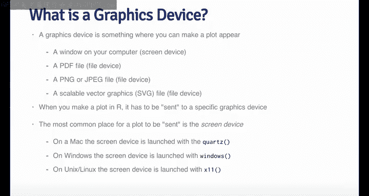
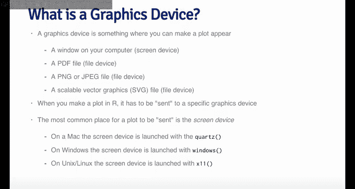
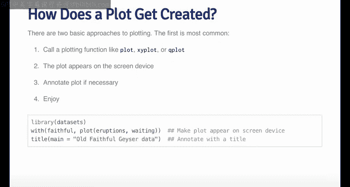

# 课程13：📊 R中的图形设备（第一部分）

在本节课中，我们将要学习R语言中图形设备的基础知识。图形设备是生成和显示图形输出的关键，理解它们对于创建和保存图表至关重要。



## 什么是图形设备？

图形设备是绘图可以显示的地方或对象。最明显的地方是屏幕，当你调用绘图函数时，一个图形窗口会启动，图表就显示在那里。这被称为屏幕设备。

除了屏幕，你可能还想将图表发送到文件。文件有多种格式，例如PDF、PNG、JPEG或可缩放矢量图形（SVG）文件。因此，你可以选择多种不同的文件设备来发送图表。




## 图形设备的重要性



在R中制作图表时，必须将其发送到特定的图形设备，否则无法生成图表。最常见的发送位置是屏幕设备。

屏幕设备在不同操作系统上有不同的名称：
*   在Mac上称为 **quartz**
*   在Windows上称为 **Windows**
*   在Unix/Linux系统上称为 **X11**




当你制作图表时，首先需要考虑这个图表将显示在哪里。你可以通过 `?Devices` 命令查看帮助页面，那里列出了所有可用的设备。此外，CRAN上也有用户创建的图形设备包，安装后即可使用。本节课我们主要关注R自带的设备。

## 屏幕设备与文件设备

上一节我们介绍了图形设备的基本概念，本节中我们来看看两种主要设备类型的使用场景。

在进行数据可视化和探索性分析时，通常最明显的选择是将图表发送到屏幕设备。你调用如 `plot`、`xyplot` 或 `ggplot2` 中的 `qplot` 等函数，图表就会出现在屏幕设备上。这样你可以快速查看数据，并决定下一步的绘图操作。

在任何给定的平台（Mac、Windows或Unix）上，只有一个屏幕设备，因此你无需选择将其发送到哪个屏幕设备，只有一个去处，所以不必担心。

然而，通常在完成探索性分析并确定了想要保留或分享的图表后，你就需要在另一种类型的设备（例如文件设备）上制作图表。将图表制作到文件中后，你可以将该文件包含在报告、演示文稿中，或者通过电子邮件发送给他人。因此，文件对于这类用途更为有用。

与屏幕设备不同，文件设备有多种选择。以下是常见的文件设备类型：

*   **PDF设备**：生成可缩放的高质量文档。
*   **PNG设备**：生成位图文件，适用于网络使用。
*   **JPEG设备**：生成有损压缩的位图文件，适用于照片类图像。
*   **SVG设备**：生成基于XML的矢量图形，可在Web浏览器中缩放。


需要注意的是，并非本讲座中讨论的所有图形设备在所有平台上都可用。例如，Mac或Unix系统上没有Windows设备，同样，Windows系统上也没有quartz设备。因此，你无法在每个平台上打开每一个图形设备。

## 创建图表的两种方法

了解了设备类型后，我们来看看如何创建图表。创建图表实际上不止一种方法。

第一种方法最简单，可能也是你已经熟悉的方法：直接调用绘图函数（如 `plot`、`xyplot`、`qplot`），图表就会出现在屏幕设备上。然后，你可以使用 `text`、`title` 等函数为图表添加注释。一旦完成注释并且图表看起来符合你的要求，就完成了。图表显示在屏幕上，你可以查看它或在屏幕上展示给他人。

以下是一些加载数据集并使用 `plot` 函数创建图表，然后在图表顶部添加标题的代码示例：

```r
# 加载数据
library(datasets)
data(cars)

# 创建图表并添加标题
plot(cars$speed, cars$dist)
title("Speed vs. Stopping Distance")
```




第二种方法最常用于文件设备，它涉及显式启动一个图形设备。你可能需要先打开一个文件设备，然后使用绘图函数创建图表。使用文件设备时有点棘手，因为图表实际上不会显示在屏幕上，所有绘图信息都进入了文件。因此，在向文件创建图表时，你必须确切知道自己在做什么，因为你无法在屏幕上看到它。通常，最好的方法是将你的绘图代码保存在一个单独的文件中，这样你就可以直接将代码复制粘贴到R中，而不必担心在输入代码时出错。

创建图表后，如果需要，可以为其添加注释。然后，必须使用 `dev.off()` 函数关闭图形设备。一旦关闭了图形设备，图表就完成了。如果你将其发送到了文件，就可以在计算机上打开该文件，查看它，将其包含在演示文稿中，或通过电子邮件发送给他人。

以下是一些打开PDF设备、创建图表、添加注释然后关闭设备的代码示例：

```r
# 打开PDF设备，指定文件名
pdf("myplot.pdf")

# 创建图表
plot(cars$speed, cars$dist)

# 添加注释
title("Speed vs. Stopping Distance")

# 关闭设备（完成文件写入）
dev.off()
```

一旦调用了 `dev.off()`，你的工作目录中应该会有一个名为 `myplot.pdf` 的文件，你可以用任何PDF查看器打开它。

## 总结

本节课中我们一起学习了R语言中图形设备的基础知识。我们了解到图形设备是绘图显示的地方，主要分为屏幕设备（如quartz、Windows、X11）和文件设备（如PDF、PNG）。我们探讨了创建图表的两种主要方法：一种是直接绘图到屏幕并即时修改，另一种是显式打开文件设备、绘图、注释然后关闭设备以保存文件。理解这些概念是有效创建、查看和保存R图表的关键第一步。