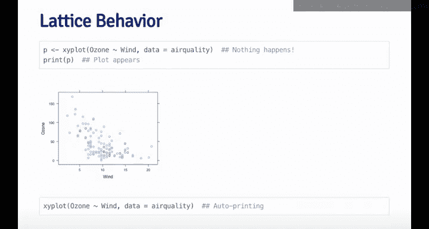

# 课程 15：📊 格子绘图系统（第 1 部分）


在本节课中，我们将要学习 R 语言中的格子绘图系统。这个系统与基础绘图系统不同，它特别适用于绘制高维数据，并能一次性生成大量图形。

## 概述

格子绘图系统是 R 语言中一个独立的绘图系统，其设计理念和工作方式与基础绘图系统有显著差异。它尤其擅长处理多维数据，并能高效地创建多面板图形。

## 格子绘图系统简介

上一节我们提到了格子绘图系统的特点，本节中我们来看看它的具体实现方式。

格子绘图系统通过 `lattice` 包实现，使用前需要加载该包。`lattice` 包底层依赖于 `grid` 包，后者提供了格子图形系统的底层基础设施。用户通常不需要直接调用 `grid` 包中的函数，但了解其存在是有帮助的。

与基础绘图系统不同，格子绘图系统没有“先创建图形，后添加标注”的两阶段过程。在格子系统中，你必须通过一次函数调用就完整地指定图形的所有细节，因为之后没有机会再进行标注。

## 主要绘图函数

以下是 `lattice` 包中一些主要的绘图函数：

*   **`xyplot`**：这是最重要的函数，用于创建散点图。
*   **`bwplot`**：用于绘制箱线图。
*   **`histogram`**：用于绘制直方图。
*   **`stripplot`**：类似于箱线图，但使用点来表示。
*   **`dotplot`**：绘制点图，其点排列类似小提琴弦。
*   **`splom`**：绘制散点图矩阵，类似于基础绘图系统中的 `pairs` 函数。
*   **`levelplot`** 和 **`contourplot`**：用于绘制图像数据。

## 深入 `xyplot` 函数

现在，我们来重点了解一下 `xyplot` 函数，因为它是最常用的。

`xyplot` 函数的基本调用使用公式表示法：
```r
xyplot(y ~ x | f * g, data)
```
其中，`y` 是 Y 轴变量，`x` 是 X 轴变量。竖线 `|` 后面是条件变量，例如 `f` 和 `g` 是需要在其不同水平上分别绘图的分类变量。这个函数调用的含义是：为 `f` 和 `g` 的每一个水平组合，绘制 `y` 对 `x` 的散点图。第二个参数 `data` 指定了包含这些变量的数据框。

### 简单散点图示例

加载必要的包和数据后，我们可以绘制一个简单的散点图：
```r
library(lattice)
library(datasets)
xyplot(Ozone ~ Wind, data = airquality)
```
这段代码绘制了 `airquality` 数据框中臭氧浓度与风速的关系散点图。其默认样式（如使用蓝色空心圆点）与基础绘图系统略有不同。

### 多面板散点图示例

`xyplot` 的强大之处在于能轻松创建多面板图形。以下代码将月份转换为因子，并按月份分别绘制臭氧与风速的关系：
```r
airquality <- transform(airquality, Month = factor(Month))
xyplot(Ozone ~ Wind | Month, data = airquality, layout = c(5, 1))
```
通过公式 `Ozone ~ Wind | Month`，我们为 5 月到 9 月的每一个月生成了一个子图。从图中可以观察到，臭氧与风速的关系在不同月份间有所变化。在基础绘图系统中，创建这样的图形需要多次函数调用，而 `xyplot` 只需一次。

## 格子绘图系统的行为特点

了解格子函数与基础图形函数的行为差异非常重要。

基础图形函数会直接将图形绘制到图形设备上。而格子函数（如 `xyplot`）则不同：它们并不立即绘图，而是返回一个属于 **`trellis`** 类的对象。这个对象需要被**打印**，图形才会被发送到图形设备。

不过，这个过程对用户通常是透明的。因为当你调用 `xyplot` 时，R 的自动打印功能会立即将这个 `trellis` 对象打印出来，从而显示出图形。所以大多数时候，你感觉不到这个两步过程。

你可以通过以下代码观察这个行为：
```r
p <- xyplot(Ozone ~ Wind, data = airquality) # 此时图形不会显示
print(p) # 执行此命令后，图形才会显示
```
运行第一行代码后，图形不会出现。只有运行 `print(p)` 或依靠自动打印（例如在交互式环境中直接输入 `p`）时，图形才会显示。

## 总结



本节课中我们一起学习了 R 语言格子绘图系统的基础知识。我们了解到格子系统通过 `lattice` 包实现，特别适合绘制条件多面板图形。我们重点学习了 `xyplot` 函数及其公式语法，它可以用简洁的代码探索变量间在不同条件下的关系。最后，我们明白了格子函数返回 `trellis` 对象并由打印机制驱动显示的特性。掌握这些基础将帮助我们更高效地进行数据可视化。