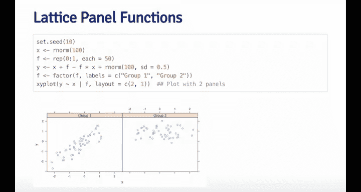

# 课程16：📊 格子绘图系统第2部分

在本节课中，我们将要学习R语言`lattice`绘图系统的进阶功能，特别是如何使用自定义面板函数来增强多面板图表的表达能力，以及如何利用该系统高效地探索和可视化复杂的数据集。

上一节我们介绍了`lattice`系统的基础概念和核心绘图函数。本节中我们来看看如何通过自定义面板函数来精确控制每个子面板的绘图内容，从而创建更丰富、更具洞察力的可视化图表。

## 自定义面板函数


`lattice`系统拥有所谓的“面板函数”。当您创建一个多面板图表时，会有一个函数被调用来绘制每个面板中的数据，这个函数控制着每个面板中发生的一切。`lattice`包自带了许多默认的面板函数，但如果您想自定义每个面板的内容，也可以提供自己的函数。

基本上，每个面板函数会接收该特定面板内数据点的x和y坐标。请记住，每个面板代表数据的一个子集，这个子集由您提供的条件变量定义。因此，对于每一个面板，面板函数都会获取该图内所有点的x、y坐标。



以下是一个示例，我们生成了一些遵循线性模型的随机数据，并创建了一个因子变量来区分“组1”和“组2”。我们希望通过分组来绘制x和y的关系。

```r
# 生成示例数据
set.seed(123)
x <- rnorm(100)
y_group1 <- 2 * x[1:50] + rnorm(50, sd=0.5)
y_group2 <- rnorm(50, sd=1.5)
y <- c(y_group1, y_group2)
group <- factor(rep(c("Group 1", "Group 2"), each=50))

# 使用xyplot绘制分组图
library(lattice)
xyplot(y ~ x | group)
```


在“组1”中，看起来有很强的线性关系，而在“组2”中，似乎没有明显关系。

## 添加自定义元素

您可以通过`panel`参数调用自定义面板函数。以下是自定义面板函数的基本结构：


```r
# 自定义面板函数示例：添加水平中位线
xyplot(y ~ x | group,
       panel = function(x, y, ...) {
         panel.xyplot(x, y, ...) # 首先调用默认函数绘制点
         panel.abline(h = median(y, na.rm = TRUE), lty = 2) # 添加一条水平虚线表示y值的中位数
       })
```


在这个自定义函数中，前两个参数是`x`和`y`，后面跟着`...`（省略号），表示可能传入的任何其他参数。函数内，我们首先调用默认的`panel.xyplot`函数让数据点出现，然后我们的定制操作是：在每个面板中添加一条水平虚线，代表该面板内y值的中位数。现在，您可以在每个面板中看到一条虚线，正好位于y坐标中位数的位置。

另一个更高级的做法是添加回归线，这有助于观察每个面板内x和y之间的线性关系。

```r
# 自定义面板函数示例：添加回归线
xyplot(y ~ x | group,
       panel = function(x, y, ...) {
         panel.xyplot(x, y, ...) # 绘制点
         panel.lmline(x, y, col = "red") # 添加回归线
       })
```


这里，我们再次传递了一个自定义函数。首先调用`panel.xyplot`函数让点、坐标轴标签等元素出现，然后调用`panel.lmline`来为面板添加回归线。

**一个重要的注意事项是：您不能在`lattice`系统中使用基础绘图系统的任何注释函数。** 作为通用规则，不能在不同绘图系统之间混合使用函数。因此，您必须使用与给定绘图系统相关的所有函数。


## 实战案例：可视化大型数据集

为了展示如何处理更大的数据集，我们来看一个来自“巴尔的摩市小鼠过敏原与哮喘队列研究”的实例。这项研究旨在观察巴尔的摩市哮喘儿童的室内环境，其中许多儿童对小鼠过敏原过敏。这是一项观察性研究，包含一次基线家访和随后每三个月一次、为期一年的随访，总共五次访问。


一个可能的研究问题是：室内空气中小鼠过敏原的水平如何随时间变化，以及在受试者之间有何差异？我们想要为每个受试者的每次访问绘制空气中小鼠过敏原水平的图。数据集中有150名受试者，每人有五次访问，因此我们总共有750个数据点需要观察。

一种紧凑且简单的方法是使用`xyplot`和多面板`lattice`图。

```r
# 假设数据框‘mast’包含‘subject_id’, ‘visit’, ‘log_allergen’列
# xyplot(log_allergen ~ visit | subject_id, data = mast,
#        type = "b", # 用点和线连接
#        layout = c(5, 30), # 大致布局，实际会根据数据调整
#        scales = list(x = list(rot = 45)), # 旋转x轴标签
#        main = “Log Airborne Mouse Allergen by Subject and Visit”)
```


通过这个图，我们可以观察到：
*   **个体内变异**：在每个面板（代表一个受试者）内，可以看到他们的过敏原水平在访问之间会上升、下降或波动。
*   **个体间变异**：可以看到有些人的水平普遍很高，而有些人则普遍较低。这体现了除了个体内变异之外的个体间差异。
*   **缺失值**：可以看到不少人存在缺失值，并非每个人都有五个值。有些人可能只有两个或一个值。这可能有助于后续跟进这些受试者。
*   **变异程度**：有些受试者的变异很大（在访问间上下波动剧烈），而有些则几乎没有变异（每次访问的水平几乎相同）。

根据您具体的研究兴趣，您可能希望跟进其中一些模式。可以看到，通过本质上**一两个函数调用**，您就能制作出这样一个庞大的图表，查看大量数据，而无需编写大量代码。这正是`lattice`系统力量的一部分——只要数据以某种方式格式化，它就能让您轻松查看大量数据。

这展示了访问编号与对数转换后空气中小鼠过敏原水平之间的关系，是按受试者分组的。这是总结整个研究数据的一种快速方法。

## 总结与核心优势

本节课中我们一起学习了`lattice`绘图系统的进阶应用。

以下是`lattice`绘图的核心要点总结：

*   **单函数调用**：`lattice`图是通过调用`xyplot`等核心函数一次构建的。
*   **自动布局**：`lattice`图的一个优点是边距、间距和标签等元素会自动处理，您不需要像在基础绘图系统中那样频繁地设置`mar`、`oma`、`mtext`等选项。
*   **条件绘图的理想选择**：当您拥有可以通过某些变量进行“条件筛选”来查看的数据集时，`lattice`系统是理想的选择。您通常希望观察某种关系，但希望在不同水平的另一个变量内部进行观察，即在不同条件下查看同类型的图表。
*   **强大的自定义能力**：您可以使用自定义的面板函数来精确修改每个绘图面板中的内容，这为您定制这些面板图的外观提供了强大的能力。


我发现`lattice`系统对于以非常快速的方式查看大量数据非常有用。我鼓励您尝试使用它，并探索其他函数，如`bwplot`（箱线图）和`splom`（散点图矩阵），看看它们如何为您工作。