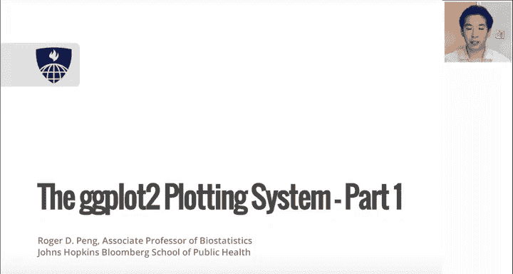

# 课程 P117：ggplot2 第1部分 📊

## 概述

在本节课中，我们将要学习 R 语言中一个强大的绘图包——ggplot2。我们将了解它的基本概念，并学习如何使用 `qplot` 函数来创建基础的图形。ggplot2 基于“图形语法”理论，它提供了一种系统且灵活的方式来构建数据可视化。

## 什么是 ggplot2？

首先，一个非常基础的问题是：什么是 ggplot2？

本质上，它是一个可以从 CRAN 下载的 R 包。它实现了一种称为“图形语法”的理论，该理论最初由 Leland Wilkinson 提出，并在《Grammar of Graphics》一书中进行了描述。

图形语法描述了如何将图形分解为抽象的概念。你可以将其类比为英语语法中的动词、名词和形容词。问题在于，数据图形的“动词”、“名词”和“形容词”是什么？图形语法描述了这些基本元素，以便你可以将它们组合起来创建新型的图形。

就像你可以用一个动词、一个名词和一个形容词组成一个可能从未有人听过的新句子一样，你可以利用图形语法，将图形的各个方面组合起来，创造出前所未见的图形。这就是其基本理念，它是一个用于组织各种数据图形的非常强大的概念。

直到最近，R 语言中还没有其具体的实现。但 Hadley Wickham 在爱荷华州立大学读研究生时，将图形语法实现为一个名为 ggplot 的 R 包。其当前的实现被称为 ggplot2。因此，我们可以将其视为 R 中的第三种图形系统，尽管它是建立在 R 自带的网格图形系统之上的。它已成为一种非常流行的绘图模式。

*   第一种模式是使用 `plot`、`hist`、`boxplot` 等函数的基础绘图系统。
*   第二种模式是使用 `xyplot` 等函数的 lattice 绘图系统。
*   第三种模式就是 ggplot2。

你可以从 CRAN 获取这个包，使用 `install.packages` 命令安装，它几乎可以在所有系统上运行。你也可以访问 ggplot2 的官方网站：ggplot2.org。

ggplot2 的优点在于它基于图形语法，从某种意义上说，它有一套图形理论。你可以利用这套理论，重新组合不同的部分来创建新型的图表。正如 Hadley Wickham 在他的书中所说，其基本理念是缩短从想法到图表的距离。如果你有一些数据，并想到了可视化这些数据的方法，你希望能够迅速将这些想法转化为屏幕上的图像。

## 图形语法的核心思想

从 ggplot2 的书中，这句话概括了其基本思想：图形语法告诉我们，一个统计图形是从数据到美学属性（如颜色、形状、大小）的映射，这些属性应用于几何对象（如点、线、条）。图形还可能包含数据的统计变换，并绘制在特定的坐标系上。

因此，我们拥有从数据到美学属性的映射、几何对象、统计变换和坐标系。

## 初识 qplot 函数

在本讲中，我将主要讨论 `qplot` 函数，它是最基础的函数，对于从基础绘图系统过渡过来的用户来说，可能是最好的起点。

在基础绘图系统中，核心函数是 `plot` 函数。而 `qplot`（可以理解为“快速绘图”）是 ggplot2 中的核心函数，它与基础系统中的 `plot` 函数类似。

使用 ggplot2 时需要习惯的一个关键区别是：当你使用 `qplot` 函数绘图并传递数据时，通常需要告诉它数据来自哪里，而数据总是来自一个数据框。因此，你的数据必须组织在数据框中，然后当你绘制变量时，这些变量将来自该数据框。

如果你不指定数据框，`qplot` 函数（或所有绘图函数）会在你的工作空间中寻找数据。但通常最好指定数据框，这样当你阅读生成图形的代码时，就能确切知道数据来自何处。

## 绘图前的准备：数据框与因子

因此，在开始绘图之前，组织好数据框非常重要。一旦开始绘图，图形由美学属性和几何对象构成。美学属性指的是点的大小、形状、颜色等，而几何对象则是你正在绘制的对象类型，例如是点、线还是条形图等。

对于 `qplot` 函数（以及使用 lattice 函数时同样重要）的一个关键方面是使用因子变量的概念。因子非常重要，因为它们指示了数据的子集。

例如，假设你有一个数据框，其中包含一个 Y 变量、一个 X 变量和一个因子变量。该因子将指示数据框中的数据子集。例如，你可能有一个表示性别的因子，包含一组男性和一组女性，这些就是你的数据子集。你可能希望按不同子集绘制某种关系，或者根据点是男性还是女性来着色。因此，由各种因子变量指示的类别对于标注图形非常有用。

关于这个特性，重要的一点是：当数据中存在因子变量时，你需要确保它们被正确标记。通常，将因子变量标记为 1、2、3 是没有用的，即使你有三个类别。通常你希望用更具信息性的标签来标记它们，以便了解这些因子变量试图编码什么信息。

## 使用 qplot

`qplot` 函数使用起来相当直接，我认为它很容易上手。它隐藏了 ggplot2 底层操作的许多细节，这在许多情况下是没问题的。

但 `ggplot` 函数才是该系统的核心函数，它非常灵活，可以与许多 `qplot` 无法做到的事情结合使用。

## 总结

本节课中，我们一起学习了 ggplot2 的基本概念。我们了解到 ggplot2 是基于“图形语法”理论构建的 R 包，它提供了一种强大且系统的方式来创建数据可视化。我们重点介绍了其入门函数 `qplot`，它类似于基础绘图系统中的 `plot` 函数，但要求数据组织在数据框中，并强调了正确使用因子变量对于图形分组和标注的重要性。在下一讲中，我们将更深入地探讨 ggplot2 的设计原理和扩展功能。