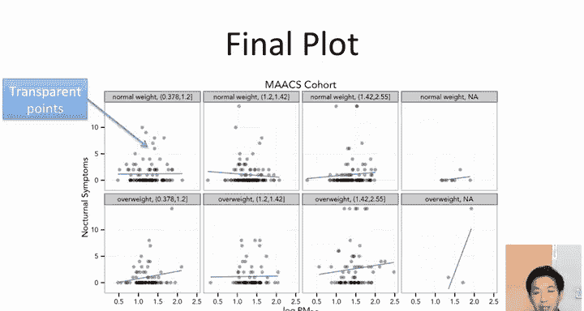

# 📊 课程 21：ggplot2 第五部分

在本节课中，我们将学习 ggplot2 中两个重要的高级主题：如何处理超出绘图范围的数据点，以及如何通过组合多个图层和分面来构建复杂的图形。我们将通过具体的例子来理解这些概念。

---

## 🎯 处理超出绘图范围的数据点

上一节我们介绍了 ggplot2 的基本语法。本节中我们来看看 ggplot2 与基础绘图在处理超出坐标轴范围的数据时有何不同。

在基础绘图中，如果数据点超出了设定的坐标轴范围，线条仍会连接所有数据点，只是超出部分在图中不可见。而在 ggplot2 中，默认行为是绘制所有数据点，包括超出范围的。如果我们简单地通过 `ylim()` 或 `xlim()` 来限制坐标轴，ggplot2 会直接**剔除**超出范围的数据点，导致线条在缺失点处断开。

为了在 ggplot2 中重现基础绘图的行为（即保留数据点但限制显示范围），我们需要使用 `coord_cartesian()` 函数。这个函数会设置坐标轴的显示范围，但不会从数据集中删除任何点。

以下是两种方法的对比代码：

```r
# 基础绘图：线条连接所有点，包括超出范围的
plot(x, y, type = "l", ylim = c(-3, 3))

# ggplot2 错误方法：剔除超出范围的点，线条断开
ggplot(test_data, aes(x, y)) +
  geom_line() +
  ylim(-3, 3)

# ggplot2 正确方法：保留所有点，仅限制显示范围
ggplot(test_data, aes(x, y)) +
  geom_line() +
  coord_cartesian(ylim = c(-3, 3))
```

---

## 🧩 构建复杂图形：组合图层与分面

理解了如何处理数据范围后，现在我们来学习如何通过叠加多个图层和分面来构建更复杂的图形。我们将创建一个研究 PM2.5 与夜间症状关系的图形，并同时考虑 BMI 和 NO2 两个变量的影响。

由于 NO2 是一个连续变量，我们需要先将其分类，以便进行分面绘图。我们可以使用 `cut()` 函数，根据分位数将连续变量切割成几个区间。

以下是准备数据的步骤：

```r
# 计算 NO2 的 33% 和 66% 分位数
cutpoints <- quantile(no2, c(0, 0.33, 0.66, 1), na.rm = TRUE)

# 使用 cut 函数将 NO2 分为三个类别（三分位数）
no2_cat <- cut(no2, breaks = cutpoints)
```

现在，我们可以构建最终的图形。这个图形将包含多个元素：

以下是构建该图形的完整代码：

```r
# 创建 ggplot 对象，设置基本美学映射
p <- ggplot(data, aes(x = pm25, y = nocturnal_symptoms))

# 添加点图层，并设置透明度
p <- p + geom_point(alpha = 0.3)

# 添加分面：按 BMI 类别和 NO2 类别分面
p <- p + facet_wrap(~ bmi_cat + no2_cat)



# 添加平滑曲线（线性回归），并关闭置信区间
p <- p + geom_smooth(method = "lm", se = FALSE)

# 更改主题和字体
p <- p + theme_bw(base_family = "Avenir", base_size = 10)

# 修改坐标轴标签和标题
p <- p + labs(x = "PM2.5 Concentration",
              y = "Nocturnal Symptoms Score",
              title = "Relationship between PM2.5 and Symptoms by BMI and NO2")
```

通过这段代码，我们逐步添加了散点、分面、平滑线和主题样式，最终形成了一个信息丰富、可读性强的多面板图形。ggplot2 的这种模块化特性，使得构建和定制复杂图形变得非常直观和灵活。

---

## 📝 总结

本节课中我们一起学习了 ggplot2 的两个高级技巧。

首先，我们了解了 `coord_cartesian()` 函数在处理超出绘图范围数据时的重要性，它能确保数据不被剔除，仅调整显示范围。

其次，我们通过一个综合案例，实践了如何将连续变量分类、使用 `facet_wrap()` 进行分面、叠加多个几何对象（如 `geom_point` 和 `geom_smooth`），以及如何通过 `theme()` 和 `labs()` 函数来美化图形。


总而言之，ggplot2 是一个功能强大且灵活的绘图系统。掌握其“图形语法”，理解如何组合不同的图层和组件，你就能为你的数据创建出几乎任何类型的可视化图形。最好的学习方式就是多动手尝试和探索。