# 课程 P124：层次聚类（第3部分）🎯

在本节课中，我们将学习如何优化层次聚类结果的可视化，理解不同的聚类合并策略（如平均连接和完全连接），并探索热图函数在可视化高维数据中的应用。

上一节我们介绍了层次聚类的基本概念和树状图的生成。本节中我们来看看如何美化树状图，并深入探讨聚类合并的不同方法。

## 美化聚类树状图 🌳

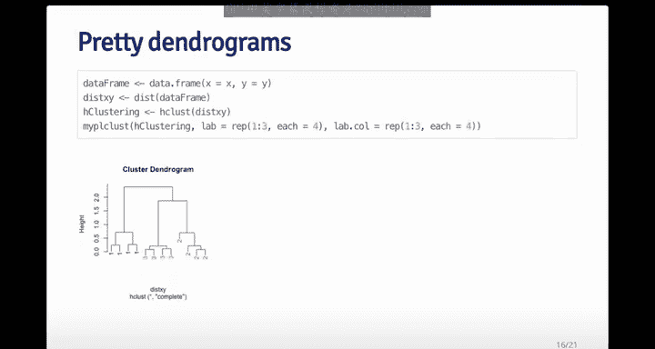

R语言默认生成的聚类树状图效果尚可，但我们可以通过特定函数使其更美观。课程网站上提供了一个名为 `myPcluster` 的函数，下载并导入R环境后即可使用。

该函数生成的树状图有两个特点：
1.  每个聚类中的点都会用其聚类标签进行标记。
2.  不同的聚类会以不同的颜色区分。

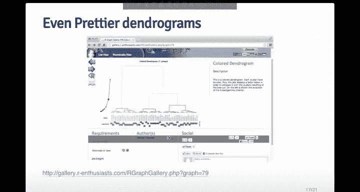

例如，聚类1的标签全是“1”且显示为黑色，聚类2显示为红色，聚类3显示为绿色。当然，使用此功能前，需要先确定聚类的数量，才能进行标记和着色。

你还可以访问R图形库，查看更丰富有趣的聚类图示例，并了解用于创建精美聚类图的软件。例如，下面这个树状图在叶节点上添加了标签，对不同组进行了着色，并包含了一些额外信息。该图库中还有许多其他优秀的可视化案例。

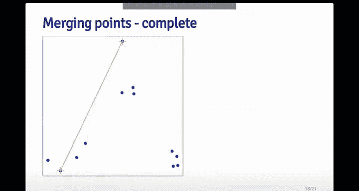

## 聚类合并策略 🔗

使用层次聚类时，另一个关键问题是如何合并点。核心在于：合并后，新点的位置用什么来代表？

以下是两种主要的合并策略：

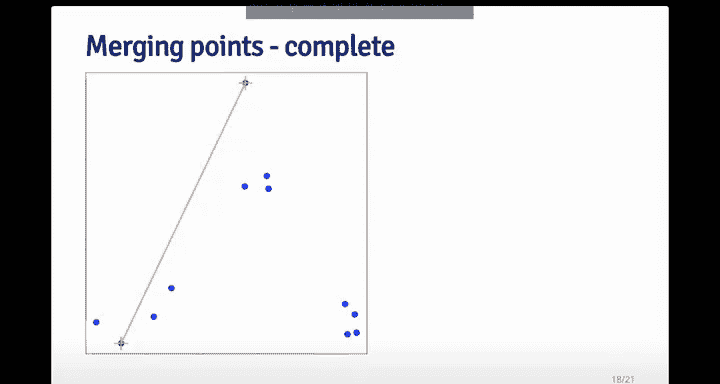

**平均连接**
其思想是，合并两个点（或聚类）后，新坐标位置是其所有点坐标的平均值。这类似于该点群的重心或中心点。
**公式表示**：新坐标 = (所有点x坐标的平均值， 所有点y坐标的平均值)

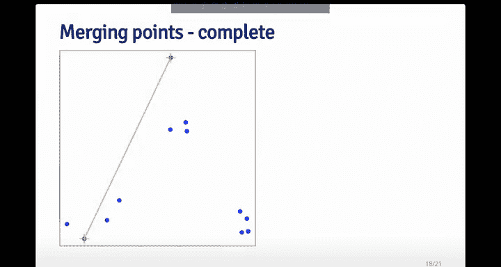

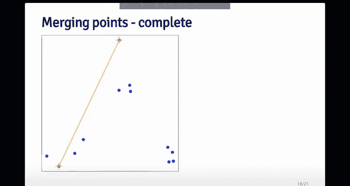

这种方法逻辑直观，会产生特定类型的聚类结果。

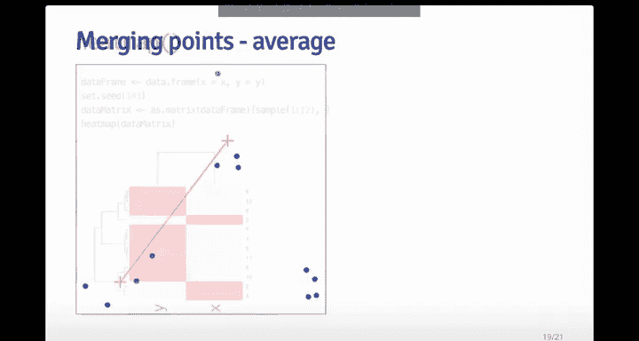

**完全连接**
其思想是，衡量两个聚类之间的距离时，取两个聚类中彼此最远的两个点之间的距离作为聚类间距。
**公式表示**：聚类间距 = max(点A到点B的距离)， 其中点A属于聚类1，点B属于聚类2

例如，在下图中，上方聚类与左下方聚类之间的距离，等于两个聚类中最远两点间的距离。

可以看到，在完全连接的例子中，聚类间距相对较远；而在平均连接的例子中，间距则较短一些。没有绝对正确或错误的方法，关键在于这两种不同的合并策略可能产生非常不同的结果。因此，尝试两种方法以观察最终得到哪种聚类结果，以及哪一种结果更合理，通常是很有用的。

## 热图函数可视化 📊

接下来要重点介绍的是 `heatmap` 函数，这是一个用于可视化矩阵数据的强大工具。

如果你有一个非常大的表格或数值矩阵，且数值尺度相似，希望快速、有条理地查看，可以调用 `heatmap` 函数。该函数本质上会对表格的行和列分别运行层次聚类分析。

*   将表格的行视为观测值，对其运行聚类分析。
*   将表格的列也视为不同的观测值集（即使它们实际上是变量等），同样运行聚类分析。

`heatmap` 函数的思想是利用层次聚类的结果来重新组织表格的行和列，然后使用图形函数来可视化。它会创建一个图像图，并根据层次聚类算法重新排列表格的行和列的顺序。

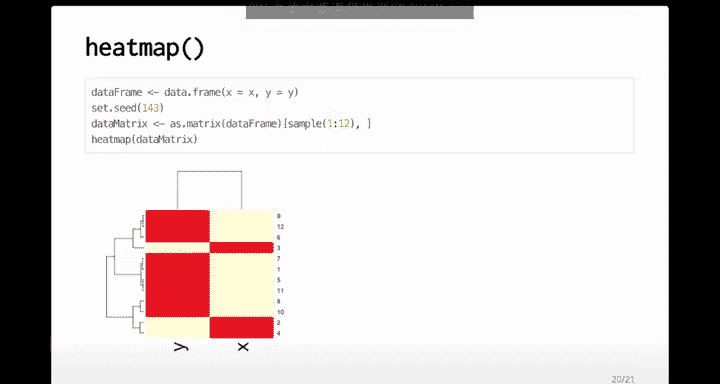

如下图所示，在行方向上，树状图显示可能存在三个聚类，因此这些行被分组在一起。这个数据框只有两列，所以对列进行聚类分析的意义不大。但如果你有很多列，`heatmap` 函数会重新组织列，使相似的列靠得更近，差异大的列相距更远。

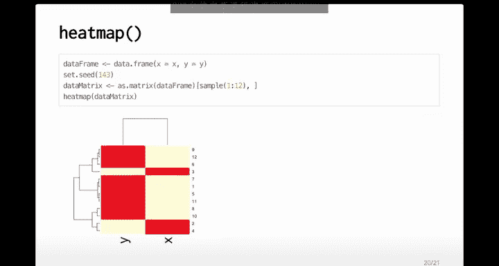

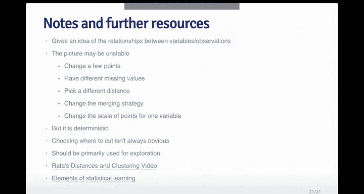

因此，`heatmap` 函数对于快速可视化这类高维表格数据非常有用。

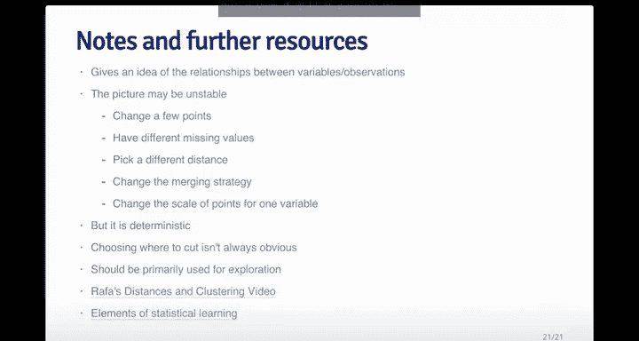

## 总结与注意事项 📝

本节课中我们一起学习了层次聚类的进阶内容。

**总结**
层次聚类是观察高维数据的一种非常有用的技术，它能以逻辑直观的方式组织数据。特别是像 `heatmap` 这样的函数，对于快速查看表格或矩阵数据极具价值。

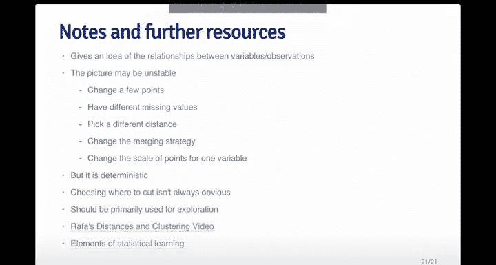

进行层次聚类需要明确两点：
1.  定义两个点之间“远近”的概念（距离度量）。
2.  确定合并策略（如完全连接和平均连接）。

给定这两点，层次聚类算法就会运行并产生一个聚类树状图，展示点是如何通过算法逐步合并的。

**注意事项**
层次聚类（以及许多其他聚类算法）可能存在几个问题：
1.  **结果不稳定性**：聚类结果可能不稳定。例如，如果少数数据点发生变化或存在异常值，移除或稍微修改这些点可能导致最终的聚类树状图发生很大变化。因此需要注意这种可能性。
2.  **参数敏感性**：尝试不同的距离度量以检查结果对度量的敏感性，或者改变合并策略以观察输出图形的变化，通常是很有用的做法。
3.  **变量尺度影响**：聚类算法可能对变量的尺度敏感。如果某个变量的测量单位远大于另一个变量，有时会干扰算法。因此，对某些变量进行缩放，使它们之间更具可比性，可能是有益的。

层次聚类算法（至少这里讨论的版本）的一个优点是它是**确定性的**，没有随机起始点，也不包含随机性。只要使用相同的参数和数据，运行一次就会得到相同的图形。

当然，任何聚类方法的一个关键问题是在何处切割树状图以确定最终聚类数量。确定有多少个聚类并不总是显而易见的，虽然已有一些算法被提出来尝试解决这个问题，但层次聚类的最佳用途可能还是在于**探索性分析**，用于查看和可视化数据，初步感知是否存在任何模式。然后，你可以将这些发现融入更复杂的模型中进行形式化。

课程提供了一些关于这些方法的更详细资料的链接，鼓励你进一步查阅和探索。

