# 课程 P127：降维技术（第一部分）🔍

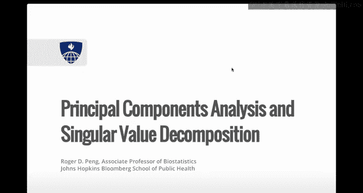


在本节课中，我们将学习两种重要的降维技术：主成分分析和奇异值分解。这两种方法在探索性数据分析阶段和正式建模阶段都非常有用。我们将重点讨论它们在探索性分析中的应用，并深入理解其背后的基本原理。

## 无模式数据的探索 🔎

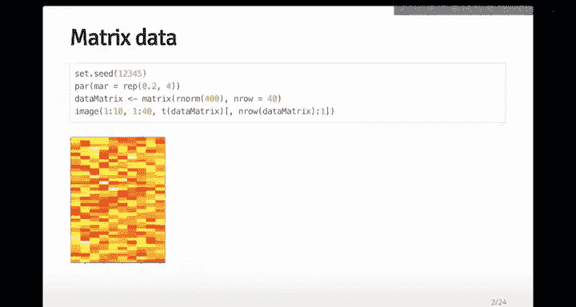

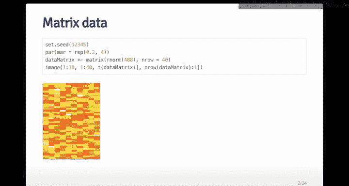

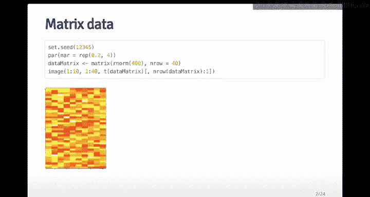

首先，我们来看一个没有明显模式的数据集。以下代码生成一个随机正态分布数据的矩阵：

```r
set.seed(12345)
dataMatrix <- matrix(rnorm(400), nrow=40)
image(1:10, 1:40, t(dataMatrix)[, nrow(dataMatrix):1])
```

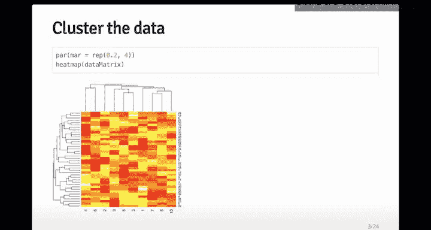


生成的矩阵图像显示，数据看起来非常嘈杂，没有明显的模式，这符合我们对随机数据的预期。

上一节我们生成了一个随机矩阵，本节中我们来看看如何对这样的数据进行聚类分析。

我们可以对数据框的行和列分别进行层次聚类分析。在R语言中，使用 `heatmap` 函数可以轻松实现这一点：


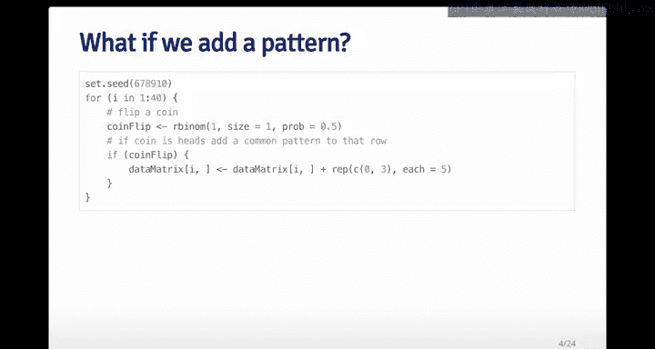


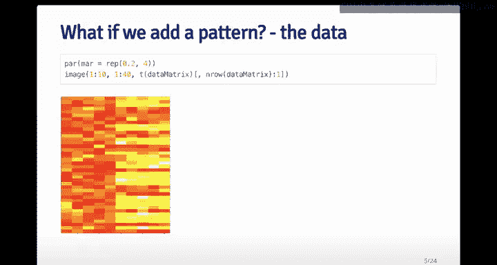

```r
heatmap(dataMatrix)
```


运行后，我们会在矩阵的顶部和左侧看到树状图。然而，由于数据本身没有内在的有趣模式，聚类分析的结果也没有显示出明显的分组结构。

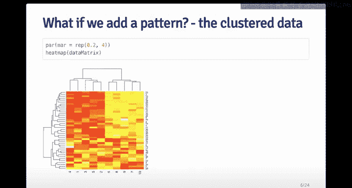

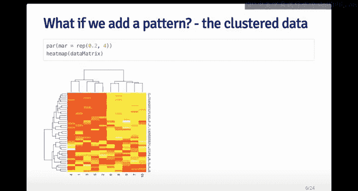

## 引入模式后的数据变化 📊

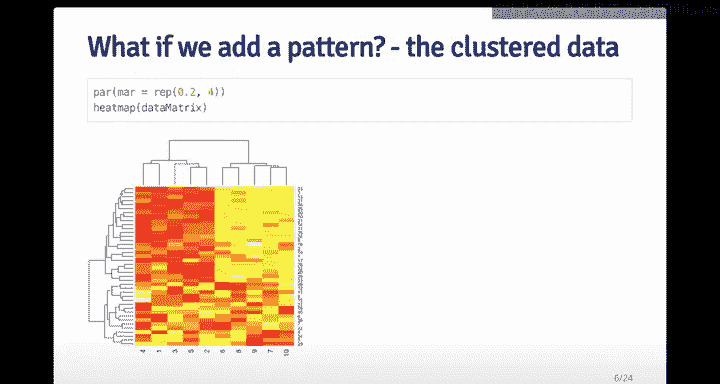

现在，我们尝试在数据集中添加一个模式。以下代码通过一个循环，随机选择一些行，并在这些行的部分列上添加一个偏移量：

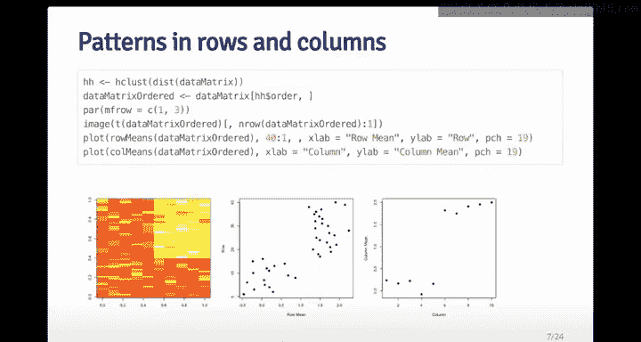

```r
set.seed(678910)
for(i in 1:40){
  coinFlip <- rbinom(1, size=1, prob=0.5)
  if(coinFlip){
    dataMatrix[i, ] <- dataMatrix[i, ] + rep(c(0,3), each=5)
  }
}
```

添加模式后，再次绘制矩阵图像，可以观察到右侧五列的颜色更偏黄（表示数值较高），而左侧五列的颜色更偏红（表示数值较低）。这是因为部分行在右侧列的均值被提高了。

现在，如果我们对包含模式的数据再次运行层次聚类分析：

```r
heatmap(dataMatrix)
```

可以清晰地看到，顶部的树状图（基于列的聚类）将10列明确地分成了两个簇：左侧5列和右侧5列。然而，行的聚类结果仍然不明确，因为行方向上没有添加系统性模式。

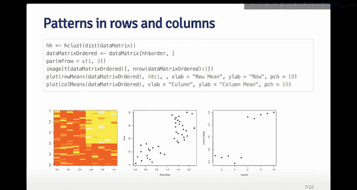


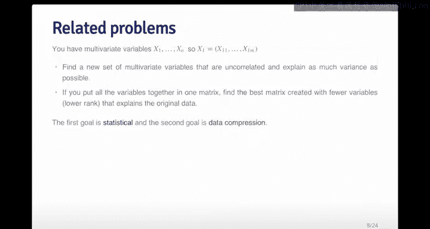

## 通过边际均值观察模式 📈

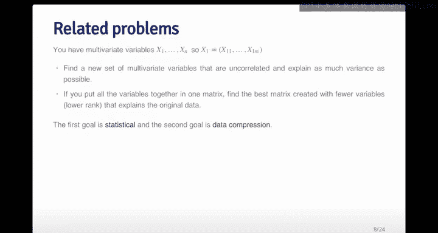

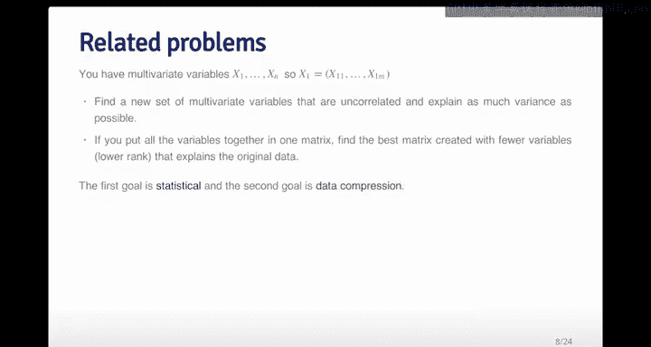

为了更细致地观察行和列的模式，我们可以查看行和列的边际均值。

以下是相关的分析步骤：
*   在左侧图中，我们展示了经过行聚类重排后的原始矩阵图像。
*   在中间图中，我们绘制了每一行的均值。Y轴是行号（1到40），X轴是该行的均值。可以观察到，不同行的均值存在明显差异。
*   在右侧图中，我们绘制了每一列的均值。可以清晰地看到，前5列的均值接近0，而后5列的均值接近2，存在一个明显的偏移。

通过这些边际均值图，我们可以更直观地看到数据在行和列方向上的结构模式。

## 降维的核心问题 🤔

聚类分析有助于识别这类模式，但我们也可以采用一种更形式化的方法，利用数据的矩阵结构。这里主要涉及两类相关的问题：

以下是两个核心的降维目标：
1.  **变量压缩（统计视角）**：当我们拥有大量变量时，希望创建一组数量更少的新变量。这组新变量应满足两个条件：一是彼此不相关（代表数据中不同类型的变化）；二是能够尽可能多地解释原始数据集中的变异性。主成分分析是解决这一问题的常用方法。
2.  **数据压缩（矩阵视角）**：如果将所有变量放在一个矩阵中，我们希望找到一个由更少变量构成的、秩更低的矩阵，这个矩阵能以较小的信息损失来近似表示原始数据。奇异值分解是理解和解决这一问题的关键工具。

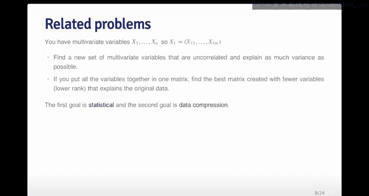

## 奇异值分解与主成分分析 🧮

奇异值分解可以用矩阵形式表示为：

**X = U D V^T**

其中：
*   **X** 是原始数据矩阵（行是观测，列是变量）。
*   **U** 的列是正交的，称为**左奇异向量**。
*   **V** 的列是正交的，称为**右奇异向量**。
*   **D** 是一个对角矩阵，其对角线上的元素称为**奇异值**。

主成分分析通常使用奇异值分解。其基本思想是：首先将原始数据矩阵的每一列进行标准化（减去列均值，除以列标准差），然后对这个标准化后的矩阵进行奇异值分解。此时，**主成分就等于标准化矩阵的右奇异向量（即 V 矩阵）**。

---

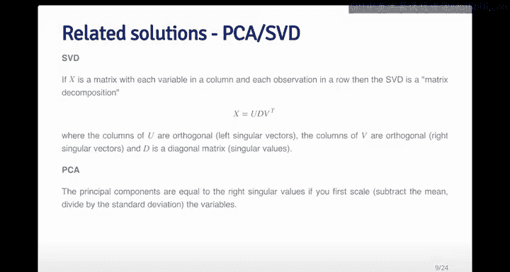

本节课中我们一起学习了降维技术的初步概念。我们通过实例看到了如何在数据中识别模式，并介绍了两种核心的数学工具：奇异值分解和主成分分析。理解这些基础是后续深入学习降维方法及其应用的关键。