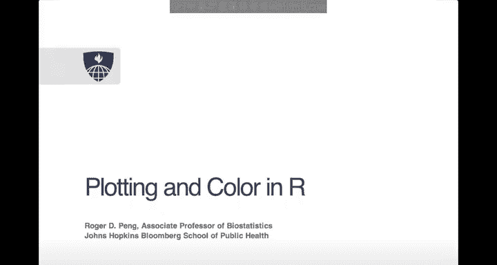
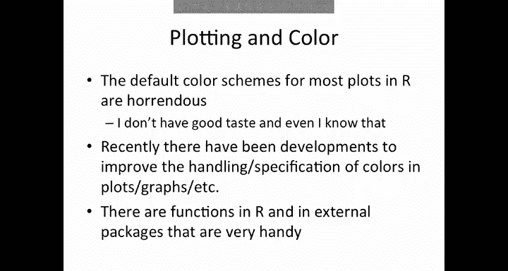
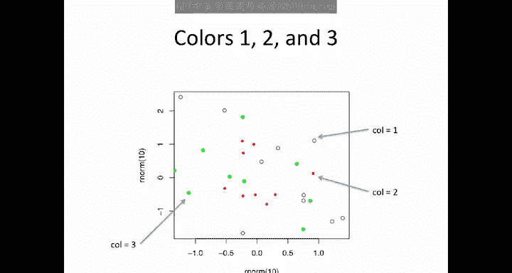

# 课程 30：🎨 在 R 绘图中处理颜色（第 1 部分）

在本节课中，我们将要学习如何在 R 语言绘图中处理和使用颜色。颜色选择虽然看似次要，但恰当运用能有效突显数据关系，提升图表表现力。

上一节我们介绍了 R 语言的基础绘图系统，本节中我们来看看如何通过调色板来指定不同的颜色。

## 默认配色方案的问题

大多数绘图函数的默认配色方案效果不佳。即使不是设计专家，也能看出这些自然生成的配色通常不适合展示不同类型的数据。

R 的核心系统及一些扩展包提供了更好的颜色处理和指定方案，本讲将介绍其中一个包及其相关函数。

## 标准颜色索引的局限性

以下是 R 中一个相当标准的散点图示例，图中点使用了三种颜色：黑色、红色和绿色。

这种现象的原因是，大多数绘图函数中都有一个 `col` 参数。设置 `col = 1` 得到黑色，`col = 2` 得到红色，`col = 3` 得到绿色。因此，如果你需要三种颜色，很容易想到使用 `col = 1:3`。

`col = 4` 对应蓝色，`col = 5` 对应洋红色。这些是设置 `col` 参数为 1、2、3、4 或 5 时的标准颜色。

然而，红色和绿色在此情境下可能缺乏特定含义。从设计角度看，长期使用此配色方案会使所有图表看起来千篇一律，缺乏针对性。

核心问题在于，我们能否选择一组更好的颜色，以更有效地传达我们想要表达的信息。

## 不同调色板的视觉比较

另一个标准颜色集展示如下。这是 R 自带的 `volcano` 数据集，显示了火山的不同海拔高度。

左侧的颜色集来自 `heat.colors` 调色板。该调色板的颜色从表示低值的偏红色，过渡到表示高值的黄色或白色。

右侧的颜色集称为地形色（`topo.colors`）。该调色板从表示低值的蓝色，过渡到表示高值的棕色或白色。

对于 `heat.colors`，如果你了解火焰，可能可以合理推断出图中高低值的对应关系。

对于 `topo.colors`，蓝色表示低、绿色表示更高，这对一些人来说可能并不直观。

本节课中我们一起学习了 R 绘图中的基础颜色处理，认识了默认配色方案的局限性，并初步比较了不同调色板（如 `heat.colors` 和 `topo.colors`）的视觉表现。下一讲我们将深入探讨如何选择和应用更合适的调色板。