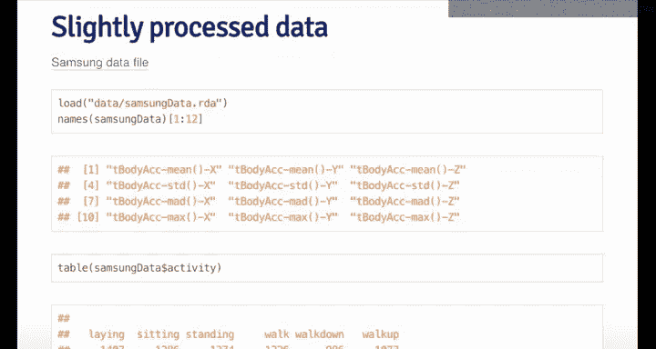
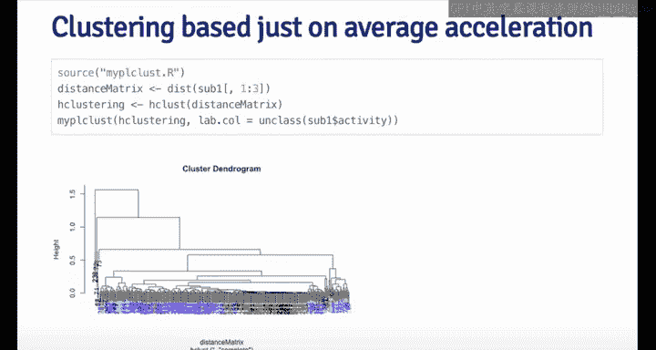
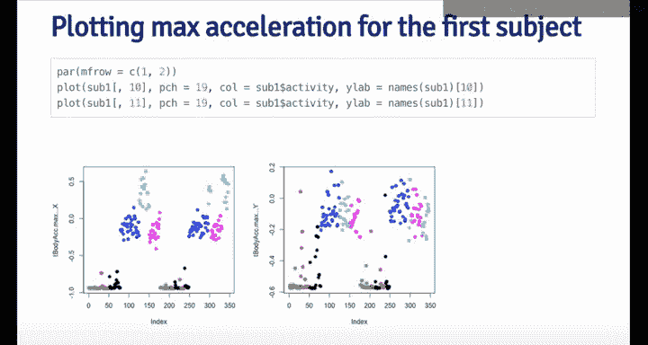
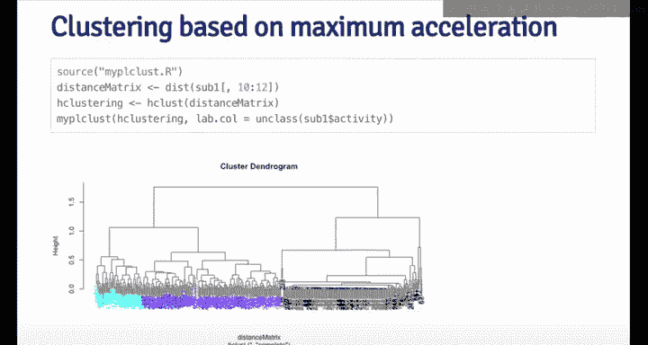
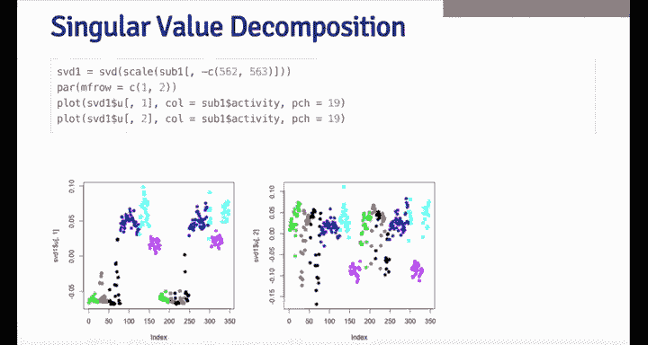
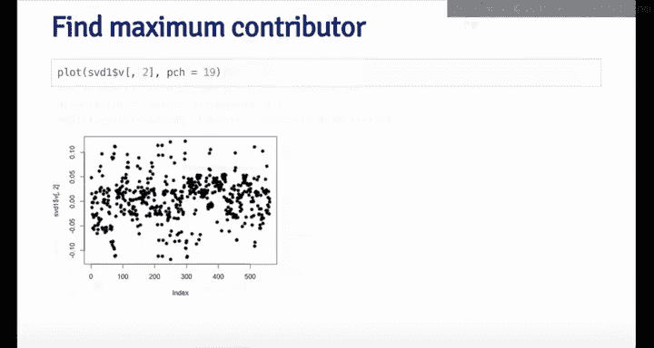
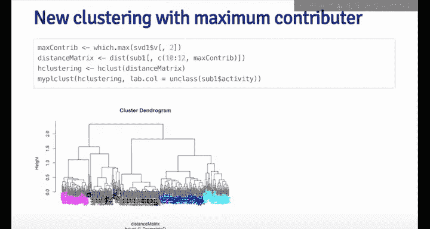
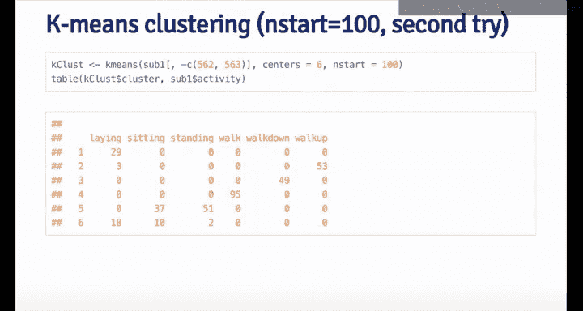
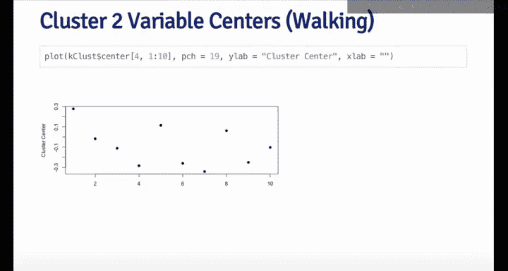

# 课程34：聚类案例研究 📊


在本节课中，我们将通过一个具体案例，深入学习探索性数据分析技术。我们将使用一个涉及智能手机预测人类活动的数据集，演示如何应用聚类分析来探索数据、发现模式，并指导后续的正式分析方向。

探索性数据分析的核心在于，在深入分析前，先对数据有一个初步的、粗略的了解。这能帮助我们判断哪些问题可能通过现有数据得到解答，哪些则不能，从而引导我们聚焦于可行的分析路径。

上一节我们介绍了探索性数据分析的基本理念，本节中我们来看看如何在一个真实数据集上应用这些理念。


## 数据来源与背景 📱

本案例使用的数据来自加州大学欧文分校的机器学习存档库。数据基于三星Galaxy手机（如S2或S3型号）内置的加速度计和陀螺仪传感器，旨在通过手机数据预测使用者的活动状态。


手机中的传感器可以记录人体在三维空间中的位置和加速度信息，前提是使用者随身携带手机。

## 数据概览 📋


为了本次演示，我们使用了该数据集的一个子集，即训练数据部分。数据经过初步处理，以矩阵形式呈现：每一行代表一次观测，每一列代表一个特征。

数据集的最后一列是活动标签，指明了每次观测时使用者正在进行的活动。共有六种可能的活动：躺下、坐下、站立、行走、下楼梯和上楼梯。

我们的目标是，基于加速度计和陀螺仪收集的众多特征，区分这六种活动。



以下是前12个特征的示例，它们包括身体加速度在X、Y、Z方向上的均值、标准差、平均绝对差和最大值等。

## 初步可视化探索 📈

首先，我们可以快速查看第一位受试者的平均加速度数据。为此，我们需要先将活动变量转换为因子变量。

以下代码演示了如何转换并筛选出第一位受试者的数据：
```r
# 转换活动变量为因子
data$activity <- as.factor(data$activity)
# 筛选第一位受试者
subject1_data <- subset(data, subject == 1)
```

接着，我们绘制第一位受试者在X和Y方向上的平均身体加速度图，并用不同颜色标注各类活动。

从图中可以发现，对于站立、坐下、躺下等活动，平均身体加速度的变化相对平缓。而对于行走、上下楼梯等活动，X方向的平均加速度则表现出更大的变异性。

## 基于平均加速度的聚类分析 🔍



我们可以尝试仅基于平均加速度对数据进行聚类。我们选取数据矩阵的前三列（代表三个方向的平均加速度），计算欧几里得距离矩阵，并进行层次聚类分析。

生成的聚类树状图显示，聚类结果较为混乱，各种颜色的点（代表不同活动）混杂在一起，没有清晰的模式。这表明仅凭平均加速度可能无法有效区分所有活动，我们需要进一步探索其他特征。

## 探索最大加速度特征 🚀



接下来，我们查看第一位受试者的最大加速度特征。我们绘制了X和Y方向的最大身体加速度图。

观察发现，与平均加速度类似，对于非移动活动（躺、坐、站），最大加速度没有太多有趣的变化。但对于移动活动（行走、上下楼），最大加速度则表现出显著的变异性。这提示最大加速度可能是区分移动与非移动状态的有效预测因子。

## 基于最大加速度的聚类分析



如果我们基于最大加速度进行层次聚类，结果会清晰许多。

聚类树状图左侧清晰地聚集了各种移动活动，右侧则聚集了各种非移动活动。这成功地将“移动”与“非移动”状态分离开来。

然而，在移动活动集群内部或非移动活动集群内部，不同活动（如上楼与下楼，或坐下与站立）仍然混杂在一起。这说明最大加速度能很好地区分宏观状态，但不足以细分具体活动。

## 使用奇异值分解探索数据 🧮



为了更深入地探索数据，我们可以尝试奇异值分解。在进行SVD之前，我们移除了数据矩阵的最后两列（活动标识和受试者标识），因为它们不是传感器特征。



对处理后的矩阵进行SVD，并查看前两个左奇异向量，同样按活动着色。

第一奇异向量似乎主要区分了移动与非移动活动。第二奇异向量则可能进一步分离出了某种特定的移动活动（如下楼或上楼），但其模式相对模糊。

## 识别关键特征贡献度



为了理解第二奇异向量揭示了什么，我们可以找出在第二右奇异向量中贡献最大的特征（即对应绝对值最大的系数）。这个特征对观测值之间的差异贡献最大。

以下代码展示了如何找到这个“最大贡献者”特征：
```r
# 假设svd_result是SVD的结果，v是右奇异向量矩阵
max_contrib_index <- which.max(abs(svd_result$v[, 2]))
max_contrib_feature <- colnames(data)[max_contrib_index]
```


## 结合关键特征的改进聚类

我们将这个“最大贡献者”特征与最大加速度特征结合起来，再次进行层次聚类。

结果显示，三种移动活动（行走、下楼梯、上楼梯）现在被更清晰地分离开来。然而，非移动活动仍然混合在一起。这表明，我们找到的这个额外特征对于细分移动活动很有帮助，但对区分非移动活动作用有限。

这个“最大贡献者”特征是Z方向上的频域平均身体加速度，即对Z方向加速度进行快速傅里叶变换后得到的频率成分。这为我们提供了新的洞察。

## 尝试K均值聚类算法 🎯

除了层次聚类，我们还可以尝试K均值聚类。需要注意的是，K均值的结果可能因初始聚类中心的随机选择而不同。为了获得更优解，通常需要设置多个初始值并多次运行算法。

我们知道数据中有六类活动，因此设定聚类数K=6。

首次运行K均值的结果显示，某些集群（如集群3）混合了躺、坐、站三种活动，而移动活动则能被较好地分离。



即使尝试多次运行（如设置`nstart=100`以尝试100个不同的初始值），最优结果中仍然存在混合了多种非移动活动的集群。这证实了区分这些静态活动的挑战性。

## 分析聚类中心特征

每个K均值聚类都有一个中心点，位于高维特征空间中。通过检查这些中心点在各个特征上的值，我们可以了解是哪些特征驱动了该集群的形成。

例如，对应于“躺下”活动的集群中心，在前三个特征（平均身体加速度）上有较高的正值，而在其他一些特征上值较低。而其他集群的中心则可能在其他特征（如最大加速度）上表现出显著值。

通过观察聚类中心，我们可以推测哪些特征对于预测特定活动可能是最重要的，这为后续的特征选择和模型构建提供了线索。

## 课程总结 📝



本节课中，我们一起学习了如何对一个拥有大量特征和观测值的数据集进行探索性分析。我们运用了层次聚类、K均值聚类和奇异值分解等多种技术来探查数据的内在结构。

通过本次探索，我们获得了一个重要的“粗略判断”：基于少数变量（主要是最大加速度相关变量），我们似乎能够较好地区分不同的移动活动（走、上、下）。然而，区分非移动活动（躺、坐、站）则更为困难。

探索性数据分析的价值正在于此：它提供了一个初步蓝图，告诉我们应将精力集中在哪里。根据本次分析，我们可能无需在区分移动活动上花费过多精力，而需要更深入地探究那些非移动活动，寻找能有效区分它们的特征。

希望本案例能帮助你理解如何起步运用聚类技术，以及如何通过审视数据来推动你的分析进程，为更正式的分析奠定基础。