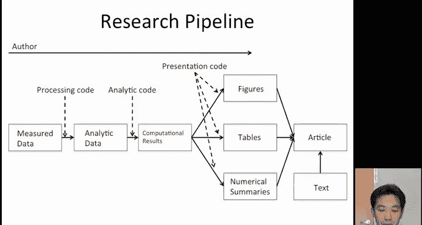
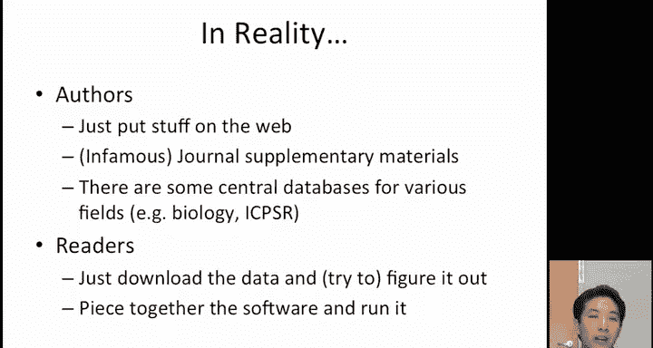

# 课程名称：可重复研究概念与思想（第二部分）📚

在本节课中，我们将深入探讨可重复研究的基本概念、面临的挑战以及实现可重复性所需的关键要素。我们将从研究流程的视角出发，理解作者与读者在可重复性中的角色，并分析当前实践中的主要困难。

---

## 研究流程与可重复性的核心思想

当您阅读文献中的研究文章时，您通常只能看到最终的论文。然而，众所周知，文章背后蕴含着大量的工作。这整个后台过程被称为 **研究流程**。

如上图所示，作者沿着研究流程从左向右推进工作。而作为读者，您则从右向左回溯：您阅读文章，并希望了解背后发生了什么、数据从何而来、使用了哪些方法。可重复研究的基本思想，就是聚焦于流程中的 **分析数据** 和 **计算结果** 这两个环节。

通过实现可重复性，我们试图让作者和读者能在中间环节“相遇”，从而使研究过程更加透明和可验证。

---

## 可重复研究的重要性与背景

可重复研究在媒体和科学文献中已被广泛讨论。例如，《科学》杂志曾出版关于可重复性和数据复现的专刊。电视节目《60分钟》也曾报道杜克大学的一起事件，该事件中许多研究结果被发现无法重复，导致多项临床试验被迫中止，并引发了持续至今的大量调查。

作为对一系列科学研究可重复性事件的回应，美国医学研究所发布了一份报告，旨在确立最佳实践，以促进和鼓励可重复性，特别是在基因组学、蛋白质组学等“组学”研究领域。

这份报告提出了多项重要建议，其中包括：数据和元数据应公开可用；计算机代码应完全公开，以便他人审查；计算分析的所有步骤都应被详细描述，以供研究和复现。

---

## 实现可重复研究的要素

那么，实现可重复研究具体需要什么呢？以下是一个基本的定义框架：

1.  **分析数据可用**：这是指用于生成文中结果的数据。它不同于原始数据，因为一次分析通常只使用原始数据的一个子集。虽然查看原始数据可能有益，但通常不切实际。因此，**分析数据**是检验数据分析的关键。
2.  **分析代码可用**：这是指应用于分析数据并产生关键结果的代码，例如回归建模代码等。
3.  **代码与数据的文档**：对代码和数据进行充分的文档说明至关重要。
4.  **标准的传播方式**：所有数据和代码必须能够通过标准、便捷的途径获取。

公式化表示，可重复研究的核心要素可概括为：
**可重复研究 = 可用数据 + 可用代码 + 完整文档 + 便捷传播**

---

## 相关方与当前挑战

在讨论可重复性时，涉及多个利益相关方，主要分为两类：

*   **作者**：生产研究，希望使其工作可重复，需要工具来简化这一过程。
*   **读者**：阅读研究，希望复现他人工作，同样需要工具来降低复现难度。

当前面临的主要挑战包括：

以下是作者面临的主要困难：
*   作者需要付出相当大的努力才能将结果、数据和代码发布到网上。尽管现在可用的资源比五年前多，但这仍然是一项挑战。
*   即使数据代码已发布，它们也常常散落在期刊补充材料（以杂乱著称）或少数几个中心化数据库中。如果您的领域没有这样一个通用数据库，发布数据将更加困难。

以下是读者面临的主要困难：
*   读者需要手动下载数据、结果和代码，并手工将它们拼凑起来，这个过程通常并不轻松。
*   读者可能不具备与原作者相同的计算资源（例如大型计算集群），因此难以精确复现相同结果。
*   尽管正在增长，但用于实现可重复研究的工具箱仍然有限，工具支持不足。

现实中，作者往往只是简单地将材料扔到网上，而读者则不得不手动下载、拼凑代码和软件，整个过程困难重重。

😊

---

## 总结

本节课中，我们一起学习了可重复研究的概念框架。我们了解到，可重复性旨在通过公开**分析数据**、**分析代码**及其**文档**，并采用**标准传播方式**，来弥合研究作者与读者之间的鸿沟。同时，我们也认识到当前实践中，无论是作者发布还是读者复现，都面临着数据管理、资源匹配和工具支持等多方面的挑战。理解这些概念和挑战是迈向更可靠、更透明科学研究的第一步。