# 课程12：连接GitHub和RStudio 🛠️

在本节课中，我们将学习如何将RStudio与GitHub连接起来。通过建立这个连接，你可以在RStudio中直接使用Git进行版本控制，并将你的项目轻松推送到GitHub仓库，从而最大化利用版本控制流程的优势。

---

## 在RStudio中配置Git

上一节我们介绍了Git和GitHub的基本概念。本节中，我们来看看如何在RStudio中配置Git。

首先，确保你的电脑上已安装Git并拥有GitHub账户。打开RStudio，按照以下步骤操作：

1.  点击顶部菜单栏的 **Tools**（工具）。
2.  在下拉菜单中选择 **Global Options...**（全局选项）。
3.  在弹出的选项窗口中，选择 **Git/SVN** 标签页。

有时，RStudio自动检测到的Git可执行文件路径可能不正确。请检查 `Git executable`（Git可执行文件）一栏中显示的路径，确认 `git.exe` 文件确实存在于该目录下。如果路径不正确，点击 **Browse...**（浏览）按钮，手动定位到正确的 `git.exe` 文件路径。


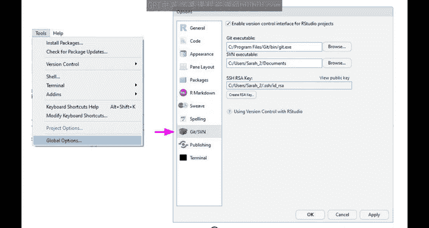

路径确认无误后，点击 **OK** 或 **Apply**（应用）按钮。至此，RStudio和Git已成功链接。

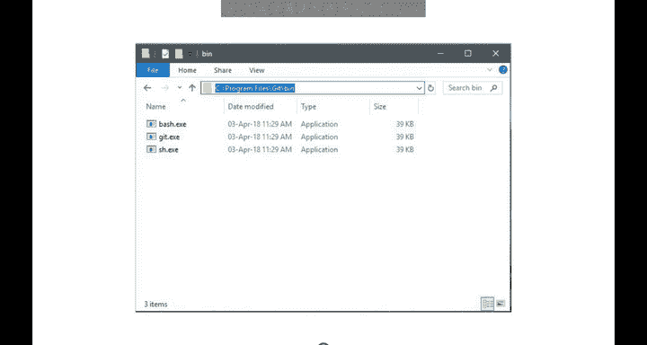


---

## 生成SSH密钥并链接GitHub

现在，我们需要将RStudio与你的GitHub账户链接。这需要通过SSH密钥进行安全认证。

在刚才的 **Git/SVN** 选项窗口中，点击 **Create RSA Key...**（创建RSA密钥）按钮。密钥生成完成后，点击 **Close**（关闭）。

接着，在同一个窗口中，点击 **View public key**（查看公钥）按钮。你会看到一串由数字和字母组成的字符串，这就是你的公钥。复制这串公钥，然后关闭这个窗口。

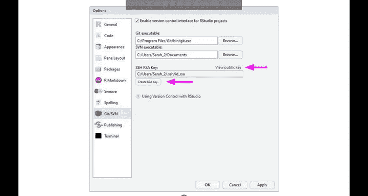

这个密钥是你的专属标识。我们将把它提供给GitHub，这样当你从RStudio提交更改时，GitHub就能识别你的身份。


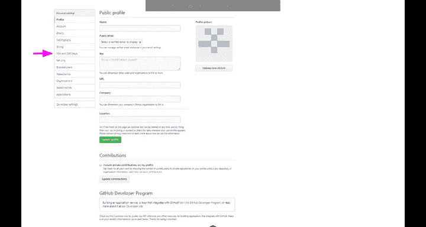

以下是链接GitHub的步骤：

1.  打开浏览器，访问 [GitHub.com](https://github.com) 并登录你的账户。
2.  点击右上角你的头像，进入 **Settings**（设置）。
3.  在左侧边栏中，找到并点击 **SSH and GPG keys**（SSH和GPG密钥）。
4.  点击 **New SSH key**（新建SSH密钥）按钮。


5.  在 `Title`（标题）字段中，为这个密钥起一个与RStudio相关的名字（例如“My RStudio”）。
6.  将你从RStudio复制的公钥粘贴到 `Key`（密钥）框中。
7.  最后，输入你的GitHub密码进行确认，并点击 **Add SSH key**（添加SSH密钥）。

现在，GitHub和RStudio已经成功链接。

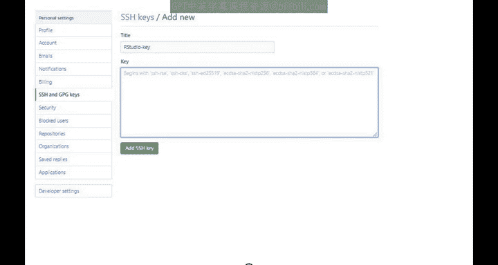

---


## 创建GitHub仓库并关联到RStudio项目

接下来，我们可以在GitHub上创建一个新仓库，并将其与RStudio中的一个新项目关联。

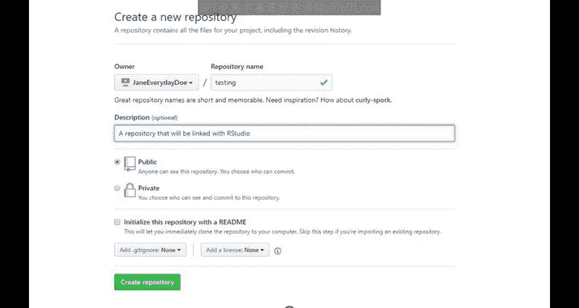

首先，在GitHub上创建仓库：

1.  在GitHub页面，点击你的头像，选择 **Your repositories**（你的仓库）。
2.  点击绿色的 **New**（新建）按钮。
3.  为你的新仓库命名（例如“test-repo”），并添加一个简短的描述。
4.  点击 **Create repository**（创建仓库）按钮。


仓库创建成功后，页面会显示仓库的URL。请复制这个URL地址。


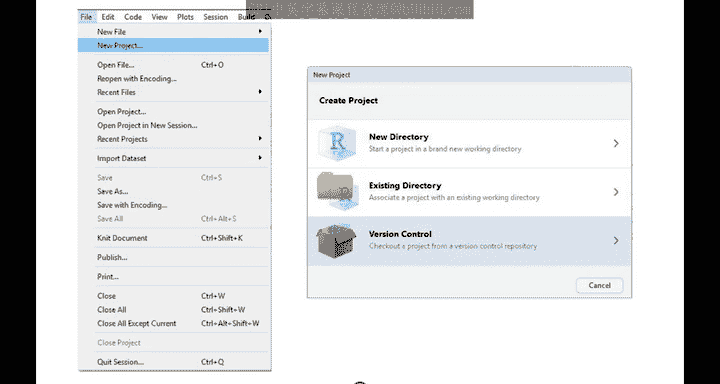

然后，回到RStudio进行操作：

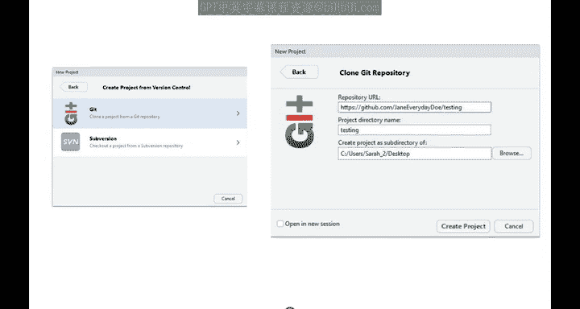

1.  点击菜单栏的 **File**（文件），选择 **New Project...**（新建项目）。
2.  在弹出的窗口中，选择 **Version Control**（版本控制）。
3.  接着选择 **Git** 作为版本控制软件。
4.  在 `Repository URL`（仓库URL）字段中，粘贴你刚刚复制的GitHub仓库URL。
5.  在 `Create project as subdirectory of`（项目创建目录）字段中，选择你希望保存此项目的本地文件夹路径。
6.  点击 **Create Project**（创建项目）。


这个操作会初始化一个新的R项目，该项目已链接到你的GitHub仓库，并会在一个新会话中打开。

---

## 创建文件并提交到GitHub

现在，让我们在新项目中创建一个R脚本文件，并将其推送到GitHub。

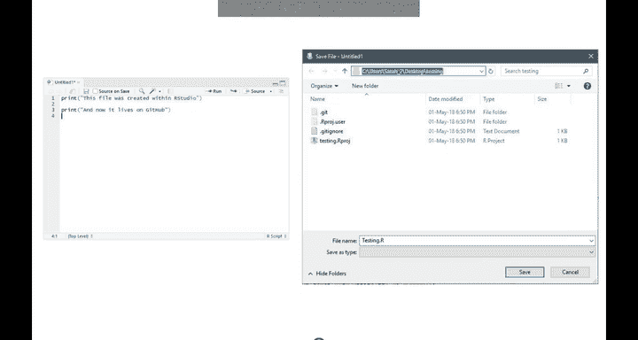

首先，创建一个新R脚本：

1.  点击 **File**（文件） -> **New File**（新建文件） -> **R Script**。
2.  在新打开的脚本编辑器中，输入以下代码：
    ```r
    print("This file was created within RStudio")
    print("and now it lives on GitHub")
    ```
3.  点击保存按钮（或按 `Ctrl+S` / `Cmd+S`）。保存时，默认位置就是你刚才创建的项目目录。


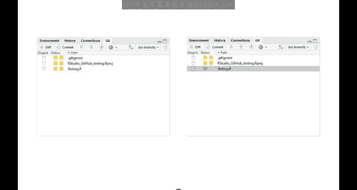

文件保存后，我们来进行Git操作。在RStudio界面右上角的 **Environment/History**（环境/历史）窗格中，找到并切换到 **Git** 标签页。

你应该能看到你刚刚创建的文件。勾选该文件名下方的 **Staged**（暂存）复选框，将文件添加到暂存区。


接下来，点击 **Commit**（提交）按钮。会弹出一个新窗口，上半部分列出了所有已更改的文件，下半部分显示了暂存文件与之前版本的差异。

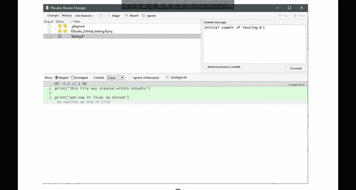

在 `Commit message`（提交信息）框中，输入本次提交的说明（例如“Initial commit: added first R script”）。然后点击 **Commit** 按钮。提交完成后，可以关闭此窗口。


到目前为止，你已经创建了文件、保存了文件、将其暂存并提交到了本地仓库。根据版本控制的流程，下一步是将这些更改推送到远程的在线仓库。

在 **Git** 标签页中，点击 **Push**（推送）按钮，将你的本地提交推送到GitHub仓库。

推送完成后，打开浏览器，访问你的GitHub仓库页面。你可以看到刚才的提交记录已经出现在仓库中。

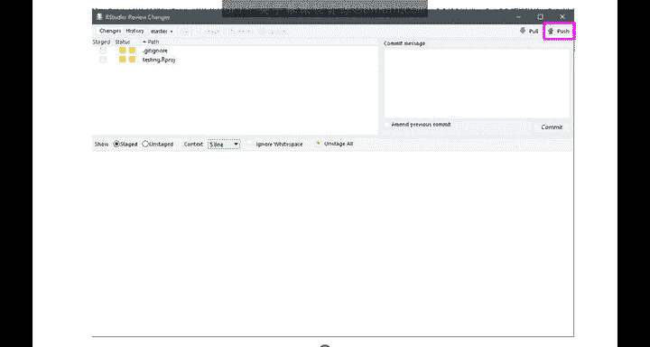


恭喜！你已成功从RStudio内部向GitHub完成了第一次推送。

---

## 总结 📝

本节课中我们一起学习了如何搭建RStudio与GitHub之间的完整工作流。

首先，我们在RStudio中配置了Git，使RStudio能够将其作为版本控制软件使用。接着，我们通过生成和配置SSH密钥，将RStudio与GitHub账户安全地链接起来。

为了测试整个流程，我们在GitHub上创建了一个新仓库，在RStudio中创建了一个与之关联的新项目，并在项目中编写了一个R脚本文件。最后，我们通过 **暂存（Stage） -> 提交（Commit） -> 推送（Push）** 的步骤，成功地将该文件从RStudio推送到了GitHub仓库。


掌握这个连接流程，将极大地方便你未来使用RStudio进行数据科学项目开发与版本管理。