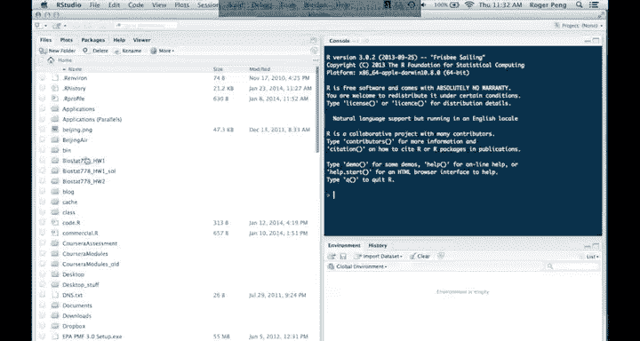
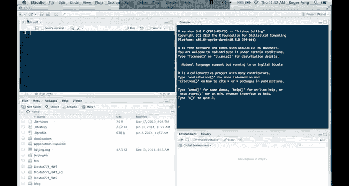
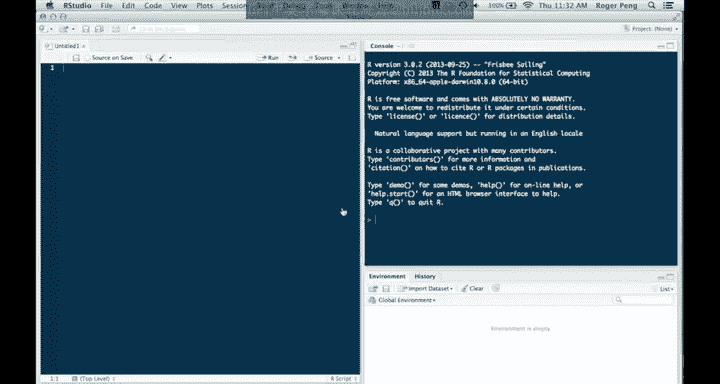

# 课程1：脚本化你的分析 📜

在本课程中，我们将学习如何通过脚本化来确保数据分析工作的可重复性。我们将探讨脚本化的核心原则、重要性以及如何开始编写你的第一个R脚本。

---

## 概述

数据分析的核心原则之一是确保工作的可重复性。实现这一目标最有效的方法是将所有分析过程脚本化。脚本就像乐谱，它详细记录了每一个步骤和决策，使得他人或未来的你能够精确复现整个分析过程。

## 脚本化的核心原则

上一节我们提到了可重复性的重要性，本节中我们来看看实现它的核心原则。

**核心原则是：将所有分析过程脚本化。** 这意味着避免手动操作，而是通过编写计算机程序（脚本）来记录和执行每一步分析。

用公式表示这个原则就是：
**可重复性 ≈ 脚本化程度**

## 为何脚本化如此重要？

为了理解脚本化的重要性，我们可以将其与音乐创作进行类比。

*   **最终呈现 vs. 完整过程**：数据分析的最终报告（如论文或演示）就像一首乐曲的主旋律。它优美、重要，但背后支撑它的整个乐团（即所有的分析过程、探索性工作、尝试过的错误路径以及未在报告中展示的决策）同样至关重要。
*   **乐谱的类比**：在音乐中，乐谱（Score）使用标准化的记谱法，记录了所有乐器在何时演奏何种音符。这使得任何人都能根据乐谱尽可能精确地重现这首乐曲。
*   **脚本即乐谱**：在数据分析和研究中，脚本就扮演着“乐谱”的角色。它使用编程语言（如R）这种“记谱法”，详细记录了对数据所做的所有操作。这确保了工作的可重复性。

因此，脚本是他人尝试复现你工作的精确指南。

## 如何开始编写脚本？

理解了脚本化的“为什么”之后，本节我们来看看“怎么做”。

以下是在R中开始编写脚本的简单步骤：

1.  **打开RStudio**：启动RStudio集成开发环境。
2.  **新建R脚本**：在菜单栏选择 `File` -> `New File` -> `R Script`。这将打开一个空白的文本编辑器窗口。
3.  **编写代码**：在这个文本文件中，你可以开始用R语言编写指令，告诉R该做什么。
4.  **保存与运行**：将脚本保存为 `.R` 文件，并可以逐行或整体运行其中的代码。

使用RStudio内置的文本编辑器是开始脚本化最简单的方式。

*（图示：在RStudio中创建新R脚本的界面示意）*

## 其他工具与总结

在本课程中，我们还将讨论其他有助于组织分析的工具，例如 `knitr` 和 `R Markdown`。但无论如何，最基本且最重要的底线始终是：

**将分析过程写下来，编写脚本或程序，使你的工作可重复。**

---

## 总结

本节课中，我们一起学习了数据科学中确保工作可重复性的核心理念——脚本化。我们了解了脚本化的重要性（如同乐谱之于音乐），掌握了在RStudio中开始编写R脚本的基本步骤，并明确了“编写一切”是提高可重复性的关键规则。记住，你的脚本就是你分析工作的精确蓝图。