# 课程 7：数据分析的结构（第二部分）📊

在本节课中，我们将继续第一部分开始的数据分析示例。我们将完成数据分析流程中剩余的关键步骤，包括探索性数据分析、统计建模、结果解释与挑战、综合报告以及创建可复现代码。

---

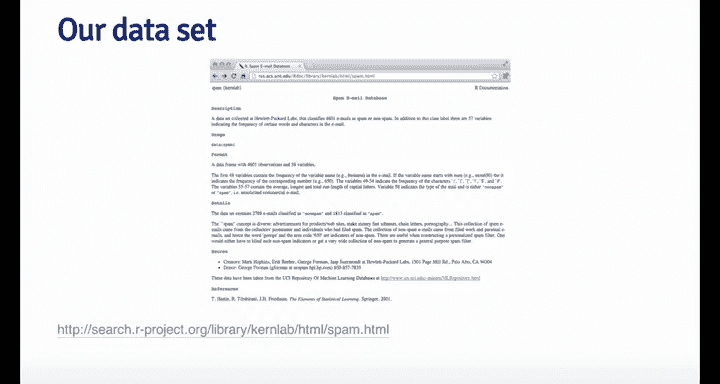

## 概述

上一节我们介绍了数据分析流程的前半部分，包括定义问题、获取数据、数据清理和初步探索。本节中，我们来看看后续步骤，并利用一个具体的垃圾邮件分类案例来演示整个过程。

---

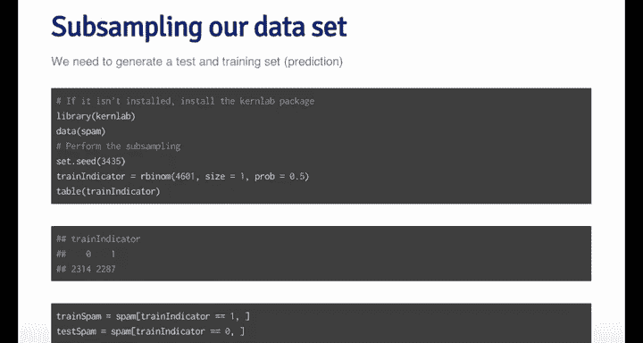

## 探索性数据分析 🔍

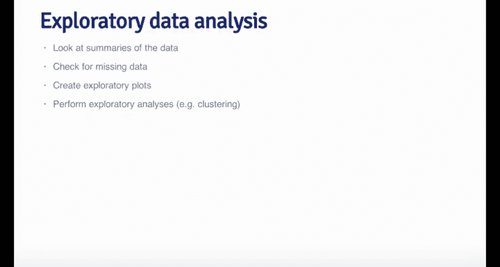

在建立任何模型之前，我们需要了解数据的基本情况。这包括查看数据分布、变量间关系以及检查缺失值。

以下是探索性数据分析的几个关键步骤：

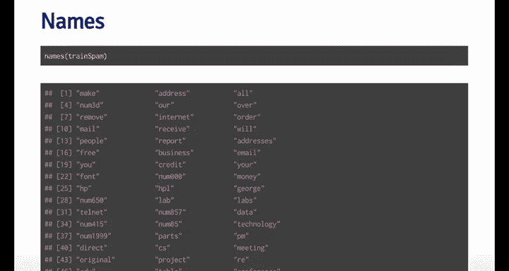

1.  **查看数据摘要**：了解数据的基本结构和变量类型。
2.  **检查缺失数据**：确认是否存在缺失值及其原因。
3.  **创建探索性图表**：通过可视化理解数据分布和关系。

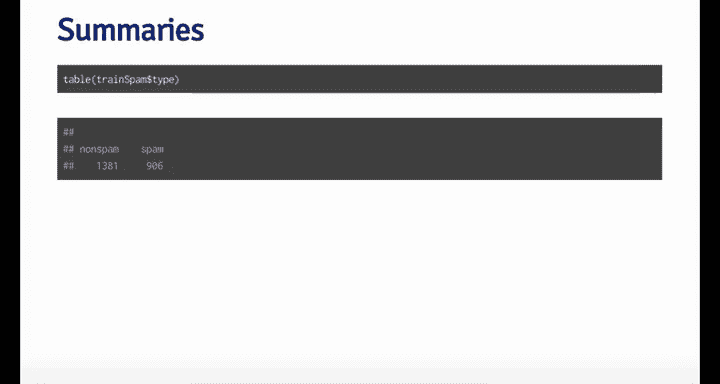

我们的数据集来自UCI机器学习仓库，包含4600封电子邮件和58个变量。这些变量大多是邮件中特定单词的出现频率。

```r
# 查看数据前几行
head(trainingData)
# 查看变量名
colnames(trainingData)
```

在训练数据集中，有906封邮件被标记为垃圾邮件，1381封为非垃圾邮件。

我们可以通过绘图比较垃圾邮件和非垃圾邮件的特征差异。例如，变量`capitalAve`（大写字母平均数量）的分布高度偏斜，因此我们查看其对数变换后的情况。

```r
# 对偏斜数据取对数（加1以避免对0取对数）
plot(log10(trainingData$capitalAve + 1), col = trainingData$type)
```

结果显示，垃圾邮件通常包含更多大写字母，这与日常观察相符。

我们还可以检查变量间的成对关系，或通过层次聚类分析探索预测变量空间。对预测变量进行对数变换后，聚类结果会更有意义，例如`capitalAve`自成一类，而“you”、“will”、“your”等词聚在一起。

---

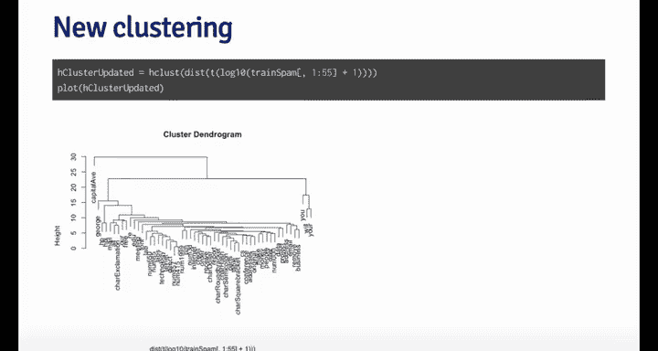

## 统计预测与建模 📈

探索性数据分析完成后，我们可以进行更正式的统计建模。建模方法应基于研究问题和探索性分析的结果。

在本例中，我们将采用一个简单的建模方法：为数据集中的每个变量单独拟合一个逻辑回归模型，以预测邮件是否为垃圾邮件。

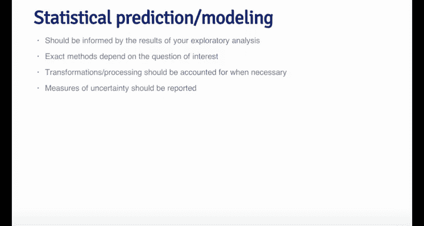

以下是建模步骤：

1.  **单变量模型拟合**：遍历每个预测变量，用逻辑回归模型预测垃圾邮件。
2.  **交叉验证**：计算每个模型的交叉验证错误率，以评估其预测性能。
3.  **选择最佳模型**：选择交叉验证错误率最低的单个预测变量模型。

```r
# 伪代码：循环拟合单变量逻辑回归模型并计算交叉验证错误率
cvErrors <- vector("numeric", length = ncol(predictors))
for(i in 1:ncol(predictors)) {
  formula <- reformulate(response = "type", termlabels = colnames(predictors)[i])
  model <- glm(formula, data = trainingData, family = binomial)
  # 计算交叉验证错误率（此处为简化表示）
  cvErrors[i] <- calculateCVError(model)
}
# 找出错误率最低的预测变量
bestPredictorIndex <- which.min(cvErrors)
bestPredictor <- colnames(predictors)[bestPredictorIndex]
```

分析发现，预测变量`charDollar`（邮件中美元符号的数量）的单变量模型交叉验证错误率最低。因此，我们选择它来构建最终模型。

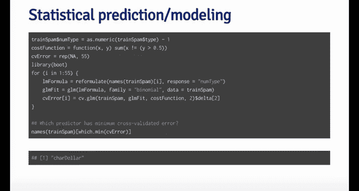

我们使用训练数据重新拟合这个最佳单变量逻辑回归模型，然后将其应用于独立的测试数据集进行预测。逻辑回归模型输出的是邮件为垃圾邮件的概率（介于0和1之间）。我们设定一个阈值（例如0.5），将概率高于此值的邮件分类为垃圾邮件。

```r
# 在测试集上使用最佳模型进行预测
bestModel <- glm(type ~ charDollar, data = trainingData, family = binomial)
predictedProb <- predict(bestModel, newdata = testData, type = "response")
predictedClass <- ifelse(predictedProb > 0.5, "spam", "nonspam")
```

通过比较预测分类和测试集中的真实分类，我们可以计算模型的错误率。在本例中，分类错误率约为22%。

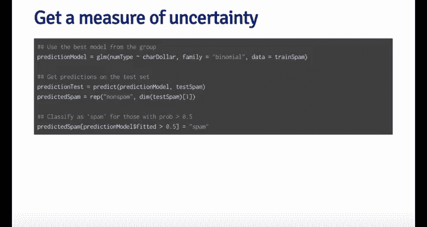

---

## 结果解释 🧠

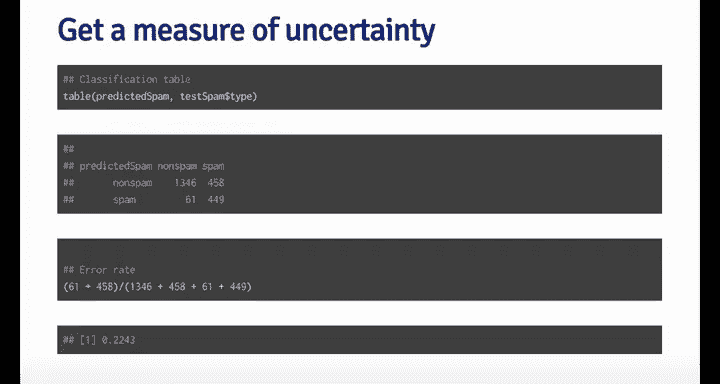

得到分析结果后，需要用恰当的语言进行解释，避免超出分析本身的范围。在预测性建模中，应使用“预测”、“相关”、“可能与结果相关联”等描述性语言。

对于本例，我们可以这样解释：
*   邮件中美元符号的比例可用于预测其是否为垃圾邮件。
*   在我们的预测模型中，美元符号越多，邮件是垃圾邮件的可能性就越高。
*   该模型在测试数据集上的错误率为22.4%。

在解释时，应尽可能提供对结果的合理解释（例如，为什么美元符号与垃圾邮件相关），并引入不确定性度量来校准对结果的解读。

---

## 挑战你的结果 ❓

在向他人展示之前，自己先挑战整个分析过程至关重要。这能让你提前发现问题，并准备好应对他人的质疑。

需要挑战的方面包括：
*   **问题本身**：这是否是一个有效的问题？
*   **数据来源与处理**：数据从何而来？处理方式是否合理？
*   **分析方法**：为什么选择这个模型？是否是最佳或最合适的模型？
*   **结论**：得出的结论是否稳健？不确定性度量是否恰当？
*   **替代分析**：是否有其他可行的分析方法？它们可能产生什么不同结果？

思考这些问题并准备好合理的答案，能显著增强你分析的可信度。

---

## 综合与撰写报告 📝

数据分析的最后一步是将所有工作综合成一份连贯的报告或演示。综合意味着从众多分析中提炼出最重要的部分，讲述一个清晰的故事。

撰写报告的建议：
*   **以问题开场**：首先明确要解决的问题，为听众建立背景。
*   **总结方法与分析**：简要说明使用了什么数据、采用了何种分析方法。不必包含所有尝试过的分析，只选择对讲述故事必要的部分。
*   **逻辑顺序**：按照故事逻辑（而非实际操作的时间顺序）来组织内容。
*   **善用图表**：使用精心制作的图表来直观传达关键发现。
*   **准备备用材料**：将一些未在报告中展示的分析保留作为“后备”，以备他人深入提问。

在我们的例子中，故事线可以是：
1.  **问题**：能否利用邮件的量化特征自动分类垃圾邮件？
2.  **方法与数据**：使用UCI的公开数据集，并划分为训练集和测试集。
3.  **探索与建模**：通过探索发现某些特征（如大写字母、美元符号）与垃圾邮件相关。采用交叉验证选择最佳单变量（美元符号）逻辑回归模型。
4.  **结果**：模型在测试集上准确率为78%。解释是美元符号越多，邮件越可能是垃圾邮件，这符合常识。
5.  **局限与展望**：指出78%的准确率仍有提升空间，未来可以纳入更多变量或尝试更复杂的模型。

---

## 创建可复现代码 🔄

确保分析的可重复性是现代数据科学的核心标准。如果他人无法复现你的结果，你的结论的说服力将大打折扣。

建议使用R Markdown、knitr等工具，将代码、分析过程和文字说明整合在同一个动态文档中。这有助于保持项目组织有序，并确保所有步骤都能被你自己或他人准确地重现。

```markdown
# 这是一个R Markdown文档示例
---
title: "垃圾邮件分类分析"
output: html_document
---
## 数据加载
```{r}
library(kernlab)
data(spam)
```
## 探索性数据分析
...（此处插入R代码块）...
```

---

## 总结

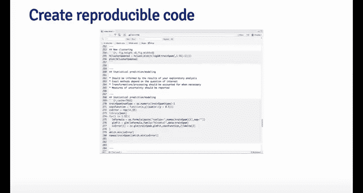

本节课中，我们一起学习了数据分析流程的后半部分。我们通过一个垃圾邮件分类的实例，演示了如何从探索性数据分析过渡到统计建模，如何解释和挑战模型结果，以及如何将复杂的分析过程综合成一份清晰的报告。最后，我们强调了使用可重复研究工具（如R Markdown）来记录和分享分析的重要性，这是确保数据科学工作严谨、可信的关键。