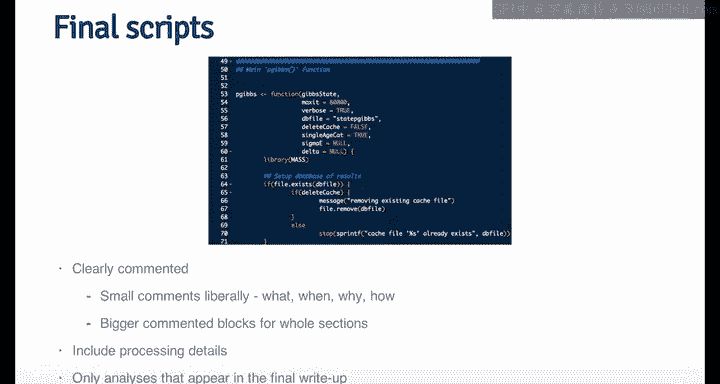
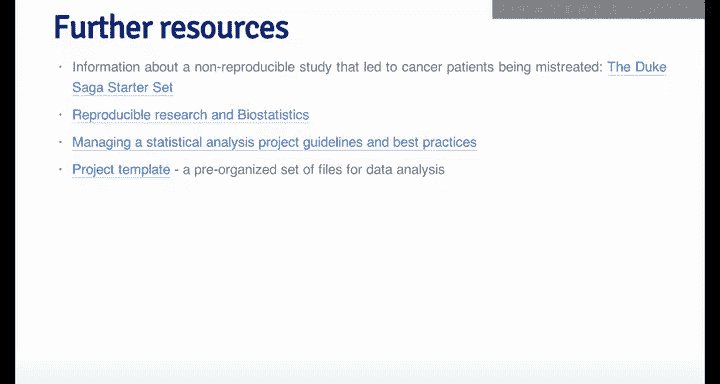

# 课程08：组织你的数据分析 📊

在本节课中，我们将学习如何有效地组织一个数据分析项目。虽然不存在适用于所有人的通用方法，但掌握一些基本原则和技巧，可以帮助你将项目文件有条理地放置，并最终确保你的分析过程是可复现的——无论是你自己还是他人。

## 概述

一个完整的数据分析项目会涉及多种类型的文件。理解每种文件的作用并合理组织它们，是保证项目清晰、高效和可复现的关键。接下来，我们将逐一介绍这些核心组成部分。

## 数据分析的核心文件类型

一个主要的数据分析项目通常会保留以下几类关键文件。理解它们有助于构建清晰的项目结构。

### 数据文件

数据是分析的基石，通常分为原始数据和加工数据。

*   **原始数据**：这是你最初获得的数据，可能以各种格式存在，例如文本记录或特定格式的文件。你需要对这些数据进行处理，使其能被分析程序（如R）使用。例如，可能需要进行文本解析或格式转换。
*   **加工数据**：这是经过清理和整理后的数据，通常比原始数据更整洁。它可能以表格形式存在，包含行和列。加工数据应该被妥善命名，以便清晰地看出是由哪个脚本生成的。

**重要提示**：务必记录原始数据来源。如果数据来自网络，应在`README`文件中或通过版本控制系统（如Git）的提交信息，记录获取数据的URL、数据集描述以及访问日期。

### 图形与表格

在分析过程中，你会创建图形和表格来展示数据。

*   **探索性图形**：这些图形是在分析初期为了快速了解数据而制作的。它们通常比较简单、粗糙，目的是让你对数据的分布和关系有一个直观感受。探索性图形不一定会出现在最终报告中。
*     **最终图形**：这些是经过精心打磨的图形，用于报告或展示。它们组织良好、标注清晰，能有效地传达核心信息。通常，最终报告只会包含所有探索性图形中的一小部分精华。

### 代码文件

代码是驱动分析的核心，其组织方式直接影响项目的可读性和可复现性。

*   **原始/未使用的脚本**：在分析过程中，你会编写许多脚本进行尝试，其中一些可能最终不会被采用。这些脚本可能注释较少，格式也比较随意。
*   **最终脚本**：这些是用于最终分析的脚本。它们应该被仔细清理，包含清晰的注释（包括大段的章节说明和小行的代码解释），格式规范。这些脚本记录了从原始数据到加工数据，再到最终结果的完整处理链。

### 文档与报告

文档将数据、图形和代码整合成一个连贯的故事。

*   **R Markdown文件**：这是一种非常强大的工具，可以将代码、文本、图形和表格整合在同一个文档中。通过R Markdown，你可以生成可复现的报告（如网页或PDF），它是连接原始代码与最终报告之间的理想桥梁。
*   **README文件**：用于解释项目目录的结构和内容。如果你使用R Markdown，其本身就能提供很好的文档。否则，README文件就至关重要。它可以包含逐步的分析说明，例如：首先运行哪个脚本处理数据，然后运行哪个脚本拟合模型等。
*   **最终报告/论文**：这是整个分析工作的最终成果，旨在讲述一个完整的故事。它通常包括：标题、引言（阐明问题）、方法、结果（含不确定性度量）以及结论。报告需要具有连贯性，因此**不应包含**分析过程中进行的所有尝试，而应聚焦于最重要的部分。同时，务必引用所使用的统计方法和软件，以确保他人能够复现。

## 总结与进阶资源

本节课我们一起学习了如何组织数据分析项目，涵盖了数据、图形、代码和文档等核心要素的组织原则。记住，清晰的组织结构是项目可复现和可协作的基础。

每个具体项目都有其独特性，但以下资源可以为你提供更深入的指导和最佳实践：

*   **案例研究**：关于癌症数据分析不可复现研究的案例链接。
*   **政策指南**：《生物统计学》杂志关于可复现研究政策的社论。
*   **最佳实践**：其他研究者提供的统计分析项目管理指南。
*   **自动化工具**：R软件包 **`ProjectTemplate`**，它可以自动化处理数据分析项目中的许多常规任务，值得一试。