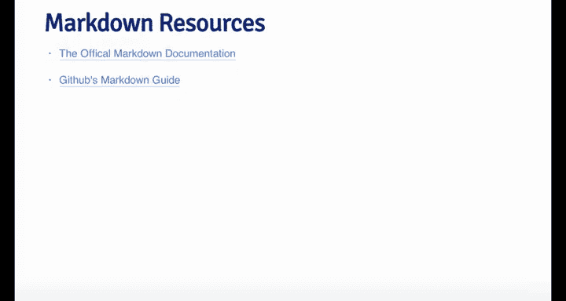

# 课程10：Markdown基础教程 📝


在本节课中，我们将学习Markdown语言的基础知识。Markdown是一种轻量级标记语言，旨在简化文档编写过程，让作者专注于内容创作，而无需处理复杂的格式标签。

## 概述

Markdown是一种文本到HTML的转换工具，专为网络写作者设计。它允许您使用易于阅读和编写的纯文本格式进行创作，然后将其转换为结构有效的XHTML。其核心理念是让用户专注于内容本身。

## 基本语法

上一节我们介绍了Markdown的设计理念，本节中我们来看看它的基本语法元素。

### 文本格式

以下是基本的文本格式化方法：

*   **斜体文本**：使用单个星号或下划线包裹文本。例如，`*斜体*` 或 `_斜体_` 会呈现为 *斜体*。
*   **粗体文本**：使用两个星号或下划线包裹文本。例如，`**粗体**` 或 `__粗体__` 会呈现为 **粗体**。

### 标题

标题通过井号（`#`）的数量来定义级别，类似于HTML中的`<h1>`到`<h6>`标签。

*   `# 一级标题` 对应 `<h1>`
*   `## 二级标题` 对应 `<h2>`
*   `### 三级标题` 对应 `<h3>`

### 列表

列表分为无序列表和有序列表。

以下是创建无序列表的方法，使用连字符（`-`）、星号（`*`）或加号（`+`）作为项目符号：

*   项目一
*   项目二

以下是创建有序列表的方法，只需在行首使用数字加句点（例如 `1.`）：

1.  第一项
2.  第二项
3.  第三项

> **注意**：在有序列表中，您使用的数字顺序并不重要。Markdown处理器会自动按顺序编号。例如，输入 `1.`、`3.`、`2.` 最终仍会输出为1、2、3。

### 链接

在文档中插入链接非常重要。Markdown提供两种方式。

**内联链接**：将链接文本放在方括号 `[]` 中，紧接着将URL放在圆括号 `()` 内。
格式为：`[链接文本](URL)`
例如：`[约翰霍普金斯大学](https://www.jhu.edu)`

**引用式链接**：为了使文档正文更整洁，尤其是当URL很长时，可以使用引用式链接。
1.  首先，用方括号定义链接文本和引用标识：`[链接文本][引用ID]`
2.  然后，在文档的其他地方（通常在底部）定义该标识对应的URL：`[引用ID]: URL`

例如：
```
了解更多数据科学知识，请访问[我们的博客][1]或[统计网站][2]。

[1]: https://simplystatistics.org
[2]: https://www.r-project.org
```

### 换行

在Markdown中创建新行有一个需要注意的细节：在行末添加**两个空格**，然后按回车键，才会产生真正的换行。
*   `第一行第二行` （无空格）会显示为“第一行第二行”。
*   `第一行␣␣` （后跟两个空格和回车）
    `第二行` 会显示为两行。

## 总结与资源

本节课中我们一起学习了Markdown的基础语法，包括文本格式化、标题、列表、链接和换行的创建方法。Markdown语法简单，能帮助您快速创建结构清晰的文档。



*   **官方文档**：John Gruber的[Markdown官方网站](https://daringfireball.net/projects/markdown/)提供了简洁完整的说明，您可以在几分钟内掌握。
*   **GitHub风格**：如果您在GitHub上协作或编写文档，可以查阅[GitHub Flavored Markdown](https://guides.github.com/features/mastering-markdown/)指南，它包含了一些有用的扩展语法。