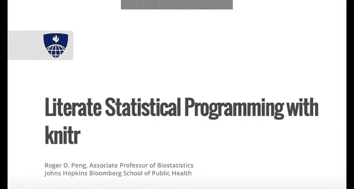
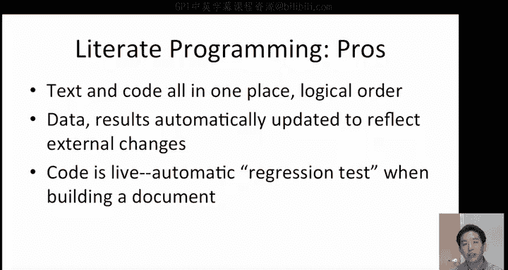
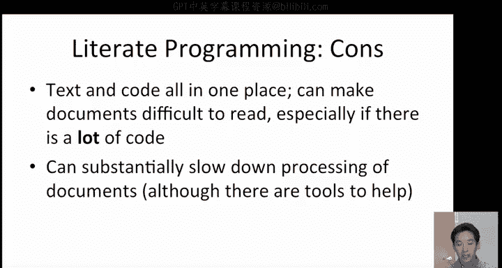

# 📘 课程 P149：13_knitr 第 1 部分

## 📖 概述
在本节课中，我们将学习**文学化统计编程**的基本概念，这是实现可重复性研究的关键工具之一。我们将探讨如何将数据分析、代码和文本描述整合到单一文档中，从而让他人能够更容易地理解和复现你的分析工作。

---

## 🧠 文学化统计编程简介
在关于可重复性研究的讲座中，我讨论了分析可重复性的基本含义。本节中，我们将介绍一种实际工具，它能帮助你让他人复现你的分析，或至少为他人复现分析提供便利。我们讨论的实现可重复文档的方法之一，就是**文学化统计编程**，或称**文学化编程**。

其核心理念是，作者通常需要付出大量努力才能将数据和结果发布到网上。即便如此，这些内容往往是分离的：数据在一处，代码在另一处。你必须弄清楚哪段代码对应哪些数据，以及如何执行这些代码，例如先加载哪个文件，先执行哪一步。即使所有材料都已公开，这个过程也可能非常混乱。

因此，简化这一过程的方法之一，就是将数据和代码整合到同一个文档中。这样，人们可以按正确顺序执行代码，并在正确的时间读取数据。你可以拥有一个单一文档，它将数据分析与所有文本描述（即你用来解释过程的文字）整合在一起。这样，所有内容不再是分散的片段，而是相互关联的整体。

## 🧩 文学化编程的起源与概念
文学化编程的理念最初由斯坦福大学的计算机科学家 **Donald Knuth** 提出。他最初的系统是为编写常规计算机程序而设计的，旨在编写代码的同时记录代码。这个基本理念被引申到**文学化统计编程**中，即你希望在记录分析过程的同时，将分析代码也放在同一文档中。

其思想是，一篇文章是**文本流**和**代码流**的结合。分析代码被划分为文本块和代码块。呈现代码（如表格和图形的格式化）与解释过程的文章文本交织在一起。

在文学化编程中，有两个核心概念：
*   **编织**：将文档转换为人类可读的文档。
*   **缠结**：将文档提取为机器可读的代码文件。

## 🛠️ 工具与实现
如前所述，文学化编程是一个通用概念，它需要一种**文档语言**和一种**编程语言**。之前提到的由 **Friedrich Leisch** 编写的原始 **Sweave** 系统，使用 **LaTeX** 作为文档语言，**R** 作为编程语言。

本讲座将重点介绍 **knitr**，它支持多种文档语言和编程语言。

## 🔑 如何实现可重复性研究
一个基本问题是：如何使我的工作可重复？基本答案是：你必须**决定**去做这件事。你可以在分析过程中的任何时刻做出这个决定，但通常在**一开始**就决定是最容易的。如果你等到最后才想使分析可重复，那通常会困难得多，甚至可能无法实现。

以下是一些关键实践原则：

*   **持续追踪**：随着分析的进行，持续记录你的工作。你可以使用版本控制系统，如 **Git** 或 **SVN**（本课不深入讨论，但了解它们是有益的）。
*   **使用可编码的软件**：使用那些操作可以通过代码记录的统计软件。这意味着你可以写下用于操作或分析数据的指令。这通常排除了图形用户界面，除非这些程序能记录或追踪你的所有点击操作。像 **R** 这样的系统，因为你必须显式地编写代码，所以只要保存了代码，就保存了你对数据所做的所有操作。
*   **不保存中间输出**：这里的“输出”主要指临时数据转换对象。如果你预处理数据后得到了一个干净的数据集，与其保存这个干净的数据集，不如保存原始数据及预处理代码。这样，你不仅能生成最终结果，还能看到你是如何从原始数据得到它的。如果你只保存了干净数据，却不小心丢失了预处理代码，你就无法清晰地记录从 A 到 B 的过程。因此，尽量保存原始数据和生成最终结果的代码，而不是保存中间或最终产物，这有助于理解你的操作和分析路径。
*   **避免使用专有格式**：尽量不要使用非公开数据布局的专有格式保存数据。虽然现在常见的专有格式不像以前那么多，但许多程序为了效率会使用专有格式存储数据。这会导致如果他人没有完全相同的程序，就无法读取数据。使用非专有格式（即使是压缩的文本格式）可以使你的研究或分析更具可重复性。

## ⚖️ 文学化编程的优缺点
文学化编程并非实现可重复性工作的唯一工具，但它是其中之一。

以下是它的一些优点：

*   **整合与逻辑性**：它迫使你将分析的所有文本和代码放在一个地方，并以逻辑顺序呈现。
*   **自动更新**：所有数据和结果都会自动更新以反映外部变化。你拥有一个“活”的文档；如果你进行了修改，重新处理文档时，它会自动更新，避免数字过时或内容不匹配的情况。
*   **回归测试**：由于代码是“活”在文档中的（必须运行代码才能生成最终文档，即编织过程），这相当于提供了一种回归测试。如果你在分析中引入了错误，代码将无法运行，从而提示你存在问题，这有助于防止在分析中引入新的错误。

当然，文学化编程也有一些缺点：

*   **编辑复杂性**：文本和代码都集中在一个地方。特别是当你的代码量很大，或者分析非常复杂冗长时，人类可读的文本会与大量代码混合在一起，这可能使编辑文档变得困难，因为你需要在整篇文档中搜索文本部分。
*   **处理速度**：如果你的分析非常复杂，每次你想查看文档的人类可读版本时都需要重新处理整个文档，这可能会显著减慢文档的生成速度。

---

## 📝 总结
本节课中，我们一起学习了**文学化统计编程**的核心概念，它是实现分析可重复性的重要方法论。我们了解了其起源、基本思想（将代码、数据和文本描述整合），探讨了实现可重复性研究的关键实践（如使用可编码软件、不保存中间输出），并分析了使用文学化编程工具（如 knitr）的优缺点。掌握这些原则和工具，将为你创建清晰、可复现的数据分析报告奠定坚实基础。