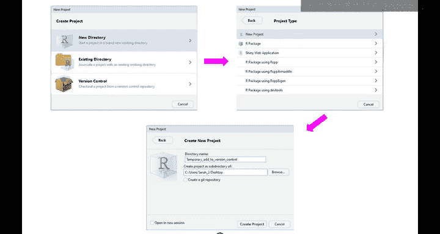
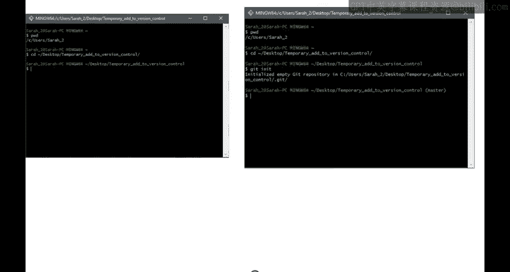
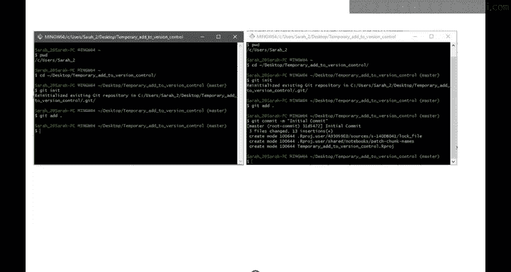
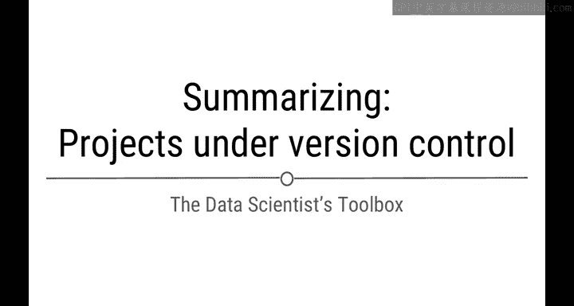

# 课程13：项目版本控制 🔄

在本节课中，我们将学习如何为一个已存在的R项目添加版本控制，并将其与GitHub关联。我们将涵盖从初始化本地Git仓库到推送到远程GitHub仓库的完整流程，并简要回顾如何克隆一个已存在的远程仓库到本地。

---

上一节我们介绍了如何在新项目开始时，通过RStudio直接创建与GitHub关联的版本控制仓库。本节中，我们来看看如何处理一个已经存在但尚未进行版本控制的R项目。

有时，你可能已经有一个正在开发的R项目，但它尚未与任何版本控制软件（如Git）关联，也未链接到GitHub。幸运的是，RStudio和GitHub提供了相应的步骤来解决这个问题。

需要承认的是，相比于在项目开始前就在GitHub上创建仓库并与RStudio链接，为现有项目添加版本控制会稍微麻烦一些。

首先，我们来模拟一个本地存在但未进行版本控制的项目场景。

以下是创建本地R项目的步骤：
1.  在RStudio中，点击 **File** -> **New Project**。
2.  选择 **New Directory**，然后选择 **New Project**。
3.  为你的项目命名。
4.  由于我们要模拟一个当前未进行版本控制的项目，**请勿勾选** “Create a Git repository” 选项。
5.  点击 **Create Project**。

至此，我们创建了一个当前未受版本控制的R项目。接下来，我们将其与Git关联。



首先，我们需要设置该项目与Git进行交互。打开Git Bash或终端，并导航到包含你项目文件的目录。

你可以通过输入 `cd`（change directory）命令，后接目录路径，来切换目录。

```bash
cd /path/to/your/project
```

当命令行提示符（`$` 符号前的部分）显示为你项目的正确路径时，说明你已处于正确的位置。

到达项目目录后，依次输入以下命令：
1.  `git init`
2.  `git add .`

`git init` 命令将此目录初始化为一个Git仓库。`git add .` 命令则将目录中的所有文件添加到你的本地仓库暂存区。

接下来，使用以下命令将这些更改提交到Git仓库：
```bash
git commit -m "initial commit"
```



此时，我们已经创建了一个R项目，并将其与Git版本控制系统关联。下一步是将其与GitHub链接。



为此，请访问 GitHub.com 并创建一个新的仓库。确保仓库名称与你的R项目名称**完全一致**，并且**不要**初始化README文件、.gitignore文件或许可证。

创建仓库后，页面会显示一个选项：“…or push an existing repository from the command line”。其下方会提供用于链接仓库的命令行代码。

在Git Bash或终端中，复制并粘贴这些代码行，以将你的本地仓库与GitHub远程仓库关联。这些命令通常类似于：
```bash
git remote add origin https://github.com/your-username/your-repo-name.git
git branch -M main
git push -u origin main
```

操作完成后，刷新你的GitHub页面，它现在应该会显示你项目中的文件。

当你在RStudio中重新打开该项目时，现在应该可以在右上角面板访问 **Git** 选项卡，并可以直接从RStudio内部将未来的任何更改推送到GitHub。

---

如果存在一个其他人正在开发的项目，并且你被要求参与贡献，你可以将这个已存在的项目与你的RStudio链接。其前提与上一节课中创建GitHub仓库然后克隆到本地的过程完全相同。

简而言之，在RStudio中：
1.  点击 **File** -> **New Project** -> **Version Control**。
2.  选择 **Git** 作为版本控制系统。
3.  如同上一课，提供你试图克隆的仓库URL，并选择本地计算机上存储文件的位置。
4.  创建项目。

现在，该仓库中的所有现有文件都已存储在本地计算机上，并且你可以通过RStudio界面进行推送和编辑。与上一课的唯一区别在于，你没有创建原始仓库，而是克隆了他人的仓库。

---



本节课中，我们一起学习了如何使用命令行将一个现有项目转换为受Git版本控制的项目。随后，我们结合GitHub页面指令和命令行，将新版本控制的项目链接到了GitHub。最后，我们简要回顾了如何使用RStudio将现有的GitHub仓库克隆到本地机器。掌握这些流程，能让你更灵活地管理各种情况下的项目版本。