# 📘 课程 P152：knitr 第4部分 - 高级选项与全局设置

在本节课中，我们将深入学习 knitr 文档的高级功能，包括如何控制代码和结果的显示、在文本中嵌入计算结果、添加图形和表格，以及如何设置全局选项以提高效率。我们还将探讨缓存计算结果的技巧，以处理耗时较长的代码块。

---

## 📄 knitr 文档的处理流程

knitr 文档的处理遵循特定顺序。首先，R Markdown 文档被处理并生成一个 Markdown 文档。接着，该 Markdown 文档被转换为 HTML 文件。最终，你查看的是这个 HTML 文件。

一般来说，你不应编辑或改动任何中间生成的文档。这意味着不要编辑自动生成的 Markdown 文档或 HTML 文档。因为如果你编辑了它们，然后重新处理原始 R Markdown 文档，你在这些文件中的所有更改都会被覆盖。因此，只编辑包含原始文本和原始 R 代码的 R Markdown 文件。

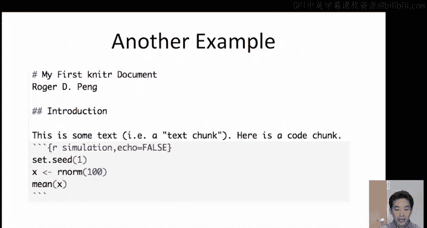

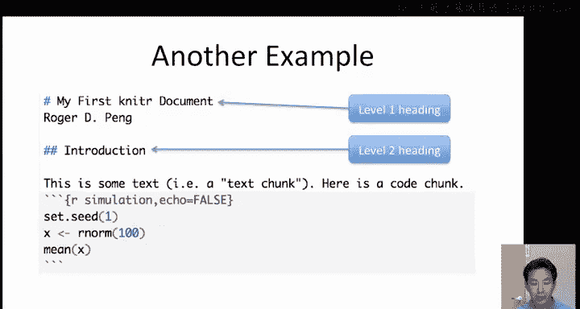

---

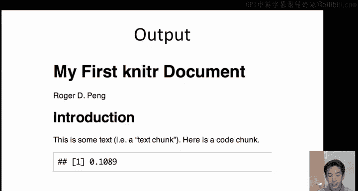

## 🚫 控制代码与结果的显示

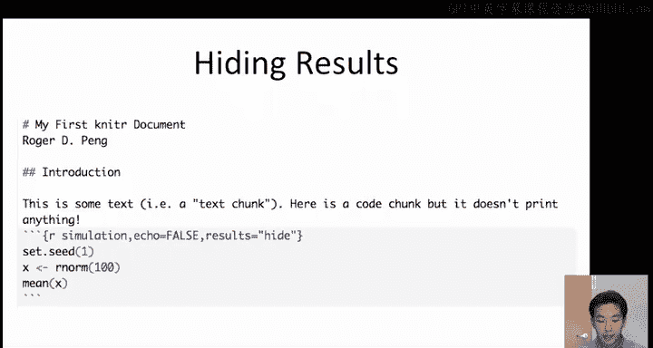

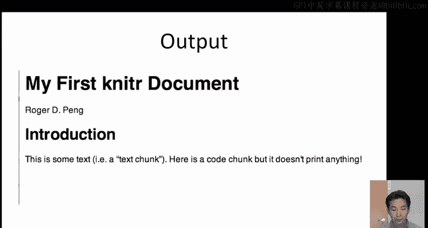

上一节我们介绍了文档的基本处理流程，本节中我们来看看如何控制代码块在输出文档中的显示。

以下是控制代码块输出的核心方法：

*   **隐藏代码 (`echo = FALSE`)**: 在代码块选项中设置 `echo = FALSE`，可以阻止代码本身出现在输出文档中，只显示代码运行的结果。
    ```r
    ```{r simulation, echo=FALSE}
    x <- rnorm(100)
    mean(x)
    ```
    ```

*   **隐藏结果 (`results = "hide"`)**: 在代码块选项中设置 `results = "hide"`，可以隐藏代码运行的结果，只显示代码本身（如果 `echo = TRUE`）。这在某些情况下可能有用。
    ```r
    ```{r hidden-results, results="hide"}
    x <- rnorm(100)
    mean(x)
    ```
    ```

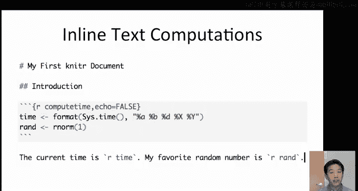

---

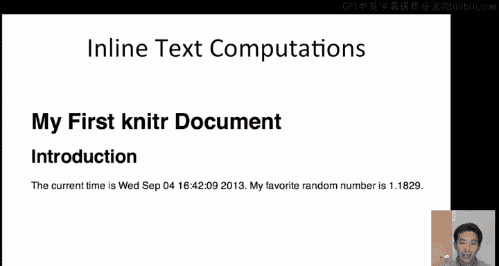

## 🔤 在文本中嵌入计算结果

knitr 文档的一个优点是，你可以在句子或段落中直接插入计算得到的数值或统计结果。

例如，你可以创建一个不显示代码的代码块来计算当前时间和一个随机数，然后在随后的文本中引用这些计算结果。

```r
`r current_time`
`r random_number`
```

输出文档中的句子会动态地填充这些值，例如：“当前时间是 Wednesday, September 4, 2013 14:30:00” 和 “我最喜欢的随机数是 0.1829”。

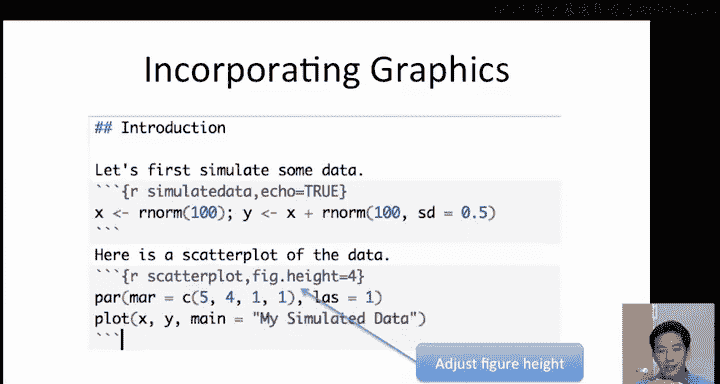

---

## 📊 在文档中添加图形

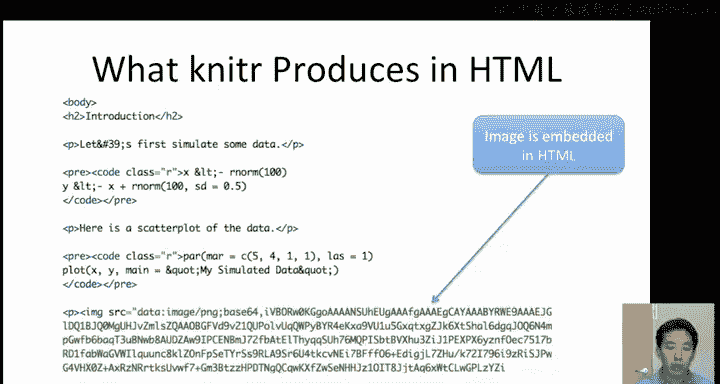

任何报告通常都包含图形。你可以在 knitr 文档中轻松添加数据可视化图表。

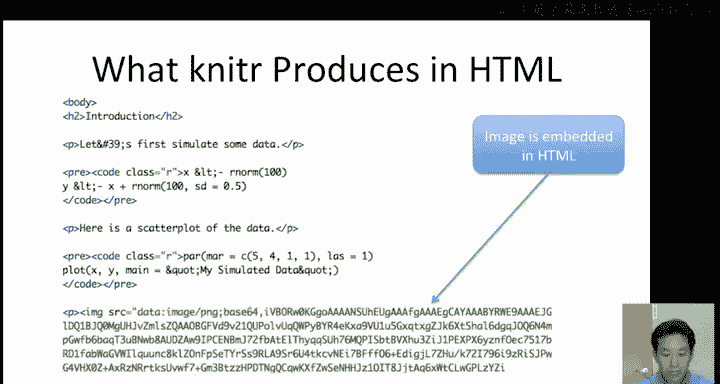

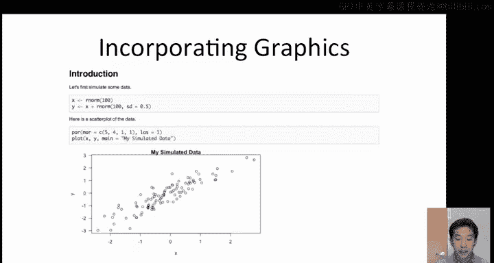

首先，在一个代码块中模拟或加载数据。然后，在另一个代码块中使用绘图函数（如 `plot()`）创建图形。你可以通过代码块选项（如 `fig.height` 和 `fig.width`）调整图形的大小和比例。

```r
```{r make-plot, fig.height=4, fig.width=6}
par(mar = c(4, 4, 2, 1), las = 1)
plot(x, y, pch = 19)
```
```

knitr 处理文档时，会将生成的图像以 Base64 编码的形式直接嵌入到最终的 HTML 文件中。这意味着 HTML 文件是独立的，不依赖于任何外部图像文件，便于分享。

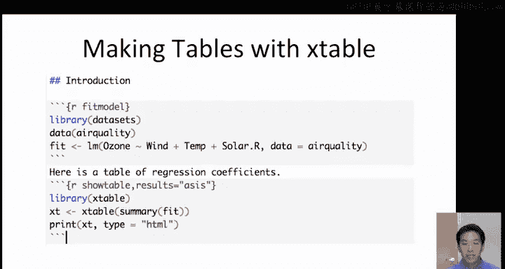

---

## 📋 创建格式美观的表格

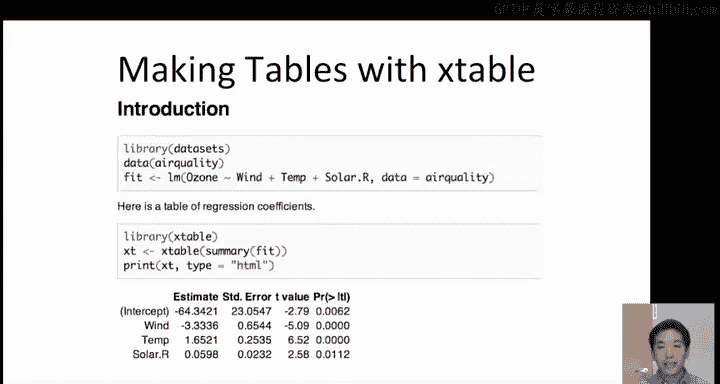


在报告中，经常需要以整洁的表格形式展示计算结果，例如回归模型的摘要。

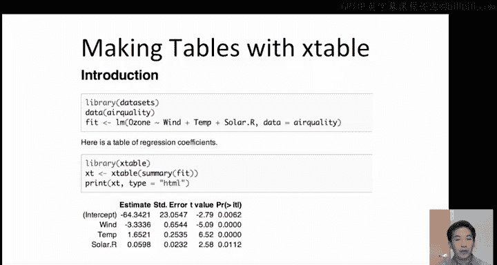

你可以使用 `xtable` 等 R 包来将模型结果转换为格式美观的 HTML 表格。首先安装并加载 `xtable` 包，然后在代码块中拟合模型并使用 `xtable()` 函数生成表格。

```r
```{r regression-table}
library(xtable)
fit <- lm(ozone ~ wind + temp + solar.r, data = airquality)
print(xtable(fit), type = "html")
```
```

处理后的 HTML 输出将包含一个格式良好的表格，显示回归系数、标准误、t 值和 p 值。

---

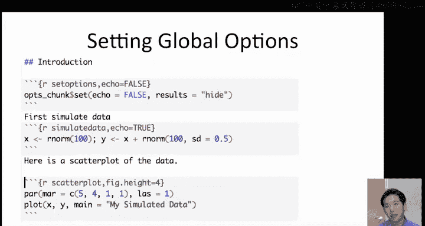

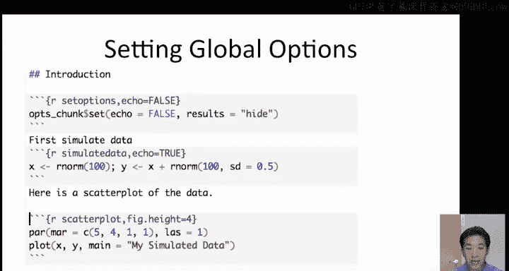

## 🌐 设置全局选项

有时，你希望某些选项应用于文档中的所有代码块，例如默认不显示所有代码。为了避免在每个代码块中重复设置，你可以定义全局选项。

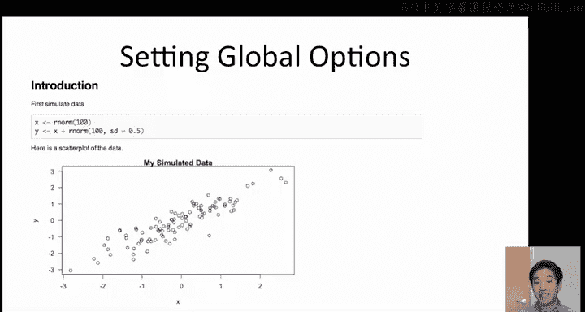

在文档开头创建一个特殊的代码块，使用 `opts_chunk$set()` 函数来设置全局默认值。

```r
```{r set-global-options, include=FALSE}
library(knitr)
opts_chunk$set(echo = FALSE, results = "hide")
```
```

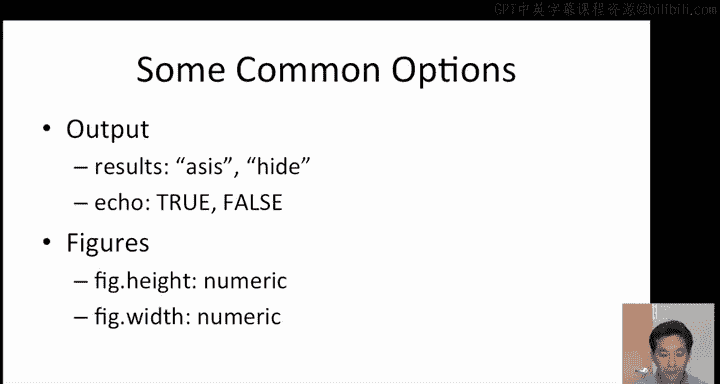

之后，你可以在单个代码块中覆盖这些全局设置。例如，如果全局设置了 `echo = FALSE`，但某个特定代码块需要显示代码，你可以在该代码块中明确设置 `echo = TRUE`。

---

## 💾 缓存计算结果

对于计算时间很长的代码块，每次处理文档时都重新运行会非常耗时。knitr 提供了缓存功能来解决这个问题。

在代码块选项中设置 `cache = TRUE`。首次处理文档时，knitr 会运行该代码块并将结果存储在磁盘上。之后处理文档时，只要代码块内容没有变化，knitr 就会直接从磁盘加载结果，从而节省大量时间。

```r
```{r long-computation, cache=TRUE}
# 这里是一些耗时的计算，例如复杂模型拟合或大数据处理
result <- someLengthyComputation(data)
```
```

需要注意以下几点：
*   如果代码、数据或依赖项发生变化，缓存会自动失效并重新计算。
*   代码块之间的依赖关系默认不会被显式跟踪，如果上游代码块发生重大变化，可能需要手动清理缓存或重新运行所有相关块。
*   具有显著副作用（如写入文件、修改全局环境）的代码块可能不适合缓存。

---

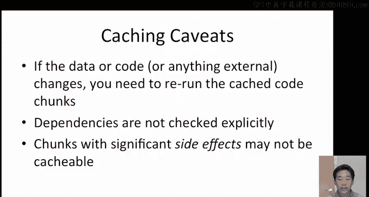

## 📝 总结

本节课中我们一起学习了 knitr 工具的高级应用。我们探讨了如何精确控制代码和结果的显示，如何在行文中动态嵌入计算结果，以及如何向文档中添加图形和格式化的表格。我们还学习了通过设置全局选项来提高文档编写效率，并利用缓存功能来处理耗时的计算。

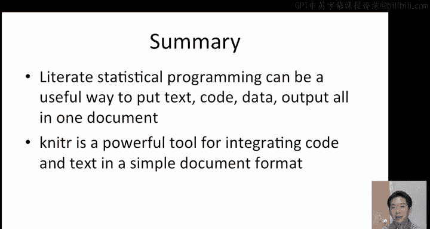

knitr 是一个用于实现“文学化统计编程”的强大工具，它允许你将文本、代码、数据和输出全部整合在一个文档中。它使用简单易学的 Markdown 格式化语言，并能生成可在任何网页浏览器中查看的 HTML 文档。尽管它并非完美无缺，但对于生成可重复的研究报告和整合文本与代码来说，它是一个非常有价值且值得学习的工具。