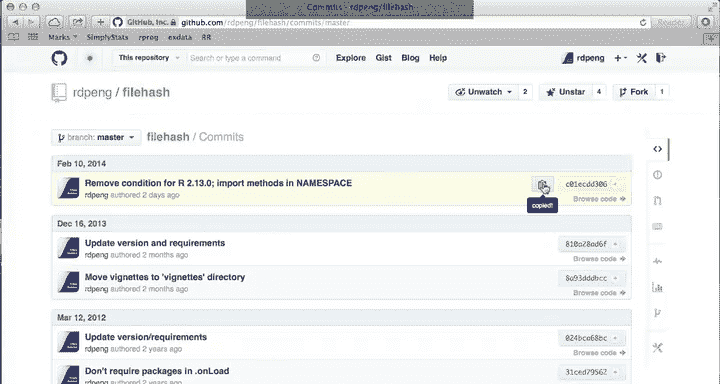
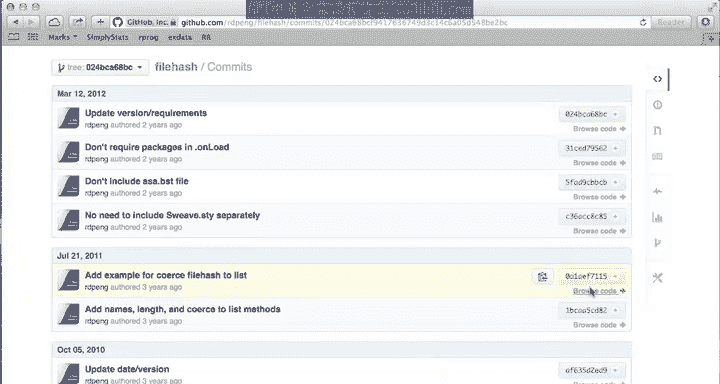

# 课程项目1介绍 📋

在本节课中，我们将学习如何完成并提交课程的第一个项目。项目要求包括进行简单的数据分析，并使用R Markdown和knitr撰写报告。提交过程涉及将你的工作上传至GitHub仓库，并提交特定的提交哈希值以供评估。

---

## 项目要求概述

本次作业需要完成两件事才能成功提交。

首先，你需要进行一个相对简单的数据分析。

其次，你需要使用R Markdown和knitr撰写一份报告。

为了提交作业，你需要先将它检入一个GitHub仓库，然后将仓库推送到GitHub。接着，你需要提交GitHub仓库的链接，这是第一部分。

第二部分是提交一个SHA-1哈希值。这个哈希值标识了与你的提交状态相对应的特定提交，这样我就知道应该查看你仓库中哪个版本的文件。请记住，在Git仓库中，内容会发生变化，你可以通过不同的提交来跟踪这些变化。因此，我需要知道哪个提交对应你本次作业的正式提交。

---

## 如何获取提交信息

接下来，我们来看看如何获取这些提交信息。

假设我正在查看我账户下的一个GitHub仓库。这个项目叫做“filehash”，它实际上是一个R包。你可以在这里看到最新的信息。

你需要知道的第一件事是仓库的URL。这个项目的仓库URL就在顶部，例如：`https://github.com/rdpeng/filehash`。这是该仓库的顶级URL，也是你提交作业第一部分时需要提交的链接（当然，你需要提交的是你自己作业对应的仓库链接）。

你需要提交的第二部分是SHA-1哈希值。

---

### 查找SHA-1哈希值

以下是查找SHA-1哈希值的步骤。

你可以转到仓库的“commits”部分。例如，我的这个仓库有245次提交，你的提交次数可能会少一些。点击提交数量，它会列出你所有的提交，按时间倒序排列。

最新的提交在最顶部。在右侧，你可以看到一个对应此次提交的SHA-1哈希值的缩写版本。

如果你想提交的SHA-1哈希值对应仓库的最新版本，只需将鼠标悬停在这个缩写哈希值上，你会看到一个复制到剪贴板的符号，点击它即可复制。然后，将其粘贴到Coursera要求提交URL和SHA-1哈希值的网页表单中。

如果你不想提交仓库的最新版本，比如你想提交一个更早的版本（例如2012年3月12日的版本），你可以向下滚动，找到那个特定的提交，然后复制该次提交的哈希值并粘贴即可。

---

## 如何评估他人的提交

现在，从评估者的角度来看，如果你需要查看他人的GitHub仓库，应该怎么做。

首先，访问该用户提供的仓库URL。这会显示仓库的最新文件版本。

然后，再次进入提交列表。你需要根据对方提供的哈希值，在这个列表中向下滚动，直到找到匹配的哈希值。

如果它是最新的提交，你会看到它与顶部的哈希值匹配。如果不是，你需要向下滚动一点。

一旦找到那个提交（假设是最新的那个），你可以点击“Browse code”。这将显示该次提交时仓库的状态，相当于项目在那个特定时间点的快照。

此时显示的所有文件都对应那个特定快照时的状态。

如果你想查看更早的时间点，比如2012年3月12日，你可以找到那次提交，然后点击旁边的“Browse code”。这样你就能看到仓库在2012年3月12日的样子。

因此，当你看到一个仓库URL和一个提交哈希值时，评估流程是：访问顶级仓库页面，点击“commits”，找到与给定哈希值匹配的提交，然后点击“Browse code”。这样你就能找到该项目的特定快照。

---

## 总结

本节课中，我们一起学习了如何提交GitHub仓库的URL和SHA-1哈希值。

对于本次作业，你需要首先为自己的版本提交这些信息。

然后，在同伴互评环节，你需要通过访问他人提供的URL，并找到对应特定快照的提交，来评估他人的仓库。

在GitHub中完成这些操作相当直接，但为了确保所有同学都清楚流程，我在此进行了详细演示。