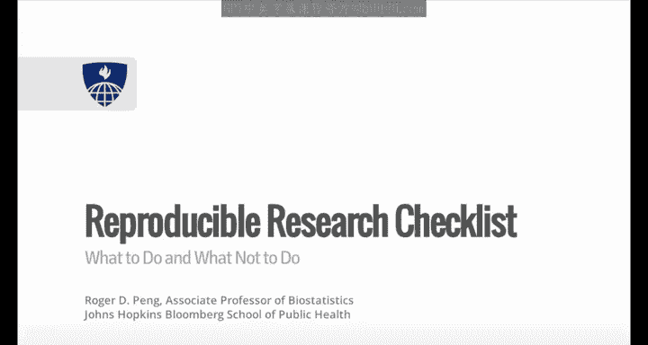
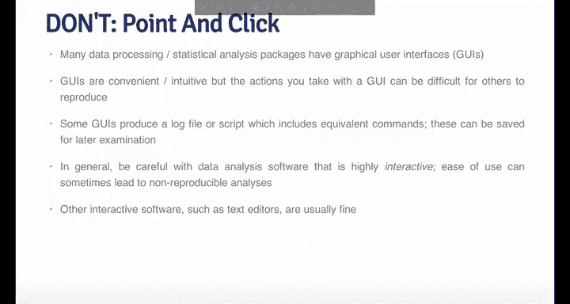

# 课程20：可重复研究清单（第一部分）📋

在本节课中，我们将学习在进行数据分析或研究项目时应考虑的关键事项清单。这份清单旨在帮助你以可重复的方式进行研究，确保你的工作过程清晰、透明，并且他人能够复现你的结果。

---

## 概述

我们将探讨一系列“该做”和“不该做”的事项，这些建议基于经验总结，旨在为你的分析工作建立一个良好的、可重复的基础。课程最后，我们会总结出在进行任何非简单数据分析时，你应该问自己的几个核心问题。

---

## 从好的科学问题开始 🔬

首先，你需要从一个好的科学问题或目标开始。这意味着你研究的课题应该对你和他人都有意义。如果起点不佳，最终结果很可能也不理想，这正应了“垃圾进，垃圾出”的道理。

*   **确保问题聚焦且连贯**：一个清晰、聚焦的问题能让你的工作更简单，因为它排除了许多不必要的可能性。反之，一个宽泛、模糊的问题会增加问题的复杂性。
*   **与优秀的协作者共事**：良好的合作关系能促进良好实践。糟糕的工作关系可能导致其他不良习惯。
*   **选择你感兴趣的主题**：兴趣是维持良好工作习惯的重要动力。

总而言之，第一步是确保你从好的科学、有趣的主题开始。

---

## 核心规则：避免手动操作 ✋

如果要将可重复性浓缩为一条核心规则，那就是：**不要手动操作**。手动操作通常是导致研究过程出错和结果不可重复的主要原因。

以下是几个常见的手动操作示例：

*   **手动编辑电子表格**：例如，在Excel中直接清理异常值或修正数据范围。除非你精确记录下操作步骤和判断标准（例如，定义何为“异常值”），否则这个过程完全不可重复。
*   **手动修改图表和表格**：例如，更改表格中的小数位数。这类看似无害的修改也可能导致结果不可重复。
*   **手动从网站下载数据**：点击链接下载数据虽然简单，但属于手动过程。向他人复现时，你需要提供冗长的说明（访问哪个网站、点击哪个链接等）。
*   **手动移动或分割文件**：在电脑上移动文件或将大文件分割。如果没有记录，他人将无法知道如何重复这些步骤。

在进行分析时，人们常常认为“这个操作只做一次，不需要写程序或详细记录”。但你必须谨慎：即使只做一次，也应将过程记录到足以让一个不了解背景的陌生人能够复现的程度。**避免手动操作的根本原因在于，任何手动操作都需要极其精确的文档记录，而这项任务远比听起来困难**，因为你可能忽略了一些对他人至关重要的细节。

---

## 慎用点击式（图形界面）软件 🖱️

第二条规则与第一条相关：**谨慎使用点击式（图形用户界面，GUI）软件**。图形界面虽然方便、直观、易于使用，但存在一个主要问题：你通过点击和选择菜单执行的操作，很难让他人精确复现。

*   **可重复性风险**：除非你详细记录“点击了哪个菜单，选择了哪个选项”，否则他人无法确切知道你的操作步骤。
*   **利用日志文件**：有些带GUI的软件会生成日志文件或脚本，记录与你的点击操作等效的命令。保存并检查这些日志对可重复性至关重要。
*   **交互式软件的双刃剑**：高度交互的数据分析或处理软件易于探索数据，但这种易用性可能以牺牲可重复性为代价，尤其是当软件不记录操作历史时。

当然，并非所有带GUI的软件都不能用。例如，你用来写代码或报告的文本编辑器有图形界面，这通常没问题，因为你的分析通常不依赖于具体使用哪个文本编辑器。但在极少数情况下，如果分析确实依赖于此，那么你也需要谨慎地记录所有相关细节。

---

## 总结

本节课我们一起学习了可重复研究清单的第一部分，重点在于建立良好的开端并避免常见的不可重复操作。

我们强调了：
1.  **从聚焦、有趣且你关心的科学问题开始**。
2.  **核心原则是避免手动操作**，因为手动操作需要极其苛刻的文档记录，且极易出错。
3.  **谨慎使用图形界面（点击式）软件**进行数据处理和分析，因为它们可能不会自动记录你的操作步骤。

在下一节中，我们将继续探讨清单的其他部分，学习如何通过自动化工具和良好习惯来构建一个真正可重复、可验证的研究工作流。