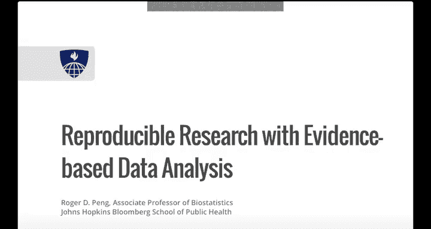
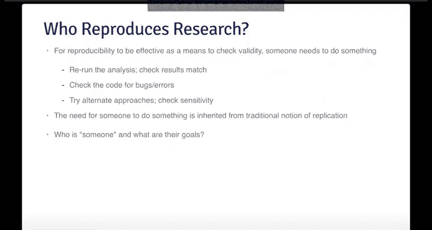
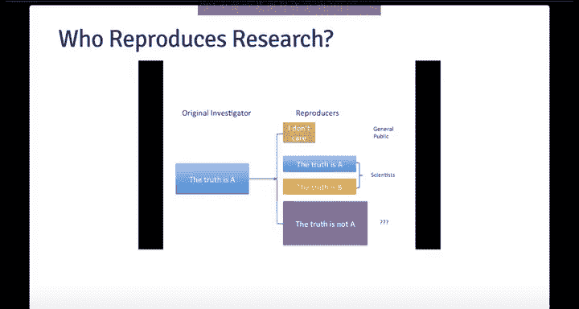
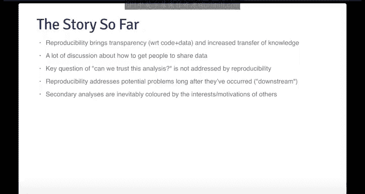
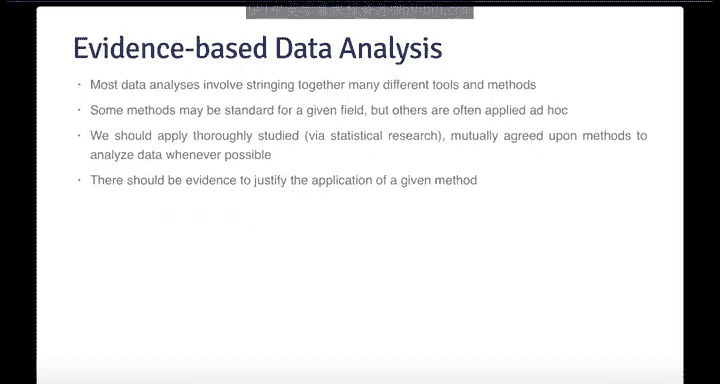
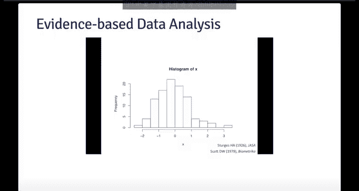

# 课程26：基于证据的数据分析（第四部分）🔬

在本节课中，我们将探讨研究的可重复性、谁来进行重复研究，以及如何通过“基于证据的数据分析”来确保分析方法的可靠性和透明度。

---

## 谁来进行研究的重复验证？🤔

上一节我们讨论了可重复性的重要性。本节中我们来看看，究竟由谁来执行研究的重复验证工作。

可重复性要真正发挥作用，必须有人采取行动。仅仅发表一篇声称可重复的论文是不够的，直到有人真正获取数据和代码，运行分析，甚至尝试复现结果，可重复性才具有实际意义。

以下是可能对您的研究进行重复验证的三类人群：

*   **普通公众**：这是人数最多的群体，但他们通常不关心研究的细节。
*   **科学家同行**：这部分科学家可能同意您的观点（认为真相是A），也可能持有不同假设（认为真相是B）。他们虽然有能力进行重复验证，但通常忙于自己的研究。
*   **持反对意见者**：这部分人并不关心世界运行的真相，他们的目标就是证明您的结论是错误的。他们非常热衷于重复您的工作。虽然我的工作基本都可重复，但这类验证有可能给研究者个人带来困扰。

---

## 可重复性的局限与挑战 ⚠️

到目前为止，我们的讨论表明，可重复性带来了透明度，并促进了知识传递。数据共享和可重复性固然关键，但“我们能否信任所见的分析”这个根本问题，并未完全通过可重复性得到解决。

此外，可重复性是一个下游环节。许多后续的二次分析会受到他人兴趣和动机的影响，这仍然可能影响分析的客观性。

---

## 引入“基于证据的数据分析” 🧪

这引出了我称之为“基于证据的数据分析”的概念。真正的数据分析涉及将大量工具和方法串联成一个长长的流程管道。

很多时候，对于流程中的特定环节，要么存在标准方法（大家做法一致），要么没有标准（研究者自行决定做法）。我认为，特别是在生物医学领域，我们应该使用经过充分研究、科学共同体（或子领域）公认的适当方法。方法不必完美，但应追求“85%的解决方案”。

同时，应有证据来证明特定方法的应用是合理的。作为统计学家，我们经常通过模拟或理论来比较不同方法，以确定在特定情况下哪种方法更合适。

---

## 一个简单的例子：直方图带宽选择 📊

让我们看一个非常简单的例子。这是我在R中生成的一个直方图，使用了 `hist(x)` 命令。直方图本质上是一种平滑器，而平滑器最重要的参数就是**带宽**。

那么，这个带宽是如何被选定的呢？

*   **斯特奇斯规则（1926年）**：斯特奇斯曾提出一个公式来确定带宽。
*   **斯科特规则（1979年）**：后来，随着核平滑的普及，戴夫·斯科特在《生物计量学》上发表论文，讨论了基于积分均方误差等度量来选择带宽。

最终，R语言将某个默认的带宽选择算法编程实现，并沿用至今。大多数时候，这个默认值效果不错，很少有人质疑。有时人们会调整它（调大或调小），但通常默认值已经足够好，并且其背后确实有研究依据作为支撑。

---

## 总结 📝

本节课中，我们一起学习了：
1.  研究的重复验证需要由不同动机的人群（公众、同行、反对者）来执行。
2.  可重复性虽能增加透明度，但未必能完全解决对分析结果的信任问题。
3.  提出了“基于证据的数据分析”理念，强调应使用经过研究验证、领域内公认的标准方法。
4.  通过直方图带宽选择的例子，说明了默认参数背后往往有研究证据支持。

核心在于，我们的数据分析决策应当建立在已有的研究证据之上，而不仅仅是凭直觉或惯例。