# 课程27：基于证据的数据分析 第5部分 📊

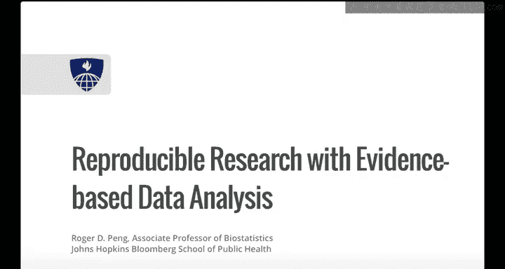

在本节课中，我们将学习“基于证据的数据分析”的核心思想，即如何构建标准化的、确定性的分析流程，并将其应用于科学研究中，以提高分析结果的可信度和可重复性。

---

上一节我们讨论了数据分析中存在的问题，本节中我们来看看如何构建一个“确定性的统计机器”。

我的核心观点是，我们应该尽可能地将这一原则应用到所有地方，即使用基于证据的组件来创建分析流程，并将其标准化。杰夫对此的另一个贡献是，他称之为“确定性的统计机器”。其核心思想是，你拥有一个算法或流程，在给定一组数据和最少的输入参数时，它能产生一个确定性的结果。一旦这个基于证据的流程建立起来，你就不要再去改动它。我称之为“透明盒子分析”。它是一个盒子，所以你不去动它，就像阿尔·戈尔的“锁箱”一样。但它是透明的，因为你可以清楚地知道里面发生了什么，所以它不是黑箱。关键在于不要随意改动。

这个目标之一是为了减少所谓的“研究自由度”，即人们可以摆弄整个流程中的每一个调优参数（这类参数正呈指数级增长），从而从分析中得到任何他们想要的结果。

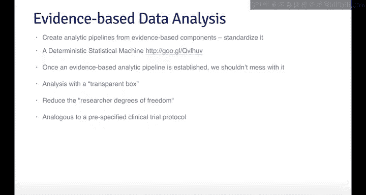

我认为这很大程度上类似于临床试验中预先设定的方案。当你进行临床试验时，你必须事先说明你将要做的一切，包括你将如何分析数据。如果有人已经为你写好了这个方案，那该多好？如果你使用一个标准化的流程，就相当于有人为你写好了方案，你可以预先精确指定在特定情况下你将做什么。

当然，这个流程的具体结构取决于你实际要解决的问题。你有一些数据集，可能还有一些最少的元数据输入，然后数据会经过一系列模块，这些模块可能很长，涉及预处理和各种统计方法。你可以想象，会有一组基准数据集用于评估各种统计方法。

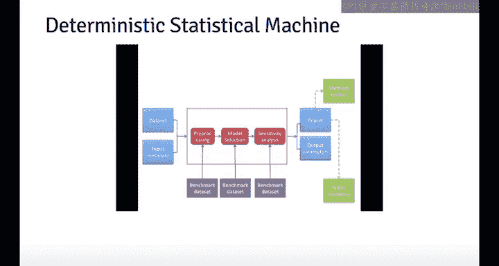

最后，你可以生成某种报告，或许可以直接复制粘贴到论文的方法部分，或者发布到某些公共存储库中。

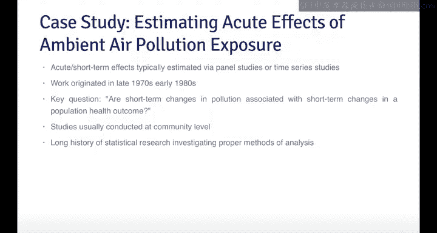

---

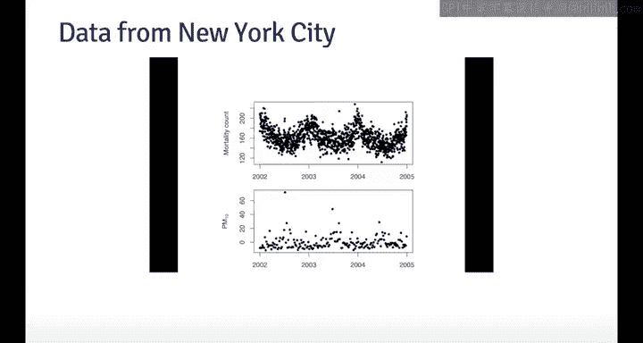

接下来，我想通过一个快速案例研究来说明我的意思。我经常做的一项工作是评估空气污染暴露的急性效应。这些都是相关性研究，这类研究很多起源于七八十年代，所以我们有很长的研究历史。基本问题是：污染的短期变化是否与人群健康结果的短期变化相关？

这类研究通常在社区层面进行，并且有大量的统计研究投入其中，其中一些是我自己做的。数据通常看起来像这样：上面是纽约市的死亡计数，持续了几年；下面是颗粒物水平。你可以看到颗粒物数据没有死亡率数据那么多，因为存在大量缺失值。基本上，你只是想问：上面这个和下面这个相关吗？

问题是，我们能否将我们在统计和流行病学研究中发现的所有东西编码到一个单一的软件包中？我认为答案是肯定的。像这样的时间序列研究变化范围不大，通常涉及相似类型的数据（可能是住院数据而非死亡率数据等），但往往非常相似。那么，我们能否在这个领域创建一个确定性的统计机器呢？

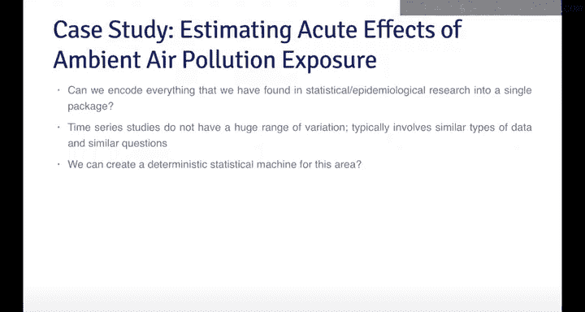

基本的流程会非常简单，分析本身并不复杂。你需要检查数据中是否有异常值或高杠杆点。污染数据通常是偏态的，所以你需要检查这一点。对于过度离散，你需要检查吗？你想填补缺失数据吗？答案是绝对不要。这方面已经有很多研究，结果并不好。这里真正的大问题是模型选择。

我们必须担心未测量的混杂因素。在这类时间序列研究中，我们没有测量很多随时间变化的东西（这有点像你的批次效应）。因此，你必须采用各种方法来估计如何调整这些未测量的混杂因素，通常使用半参数回归方法。所以，估计自由度对任何你可能估计的关联都有最深远的影响，这至关重要。实际上，关于如何做这个有研究，有几篇论文，其中一篇是我的。有各种估计这个自由度数量的方法，你可以选定一两种比其他方法更好的方法，然后直接实现它。

模型的其他方面往往不那么重要。你是否调整温度，以及如何调整，通常影响不大。你通常还感兴趣的是多滞后分析和敏感性分析。你可以在这里选择一个模型，但你想看看如果你稍微前后移动模型，你的关联是否会急剧变化。这些是这类分析中你通常想看到的东西。当我每月审阅一篇时间序列研究的论文时，我总是会问这些问题。

关于为什么填补缺失值如此糟糕的简短回答是：因为数据是系统性缺失的。污染数据很难收集，通常每六天才测量一次，所以每六天就有五天数据缺失。你可以尝试用插补法填补它，但你只是用增加大量噪声换取一点点减少的偏差。

---

我的想法是，显然我们不能只有一个机器。数据分析有很多领域，不同问题需要不同的专业知识。显然，我不能处理所有事情。所以，我们的想法是，我们可以创建一个由这些机器组成的精选库，提供标准化的、代表该领域分析流程最佳实践的状态。显然，污染的时间序列分析是一个非常成熟的领域，没有太多新的统计研究在进行，很多问题已经解决。因此，我们可以建立一个包含这类数据分析的档案库。

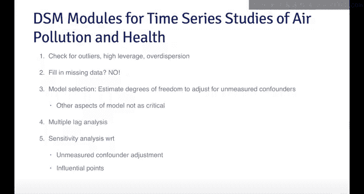

一个类比是“考克兰协作组织”，这是一个基于证据的医学档案库。你可以去考克兰协作组织搜索，例如“维生素C能治疗哮喘吗？”。在摘要中，它会说：我们审查了证据，他们基本上就是做荟萃分析，审查了来自9个维生素C临床试验的证据。总的来说，这些试验规模很小，既不能推荐使用也不能推荐避免使用维生素C治疗哮喘。所以我们不用担心维生素C，它不会帮助我们，但也不会伤害我们。

类似这样的东西是许多基于证据的干预和治疗的基础。类似的事情也可以为数据分析而做。

我们可以拥有由该领域知识渊博的专家策划的、编码了数据分析流程的软件包。这些不一定是最完美的解决方案，但它们的想法是成为相当好的解决方案，覆盖大部分基础。

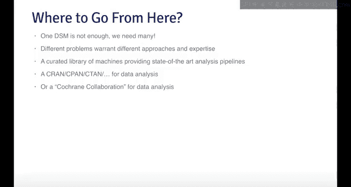

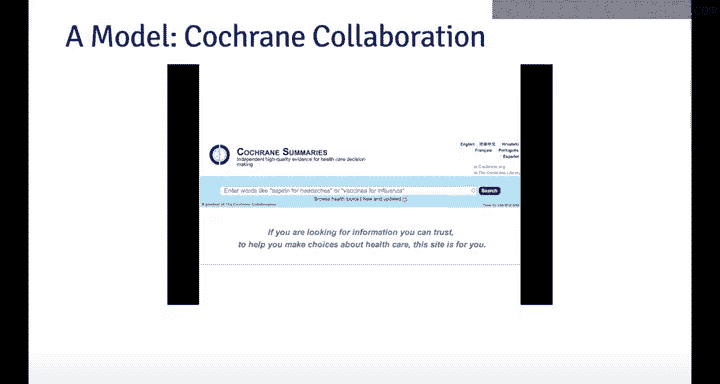

---

这就是我想说的全部内容。我跳过了可重复研究的基础部分，虽然我认为它很重要，但我不认为它从根本上解决了你是否能信任一个分析这个最重要的问题。因此，我称之为“基于证据的数据分析”。我知道有些人不喜欢这个短语，但其核心思想是为特定的科学领域和问题制定有组织的、标准化的最佳实践。我并不是认为它们不存在，真正的问题在于组织和整合。

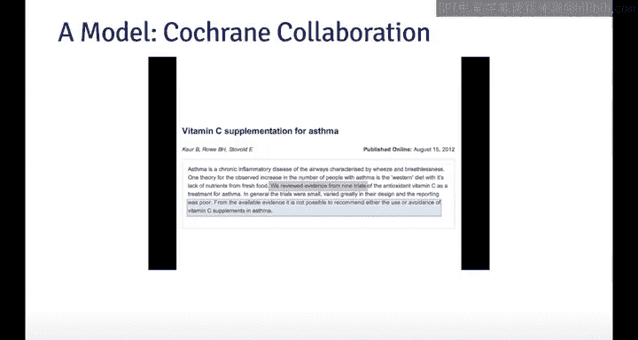

我认为这可以为审稿人提供一个强大的工具，而不会像要求他们重现分析那样极大地增加他们的负担。我认为我们应该投入更多精力来解决科学研究的上游问题。

---

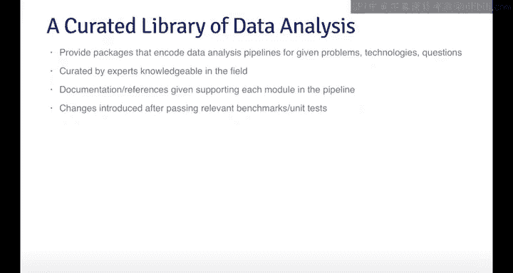

**本节课总结**

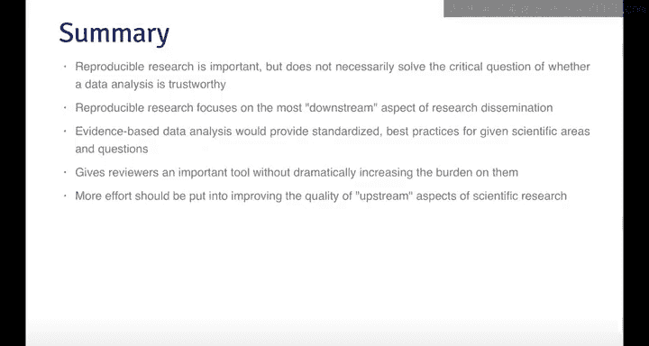

本节课中，我们一起学习了“基于证据的数据分析”的理念。我们探讨了如何构建“确定性的统计机器”或“透明盒子分析”流程，以减少分析中的主观随意性，并通过标准化提高结果的可信度。我们通过空气污染与健康的时间序列研究案例，具体说明了如何将统计研究的最佳实践编码到分析流程中。最后，我们提出了建立由专家策划的数据分析流程库的愿景，类似于医学中的考克兰协作组织，以促进更可靠、更高效的科学数据分析。