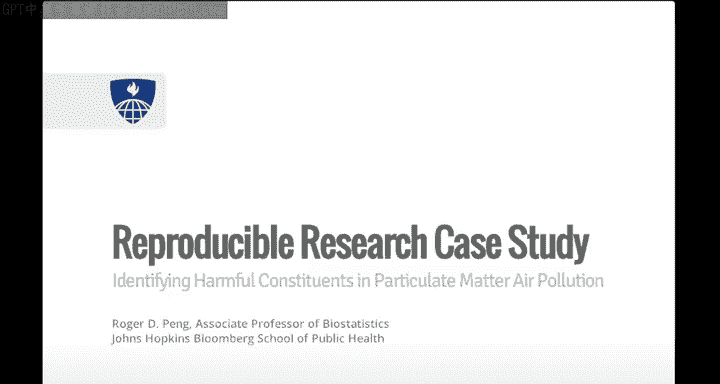
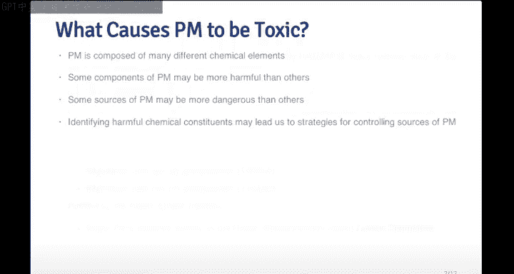
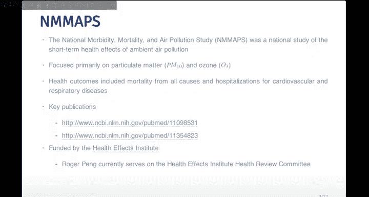
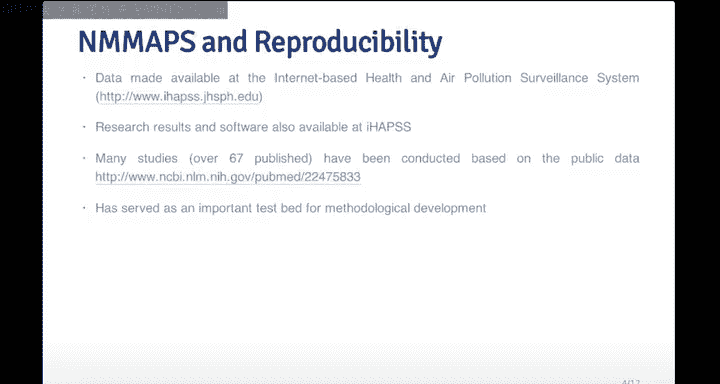
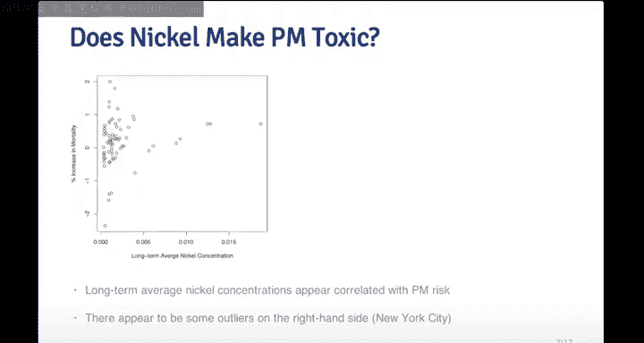
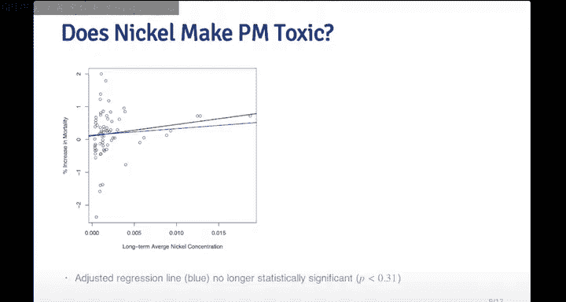
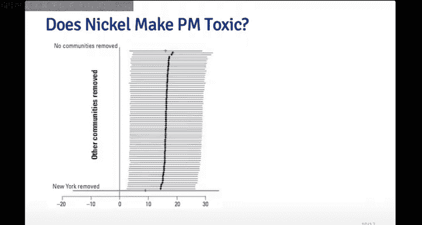
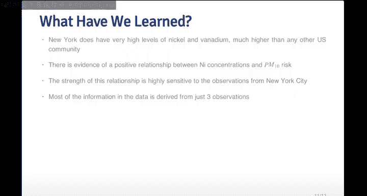
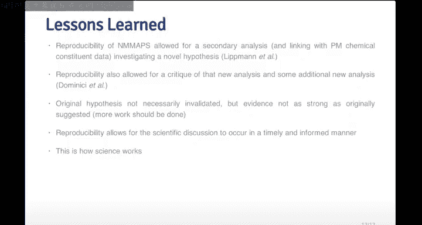

# 课程29：案例研究：空气污染 🏭

在本节课中，我们将通过一个关于空气污染的可重复性研究案例，学习如何识别颗粒物中对健康有害的化学成分。我们将探讨研究背景、分析方法、关键发现以及可重复性在科学研究中的重要性。

## 概述：颗粒物污染与化学成分

颗粒物空气污染由多种化学成分构成。理解这一点至关重要。你可以将颗粒物想象成吸入的灰尘，但这些灰尘并非单一的物质，而是由许多不同的化学成分组成，包括金属、惰性物质（如盐类）以及其他成分。

一种观点认为，这些成分中的某些子集是真正有害的元素。如果我们能找出哪些子集有害，就可以考虑尝试监管产生这些化学成分的源头。目前这非常困难，该领域的研究仍处于相当初步的阶段。因此，识别颗粒物中有害的化学成分引起了广泛兴趣。理论上，这可以引导我们制定更有针对性的法规，控制对人类健康危害最大的空气污染源。

美国环境保护署监测颗粒物的化学成分，并自1999年或2000年左右开始在全国范围内进行监测。人们普遍认为，颗粒物的某些成分可能比其他成分更有害。如果这是真的，那可能意味着某些颗粒物来源比其他来源更危险，因为不同的污染源会产生不同组合的化学成分。因此，如果我们能识别出颗粒物中特别有害的化学成分，就可能引导我们制定更好的策略来控制颗粒物的来源。

目前，颗粒物的监管或控制方式是只监管空气中颗粒物的总量，而不考虑颗粒物的来源或构成。这一策略确实改善了公共健康，因为我们知道颗粒物整体是有害的。但就公共健康而言，这可能不是最高效或最有益的策略，因为我们没有针对毒性元素或毒性最强的元素进行控制。

## 案例研究：NMMAPS项目

接下来，我们将讨论一个具体的研究案例，并稍后探讨它与可重复性的关系。这个案例研究的基础是“全国发病率、死亡率和空气污染研究”（NMMAPS）。这是一项关于环境空气污染短期健康影响的全国性研究。该研究主要关注颗粒物（PM10，即直径小于10微米的颗粒）和臭氧。在本讲座中，我们只讨论PM10。

该研究中的健康结局包括全因死亡率，以及心血管和呼吸系统疾病的住院情况。这项研究由健康影响研究所资助。

NMMAPS研究的一个有趣方面是，它是有史以来可重复性最高的空气污染研究之一。特别是，NMMAPS的原始研究者决定通过一个名为“基于互联网的健康与空气污染监测系统”（IHAPSS）的网站，公开数据、结果和软件代码。在该网站上，可以免费下载空气污染数据、天气数据、软件、结果和许多其他内容。

自数据公开以来，基于这些数据进行了许多独立于原始NMMAPS的研究。一项统计显示，基于NMMAPS数据发表的论文超过67篇。因此，向公众公开的数据和代码已成为该领域方法学发展的重要测试平台。

## 关键发现：镍的潜在危害

最近发表在《环境健康展望》期刊上的一项研究，涉及了镍在环境空气中对心血管的影响。镍是颗粒物的常见成分，是一种过渡金属，被认为非常有害，尤其可能导致心血管类疾病。该研究发现强有力的证据表明，在美国60个社区中，颗粒物中的镍改变了PM10的短期效应。

基本上，他们的发现是：在颗粒物中镍浓度相对较高的社区，PM10带来的健康风险似乎比其他镍含量较低的社区更严重。由此可以推断，镍是PM10中有毒的元素之一，甚至可能是唯一的有毒元素。如果颗粒物含有更多镍，那么它们对健康的危害就更大。这是他们在论文中提出的部分证据。

当他们观察颗粒物的其他化学成分时，似乎没有发现相同类型的效应修正作用。例如，如果一个城市的硫酸盐浓度远高于另一个城市，这并未导致更高的健康风险。主要的效应修正作用来自镍元素。这个结果很有吸引力，因为它似乎识别出了一个或少数几个导致PM10更高健康风险的元素。这几乎意味着只需要监管或控制一个或极少数元素。因此，有人认为这可能过于简单，以至于不像是真的。

## 重新分析：数据敏感性与纽约市的影响

因此，Francesco Dominici、我本人和一些同事决定重新审视数据，看看是什么驱动了PM10风险与镍以及另一种过渡金属钒之间的关联。我们重新检查了NMMAPS数据，并将其与PM化学成分数据关联起来。我们有一个特别的想法：美国纽约市的镍含量极高。

因此，一种可能性是，由于纽约市的镍含量非常高，这样的分析结果是否会受到纽约市高镍水平的影响？

以下是一个简单的散点图。X轴是社区中长期平均镍浓度，Y轴本质上是风险，即颗粒物每增加一个单位所导致的死亡率增加的百分比。你可以将其视为颗粒物的死亡风险。你可能会注意到，社区中长期平均镍浓度与其PM风险之间似乎存在相关性，因为在散点图中，随着向右移动，风险似乎略有增加。

另一方面，你可能会在图中看到，在图的右侧有一些异常值。有几个点非常偏向右侧。事实证明，最右侧的三个点都是纽约市的县。纽约市由五个县组成，因此图中最右侧的三个点就是纽约市的三个县。

以下是你可以拟合到这些数据的回归线。这是一条简单的线性回归线，你可以看到它是正斜率的，表明存在正相关，即更多的镍与更高的PM死亡风险相关。在原始论文中，该回归线具有统计学显著性，P值小于0.01。这非常有趣，似乎意味着在镍浓度较高的社区，死亡风险更大。

然而，如果仅仅移除异常点，特别是纽约市的那些点（其镍含量非常高），然后重新计算回归线，你会得到蓝线。右侧那三个点被称为高杠杆点，回归线对高杠杆点非常敏感。仅仅从数据中移除这三个点，就能使回归线下降一些，从而得到蓝线。在这种情况下，它不再具有统计学显著性，P值约为0.31。

由此可见，在观察此类相关性时，仅仅几个点就能产生巨大差异。

## 敏感性分析：逐个移除社区的影响

我们进行的另一项分析是，逐一重新计算回归线的斜率。我们逐一移除研究中的每个县或社区（原始研究有60个社区），观察分析是否对任何特定社区敏感。你可以看到，这里所有的黑点代表移除某个社区时回归线的斜率估计值。由于它们都聚集在相似的值附近，你可以看出，在大多数情况下，回归线对移除任何单个社区的数据并不敏感。

然而，最底部的红点和红线表示移除纽约市数据时的斜率估计值及其95%置信区间。你可以看到，当移除纽约市社区时，斜率估计值下降了很多，并且置信区间变得比其他所有点都宽得多。这是另一个迹象，表明该回归线的斜率估计值对是否包含纽约市的数据点非常敏感。

## 结论与启示

在我们同样发表在《环境健康展望》上的分析中，我们学到了几点。首先，我们确认了纽约市的镍和钒含量确实非常高，远高于美国其他任何社区。其次，有证据表明镍浓度与PM风险之间存在正相关关系，即使移除纽约市的数据，这种关系仍然是正的。

然而，这种关系的强度对来自单个城市的观测值高度敏感。因此，关键点在于，从数据中得出的证据实际上只依赖于少数几个数据点。认识到这一点很重要：尽管我们仍然看到镍与PM死亡风险之间存在正相关，但从这次重新分析中可能得出的关键结论是，由于证据对单个社区的高度敏感性，证据的强度可能不如人们希望的那么强。

## 总结：可重复性的重要性

从这个案例研究中我们学到的一些经验教训是：NMMAPS研究从一开始就具备的可重复性，首先允许了二次分析的发生，以研究“镍是PM中有害化学成分”这一新假设。这非常好，它允许其他人探索新想法。Liman等人的论文就是此类二次分析的一个例子。

当然，研究的可重复性也允许了对这项新分析的批评，并带来了由Dominici等人发表的额外新分析。我们从这篇论文中学到的一个经验教训是，关于镍有害的原始假设并未被完全否定，只是最初提出的证据可能不如最初暗示的那么有力，需要更多工作来研究这一假设。

从这个案例研究中获得的一个非常重要的经验教训是，可重复性使任何科学讨论都更加明智和及时。在这个案例中，你可以看到，有人提出了镍是PM有害元素的假设，人们用数据来验证这个假设，并展示了数据证据。另一组研究者使用相同的数据，试图审视这个假设，确认了正相关的存在，但也认为证据的呈现方式和强度存在一些弱点。因此，基于数据使用的明智讨论得以来回进行。

分析过程是透明的，人们可以看到其他人做了什么。这就是科学发展的方式，好的想法得以浮现，不好的想法被搁置。这是一个良好的科学交流过程，也是科学向前推进的方式。因此，可重复性是关键，因为它使整个过程变得明智、及时且透明。