# 课程 30：案例研究：高通量生物学 🔬

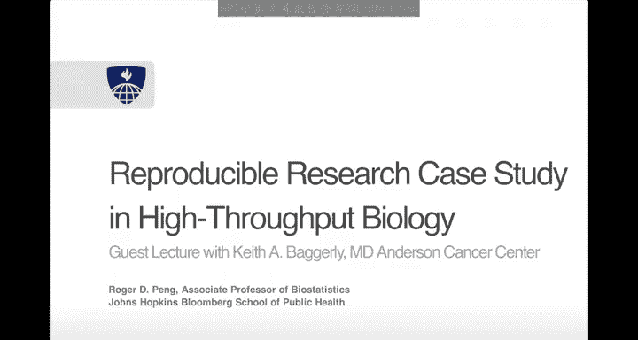

在本节课中，我们将通过一个真实案例，探讨在高通量生物学研究中可重复研究的重要性。我们将跟随 Keith Baggerly 教授，回顾杜克大学研究人员在利用基因组特征预测癌症治疗反应时发生的一系列问题，并从中学习关键教训。

---

## 概述：可重复研究的挑战

上一节我们介绍了课程背景。本节中，我们来看看在高通量生物学领域，由于测量数据量巨大且分析过程复杂，确保研究结果能被他人精确复现变得至关重要。我们的直觉对于单个基因可能有效，但对于包含成百上千个基因的特征（Signature）则常常失效。因此，当文献中方法描述不清时，我们可能不得不进行“法医生物信息学”分析，即从结果和原始数据反推其分析过程。

## 案例背景：基因组特征预测化疗敏感性

这个案例基于2006年底发表在《自然·医学》上的一篇论文。研究者声称，他们利用NCI-60细胞系面板，开发了一种通过基因组特征预测多种化疗药物敏感性的方法。

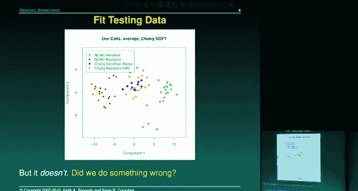

以下是该方法的核心步骤：
1.  针对目标药物（如多西他赛），在NCI-60中找出最敏感和最耐药的细胞系。
2.  获取这些细胞系的基因芯片表达谱数据。
3.  对比两组细胞系，找出表达差异最显著的基因，构成敏感性特征的候选基因集。
4.  使用“元基因”（即主成分分析）方法拟合模型，构建敏感性特征。
5.  将该特征应用于临床样本数据，预测患者对药物的反应。

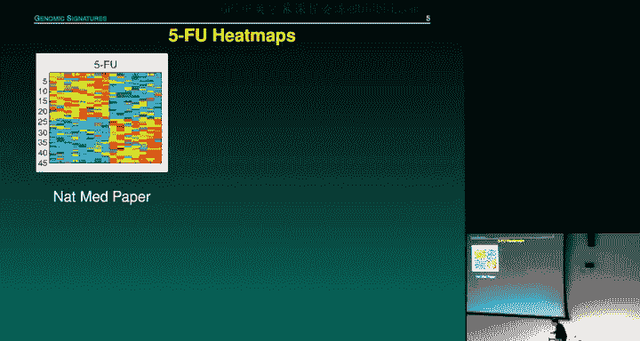

论文报告了出色的预测结果，并迅速引起了多个研究组的兴趣。

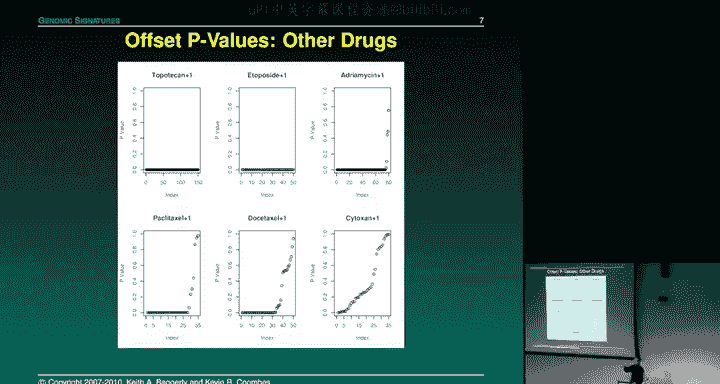

## 初步尝试与问题浮现

当Baggerly教授的团队尝试独立复现该方法时，首先选择了药物多西他赛。他们用训练数据（敏感与耐药细胞系）成功分离出了两组。然而，当将临床样本数据投射到同一空间时，并未看到预期的分离效果。

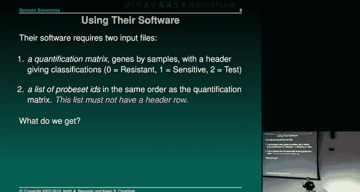

这促使他们开始仔细检查原始论文的分析细节。

## 发现错误：索引偏移与标签混淆

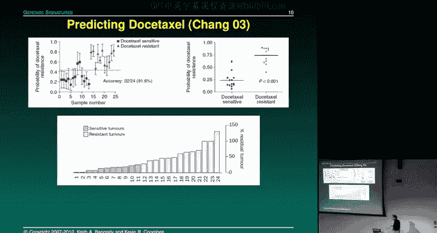

他们首先检查了论文中提供的每个药物特征基因列表。以药物5-氟尿嘧啶为例，论文提供了45个基因的列表。

以下是他们发现的第一个问题：
*   当他们使用同样的t检验方法筛选出自己认为的“最佳45个基因”时，其列表与论文列表不符。
*   将两个列表并排对比后，他们发现论文中的基因ID全部**向后偏移了一位**。这很可能是因为在将数据从Excel复制到分析软件时，不小心包含了标题行，导致软件读取基因列表时发生了索引错误。

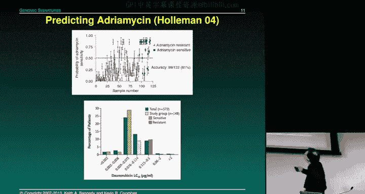

这个错误影响了对生物学解释的信任，因为论文中用于解释机制的一些基因，实际上并不在真正使用的特征列表中。

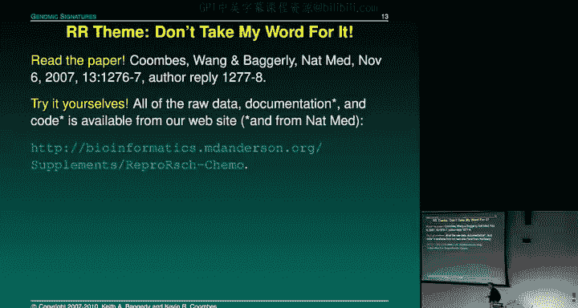

进一步检查其他六种药物时，他们发现其中六种都存在类似的索引偏移问题。

## 深入调查：预测准确性的疑云

接下来，他们检查了预测结果的准确性。论文报告了在多个公共数据集上的高预测准确率，但未提供每个样本的具体预测结果。

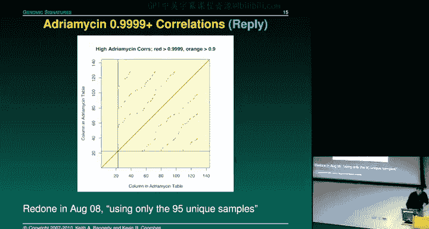

以下是他们发现的新问题：
1.  **样本标签不一致**：对于药物多西他赛，原始论文与提供测试数据集的另一篇论文在敏感/耐药样本的数量上存在矛盾。
2.  **标签可能颠倒**：对于药物阿霉素，预测结果显示大多数患者为耐药。然而，该测试数据来源于儿童白血病研究，而儿童白血病的治愈率很高。如果一种药物对大多数患者耐药，临床上是不会使用的。这强烈暗示在数据输入时，敏感（0）和耐药（1）的标签被错误地颠倒了。
3.  **特征基因来源可疑**：对于多西他赛，在修正索引偏移后，仍有19个基因无法解释。他们发现其中14个基因恰好连续地出现在测试数据集原作者提供的、能区分敏感/耐药的92个基因列表中。这种连续重叠随机发生的概率极低。而剩下的5个基因，正是论文中用来解释生物学机制的基因。这意味着，用于区分训练集、区分测试集和用于生物学解释的基因集，三者毫无重叠。

## 后续发展：错误持续与临床风险

Baggerly团队将这些问题以信件形式提交给《自然·医学》。作者方的回应是反驳，并声称已在其他论文中成功应用该方法。

然而，后续调查发现了更严重的问题：
*   对于阿霉素，作者在网站上发布的校正数据中，存在**样本重复使用且标签不一致**的情况。
*   在另一篇关于肺癌药物（顺铂/培美曲塞）的《临床肿瘤学杂志》论文中，他们声称的重要特征基因（如ERCC1），**实际上并未出现在所使用的基因芯片平台上**。
*   最令人担忧的是，基于这些存在明显错误的特征，杜克大学已经**启动了多项临床实验**，用于指导患者的治疗分配。
*   在2010年11月发布的新验证数据中，他们使用的59个样本，**每一个的标签都与原始数据库中的记录不符**。

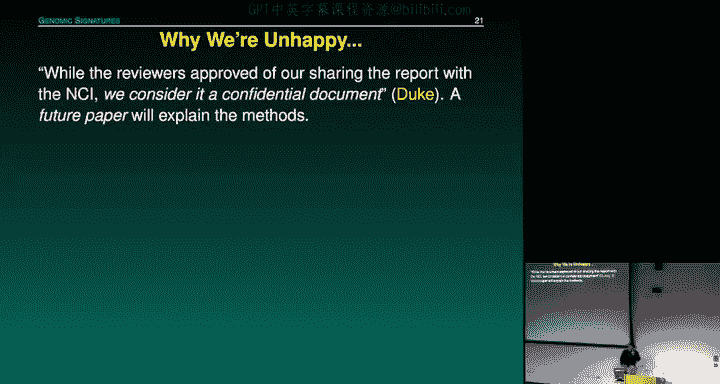

## 教训与解决方案

这个案例揭示了高通量生物信息学分析中一些普遍而危险的错误。

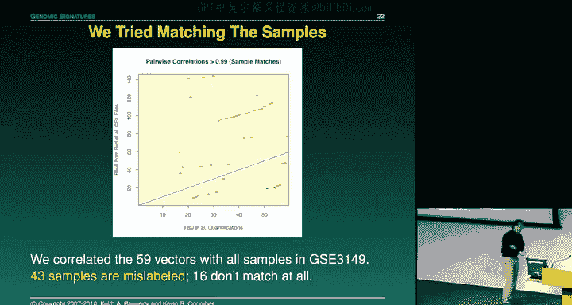

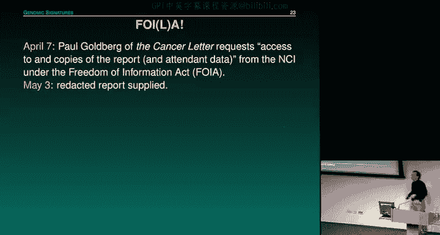

以下是常见的简单错误类型：
1.  **索引错误**：如Excel复制粘贴导致的基因或样本列表偏移。
2.  **标签混淆**：样本或组别标签错误或颠倒。
3.  **设计混淆**：实验设计缺陷导致结论不可靠。

这些错误之所以能通过审查并进入临床，核心原因在于**研究文档和代码的缺失**，导致他人无法复现和审查分析过程。

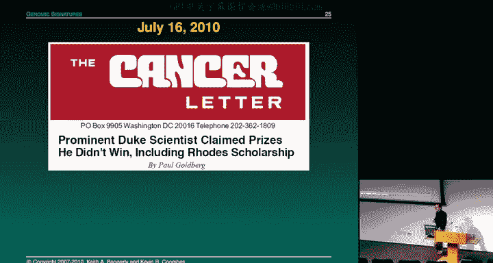

那么，如何促进可重复研究呢？以下是关键建议：
*   **提供完整数据**：公开原始数据和加工后的数据矩阵。
*   **清晰标注**：明确说明数据矩阵中每一列对应的样本和组别。
*   **提供分析代码**：公开用于从原始数据到最终结果的所有分析脚本。

Baggerly教授所在的团队从2007年起，强制要求所有分析报告使用 **Sweave**（结合R和LaTeX）编写。这样，报告本身包含了生成所有图表和结果的代码，任何人运行代码都能得到完全相同的结果。他们建立了分析师-教授两级审核流程，进一步确保了分析的可重复性和准确性。

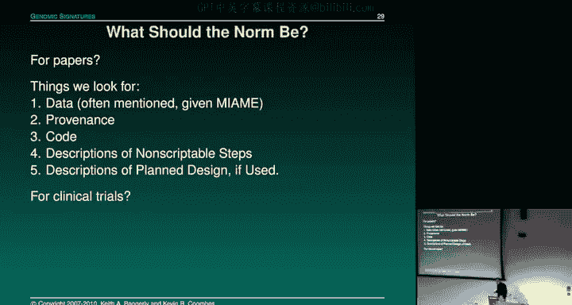

## 总结

本节课中，我们一起学习了杜克大学基因组特征案例的始末。这个案例深刻地说明了，在高通量生物学时代，**可重复研究不是锦上添花，而是科学严谨性的基石**。简单的数据操作错误，在文档缺失的情况下可能无法被察觉，进而导致严重的科学误判和临床风险。作为研究者，我们应积极采用能促进可重复性的工作流程和工具（如R Markdown, Jupyter Notebook），公开数据和代码，共同维护科学的可信度。