# 课程 16：数据科学问题的类型 📊

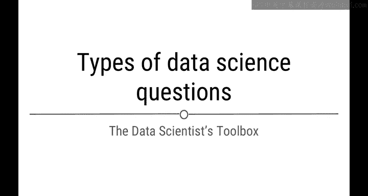

在本节课中，我们将从概念层面探讨数据科学家为解答问题所采用的几种主要分析类型。我们将了解每种分析的目标、特点以及适用场景。

---

## 概述

数据科学分析大致可分为六类，按难度递增排序，分别是：描述性分析、探索性分析、推断性分析、预测性分析、因果性分析和机制性分析。接下来，我们将逐一探讨这些分析类型的目标，并举例说明。

---

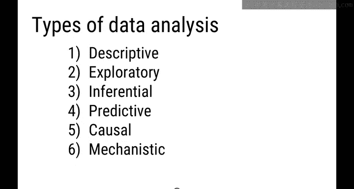

## 描述性分析 📝

描述性分析的目标是描述或总结一组数据。当你获得一个新数据集时，这通常是你首先进行的分析类型。描述性分析会生成关于样本及其测量的简单摘要。

以下是描述性分析中常见的统计量：
*   **集中趋势度量**：例如均值、中位数、众数。
*   **变异性度量**：例如极差、标准差、方差。

这种分析旨在总结你的样本，而不是将分析结果推广到更大的人群或试图得出结论。将数据与进行解释和推广分离开来，解释和推广需要额外的统计步骤。

一个纯粹描述性分析的例子是人口普查。政府收集全国公民的一系列测量数据，然后进行汇总。例如，下图展示了按性别分层的美国人口年龄分布。其目标仅仅是描述这个分布，不涉及对数据意义的推断或对未来趋势的预测，只是展示所收集数据的摘要。

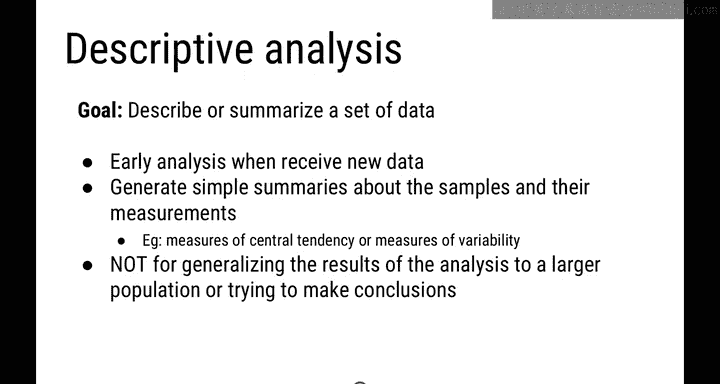

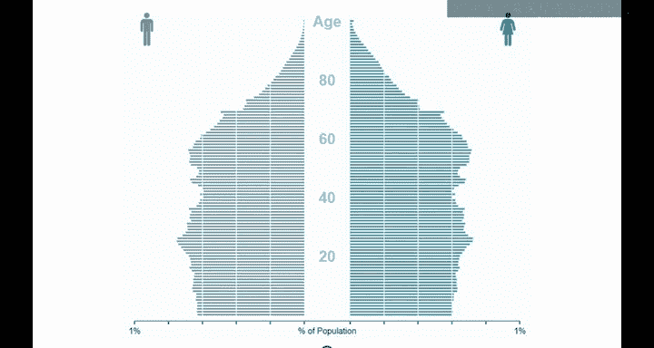

---

## 探索性分析 🔍

上一节我们介绍了如何描述数据，本节中我们来看看如何探索数据中的未知关系。探索性分析的目标是检查或探索数据，发现先前未知的关系。

探索性分析探索不同测量值之间可能存在的关系，但**不确认**这种关系是因果关系。你可能听过“相关不蕴含因果”这句话，探索性分析正是这句话的根源。仅仅因为在探索性分析中观察到两个变量之间存在关系，并不意味着其中一个必然导致另一个。

因此，探索性分析虽然有助于发现新的联系，但不应作为解答问题的最终依据。它可以让你提出假设，并推动未来研究和数据收集的设计，但仅凭探索性分析本身绝不应作为解释数据为何或如何相关的最终定论。

回到上面的人口普查例子，我们不再仅仅总结单个变量内的数据点，而是可以观察两个或多个变量之间可能存在的关系。在下图中，我们可以看到不同行业中女性劳动力所占的百分比，以及这一比例在2000年至2016年间的变化。

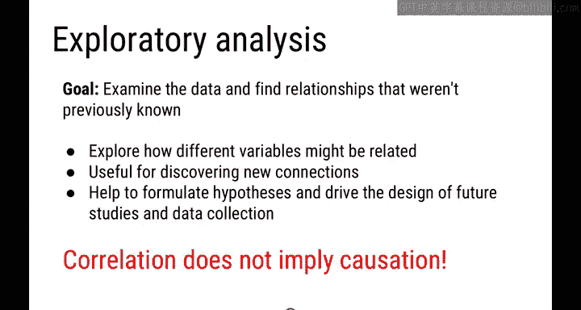

探索这些数据，我们可以看到许多关系。仅从数据顶部来看，我们可以看到女性构成了护士的绝大多数，并且在16年间略有下降。虽然注意到这些关系很有趣，但这些关系的原因从本分析中并不明显。探索性分析只能告诉我们关系存在，而非原因。

---

## 推断性分析 📈

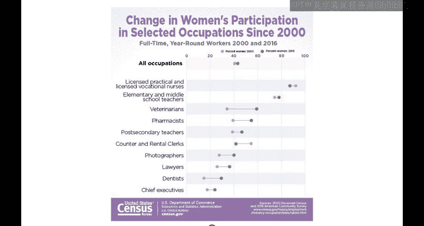

探索性分析帮助我们发现了关系，但如果我们想基于有限样本对整个群体做出判断呢？这就是推断性分析的目标。推断性分析的目标是使用相对较小的数据样本来推断或说明更大总体的情况。

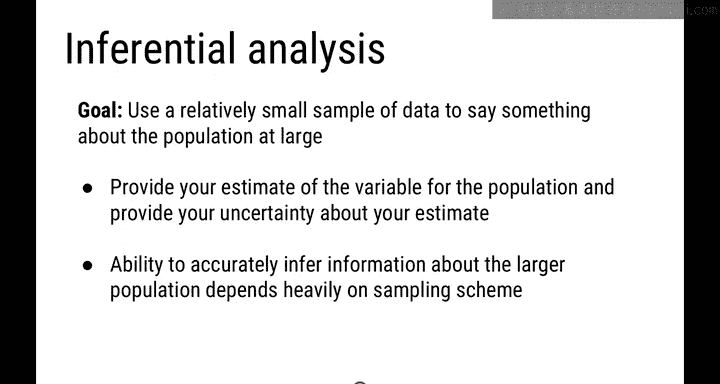

推断性分析通常是统计建模的目标，即你拥有少量信息，需要外推并将该信息推广到更大的群体。推断性分析通常涉及使用你拥有的数据来估计总体中的值，然后给出你对估计值的不确定性度量。

由于你是从少量数据出发并试图推广到更大的总体，你准确推断更大总体信息的能力在很大程度上取决于你的抽样方案。如果你收集的数据不是来自总体的代表性样本，你对总体的推断推广将不准确。

与之前的例子不同，我们不应在推断性分析中使用人口普查数据。人口普查已经收集了功能上整个总体的信息，没有剩下的人可以推断了。将美国人口普查数据推断到另一个国家也不是一个好主意，因为美国不一定代表我们试图推断知识的另一个国家。

相反，推断性分析的一个更好例子是一项研究，该研究对美国人口的一个子集进行了调查，了解他们在所经历的空气污染水平下的预期寿命。这项研究使用从美国人口样本中收集的数据，来推断空气污染可能如何影响整个美国的预期寿命。

---

## 预测性分析 🔮

推断性分析试图描述总体，而预测性分析则着眼于未来。预测性分析的目标是使用当前数据来预测未来数据。本质上，你是使用当前和历史数据来寻找模式，并预测未来结果的可能性。

与推断性分析类似，你预测的准确性取决于是否测量了正确的变量。如果你没有测量正确的变量来预测某个结果，你的预测将不会准确。此外，构建预测模型的方法有很多，有些方法在特定情况下更好或更差。但一般来说，拥有更多数据和一个简单的模型通常在预测未来结果方面表现良好。

尽管如此，就像探索性分析一样，仅仅因为一个变量可能预测另一个变量，并不意味着一个导致另一个。你只是利用观察到的这种关系来预测第二个变量。常言道，预测很难，尤其是预测未来。在事件发生之前，没有简单的方法来衡量你对事件的预测效果如何，因此评估不同的方法或模型是一个挑战。

我们花了很多时间试图预测事物：即将到来的天气、体育赛事的结果，以及我们在这里要探讨的例子——选举的结果。我们之前提到过 FiveThirtyEight 的 Nate Silver，他们试图预测美国选举和体育比赛的结果。

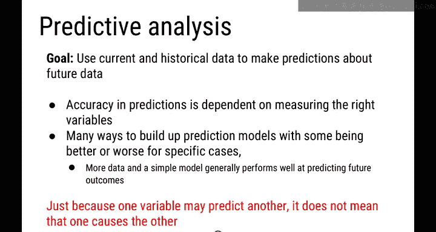

利用历史投票数据和趋势以及当前投票数据，FiveThirtyEight 建立模型来预测下一次美国总统选举的结果，并且在这方面相当准确。其模型准确预测了2008年和2012年的选举，并且在2016年美国大选中被广泛视为一个异类，因为它是少数几个暗示唐纳德·特朗普有机会获胜的模型之一。

---

## 因果性分析 ⚖️

到目前为止，我们所看到的许多分析都有一个注意事项：我们只能看到相关性，而无法触及我们所观察到的关系的原因。因果性分析填补了这一空白。

因果性分析的目标是观察当我们操纵一个变量时，另一个变量会发生什么变化，着眼于关系的因果关系。一般来说，仅凭观察数据来进行因果性分析是相当复杂的。总会存在疑问：是你的结论由相关性驱动，还是你分析所基于的假设是有效的？更常见的是，因果性分析应用于旨在识别因果关系的随机化研究的结果。

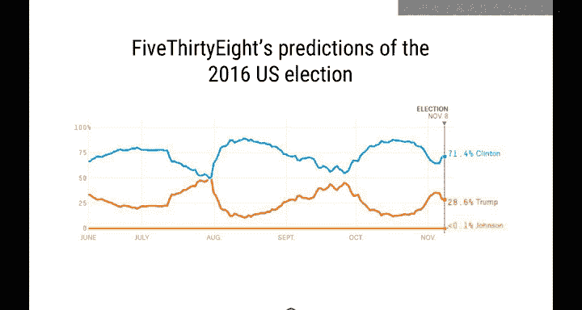

因果性分析通常被认为是数据分析的黄金标准，在科学研究中经常见到，科学家们试图确定现象的原因。但通常，为进行因果性分析获取合适的数据是一个挑战。关于因果性分析需要注意的一点是，数据通常是汇总分析的，观察到的关系通常是平均效应。因此，虽然平均而言，给特定人群服用某种药物可能会缓解疾病症状，但这种因果关系可能对每个受影响的个体都不成立。

正如我们所说，许多科学研究允许进行因果性分析。药物的随机对照试验就是一个典型的例子。例如，一项随机对照试验研究了一种新药对治疗脊髓性肌萎缩症婴儿的效果，比较了接受药物治疗的婴儿样本与接受模拟对照的样本。他们测量了婴儿的各种临床结果，并观察药物如何影响这些结果。

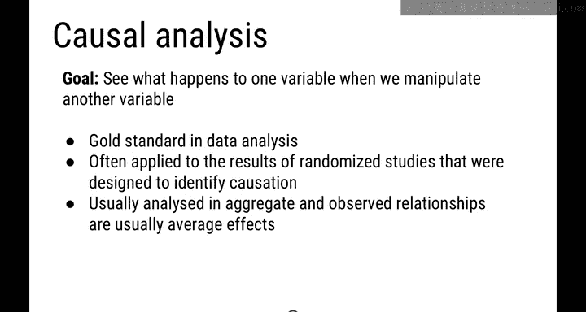

---

## 机制性分析 ⚙️

机制性分析不像之前的分析那样常用。机制性分析的目标是理解导致其他变量发生精确变化的变量的精确变化。这些分析极难用于推断，除非在简单的情况下或那些可以用确定性方程很好建模的情况下。

鉴于这个描述，可能很容易看出机制性分析最常应用于物理或工程科学。例如，生物科学的数据集噪声太大，无法使用机制性分析。通常，当应用这些分析时，数据中唯一的噪声是测量误差，这是可以解释的。

你通常可以在材料科学实验中找到机制性分析的例子。这里有一项关于生物复合材料的研究，本质上是制造可生物降解的塑料，研究生物碳颗粒大小、功能聚合物类型和浓度如何影响最终塑料的机械性能。他们通过仔细平衡控制和操纵变量，并对这些变量和期望结果进行非常精确的测量，从而能够进行机制性分析。

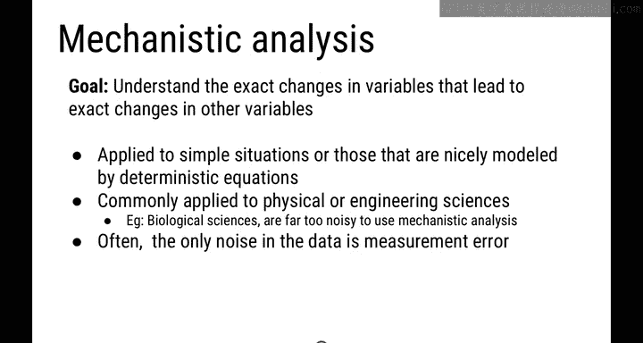

---

## 总结

在本节课中，我们涵盖了各种类型的数据分析、它们的目标，并查看了每种分析的一些示例，以展示每种分析能够做什么，以及重要的是，它不能做什么。

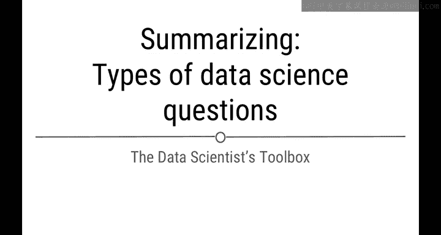

我们了解到，从简单的数据描述（描述性分析）到发现关系（探索性分析），再到基于样本推断总体（推断性分析）和预测未来（预测性分析），每一步都增加了复杂性。而确定因果关系（因果性分析）和理解精确的变化机制（机制性分析）则代表了更高层次、要求更严格的分析目标。理解这些类型的区别对于提出正确的问题、选择适当的分析方法以及合理解读结果至关重要。