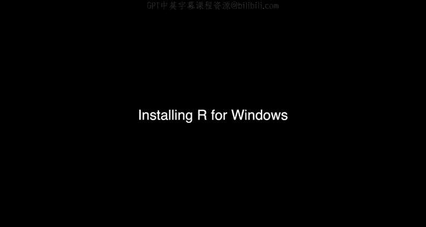
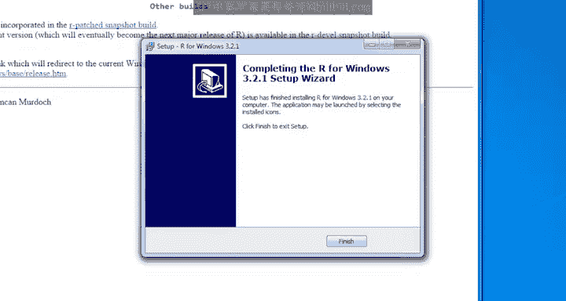
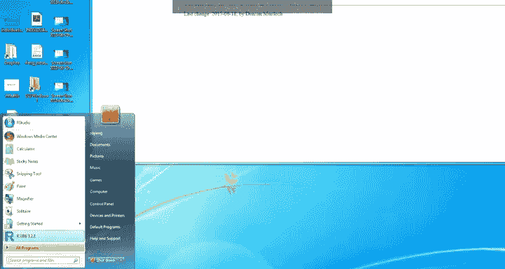
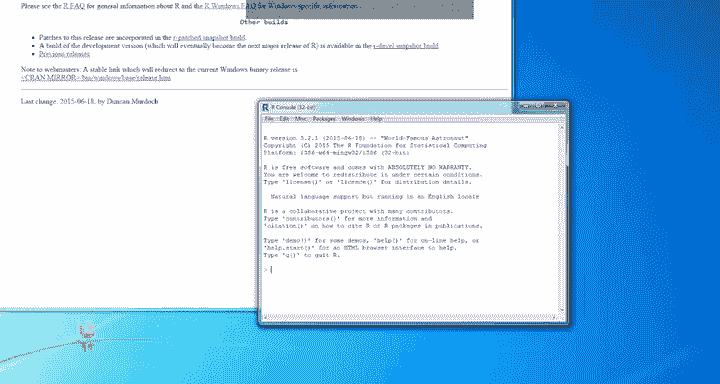

# 课程 1.1：在Windows上安装R 🖥️



在本节课中，我们将学习如何在Windows操作系统的电脑上安装R语言环境。R是一种用于统计计算和图形的编程语言，是数据科学领域的重要工具。我们将一步步完成从下载到启动的整个过程。

## 概述

安装R是开始数据科学之旅的第一步。这个过程主要涉及访问官方网站、下载安装程序、运行安装向导并进行一些基本配置。我们将确保每一步都清晰明了。

## 下载R安装程序

首先，你需要启动一个网页浏览器。你可以使用Chrome、Firefox或Edge等任何你习惯的浏览器。

以下是下载R安装程序的具体步骤：

1.  在浏览器的地址栏中，访问R项目的综合归档网络（CRAN）官网。其网址是：`https://cran.r-project.org/`。
2.  进入网站后，你会看到顶部有三个针对不同操作系统的选项：Linux、Mac和Windows。
3.  点击“Download R for Windows”链接。
4.  在接下来的页面中，点击“base”子目录下的链接。
5.  最后，点击“Download R X.X.X for Windows”链接（X.X.X代表当前版本号），下载将自动开始。下载时间取决于你的网络速度。

## 运行安装向导

下载完成后，在你的“下载”文件夹中找到名为“R-X.X.X-win.exe”的文件，双击运行它。

安装向导将引导你完成安装。以下是安装过程中的关键步骤和选项说明：

1.  **选择安装语言**：安装程序会首先让你选择界面语言。你可以从列表中选择你熟悉的语言，例如“中文（简体）”或“English”。
2.  **阅读并同意许可协议**：接下来是R的许可协议，即GNU通用公共许可证。阅读后，点击“下一步”表示同意。
3.  **选择安装位置**：默认的安装目录（通常是`C:\Program Files\R\R-X.X.X`）对于大多数用户来说都是合适的，建议直接点击“下一步”使用默认路径。
4.  **选择安装组件**：这里通常保持默认选项即可。默认设置会同时安装32位和64位版本，以适应不同的系统。除非你明确知道你的电脑是较旧的32位机器，否则无需更改。
5.  **启动选项配置**：这一步允许你自定义R的启动方式。我们建议进行简单配置以便更好地使用。
    *   **界面风格**：你可以选择MDI（多文档界面）或SDI（单文档界面）。MDI将所有窗口（如控制台、图形）嵌套在一个主窗口内；SDI则让每个窗口独立显示。对于初学者，**SDI模式**（独立窗口）通常更直观，管理起来也更方便。
    *   **帮助文件格式**：你可以选择使用“HTML帮助”或“纯文本帮助”。**HTML帮助**界面更美观，支持链接跳转，阅读体验更好，推荐选择此项。
    *   **网络连接选项**：除非有特殊需求（如需要通过代理服务器上网），否则请保持默认的“标准”选项，然后点击“下一步”。
6.  **创建快捷方式**：建议在开始菜单创建文件夹，方便日后查找。你也可以选择是否在桌面创建R的快捷方式图标，根据你的桌面整洁度决定即可。
7.  **开始安装**：确认所有设置后，点击“安装”按钮，程序将开始复制文件到你的电脑。这个过程可能需要几分钟。

## 完成安装并启动R

安装进度条完成后，点击“完成”按钮退出安装向导。

现在，R已经成功安装在你的电脑上。你可以通过以下方式启动它：
*   双击桌面上的R图标（如果你在安装时选择了创建）。
*   点击Windows“开始”菜单，在“所有程序”或“最近添加”中找到R文件夹，点击其中的“R X.X.X”程序。

启动后，你将看到R的控制台（Console）窗口。窗口中显示有R的版本信息、版权声明以及一个提示符 `>`。这个 `>` 符号表示R已经准备就绪，等待你输入命令。

例如，你可以尝试输入一个简单的计算命令并按回车：
```r
1 + 1
```
R会立即在下一行显示结果 `[1] 2`。恭喜，你的R环境已经搭建成功！

## 总结







本节课中，我们一起学习了在Windows系统上安装R的完整流程。我们首先从CRAN官网下载了安装程序，然后通过安装向导完成了语言选择、协议同意、路径设置以及重要的启动配置（如选择SDI界面和HTML帮助）。最后，我们成功启动R并验证了其基本功能。现在，你已经拥有了进行数据科学分析的强大工具，可以开始后续的学习了。