# 课程07：如何高效获取帮助 🆘

在本节课中，我们将学习在学习R语言和本课程时，如何有效地获取帮助。由于课程规模庞大、学生众多，一对一提问将变得困难。因此，我们需要借助其他工具来解答疑问，特别是讨论板和电子邮件。我们将探讨如何提问才能最大化获得正确答案的机会。

## 提问前的准备

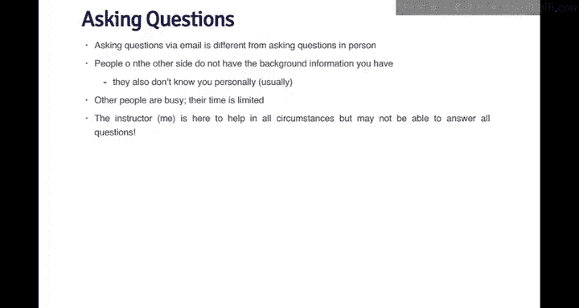

上一节我们介绍了寻求帮助的必要性。在向他人提问之前，你可以尝试多种方法自行寻找答案。如果你打算在论坛或邮件列表中提问，请务必先搜索该论坛的存档。

以下是提问前可以尝试的几种方法：

*   **搜索论坛存档**：很可能已经有人问过同样的问题，并且得到了解答。搜索存档可以为你和他人节省大量时间。
*   **利用网络资源**：网络资源丰富，包含许多答案。例如，R语言有许多可用的手册，官方网站上也有常见问题解答（FAQ）。
*   **自行实验**：尝试摆弄问题，通过检查或实验来寻找答案。例如，如果一个函数运行不正常，可以尝试改变输入参数，观察输出或错误信息的变化。
*   **请教身边的朋友**：如果你有幸认识精通R的朋友，直接请教他们通常比在论坛上发帖更便捷。
*   **阅读源代码**：如果你是程序员，或许可以通过阅读源代码来找到答案。

## 提问时的关键信息

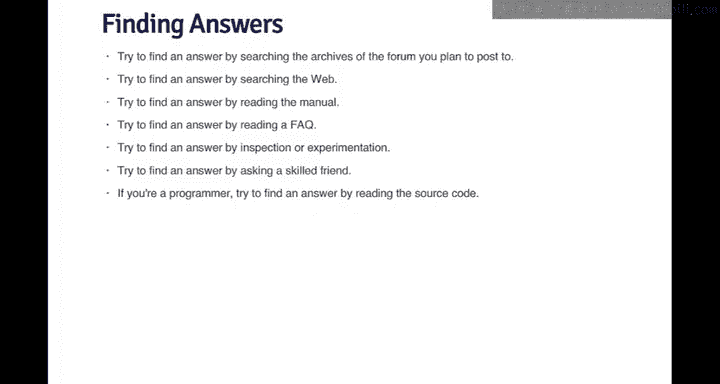

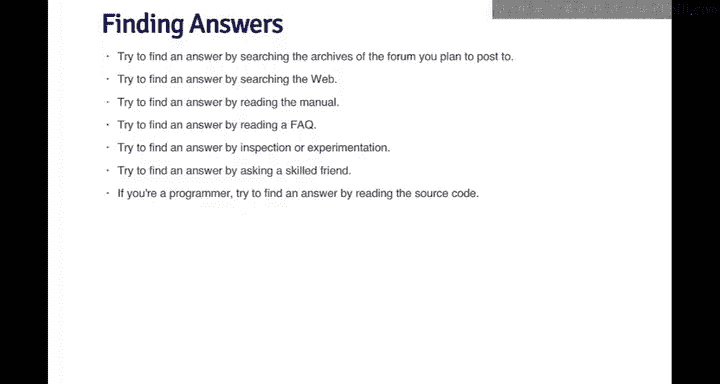

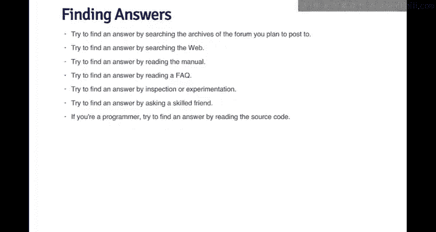

如果自行尝试后仍未找到答案，需要向他人求助，那么清晰地说明你已经做过的尝试至关重要。否则，如果答案就在文档中，对方可能会回复“请阅读文档”，从而浪费一轮沟通时间。

因此，让别人知道你已做过功课、查阅过各种资料，这非常有用，能节省大量时间。

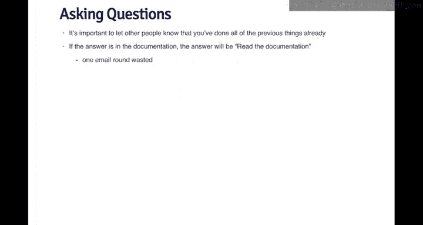

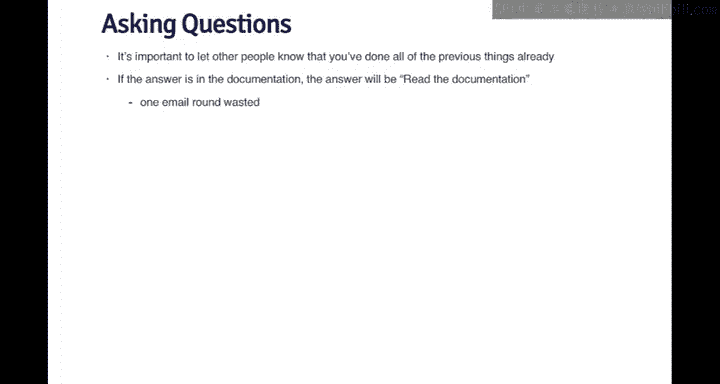

当你需要在邮件列表或讨论板上提问时，在提问前需要考虑以下几点：

*   **问题是否可复现**：如果他人能复现你的问题，将更容易找到解决方案。提供能复现问题的代码或简单示例会非常有帮助。
*   **明确期望的输出**：说明你期望得到什么结果。这有助于界定错误的性质。
*   **描述实际看到的输出**：说明实际发生了什么意外情况，从而引发了你的疑问。
*   **提供版本信息**：说明你使用的R版本、相关R包的版本，以及你的操作系统（如Mac、Windows、Linux）。旧版本可能存在已知问题，升级或许就能解决。
*   **提供其他必要信息**：根据问题的具体情况，可能需要提供其他相关信息。

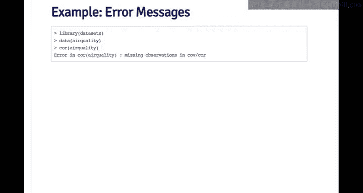

## 如何撰写有效的邮件主题

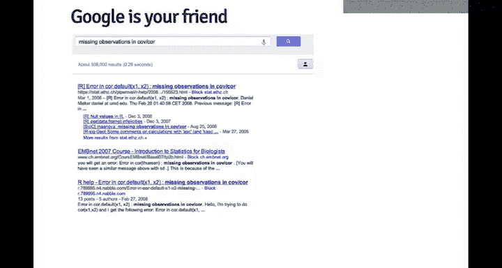

向论坛或讨论板发送邮件时，在主题行中提供尽可能多且有用的信息非常重要。

以下是一些主题行示例，展示了其有用性的差异：

*   **帮助：无法拟合线性模型**：这是最无用的。信息量极少，只知道线性模型有问题。
*   **R 2.15.0中，`lm`函数在处理大型数据框时导致段错误（Mac OS X 10.6.3）**：这好得多。它说明了R版本、使用的函数、操作系统及版本，并总结了实际发生的问题。
*   **R 2.15.0， `lm`， Mac OS X 10.6.3：处理大型数据框时出现段错误**：只需稍微调整格式，将R版本、函数和操作系统版本放在前面提供上下文，然后说明问题。这样重要的细节在阅读邮件正文前就已一目了然。

## 提问时的注意事项

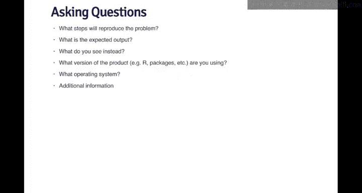

在论坛或邮件列表提问时，有几件你**应该做**的事情：

*   **描述目标，而非步骤**：让他人了解你试图实现的更大目标，他们可能有更好、更简单的方法来达成目标，从而绕过你遇到的问题。
*   **问题要具体明确**：提供必要的细节和你试图做的事情。提供**最少必要信息**，而非最大信息量。冗长的输出通常无助于诊断问题。
*   **保持礼貌**：礼貌待人永远不会错，促进邮件列表的文明交流总是好事。
*   **后续分享解决方案**：如果你后来自己找到了解决方案，请跟帖说明问题所在以及你是如何解决的，这对社区中的其他人非常有用。

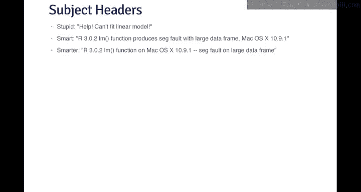

在论坛发帖时，有几件你**绝对不应该做**的事情：

*   **不要轻易声称发现了程序错误（Bug）**：十有八九，这只是用户对预期行为的误解。
*   **不要用提问代替做功课**：这通常不受欢迎。
*   **绝对不要在邮件列表或论坛上发布作业问题**：布置作业的人会阅读这些列表，他们能轻易识别出所有作业问题。
*   **不要同时向多个邮件列表发送同一封邮件**：这很烦人，因为订阅了不同邮件列表的人会多次收到你的消息。应找出最适合你问题的邮件列表，然后只发送到那里。
*   **不要在不提供任何线索的情况下要求他人调试你的代码**：如果只是贴出一长串代码说“这里有地方不对，请帮忙”，这非常困难。最好指明你认为问题可能出在哪里，以及你试图做什么。

## 案例分析：一个失败的提问

这是一个关于R开发邮件列表近期帖子的简短案例分析。该列表面向从事R开发工作（如开发包或修改R源代码）的人员。

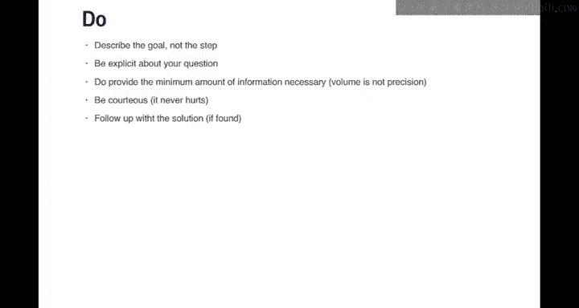

*   **主题**：`large data - confused`（大型数据 - 困惑）。主题信息量很少，问题不明确。
*   **内容**：“我正在尝试将数据加载到R中，但我完全搞不懂了。这可能主要是因为我完全是个R新手，但这让我的研究项目卡住了。”

从这条消息中，你几乎无法了解提问者的问题。因此，回复是可以预见的：第一个回复者说“是的，你确实很困惑”，然后提供了发帖指南的链接（每个发邮件前都应阅读），以及一系列手册。可以看到，由于答案很可能就在手册里，一轮邮件沟通立即被浪费了。

这次交流的问题在于：
1.  问题发错了邮件列表（应发到R帮助列表）。
2.  邮件主题非常模糊。
3.  问题本身很宽泛，没有提供可复现的示例。
4.  没有证据表明提问者曾努力自行解决问题（如搜索网络、查阅手册、实验等）。

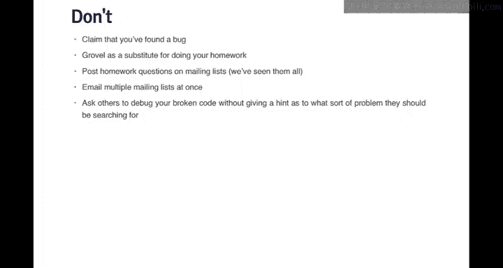

最终，这很可能导致提问者没有获得答案。

## 本课程的求助渠道

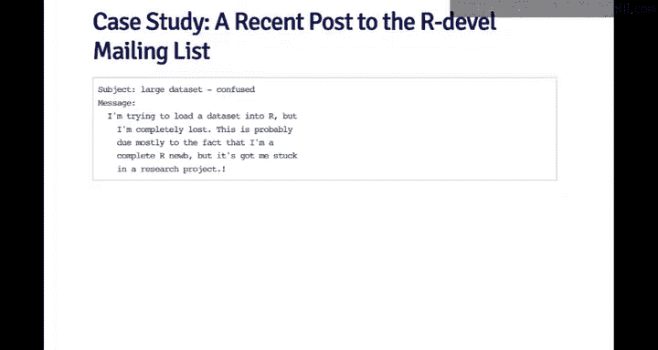

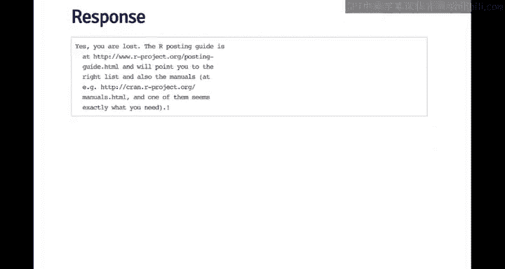

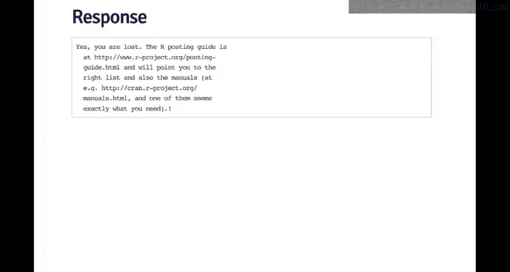

最后，我们来看看本课程可以求助的几个地方：

*   **课程讨论板**：这可能是最有用的，因为你的同学可以在那里帮助你，我也可以在课外在讨论板上回复你。
*   **R帮助邮件列表**：你可以向此列表发帖，当然，请遵循我们刚才讨论的所有规则。
*   **其他项目特定邮件列表**：取决于你正在进行的其他项目，可能还有其他特定软件的邮件列表。

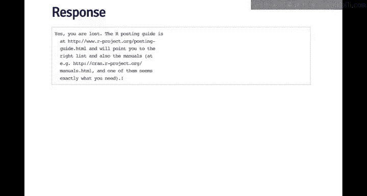

本次讨论的灵感来源于埃里克·雷蒙德的文章《如何聪明地提问》，鼓励你阅读该文，它更长，包含更多有用的技巧。

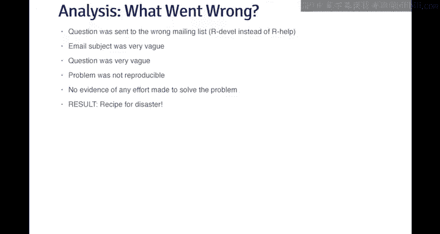

## 总结

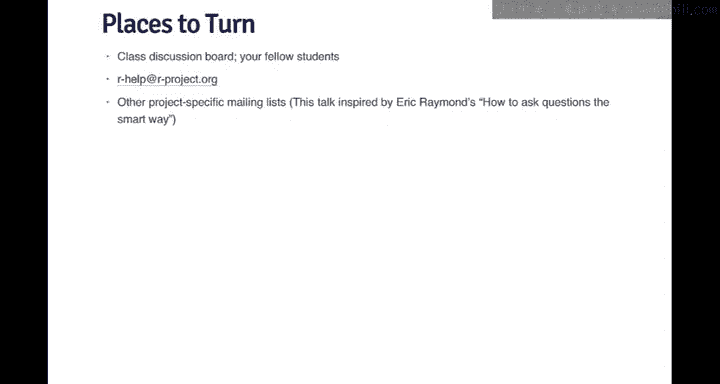

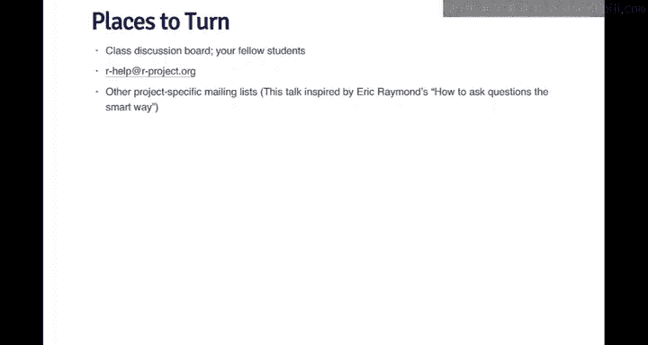

本节课中，我们一起学习了在学习R语言时如何高效获取帮助。我们探讨了提问前自行寻找答案的方法，明确了提问时应提供的关键信息（如可复现的示例、版本信息等），学习了如何撰写有效的邮件主题，并列举了提问时应该做和不应该做的事情。最后，通过一个案例分析，我们看到了一个失败的提问是如何发生的，并了解了本课程可用的主要求助渠道。记住，清晰、具体且表明你已做过努力的提问，将大大提高你获得有效帮助的几率。