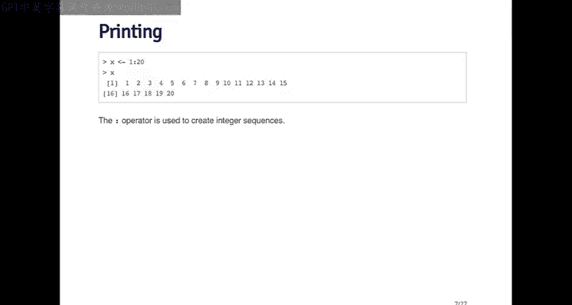

# 课程 8：R 控制台输入与表达式评估 🧮


在本节课中，我们将学习如何在 R 控制台中输入代码，以及 R 如何评估和执行这些代码。我们将重点理解表达式、赋值操作符、对象以及 R 的打印机制。

---

## 表达式与赋值

上一节我们介绍了 R 控制台的基本界面，本节中我们来看看如何向其中输入代码。在 R 提示符后输入的内容被称为**表达式**。

例如，符号 `<-` 看起来像一个左箭头，它由小于号 `<` 和连字符 `-` 组成。这个符号被称为**赋值操作符**。赋值操作符的作用是将一个值赋予一个符号。

在第一个表达式中，我创建了一个名为 `x` 的符号，并将数值 `1` 赋给它。我使用赋值操作符来完成这个操作。因此，`x <- 1` 是一个 R 表达式。

```r
x <- 1
```

在下一个表达式中，我将打印这个值。`print` 是一个函数，我将符号 `x` 传递给它。当我打印 `x` 时，我得到它的值，在这个例子中是 `1`。

```r
print(x)
```

另一个需要理解的概念是，`x` 也被视为一个 R 对象。它是一个数值对象，包含一个元素。本质上，它是一个第一个元素为数字 `1` 的数值向量。

---

## 自动打印与对象类型

在第三个表达式中，我直接在提示符后输入 `x` 并按下回车。这时，`x` 的值会被打印出来。这被称为**自动打印**。这是另一种打印对象的方式，无需显式调用 `print` 函数。

```r
x
```

在这个表达式中，我创建了一个名为 `msg` 的新符号，并将字符串 `"hello"` 赋给它。现在，`msg` 是一个字符向量，其第一个元素是字符串 `"hello"`。如果我愿意，可以向这个向量添加其他元素，但它们都必须是字符类型。

```r
msg <- "hello"
```

---

## 语法、完整表达式与注释

语言的语法决定了表达式是否正确或完整。例如，如果我输入 `x <-` 后没有输入其他内容，这便不是一个完整的表达式。当我按下回车时，什么也不会发生，因为 R 在等待表达式被完成。

此外，这里还有一个井号 `#`。这个符号表示其右侧的所有内容都是**注释**。R 引擎会忽略该符号右侧的任何内容。因此，你可以在代码中添加注释或给自己的笔记，R 会忽略这些注释。

```r
# 这是一个注释，R 会忽略它
x <- 5 # 将 5 赋值给 x
```

---

## 表达式的评估与自动打印

一旦你在提示符后输入了一个语法有效且完整的表达式并按下回车，R 引擎就会**评估**这个表达式，并返回评估结果。

有时，评估一个表达式后什么也不会发生，因为没有需要显示的内容。例如，在第一个表达式中，当我说 `x` 被赋值为 `5` 时，我创建了一个名为 `x` 的对象，它是一个第一个元素为 `5` 的数值向量。当我按下回车时，什么也没有显示。

```r
x <- 5
```

但现在，当我输入 `x` 并按下回车时，它会打印出值 `5`。这被称为**自动打印**。当你只输入一个对象的名字并按下回车时，R 默认会自动打印该对象的值。这与对该对象调用 `print` 函数的效果相同。

```r
x
```

你可能会注意到，当我打印对象 `x` 时，前面有一个 `[1]`。这表示你看到的数字 `5` 是该向量的第一个元素。当我们查看更长的向量时，这会更有意义。

---

## 序列与向量的打印

对于打印，你会看到这里我创建了一个名为 `x` 的对象，它是序列 `1` 到 `20`。这里使用的冒号操作符 `:` 用于创建序列。当我说 `1:20` 时，它创建了一个从 `1` 到 `20` 的序列。

```r
x <- 1:20
```

现在，当我自动打印 `x` 时，你会看到一个更长的向量。这是一个整数向量。打印输出的第一行旁边有一个 `[1]`，因为那是第一个元素。第二行旁边有一个 `[16]`，因为该行的第一个元素是这个向量的第 16 个元素。这一切都很直观，这就是打印输出的工作方式。

```r
x
```

---

## 总结



本节课中我们一起学习了 R 控制台输入与表达式评估的核心概念。我们了解了什么是表达式和赋值操作符，如何创建数值与字符对象，以及 R 的自动打印机制。我们还学习了注释的用法，以及如何创建和打印序列。理解这些基础是编写有效 R 代码的第一步。