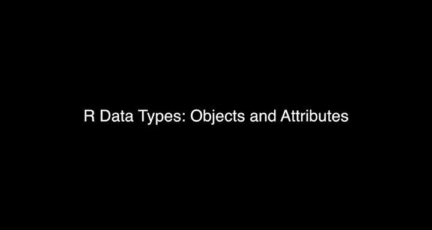
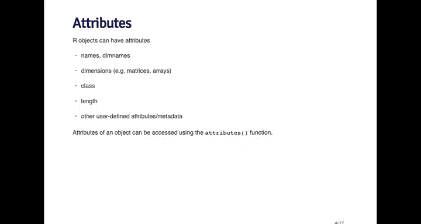

# 课程 9：R 的数据类型、对象与属性 📊

在本节课中，我们将深入探讨 R 语言的核心细节，特别是 R 中使用的不同数据类型，以及对这些数据类型的一些基本操作。



---

## 概述

R 语言中的所有内容都被视为**对象**。对象可以包含各种数据，但每个对象都属于特定的类别。理解这些基本的数据类型和对象属性，是有效使用 R 进行数据分析的基础。

---

## R 中的基本对象类型

在 R 中，所有你操作和遇到的事物都可以被称为**对象**。对象可以是各种类型，包含各种数据，但 R 中的一切都是对象。

R 有五种基本的原子类对象。这些是非常底层或基础的对象类别，它们分别是：
*   **字符型**
*   **数值型**（例如实数或小数）
*   **整型**
*   **复数型**
*   **逻辑型**（即 `TRUE`/`FALSE` 类型）

---

## 向量：R 中最基本的对象

R 中最基本的对象被称为**向量**。一个向量包含多个相同类型对象的副本。例如，它可以是一个字符向量或一个整型向量。

关于标准向量的一个重要规则是：**不能混合不同类型的对象**。你不能创建一个同时包含字符型和数值型，或数值型和整型，或整型和逻辑型的向量。向量中的所有元素必须属于同一类别。

当然，任何伟大的规则都有例外。对于向量来说，有一种类型的向量可以包含多个不同类别的元素，那就是**列表**。

列表表现为一个向量（即一个对象序列），但其中的每个元素可以是不同类别的对象。例如，一个列表可以包含一个字符、一个数值和一个逻辑值。列表的一个元素本身也可以是另一个列表，甚至是一个数据框。列表中的任何元素都可以是任何东西，这也正是列表如此有用的原因。因此，列表是“向量只能包含相同类别元素”这一通用规则的一个例外。

---

## 创建向量

你可以使用 `vector` 函数创建一个空向量。`vector` 函数有两个基本参数：
*   第一个参数是对象的**类别**，即你希望向量中包含的对象类型。
*   第二个参数是向量本身的**长度**。

其基本语法为：
```r
vector(mode = "character", length = 0)
```

---

## 数字对象

R 中最重要的对象类型之一当然是数字。R 中的数字通常被视为**数值型**对象。几乎所有数字都被当作双精度实数处理。即使你输入的是像 1 或 2 这样的数字，R 也将其视为数值型对象。

有一种方法可以明确指定你想要一个**整型**数，即使用大写字母 `L` 作为后缀。例如：
*   在 R 中输入 `1` 会得到一个数值型对象。
*   输入 `1L` 则会明确得到一个整型对象。

这种区别目前看来并不非常重要，但以后会变得重要。

---

## 特殊数值：Inf 与 NaN

R 中还有一些特殊的数值。

**Inf** 代表**无穷大**。`Inf` 就像一个实数，可以用于计算并得到预期的结果。例如：
*   `1 / 0` 会得到 `Inf`。
*   `1 / Inf` 会得到 `0`。
*   同样也存在 `-Inf`（负无穷大）。

**NaN** 代表**未定义的值**，可以理解为“不是一个数字”。例如：
*   `0 / 0` 是未定义的，因此会返回 `NaN`。
*   `NaN` 也可以被视为一种缺失值，我们稍后会更多地讨论缺失值。

---

## 对象的属性

上一节我们介绍了 R 中的基本对象类型，本节中我们来看看每个 R 对象都附带的一个概念：**属性**。

并非每个 R 对象都必须有属性，但属性可以是 R 对象的一部分。我们将遇到的一些最常见的属性类型包括：
*   **名称** 或 **维度名称**
*   **维度**：例如，矩阵会有维度（行数和列数）。如果你有一个多维数组，它将有两个以上的维度。
*   对象的**类别**：每个对象都有一个类别。例如，数值型对象的类别是 `numeric`，整型对象的类别是 `integer`。
*   对象的**长度**：对于向量来说很简单，对象的长度就是向量中元素的数量。
*   其他用户定义的**属性**或**元数据**：这些是你可以使用各种属性函数为对象单独定义的东西。

有一个通用的函数叫做 `attributes()`，它允许你设置或修改 R 对象的属性。

---

## 总结



在本节课中，我们一起学习了 R 语言中关于数据类型、对象和属性的核心概念。我们了解到 R 中一切都是对象，并掌握了五种基本的原子数据类型。我们探讨了向量作为基础对象的重要性及其创建方法，同时认识了列表作为可以混合类型的特殊向量。我们还区分了数值型与整型数字，并了解了 `Inf` 和 `NaN` 这两个特殊数值的含义。最后，我们学习了对象属性的概念，知道它们如何为对象提供额外的信息（如名称、维度、类别和长度），并了解了如何使用 `attributes()` 函数来操作这些属性。理解这些基础知识是后续进行更复杂数据操作和分析的关键。